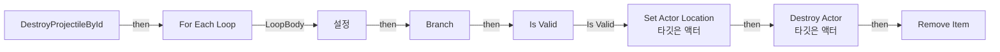
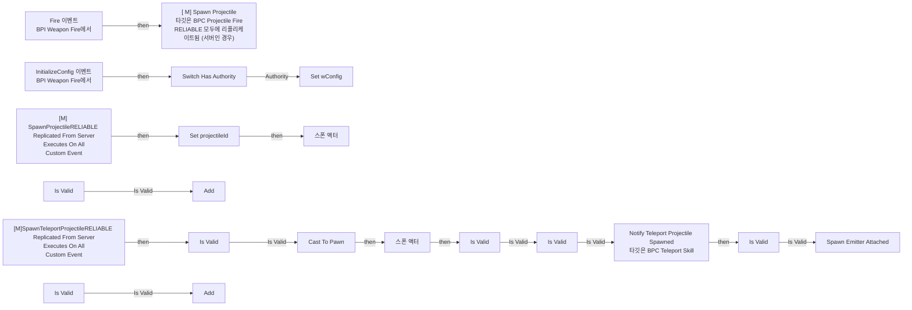
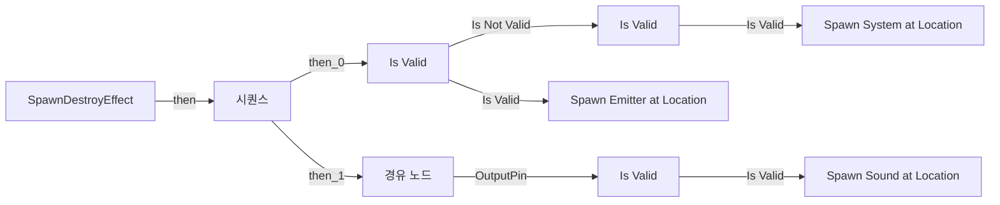

# BPC_ProjectileFire

에셋: `/Game/QuakeLike_1_0/HeldItem/Component/BPC_ProjectileFire`

부모: `/Script/CoreUObject.Class'/Script/Engine.ActorComponent'`

수집일: 2026-10-12. MCP에서 읽은 그래프·핀 연결의 자동 전사입니다. 상속된 그래프는 부모 문서를 함께 확인합니다.

정적 루트 참조 도달: 있음. 실행 여부 또는 삭제 가능 여부의 확정이 아닙니다.

컴포넌트 목록은 이 BP가 직접 정의한 SCS만 포함합니다. 부모·네이티브 생성 컴포넌트, 인스턴스 설정은 별도입니다.

## 변수와 기본값

| 이름 | 타입 | CDO 기본값 |
|---|---|---|
| `wConfig` | `ST_WeaponConfig` | &lt;Struct 'ST_WeaponConfig' {}&gt; |
| `projectileId` | `int` | 0 |
| `spawnedProjectiles` | `ST_ProjectileInfo` | [] |
| `spawnedProjectile` | `ST_ProjectileInfo` | &lt;Struct 'ST_ProjectileInfo' {}&gt; |
| `NewVar` | `int` | {} |

## 그래프 목록

| 그래프 | 전체 노드 수 |
|---|---|
| DestroyProjectileById | 21 |
| EventGraph | 70 |
| SpawnDestroyEffect | 29 |

## 그래프별 실행 연결

실선은 출력 exec 핀의 실제 연결입니다. 여러 분기는 출력 핀 이름을 표시합니다. 함수 호출·delegate·타이머의 다음 그래프 실행은 이 그림에서 자동으로 이어 붙이지 않습니다.

순수 계산 노드 및 데이터 핀은 아래 목록과 원본 JSON을 확인합니다. 연결되지 않은 이벤트도 표시되므로, 노드가 있다는 이유만으로 실행된다고 판단하면 안 됩니다.

### DestroyProjectileById

실행 핀 플로우차트

전체 노드·기본 입력 목록

| 노드 ID | 제목 | 미연결 기본 입력 / 에셋 입력 |
|---|---|---|
| `K2Node_FunctionEntry_0` | DestroyProjectileById |  |
| `K2Node_VariableGet_7` | Get spawnedProjectiles |  |
| `K2Node_MacroInstance_2` | For Each Loop |  |
| `K2Node_PromotableOperator_0` | Equal (Integer) |  |
| `K2Node_Knot_6` | 경유 노드 |  |
| `K2Node_Knot_8` | 경유 노드 |  |
| `K2Node_Knot_10` | 경유 노드 |  |
| `K2Node_Knot_14` | 경유 노드 |  |
| `K2Node_IfThenElse_0` | Branch |  |
| `K2Node_MacroInstance_3` | Is Valid |  |
| `K2Node_Knot_15` | 경유 노드 |  |
| `K2Node_CallFunction_3` | Set Actor Location 타깃은 액터 | bSweep=false; bTeleport=true; ReturnValue=false |
| `K2Node_Knot_16` | 경유 노드 |  |
| `K2Node_Knot_17` | 경유 노드 |  |
| `K2Node_CallFunction_4` | Destroy Actor 타깃은 액터 |  |
| `K2Node_VariableGet_8` | Get spawnedProjectiles |  |
| `K2Node_CallArrayFunction_2` | Remove Item | ReturnValue=false |
| `K2Node_VariableSet_1` | 설정 |  |
| `K2Node_VariableGet_9` | Get spawnedProjectile |  |
| `K2Node_VariableGet_0` | Get NewVar |  |
| `K2Node_CallFunction_0` | Find | ReturnValue=false |

### EventGraph

실행 핀 플로우차트

전체 노드·기본 입력 목록

| 노드 ID | 제목 | 미연결 기본 입력 / 에셋 입력 |
|---|---|---|
| `K2Node_Event_2` | InitializeConfig 이벤트 BPI Weapon Fire에서 |  |
| `K2Node_Event_3` | Fire 이벤트 BPI Weapon Fire에서 |  |
| `K2Node_CustomEvent_0` | [M] SpawnProjectileRELIABLE Replicated From Server Executes On All Custom Event |  |
| `K2Node_CallFunction_1` | [ M] Spawn Projectile 타깃은 BPC Projectile Fire RELIABLE 모두에 리플리케이트됨 (서버인 경우) |  |
| `K2Node_VariableGet_1` | Get projectileClass |  |
| `K2Node_CallFunction_2` | Make Transform | Scale=1.000000,1.000000,1.000000 |
| `K2Node_Knot_0` | 경유 노드 |  |
| `K2Node_Knot_1` | 경유 노드 |  |
| `K2Node_CallFunction_19` | Find Look at Rotation |  |
| `K2Node_Knot_2` | 경유 노드 |  |
| `K2Node_MacroInstance_0` | Switch Has Authority |  |
| `K2Node_VariableGet_3` | Get |  |
| `K2Node_VariableSet_3` | Set wConfig |  |
| `K2Node_Knot_5` | 경유 노드 |  |
| `K2Node_Knot_7` | 경유 노드 |  |
| `K2Node_CallFunction_0` | Has Authority 타깃은 액터 |  |
| `K2Node_Knot_9` | 경유 노드 |  |
| `K2Node_Knot_11` | 경유 노드 |  |
| `K2Node_Knot_12` | 경유 노드 |  |
| `K2Node_Knot_13` | 경유 노드 |  |
| `K2Node_VariableGet_0` | Get Instigator |  |
| `K2Node_MacroInstance_1` | Is Valid |  |
| `K2Node_VariableSet_0` | Set projectileId | Output_Get=0 |
| `K2Node_VariableGet_2` | Get projectileId |  |
| `K2Node_Knot_3` | 경유 노드 |  |
| `K2Node_Knot_4` | 경유 노드 |  |
| `K2Node_MakeStruct_1` | Make ST Projectile Info |  |
| `K2Node_VariableGet_5` | Get projectileId |  |
| `K2Node_VariableGet_6` | Get spawnedProjectiles |  |
| `K2Node_CallArrayFunction_1` | Add | ReturnValue=0 |
| `K2Node_Knot_6` | 경유 노드 |  |
| `K2Node_Knot_8` | 경유 노드 |  |
| `K2Node_Knot_10` | 경유 노드 |  |
| `K2Node_Knot_14` | 경유 노드 |  |
| `K2Node_SpawnActorFromClass_0` | 스폰 액터 | CollisionHandlingOverride=Undefined; TransformScaleMethod=MultiplyWithRoot |
| `K2Node_CustomEvent_1` | [M]SpawnTeleportProjectileRELIABLE Replicated From Server Executes On All Custom Event |  |
| `K2Node_MacroInstance_2` | Is Valid |  |
| `K2Node_Knot_15` | 경유 노드 |  |
| `K2Node_CallFunction_3` | Find Look at Rotation |  |
| `K2Node_CallFunction_4` | Make Transform | Scale=1.000000,1.000000,1.000000 |
| `K2Node_Knot_17` | 경유 노드 |  |
| `K2Node_VariableGet_4` | Get projectileClass |  |
| `K2Node_Knot_18` | 경유 노드 |  |
| `K2Node_Knot_19` | 경유 노드 |  |
| `K2Node_Knot_20` | 경유 노드 |  |
| `K2Node_Knot_21` | 경유 노드 |  |
| `K2Node_Knot_23` | 경유 노드 |  |
| `K2Node_CallFunction_5` | Get Owner 타깃은 액터 컴포넌트 |  |
| `K2Node_CallFunction_6` | Has Authority 타깃은 액터 |  |
| `K2Node_Knot_24` | 경유 노드 |  |
| `K2Node_DynamicCast_0` | Cast To Pawn |  |
| `K2Node_SpawnActorFromClass_2` | 스폰 액터 | CollisionHandlingOverride=AlwaysSpawn; TransformScaleMethod=MultiplyWithRoot; canDealDamage=False; projectileId=0 |
| `K2Node_MacroInstance_3` | Is Valid |  |
| `K2Node_MakeStruct_12` | Make ST Projectile Info |  |
| `K2Node_VariableGet_14` | Get projectileId |  |
| `K2Node_Knot_27` | 경유 노드 |  |
| `K2Node_VariableGet_15` | Get spawnedProjectiles |  |
| `K2Node_CallArrayFunction_0` | Add | ReturnValue=0 |
| `K2Node_MacroInstance_4` | Is Valid |  |
| `K2Node_CallFunction_7` | Get Owner 타깃은 액터 컴포넌트 |  |
| `K2Node_CallFunction_9` | Get Component by Class 타깃은 액터 | ComponentClass=/Game/QuakeLike_1_0/Skill/BPC_TeleportSkill.BPC_TeleportSkill_C |
| `K2Node_CallFunction_10` | Notify Teleport Projectile Spawned 타깃은 BPC Teleport Skill |  |
| `K2Node_Knot_29` | 경유 노드 |  |
| `K2Node_Knot_30` | 경유 노드 |  |
| `K2Node_VariableGet_7` | Get travelEffect |  |
| `K2Node_MacroInstance_5` | Is Valid |  |
| `K2Node_CallFunction_8` | Spawn Emitter Attached | AttachPointName=None; Location=0, 0, 0; Rotation=0, 0, 0; Scale=1.000000,1.000000,1.000000; LocationType=SnapToTarget; bAutoDestroy=false; PoolingMethod=None; bAutoActivate=true |
| `K2Node_VariableGet_8` | Get RootComponent |  |
| `K2Node_MacroInstance_6` | Is Valid |  |
| `K2Node_Knot_16` | 경유 노드 |  |

### SpawnDestroyEffect

실행 핀 플로우차트

전체 노드·기본 입력 목록

| 노드 ID | 제목 | 미연결 기본 입력 / 에셋 입력 |
|---|---|---|
| `K2Node_FunctionEntry_0` | SpawnDestroyEffect |  |
| `K2Node_ExecutionSequence_0` | 시퀀스 |  |
| `K2Node_MacroInstance_6` | Is Valid |  |
| `K2Node_MacroInstance_2` | Is Valid |  |
| `K2Node_CallFunction_20` | Spawn Sound at Location | Rotation=0, 0, 0; PitchMultiplier=1.000000; StartTime=0.000000; bAutoDestroy=true |
| `K2Node_Knot_7` | 경유 노드 |  |
| `K2Node_Knot_33` | 경유 노드 |  |
| `K2Node_Knot_12` | 경유 노드 |  |
| `K2Node_Knot_13` | 경유 노드 |  |
| `K2Node_Knot_14` | 경유 노드 |  |
| `K2Node_Knot_15` | 경유 노드 |  |
| `K2Node_Knot_18` | 경유 노드 |  |
| `K2Node_Knot_34` | 경유 노드 |  |
| `K2Node_Knot_35` | 경유 노드 |  |
| `K2Node_Knot_36` | 경유 노드 |  |
| `K2Node_Knot_6` | 경유 노드 |  |
| `K2Node_VariableGet_33` | Get projectileSound |  |
| `K2Node_VariableGet_34` | Get projectileDestroyEffect |  |
| `K2Node_CallFunction_38` | Spawn Emitter at Location | Scale=1.000000,1.000000,1.000000; bAutoDestroy=true; PoolingMethod=None; bAutoActivateSystem=true |
| `K2Node_VariableGet_4` | Get |  |
| `K2Node_Knot_0` | 경유 노드 |  |
| `K2Node_CallFunction_1` | Make Rot from X |  |
| `K2Node_Knot_1` | 경유 노드 |  |
| `K2Node_VariableGet_0` | Get projectileDestroyVolumeMultiplier |  |
| `K2Node_Knot_2` | 경유 노드 |  |
| `K2Node_VariableGet_1` | Get NSProjectileDestroyEffect |  |
| `K2Node_MacroInstance_0` | Is Valid |  |
| `K2Node_CallFunction_0` | Spawn System at Location | Scale=1.000000,1.000000,1.000000; bAutoDestroy=true; bAutoActivate=true; PoolingMethod=None; bPreCullCheck=true |
| `K2Node_CallFunction_2` | Make Rot from X |  |

## 조회 범위의 한계

ObjectIterator로 발견했으나 MCP helper가 반환하지 않은 그래프입니다. delegate signature·컴파일된 중간 그래프·macro·애니메이션 내부 그래프가 섞일 수 있습니다.

- `Fire`: Graph 'Fire' not found in Blueprint.
- `InitializeConfig`: Graph 'InitializeConfig' not found in Blueprint.
- `[M] SpawnProjectile`: Graph '[M] SpawnProjectile' not found in Blueprint.
- `[M]SpawnTeleportProjectile`: Graph '[M]SpawnTeleportProjectile' not found in Blueprint.

[원본 MCP 스냅샷](../../../../Evidence/blueprints-070.json)
