# BP_WeaponBase

에셋: `/Game/QuakeLike_1_0/HeldItem/Gun/BP_WeaponBase`

부모: `/Script/Engine.BlueprintGeneratedClass'/Game/QuakeLike_1_0/HeldItem/BP_HeldItem.BP_HeldItem_C'`

수집일: 2026-10-12. MCP에서 읽은 그래프·핀 연결의 자동 전사입니다. 상속된 그래프는 부모 문서를 함께 확인합니다.

정적 루트 참조 도달: 있음. 실행 여부 또는 삭제 가능 여부의 확정이 아닙니다.

컴포넌트 목록은 이 BP가 직접 정의한 SCS만 포함합니다. 부모·네이티브 생성 컴포넌트, 인스턴스 설정은 별도입니다.

## 직접 정의한 컴포넌트

| 이름 | 클래스 | 부모 컴포넌트 |
|---|---|---|
| `BPC_ProjectileFire` | `BPC_ProjectileFire_C` | `` |
| `ProjectileConvergenceSettings` | `ProjectileConvergenceSettings` | `` |

## 변수와 기본값

| 이름 | 타입 | CDO 기본값 |
|---|---|---|
| `weaponData` | `PDA_WeaponBase_C` | None |
| `OnHit` | `mcdelegate` | &lt;Delegate 'DelegateBase' &lt;Unbound&gt;&gt; |
| `timeOfLastShot` | `real` | 0.0 |
| `bOnce` | `bool` | False |
| `projectileId` | `int` | 0 |
| `hitInfo` | `ST_HitInfo` | [] |
| `effectVector` | `ST_HitEffectVector` | [] |
| `hitSoundCount` | `int` | 0 |
| `spawnedProjectiles` | `ST_ProjectileInfo` | [] |
| `spawnedProjectile` | `ST_ProjectileInfo` | &lt;Struct 'ST_ProjectileInfo' {}&gt; |
| `bUseScope` | `bool` | False |
| `bZoomIn` | `bool` | True |
| `finalDamage` | `real` | 0.0 |
| `bUseMuzzleProjectileAim` | `bool` | True |

## 그래프 목록

| 그래프 | 전체 노드 수 |
|---|---|
| CheckEmptyPistol | 8 |
| CheckFinishEquipPlay | 5 |
| CheckRefireRate | 8 |
| EventGraph | 265 |
| GetAimEnd | 7 |
| GetEffectAim | 12 |
| GetFinalDamage | 6 |
| GetHitScanAim | 7 |
| GetHitScanBeamTransform | 10 |
| GetProjectileAim | 23 |
| GetZoomData | 5 |
| SelectMesh | 11 |
| SetCurrentCount | 4 |
| SetHitScan | 6 |
| SetProjectileId | 4 |
| SpawnRailGunBeamFX | 45 |
| StartFire | 1 |
| UserConstructionScript | 2 |

## 그래프별 실행 연결

실선은 출력 exec 핀의 실제 연결입니다. 여러 분기는 출력 핀 이름을 표시합니다. 함수 호출·delegate·타이머의 다음 그래프 실행은 이 그림에서 자동으로 이어 붙이지 않습니다.

순수 계산 노드 및 데이터 핀은 아래 목록과 원본 JSON을 확인합니다. 연결되지 않은 이벤트도 표시되므로, 노드가 있다는 이유만으로 실행된다고 판단하면 안 됩니다.

### CheckEmptyPistol

실행 핀 플로우차트

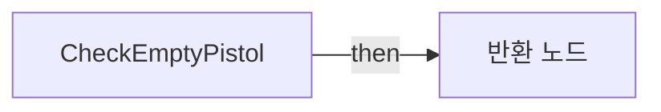

전체 노드·기본 입력 목록

| 노드 ID | 제목 | 미연결 기본 입력 / 에셋 입력 |
|---|---|---|
| `K2Node_FunctionEntry_0` | CheckEmptyPistol |  |
| `K2Node_FunctionResult_0` | 반환 노드 |  |
| `K2Node_VariableGet_21` | Get |  |
| `K2Node_PromotableOperator_0` | integer &lt;= integer |  |
| `K2Node_VariableGet_22` | Get weaponData |  |
| `K2Node_VariableGet_23` | Get attributes |  |
| `K2Node_CallFunction_17` | Has Tag | Tag=(TagName="ID.Pistol"); bExactMatch=false |
| `K2Node_CommutativeAssociativeBinaryOperator_1` | AND Boolean |  |

### CheckFinishEquipPlay

실행 핀 플로우차트

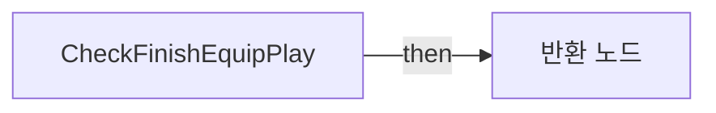

전체 노드·기본 입력 목록

| 노드 ID | 제목 | 미연결 기본 입력 / 에셋 입력 |
|---|---|---|
| `K2Node_FunctionEntry_0` | CheckFinishEquipPlay |  |
| `K2Node_FunctionResult_0` | 반환 노드 |  |
| `K2Node_PromotableOperator_0` | float &lt; float |  |
| `K2Node_VariableGet_0` | Get equipPlayTIme |  |
| `K2Node_CallFunction_0` | Get Game Time in Seconds |  |

### CheckRefireRate

실행 핀 플로우차트

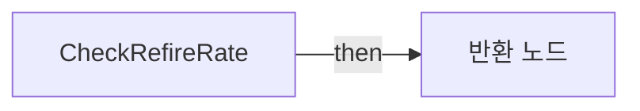

전체 노드·기본 입력 목록

| 노드 ID | 제목 | 미연결 기본 입력 / 에셋 입력 |
|---|---|---|
| `K2Node_FunctionEntry_0` | CheckRefireRate |  |
| `K2Node_FunctionResult_1` | 반환 노드 |  |
| `K2Node_CallFunction_3` | Get Game Time in Seconds |  |
| `K2Node_VariableGet_8` | Get timeOfLastShot |  |
| `K2Node_VariableGet_6` | Get weaponData |  |
| `K2Node_VariableGet_7` | Get fireRate |  |
| `K2Node_PromotableOperator_3` | float - float |  |
| `K2Node_PromotableOperator_1` | float &gt;= float |  |

### EventGraph

실행 핀 플로우차트

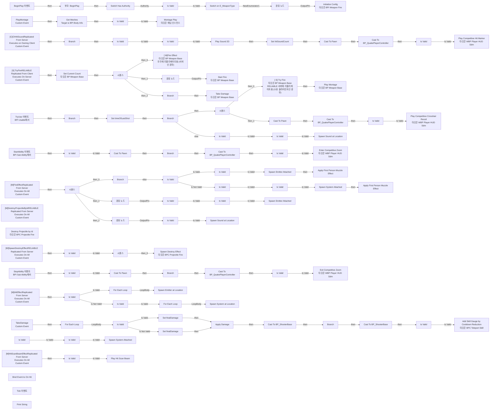

전체 노드·기본 입력 목록

| 노드 ID | 제목 | 미연결 기본 입력 / 에셋 입력 |
|---|---|---|
| `K2Node_Event_2` | TryUse 이벤트 BPI Usable에서 |  |
| `K2Node_IfThenElse_1` | Branch |  |
| `K2Node_MacroInstance_3` | Switch Has Authority |  |
| `K2Node_VariableGet_20` | Get weaponData |  |
| `K2Node_VariableGet_10` | Get BPC_ProjectileFire |  |
| `K2Node_CallFunction_13` | Initialize Config 타깃은 BPI Weapon Fire |  |
| `K2Node_Self_1` | 셀프-레퍼런스 |  |
| `K2Node_VariableGet_11` | Get weaponData |  |
| `K2Node_Knot_3` | 경유 노드 |  |
| `K2Node_VariableGet_12` | Get weaponType |  |
| `K2Node_SwitchEnum_1` | Switch on E_WeaponType |  |
| `K2Node_Knot_29` | 경유 노드 |  |
| `K2Node_MacroInstance_0` | Is Valid |  |
| `K2Node_Event_3` | BeginPlay 이벤트 |  |
| `K2Node_CallParentFunction_2` | 부모: BeginPlay |  |
| `K2Node_CustomEvent_4` | [S] TryFireRELIABLE Replicated From Client Executes On Server Custom Event |  |
| `K2Node_CallFunction_12` | [ S] Try Fire 타깃은 BP Weapon Base RELIABLE 서버에 리플리케이트됨 (소유 클라이언트인 경우) |  |
| `K2Node_CustomEvent_2` | PlayMontage Custom Event |  |
| `K2Node_VariableGet_15` | Get |  |
| `K2Node_Message_1` | Get Meshes Target is BPI Body Info |  |
| `K2Node_MacroInstance_1` | Is Valid |  |
| `K2Node_VariableGet_6` | Get weaponData |  |
| `K2Node_VariableGet_7` | Get useMontage |  |
| `K2Node_CallFunction_15` | Get Anim Instance 타깃은 스켈레탈 메시 컴포넌트 |  |
| `K2Node_CallFunction_4` | Montage Play 타깃은 애님 인스턴스 | InPlayRate=1.000000; ReturnValueType=MontageLength; InTimeToStartMontageAt=0.000000; bStopAllMontages=true; ReturnValue=0.0 |
| `K2Node_Knot_4` | 경유 노드 |  |
| `EdGraphNode_Comment_0` | 핑이 튈 시 fire가 이상해질 수 있음 |  |
| `K2Node_Knot_5` | 경유 노드 |  |
| `K2Node_CustomEvent_3` | [M]FireEffectReplicated From Server Executes On All Custom Event |  |
| `K2Node_CallFunction_16` | [ M]Fire Effect 타깃은 BP Weapon Base 모두에 리플리케이트됨 (서버인 경우) |  |
| `K2Node_ExecutionSequence_2` | 시퀀스 |  |
| `K2Node_MacroInstance_7` | Is Valid |  |
| `K2Node_MacroInstance_8` | Is Valid |  |
| `K2Node_CallFunction_2` | Spawn Sound at Location | Rotation=0, 0, 0; PitchMultiplier=1.000000; StartTime=0.000000; AttenuationSettings=/Game/QuakeLike_1_0/HeldItem/SA/SA_WeaponFire.SA_WeaponFire; bAutoDestroy=true |
| `K2Node_VariableGet_31` | Get weaponData |  |
| `K2Node_Knot_47` | 경유 노드 |  |
| `K2Node_VariableGet_29` | Get fireSound |  |
| `K2Node_Knot_37` | 경유 노드 |  |
| `K2Node_Knot_38` | 경유 노드 |  |
| `K2Node_Knot_39` | 경유 노드 |  |
| `K2Node_Knot_40` | 경유 노드 |  |
| `K2Node_Knot_41` | 경유 노드 |  |
| `K2Node_Knot_42` | 경유 노드 |  |
| `K2Node_Knot_43` | 경유 노드 |  |
| `K2Node_ExecutionSequence_1` | 시퀀스 |  |
| `K2Node_CallFunction_26` | Check Refire Rate |  |
| `K2Node_CallFunction_6` | Can Use |  |
| `K2Node_CallFunction_14` | Play Montage 타깃은 BP Weapon Base |  |
| `K2Node_CommutativeAssociativeBinaryOperator_0` | AND Boolean |  |
| `K2Node_VariableGet_30` | Get fireFX |  |
| `K2Node_Knot_44` | 경유 노드 |  |
| `K2Node_Knot_45` | 경유 노드 |  |
| `K2Node_Knot_46` | 경유 노드 |  |
| `K2Node_VariableGet_13` | Get FP_Mesh |  |
| `K2Node_CallFunction_8` | Get Socket Location 타깃은 씬 컴포넌트 | InSocketName=Muzzle |
| `K2Node_CallFunction_35` | Spawn Emitter Attached | AttachPointName=Muzzle; Location=0, 0, 0; Rotation=0, 0, 0; Scale=1.000000,1.000000,1.000000; LocationType=SnapToTarget; bAutoDestroy=true; PoolingMethod=None; bAutoActivate=true |
| `K2Node_CallFunction_36` | Select Mesh |  |
| `K2Node_CallFunction_5` | Set Current Count 타깃은 BP Weapon Base |  |
| `K2Node_CallFunction_1` | Check Finish Equip Play |  |
| `K2Node_IfThenElse_2` | Branch |  |
| `K2Node_VariableGet_0` | Get weaponData |  |
| `K2Node_VariableGet_1` | Get emptyAmmoSound |  |
| `K2Node_CallFunction_34` | Spawn Sound at Location | Rotation=0, 0, 0; PitchMultiplier=1.000000; StartTime=0.000000; AttenuationSettings=/Game/QuakeLike_1_0/HeldItem/SA/SA_HeldItem.SA_HeldItem; bAutoDestroy=true |
| `K2Node_MacroInstance_20` | Is Valid |  |
| `K2Node_Knot_0` | 경유 노드 |  |
| `K2Node_Knot_1` | 경유 노드 |  |
| `K2Node_Knot_2` | 경유 노드 |  |
| `K2Node_Knot_6` | 경유 노드 |  |
| `K2Node_VariableGet_32` | Get FP_Mesh |  |
| `K2Node_CallFunction_37` | Get Socket Location 타깃은 씬 컴포넌트 | InSocketName=Muzzle |
| `K2Node_Knot_7` | 경유 노드 |  |
| `K2Node_Knot_8` | 경유 노드 |  |
| `K2Node_Knot_9` | 경유 노드 |  |
| `K2Node_Knot_10` | 경유 노드 |  |
| `K2Node_Knot_11` | 경유 노드 |  |
| `K2Node_MacroInstance_4` | Is Valid |  |
| `K2Node_Knot_13` | 경유 노드 |  |
| `K2Node_CustomEvent_5` | [M]HitScanBeamEffectReplicated From Server Executes On All Custom Event |  |
| `K2Node_Knot_18` | 경유 노드 |  |
| `K2Node_VariableSet_0` | Set timeOfLastShot | Output_Get=0.0 |
| `K2Node_CallFunction_0` | Get Game Time in Seconds |  |
| `K2Node_CustomEvent_7` | [C]ChHitSoundReplicated From Server Executes on Owning Client Custom Event |  |
| `K2Node_VariableGet_21` | Get weaponData |  |
| `K2Node_VariableGet_22` | Get chHitSound |  |
| `K2Node_MacroInstance_5` | Is Valid |  |
| `K2Node_CallFunction_22` | Play Sound 2D | PitchMultiplier=1.000000; StartTime=0.000000; ConcurrencySettings=/Game/QuakeLike_1_0/HeldItem/SA/SC_HitSound.SC_HitSound; bIsUISound=true |
| `K2Node_Knot_16` | 경유 노드 |  |
| `K2Node_Knot_24` | 경유 노드 |  |
| `K2Node_Knot_25` | 경유 노드 |  |
| `K2Node_Knot_26` | 경유 노드 |  |
| `K2Node_Knot_27` | 경유 노드 |  |
| `K2Node_CustomEvent_8` | [M]DestroyProjectileByIdRELIABLE Replicated From Server Executes On All Custom Event |  |
| `K2Node_VariableGet_28` | Get BPC_ProjectileFire |  |
| `K2Node_MacroInstance_14` | Is Valid |  |
| `K2Node_Knot_14` | 경유 노드 |  |
| `K2Node_CallFunction_19` | Destroy Projectile by Id 타깃은 BPC Projectile Fire |  |
| `K2Node_Knot_28` | 경유 노드 |  |
| `K2Node_VariableGet_33` | Get hitInfo |  |
| `K2Node_IfThenElse_4` | Branch |  |
| `K2Node_CallArrayFunction_0` | Length |  |
| `K2Node_PromotableOperator_1` | integer &gt; integer |  |
| `K2Node_Knot_30` | 경유 노드 |  |
| `K2Node_Knot_32` | 경유 노드 |  |
| `K2Node_VariableSet_3` | Set hitSoundCount | hitSoundCount=0; Output_Get=0 |
| `K2Node_CustomEvent_9` | [M]HitEffectReplicated From Server Executes On All Custom Event |  |
| `K2Node_VariableGet_37` | Get weaponData |  |
| `K2Node_VariableGet_41` | Get hitscanHitEffect |  |
| `K2Node_MacroInstance_11` | Is Valid |  |
| `K2Node_MacroInstance_30` | For Each Loop |  |
| `K2Node_CallFunction_30` | Spawn Emitter at Location | Scale=1.000000,1.000000,1.000000; bAutoDestroy=true; PoolingMethod=None; bAutoActivateSystem=true |
| `K2Node_Knot_33` | 경유 노드 |  |
| `K2Node_Knot_35` | 경유 노드 |  |
| `K2Node_CallFunction_57` | Make Rot from X |  |
| `K2Node_Knot_79` | 경유 노드 |  |
| `K2Node_Knot_80` | 경유 노드 |  |
| `K2Node_IfThenElse_6` | Branch |  |
| `K2Node_PromotableOperator_2` | integer &gt; integer |  |
| `K2Node_CallFunction_32` | Start Fire 타깃은 BP Weapon Base |  |
| `K2Node_CustomEvent_6` | TakeDamage Custom Event |  |
| `K2Node_MacroInstance_13` | For Each Loop |  |
| `K2Node_CallFunction_9` | Apply Damage | ReturnValue=0.0 |
| `K2Node_CallFunction_10` | Get Owner 타깃은 액터 |  |
| `K2Node_CallFunction_17` | Get Instigator Controller 타깃은 액터 |  |
| `K2Node_Knot_19` | 경유 노드 |  |
| `K2Node_CallFunction_18` | Take Damage 타깃은 BP Weapon Base |  |
| `K2Node_VariableGet_3` | Get chHitVolumeMultiplier |  |
| `K2Node_VariableGet_5` | Get fireVolumeMultiplier |  |
| `K2Node_VariableGet_19` | Get emptyAmmoVolumeMultiplier |  |
| `K2Node_Knot_31` | 경유 노드 |  |
| `K2Node_CallFunction_40` | Spawn Destroy Effect 타깃은 BPC Projectile Fire |  |
| `K2Node_Knot_34` | 경유 노드 |  |
| `K2Node_ExecutionSequence_0` | 시퀀스 |  |
| `K2Node_Event_0` | StartAbility 이벤트 BPI Sub Ability에서 |  |
| `K2Node_Event_1` | StopAbility 이벤트 BPI Sub Ability에서 |  |
| `K2Node_CallFunction_27` | Get Owner 타깃은 액터 |  |
| `K2Node_CallFunction_7` | Get Owner 타깃은 액터 |  |
| `K2Node_Knot_52` | 경유 노드 |  |
| `K2Node_Knot_54` | 경유 노드 |  |
| `K2Node_Knot_55` | 경유 노드 |  |
| `K2Node_MacroInstance_16` | Is Valid |  |
| `K2Node_MacroInstance_21` | Is Valid |  |
| `K2Node_Knot_56` | 경유 노드 |  |
| `K2Node_MacroInstance_17` | Is Valid |  |
| `K2Node_Knot_57` | 경유 노드 |  |
| `K2Node_MacroInstance_18` | Is Valid |  |
| `K2Node_CustomEvent_0` | [M]SpawnDestroyEffectRELIABLE Replicated From Server Executes On All Custom Event |  |
| `K2Node_DynamicCast_0` | Cast To BP_ShooterBase |  |
| `K2Node_CallFunction_3` | Get Component by Class 타깃은 액터 | ComponentClass=/Game/QuakeLike_1_0/Life/BPC_Life.BPC_Life_C |
| `K2Node_CallFunction_33` | Is Fatal Damage 타깃은 BPC Life |  |
| `K2Node_IfThenElse_5` | Branch |  |
| `K2Node_CallFunction_41` | Get Owner 타깃은 액터 |  |
| `K2Node_DynamicCast_1` | Cast To BP_ShooterBase |  |
| `K2Node_CallFunction_42` | Add Skill Gauge by Cooldown Reduction 타깃은 BPC Teleport Skill |  |
| `EdGraphNode_Comment_1` | 임시 구현 추후에 Death관련 이벤트 디스패쳐가 생기면 그쪽으로 이전 |  |
| `K2Node_CallFunction_43` | Get Component by Class 타깃은 액터 | ComponentClass=/Game/QuakeLike_1_0/Skill/BPC_TeleportSkill.BPC_TeleportSkill_C |
| `K2Node_VariableGet_27` | Get skillData |  |
| `K2Node_VariableGet_34` | Get killCooldownReduce |  |
| `K2Node_MacroInstance_19` | Is Valid |  |
| `K2Node_Knot_59` | 경유 노드 |  |
| `K2Node_Knot_60` | 경유 노드 |  |
| `K2Node_VariableGet_2` | Get afterSmokeEffect |  |
| `K2Node_Knot_20` | 경유 노드 |  |
| `K2Node_VariableGet_4` | Get smokeEffectSocketName |  |
| `K2Node_Knot_58` | 경유 노드 |  |
| `K2Node_MacroInstance_2` | Is Valid |  |
| `K2Node_Knot_63` | 경유 노드 |  |
| `K2Node_CallFunction_11` | Select Mesh |  |
| `K2Node_MacroInstance_22` | Is Valid |  |
| `K2Node_Knot_64` | 경유 노드 |  |
| `K2Node_Knot_65` | 경유 노드 |  |
| `K2Node_CallFunction_39` | Spawn Emitter Attached | Location=0, 0, 0; Rotation=0, 0, 0; Scale=1.000000,1.000000,1.000000; LocationType=SnapToTarget; bAutoDestroy=true; PoolingMethod=None; bAutoActivate=true |
| `K2Node_Knot_66` | 경유 노드 |  |
| `K2Node_Knot_67` | 경유 노드 |  |
| `K2Node_DynamicCast_4` | Cast To Pawn |  |
| `K2Node_CallFunction_48` | Is Locally Controlled 타깃은 폰 |  |
| `K2Node_IfThenElse_7` | Branch |  |
| `K2Node_DynamicCast_5` | Cast To BP_QuakePlayerController |  |
| `K2Node_VariableGet_25` | Get LifeAndWeapon |  |
| `K2Node_MacroInstance_24` | Is Valid |  |
| `K2Node_CallFunction_49` | Enter Competitive Zoom 타깃은 WBP Player HUD Sdm |  |
| `K2Node_Knot_69` | 경유 노드 |  |
| `K2Node_VariableGet_26` | Get weaponData |  |
| `K2Node_CallFunction_50` | Get Controller 타깃은 폰 |  |
| `K2Node_DynamicCast_2` | Cast To Pawn |  |
| `K2Node_CallFunction_44` | Is Locally Controlled 타깃은 폰 |  |
| `K2Node_IfThenElse_3` | Branch |  |
| `K2Node_DynamicCast_3` | Cast To BP_QuakePlayerController |  |
| `K2Node_VariableGet_23` | Get LifeAndWeapon |  |
| `K2Node_MacroInstance_23` | Is Valid |  |
| `K2Node_Knot_68` | 경유 노드 |  |
| `K2Node_CallFunction_47` | Get Controller 타깃은 폰 |  |
| `K2Node_CallFunction_51` | Exit Competitive Zoom 타깃은 WBP Player HUD Sdm |  |
| `K2Node_Knot_70` | 경유 노드 |  |
| `K2Node_Knot_71` | 경유 노드 |  |
| `K2Node_Knot_72` | 경유 노드 |  |
| `K2Node_Knot_73` | 경유 노드 |  |
| `K2Node_VariableGet_35` | Get bUseScope |  |
| `K2Node_CallFunction_24` | Get Owner 타깃은 액터 |  |
| `K2Node_DynamicCast_6` | Cast To Pawn |  |
| `K2Node_CallFunction_25` | Get Controller 타깃은 폰 |  |
| `K2Node_DynamicCast_7` | Cast To BP_QuakePlayerController |  |
| `K2Node_VariableGet_8` | Get LifeAndWeapon |  |
| `K2Node_MacroInstance_9` | Is Valid |  |
| `K2Node_CallFunction_29` | Play Competitive Hit Marker 타깃은 WBP Player HUD Sdm |  |
| `K2Node_Knot_49` | 경유 노드 |  |
| `K2Node_VariableGet_9` | Get bZoomIn |  |
| `K2Node_ExecutionSequence_3` | 시퀀스 |  |
| `K2Node_CallFunction_38` | Get Owner 타깃은 액터 |  |
| `K2Node_DynamicCast_8` | Cast To Pawn |  |
| `K2Node_CallFunction_45` | Get Controller 타깃은 폰 |  |
| `K2Node_DynamicCast_9` | Cast To BP_QuakePlayerController |  |
| `K2Node_VariableGet_14` | Get LifeAndWeapon |  |
| `K2Node_MacroInstance_15` | Is Valid |  |
| `K2Node_CallFunction_46` | Play Competitive Crosshair Recoil 타깃은 WBP Player HUD Sdm |  |
| `K2Node_Knot_50` | 경유 노드 |  |
| `K2Node_Knot_51` | 경유 노드 |  |
| `K2Node_CallFunction_52` | Get Component by Class 타깃은 액터 | ComponentClass=/Game/QuakeLike_1_0/Buff/BPC_Buff.BPC_Buff_C |
| `K2Node_CallFunction_53` | Calc Attack Buff 타깃은 BPC Buff |  |
| `K2Node_Knot_74` | 경유 노드 |  |
| `K2Node_Knot_75` | 경유 노드 |  |
| `K2Node_MacroInstance_25` | Is Valid |  |
| `K2Node_VariableSet_1` | Set finalDamage | Output_Get=0.0 |
| `K2Node_VariableSet_2` | Set finalDamage | Output_Get=0.0 |
| `K2Node_VariableGet_24` | Get finalDamage |  |
| `K2Node_VariableGet_36` | Get finalDamage |  |
| `K2Node_Knot_76` | 경유 노드 |  |
| `K2Node_VariableGet_38` | Get NSFireFX |  |
| `K2Node_MacroInstance_26` | Is Valid |  |
| `K2Node_CallFunction_54` | Select Mesh |  |
| `K2Node_MacroInstance_27` | Is Valid |  |
| `K2Node_CallFunction_55` | Spawn System Attached | AttachPointName=Muzzle; Location=0, 0, 0; Rotation=0, 0, 0; LocationType=SnapToTarget; bAutoDestroy=true; bAutoActivate=true; PoolingMethod=None; bPreCullCheck=true |
| `K2Node_Knot_61` | 경유 노드 |  |
| `K2Node_Knot_62` | 경유 노드 |  |
| `K2Node_Knot_77` | 경유 노드 |  |
| `K2Node_VariableGet_42` | Get NSHitscanHitEffect |  |
| `K2Node_MacroInstance_29` | Is Valid |  |
| `K2Node_MacroInstance_12` | For Each Loop |  |
| `K2Node_CallFunction_31` | Make Rot from X |  |
| `K2Node_Knot_36` | 경유 노드 |  |
| `K2Node_Knot_48` | 경유 노드 |  |
| `K2Node_CallFunction_58` | Spawn System at Location | Scale=1.000000,1.000000,1.000000; bAutoDestroy=true; bAutoActivate=true; PoolingMethod=None; bPreCullCheck=true |
| `K2Node_VariableGet_43` | Get NSAfterSmokeEffect |  |
| `K2Node_MacroInstance_31` | Is Valid |  |
| `K2Node_CallFunction_59` | Select Mesh |  |
| `K2Node_MacroInstance_32` | Is Valid |  |
| `K2Node_CallFunction_60` | Spawn System Attached | Location=0, 0, 0; Rotation=0, 0, 0; LocationType=KeepRelativeOffset; bAutoDestroy=true; bAutoActivate=true; PoolingMethod=None; bPreCullCheck=true |
| `K2Node_CallFunction_66` | Play Hit Scan Beam | MachineGunSpeed=12000.000000; MachineGunFrontOffset=1000.000000; ReturnValue=false |
| `K2Node_VariableGet_16` | Get weaponData |  |
| `K2Node_VariableGet_39` | Get hitscanBeamEffect |  |
| `K2Node_VariableGet_44` | Get MachineGunBeamLifeTime |  |
| `K2Node_VariableGet_45` | Get RailGunBeamLifeTime |  |
| `K2Node_AddDelegate_0` | Bind Event to On Hit |  |
| `K2Node_VariableGet_18` | Get railGunTrailEffect |  |
| `K2Node_CallFunction_21` | Select Mesh |  |
| `K2Node_MacroInstance_6` | Is Valid |  |
| `K2Node_CallFunction_56` | Get Socket Location 타깃은 씬 컴포넌트 | InSocketName=Muzzle |
| `K2Node_VariableGet_40` | Get railGunSonicBombEffect |  |
| `K2Node_CallFunction_20` | Should Use Projectile Muzzle Flash |  |
| `K2Node_Self_0` | 셀프-레퍼런스 |  |
| `K2Node_IfThenElse_0` | Branch |  |
| `K2Node_Self_2` | 셀프-레퍼런스 |  |
| `K2Node_CallFunction_23` | Apply First Person Muzzle Effect |  |
| `K2Node_CallFunction_28` | Apply First Person Muzzle Effect |  |
| `K2Node_Event_4` | Tick 이벤트 | DeltaSeconds=0.0 |
| `K2Node_CallFunction_61` | Print String | InString=Hello; bPrintToScreen=true; bPrintToLog=true; TextColor=(R=0.000000,G=0.660000,B=1.000000,A=1.000000); Duration=2.000000; Key=None |

### GetAimEnd

실행 핀 플로우차트

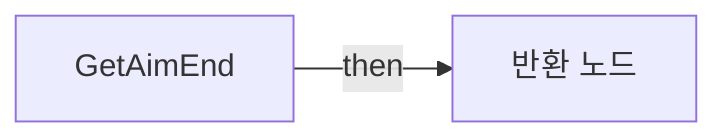

전체 노드·기본 입력 목록

| 노드 ID | 제목 | 미연결 기본 입력 / 에셋 입력 |
|---|---|---|
| `K2Node_FunctionEntry_0` | GetAimEnd |  |
| `K2Node_FunctionResult_0` | 반환 노드 |  |
| `K2Node_CallFunction_0` | Get Forward Vector |  |
| `K2Node_VariableGet_0` | Get weaponData |  |
| `K2Node_VariableGet_1` | Get range |  |
| `K2Node_PromotableOperator_0` | vector * vector |  |
| `K2Node_PromotableOperator_1` | vector + vector |  |

### GetEffectAim

실행 핀 플로우차트

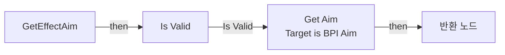

전체 노드·기본 입력 목록

| 노드 ID | 제목 | 미연결 기본 입력 / 에셋 입력 |
|---|---|---|
| `K2Node_FunctionEntry_0` | GetEffectAim |  |
| `K2Node_CallFunction_3` | Get Aim End |  |
| `K2Node_CallFunction_2` | Get Socket Location 타깃은 씬 컴포넌트 | InSocketName=Muzzle |
| `K2Node_Message_0` | Get Aim Target is BPI Aim |  |
| `K2Node_VariableGet_1` | Get |  |
| `K2Node_FunctionResult_1` | 반환 노드 |  |
| `K2Node_MacroInstance_0` | Is Valid |  |
| `K2Node_Knot_3` | 경유 노드 |  |
| `K2Node_Knot_4` | 경유 노드 |  |
| `K2Node_Knot_5` | 경유 노드 |  |
| `K2Node_Knot_6` | 경유 노드 |  |
| `K2Node_Knot_7` | 경유 노드 |  |

### GetFinalDamage

실행 핀 플로우차트

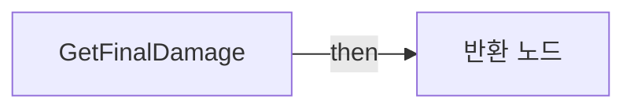

전체 노드·기본 입력 목록

| 노드 ID | 제목 | 미연결 기본 입력 / 에셋 입력 |
|---|---|---|
| `K2Node_FunctionEntry_0` | GetFinalDamage |  |
| `K2Node_FunctionResult_0` | 반환 노드 |  |
| `K2Node_CallFunction_0` | Select Float | bPickA=false |
| `K2Node_PromotableOperator_0` | float * float | B=1.000000 |
| `K2Node_Knot_0` | 경유 노드 |  |
| `K2Node_Knot_1` | 경유 노드 |  |

### GetHitScanAim

실행 핀 플로우차트

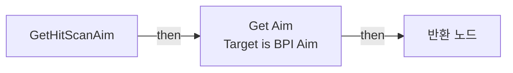

전체 노드·기본 입력 목록

| 노드 ID | 제목 | 미연결 기본 입력 / 에셋 입력 |
|---|---|---|
| `K2Node_FunctionEntry_0` | GetHitScanAim |  |
| `K2Node_CallFunction_3` | Get Aim End |  |
| `K2Node_Knot_0` | 경유 노드 |  |
| `K2Node_Knot_1` | 경유 노드 |  |
| `K2Node_Message_0` | Get Aim Target is BPI Aim |  |
| `K2Node_VariableGet_1` | Get |  |
| `K2Node_FunctionResult_0` | 반환 노드 |  |

### GetHitScanBeamTransform

실행 핀 플로우차트

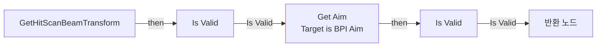

전체 노드·기본 입력 목록

| 노드 ID | 제목 | 미연결 기본 입력 / 에셋 입력 |
|---|---|---|
| `K2Node_FunctionEntry_0` | GetHitScanBeamTransform |  |
| `K2Node_VariableGet_16` | Get |  |
| `K2Node_Message_0` | Get Aim Target is BPI Aim | aimStartPosition=0, 0, 0 |
| `K2Node_CallFunction_17` | Select Mesh |  |
| `K2Node_CallFunction_18` | Get Socket Location 타깃은 씬 컴포넌트 | InSocketName=Muzzle |
| `K2Node_FunctionResult_1` | 반환 노드 |  |
| `K2Node_Knot_0` | 경유 노드 |  |
| `K2Node_MacroInstance_0` | Is Valid |  |
| `K2Node_Knot_1` | 경유 노드 |  |
| `K2Node_MacroInstance_1` | Is Valid |  |

### GetProjectileAim

실행 핀 플로우차트

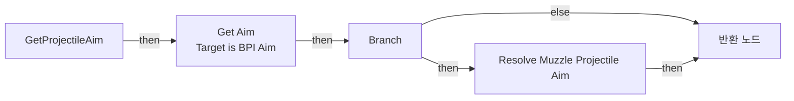

전체 노드·기본 입력 목록

| 노드 ID | 제목 | 미연결 기본 입력 / 에셋 입력 |
|---|---|---|
| `K2Node_FunctionEntry_0` | GetProjectileAim |  |
| `K2Node_FunctionResult_0` | 반환 노드 |  |
| `K2Node_CallFunction_3` | Get Aim End |  |
| `K2Node_CallFunction_2` | Get Socket Location 타깃은 씬 컴포넌트 | InSocketName=Muzzle |
| `K2Node_Knot_0` | 경유 노드 |  |
| `K2Node_Knot_1` | 경유 노드 |  |
| `K2Node_Knot_2` | 경유 노드 |  |
| `K2Node_Message_0` | Get Aim Target is BPI Aim |  |
| `K2Node_VariableGet_1` | Get |  |
| `K2Node_CallFunction_0` | Select Mesh |  |
| `K2Node_VariableGet_0` | Get bUseMuzzleProjectileAim |  |
| `K2Node_IfThenElse_0` | Branch |  |
| `K2Node_CallFunction_1` | Resolve Muzzle Projectile Aim |  |
| `K2Node_VariableGet_2` | Get weaponData |  |
| `K2Node_VariableGet_3` | Get traceChannel |  |
| `K2Node_CallFunction_4` | Get Owner 타깃은 액터 |  |
| `K2Node_CallFunction_5` | Get Owner 타깃은 액터 컴포넌트 |  |
| `K2Node_CallFunction_6` | Select Vector |  |
| `K2Node_CallFunction_7` | Select Vector |  |
| `K2Node_CallFunction_8` | Resolve Projectile Convergence |  |
| `K2Node_VariableGet_4` | Get ProjectileConvergenceSettings |  |
| `K2Node_CallFunction_9` | AND Boolean |  |
| `K2Node_CallFunction_10` | Resolve Safe Projectile Start |  |

### GetZoomData

실행 핀 플로우차트

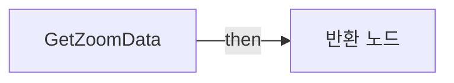

전체 노드·기본 입력 목록

| 노드 ID | 제목 | 미연결 기본 입력 / 에셋 입력 |
|---|---|---|
| `K2Node_FunctionEntry_0` | GetZoomData |  |
| `K2Node_FunctionResult_0` | 반환 노드 |  |
| `K2Node_VariableGet_0` | Get weaponData |  |
| `K2Node_VariableGet_1` | Get zoomFov |  |
| `K2Node_VariableGet_2` | Get interpSpeed |  |

### SelectMesh

실행 핀 플로우차트

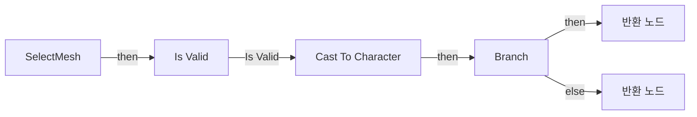

전체 노드·기본 입력 목록

| 노드 ID | 제목 | 미연결 기본 입력 / 에셋 입력 |
|---|---|---|
| `K2Node_FunctionEntry_0` | SelectMesh |  |
| `K2Node_VariableGet_1` | Get |  |
| `K2Node_DynamicCast_0` | Cast To Character |  |
| `K2Node_CallFunction_1` | Is Locally Controlled 타깃은 폰 |  |
| `K2Node_IfThenElse_0` | Branch |  |
| `K2Node_FunctionResult_2` | 반환 노드 |  |
| `K2Node_FunctionResult_1` | 반환 노드 |  |
| `K2Node_VariableGet_0` | Get FP_Mesh |  |
| `K2Node_VariableGet_2` | Get TP_Mesh |  |
| `K2Node_Knot_0` | 경유 노드 |  |
| `K2Node_MacroInstance_0` | Is Valid |  |

### SetCurrentCount

실행 핀 플로우차트

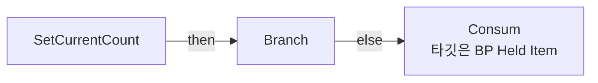

전체 노드·기본 입력 목록

| 노드 ID | 제목 | 미연결 기본 입력 / 에셋 입력 |
|---|---|---|
| `K2Node_FunctionEntry_0` | SetCurrentCount |  |
| `K2Node_CallFunction_0` | Consum 타깃은 BP Held Item | consumCount=1 |
| `K2Node_IfThenElse_0` | Branch |  |
| `K2Node_CallFunction_1` | Is Default Weapon |  |

### SetHitScan

실행 핀 플로우차트

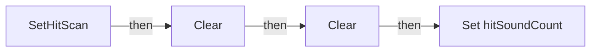

전체 노드·기본 입력 목록

| 노드 ID | 제목 | 미연결 기본 입력 / 에셋 입력 |
|---|---|---|
| `K2Node_FunctionEntry_0` | SetHitScan |  |
| `K2Node_VariableGet_34` | Get hitInfo |  |
| `K2Node_VariableGet_35` | Get effectVector |  |
| `K2Node_VariableSet_2` | Set hitSoundCount | hitSoundCount=0; Output_Get=0 |
| `K2Node_CallArrayFunction_1` | Clear |  |
| `K2Node_CallArrayFunction_2` | Clear |  |

### SetProjectileId

실행 핀 플로우차트

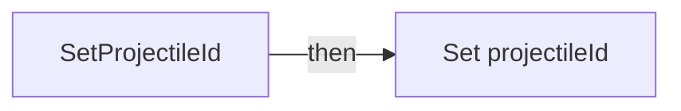

전체 노드·기본 입력 목록

| 노드 ID | 제목 | 미연결 기본 입력 / 에셋 입력 |
|---|---|---|
| `K2Node_FunctionEntry_0` | SetProjectileId |  |
| `K2Node_VariableGet_27` | Get projectileId |  |
| `K2Node_PromotableOperator_0` | int + int | B=1 |
| `K2Node_VariableSet_1` | Set projectileId | Output_Get=0 |

### SpawnRailGunBeamFX

실행 핀 플로우차트

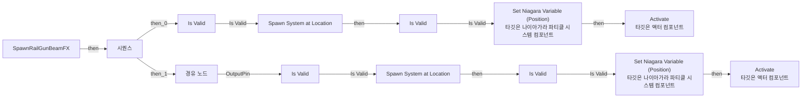

전체 노드·기본 입력 목록

| 노드 ID | 제목 | 미연결 기본 입력 / 에셋 입력 |
|---|---|---|
| `K2Node_FunctionEntry_0` | SpawnRailGunBeamFX |  |
| `K2Node_CallFunction_0` | Spawn System at Location | Scale=1.000000,1.000000,1.000000; bAutoDestroy=true; bAutoActivate=false; PoolingMethod=None; bPreCullCheck=false |
| `K2Node_CallFunction_1` | Activate 타깃은 액터 컴포넌트 | bReset=false |
| `K2Node_MacroInstance_0` | Is Valid |  |
| `K2Node_Knot_2` | 경유 노드 |  |
| `K2Node_Knot_3` | 경유 노드 |  |
| `K2Node_Knot_4` | 경유 노드 |  |
| `K2Node_Knot_5` | 경유 노드 |  |
| `K2Node_CallFunction_2` | Set Niagara Variable (Position) 타깃은 나이아가라 파티클 시스템 컴포넌트 | InVariableName=User.BeamEnd; InValue_Y=0.0; InValue_Z=0.0 |
| `K2Node_CallFunction_48` | Find Look at Rotation |  |
| `K2Node_CallFunction_3` | Distance (Vector) |  |
| `K2Node_Knot_0` | 경유 노드 |  |
| `K2Node_Knot_1` | 경유 노드 |  |
| `K2Node_ExecutionSequence_0` | 시퀀스 |  |
| `K2Node_CallFunction_22` | Spawn System at Location | Scale=1.000000,1.000000,1.000000; bAutoDestroy=true; bAutoActivate=false; PoolingMethod=None; bPreCullCheck=false |
| `K2Node_CallFunction_31` | Activate 타깃은 액터 컴포넌트 | bReset=false |
| `K2Node_MacroInstance_5` | Is Valid |  |
| `K2Node_Knot_24` | 경유 노드 |  |
| `K2Node_Knot_25` | 경유 노드 |  |
| `K2Node_Knot_26` | 경유 노드 |  |
| `K2Node_Knot_27` | 경유 노드 |  |
| `K2Node_CallFunction_46` | Set Niagara Variable (Position) 타깃은 나이아가라 파티클 시스템 컴포넌트 | InVariableName=User.BeamEnd; InValue_Y=0.0; InValue_Z=0.0 |
| `K2Node_CallFunction_50` | Distance (Vector) |  |
| `K2Node_Knot_6` | 경유 노드 |  |
| `K2Node_Knot_7` | 경유 노드 |  |
| `K2Node_Knot_8` | 경유 노드 |  |
| `K2Node_Knot_9` | 경유 노드 |  |
| `K2Node_Knot_10` | 경유 노드 |  |
| `K2Node_Knot_11` | 경유 노드 |  |
| `K2Node_Knot_12` | 경유 노드 |  |
| `K2Node_Knot_13` | 경유 노드 |  |
| `K2Node_VariableGet_0` | Get weaponData |  |
| `K2Node_VariableGet_1` | Get hitscanBeamEffect |  |
| `K2Node_Knot_14` | 경유 노드 |  |
| `K2Node_VariableGet_2` | Get railGunTrailEffect |  |
| `K2Node_MacroInstance_1` | Is Valid |  |
| `K2Node_Knot_15` | 경유 노드 |  |
| `K2Node_Knot_16` | 경유 노드 |  |
| `K2Node_Knot_17` | 경유 노드 |  |
| `K2Node_Knot_18` | 경유 노드 |  |
| `K2Node_MacroInstance_2` | Is Valid |  |
| `K2Node_Knot_19` | 경유 노드 |  |
| `K2Node_Knot_20` | 경유 노드 |  |
| `K2Node_Knot_21` | 경유 노드 |  |
| `K2Node_Knot_22` | 경유 노드 |  |

### StartFire

실행 핀 플로우차트

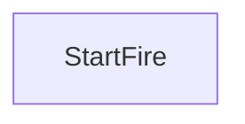

전체 노드·기본 입력 목록

| 노드 ID | 제목 | 미연결 기본 입력 / 에셋 입력 |
|---|---|---|
| `K2Node_FunctionEntry_0` | StartFire |  |

### UserConstructionScript

실행 핀 플로우차트

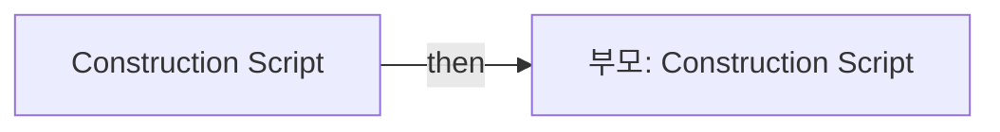

전체 노드·기본 입력 목록

| 노드 ID | 제목 | 미연결 기본 입력 / 에셋 입력 |
|---|---|---|
| `K2Node_FunctionEntry_0` | Construction Script |  |
| `K2Node_CallParentFunction_0` | 부모: Construction Script |  |

## 조회 범위의 한계

ObjectIterator로 발견했으나 MCP helper가 반환하지 않은 그래프입니다. delegate signature·컴파일된 중간 그래프·macro·애니메이션 내부 그래프가 섞일 수 있습니다.

- `GetWeaponData`: Graph 'GetWeaponData' not found in Blueprint.
- `OnHit`: Graph 'OnHit' not found in Blueprint.
- `PlayMontage`: Graph 'PlayMontage' not found in Blueprint.
- `ReceiveBeginPlay`: Graph 'ReceiveBeginPlay' not found in Blueprint.
- `ReceiveTick`: Graph 'ReceiveTick' not found in Blueprint.
- `StartAbility`: Graph 'StartAbility' not found in Blueprint.
- `StopAbility`: Graph 'StopAbility' not found in Blueprint.
- `TakeDamage`: Graph 'TakeDamage' not found in Blueprint.
- `TryUse`: Graph 'TryUse' not found in Blueprint.
- `[C]ChHitSound`: Graph '[C]ChHitSound' not found in Blueprint.
- `[M]DestroyProjectileById`: Graph '[M]DestroyProjectileById' not found in Blueprint.
- `[M]FireEffect`: Graph '[M]FireEffect' not found in Blueprint.
- `[M]HitEffect`: Graph '[M]HitEffect' not found in Blueprint.
- `[M]HitScanBeamEffect`: Graph '[M]HitScanBeamEffect' not found in Blueprint.
- `[M]SpawnDestroyEffect`: Graph '[M]SpawnDestroyEffect' not found in Blueprint.
- `[S] TryFire`: Graph '[S] TryFire' not found in Blueprint.

[원본 MCP 스냅샷](../../../../Evidence/blueprints-070.json)
