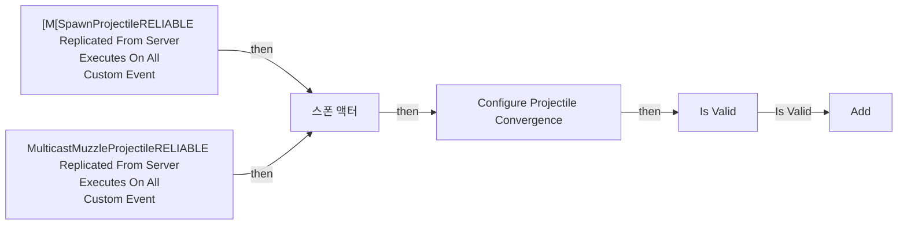
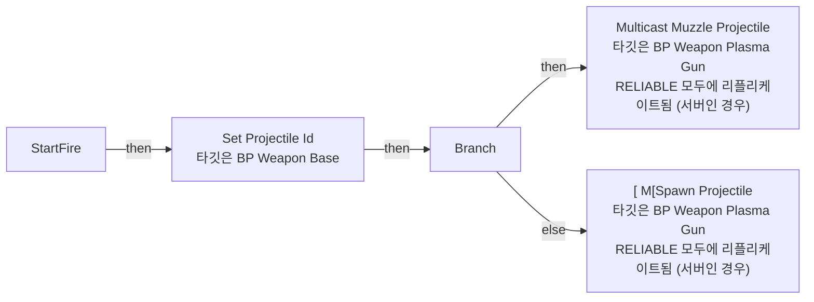

# BP_Weapon_PlasmaGun

에셋: `/Game/QuakeLike_1_0/HeldItem/Gun/BP_Weapon_PlasmaGun`

부모: `/Script/Engine.BlueprintGeneratedClass'/Game/QuakeLike_1_0/HeldItem/Gun/BP_WeaponBase.BP_WeaponBase_C'`

수집일: 2026-10-12. MCP에서 읽은 그래프·핀 연결의 자동 전사입니다. 상속된 그래프는 부모 문서를 함께 확인합니다.

정적 루트 참조 도달: 있음. 실행 여부 또는 삭제 가능 여부의 확정이 아닙니다.

컴포넌트 목록은 이 BP가 직접 정의한 SCS만 포함합니다. 부모·네이티브 생성 컴포넌트, 인스턴스 설정은 별도입니다.

## 직접 정의한 컴포넌트

| 이름 | 클래스 | 부모 컴포넌트 |
|---|---|---|
| `WeaponAimAlignment` | `WeaponAimAlignmentComponent` | `` |

## 그래프 목록

| 그래프 | 전체 노드 수 |
|---|---|
| EventGraph | 31 |
| StartFire | 8 |
| UserConstructionScript | 2 |

## 그래프별 실행 연결

실선은 출력 exec 핀의 실제 연결입니다. 여러 분기는 출력 핀 이름을 표시합니다. 함수 호출·delegate·타이머의 다음 그래프 실행은 이 그림에서 자동으로 이어 붙이지 않습니다.

순수 계산 노드 및 데이터 핀은 아래 목록과 원본 JSON을 확인합니다. 연결되지 않은 이벤트도 표시되므로, 노드가 있다는 이유만으로 실행된다고 판단하면 안 됩니다.

### EventGraph

실행 핀 플로우차트

전체 노드·기본 입력 목록

| 노드 ID | 제목 | 미연결 기본 입력 / 에셋 입력 |
|---|---|---|
| `K2Node_CustomEvent_0` | [M[SpawnProjectileRELIABLE Replicated From Server Executes On All Custom Event |  |
| `K2Node_CallFunction_1` | Find Look at Rotation |  |
| `K2Node_CallFunction_2` | Make Transform | Scale=1.000000,1.000000,1.000000 |
| `K2Node_Knot_0` | 경유 노드 |  |
| `K2Node_SpawnActorFromClass_0` | 스폰 액터 | CollisionHandlingOverride=Undefined; TransformScaleMethod=MultiplyWithRoot |
| `K2Node_VariableGet_0` | Get weaponData |  |
| `K2Node_VariableGet_1` | Get projectileClass |  |
| `K2Node_Knot_1` | 경유 노드 |  |
| `K2Node_Knot_2` | 경유 노드 |  |
| `K2Node_CallFunction_3` | Get Owner 타깃은 액터 |  |
| `K2Node_CallFunction_4` | Has Authority 타깃은 액터 |  |
| `K2Node_VariableGet_2` | Get projectileId |  |
| `K2Node_Self_1` | 셀프-레퍼런스 |  |
| `K2Node_CallFunction_7` | Get Instigator 타깃은 액터 |  |
| `K2Node_MacroInstance_1` | Is Valid |  |
| `K2Node_Knot_3` | 경유 노드 |  |
| `K2Node_Knot_4` | 경유 노드 |  |
| `K2Node_MakeStruct_12` | Make ST Projectile Info |  |
| `K2Node_VariableGet_5` | Get projectileId | projectileId=0 |
| `K2Node_VariableGet_6` | Get spawnedProjectiles |  |
| `K2Node_CallArrayFunction_1` | Add | ReturnValue=0 |
| `K2Node_CallFunction_5` | Get Hit Scan Aim |  |
| `K2Node_CustomEvent_1` | MulticastMuzzleProjectileRELIABLE Replicated From Server Executes On All Custom Event |  |
| `K2Node_VariableGet_3` | Get bUseMuzzleProjectileAim |  |
| `K2Node_CallFunction_0` | Select Vector |  |
| `K2Node_CallFunction_6` | Select Vector |  |
| `K2Node_CallFunction_8` | Select Int |  |
| `K2Node_CallFunction_9` | Configure Projectile Convergence | ReturnValue=false |
| `K2Node_CallFunction_10` | AND Boolean |  |
| `K2Node_CallFunction_11` | Select Mesh |  |
| `K2Node_CallFunction_12` | Resolve Projectile View Start |  |

### StartFire

실행 핀 플로우차트

전체 노드·기본 입력 목록

| 노드 ID | 제목 | 미연결 기본 입력 / 에셋 입력 |
|---|---|---|
| `K2Node_FunctionEntry_0` | StartFire |  |
| `K2Node_CallFunction_0` | Set Projectile Id 타깃은 BP Weapon Base |  |
| `K2Node_CallFunction_2` | [ M[Spawn Projectile 타깃은 BP Weapon Plasma Gun RELIABLE 모두에 리플리케이트됨 (서버인 경우) |  |
| `K2Node_VariableGet_0` | Get bUseMuzzleProjectileAim |  |
| `K2Node_IfThenElse_0` | Branch |  |
| `K2Node_CallFunction_1` | Get Projectile Aim |  |
| `K2Node_CallFunction_3` | Multicast Muzzle Projectile 타깃은 BP Weapon Plasma Gun RELIABLE 모두에 리플리케이트됨 (서버인 경우) |  |
| `K2Node_VariableGet_1` | Get projectileId |  |

### UserConstructionScript

실행 핀 플로우차트

전체 노드·기본 입력 목록

| 노드 ID | 제목 | 미연결 기본 입력 / 에셋 입력 |
|---|---|---|
| `K2Node_FunctionEntry_0` | Construction Script |  |
| `K2Node_CallParentFunction_0` | 부모: Construction Script |  |

## 조회 범위의 한계

ObjectIterator로 발견했으나 MCP helper가 반환하지 않은 그래프입니다. delegate signature·컴파일된 중간 그래프·macro·애니메이션 내부 그래프가 섞일 수 있습니다.

- `MulticastMuzzleProjectile`: Graph 'MulticastMuzzleProjectile' not found in Blueprint.
- `[M[SpawnProjectile`: Graph '[M[SpawnProjectile' not found in Blueprint.

[원본 MCP 스냅샷](../../../../Evidence/blueprints-105.json)
