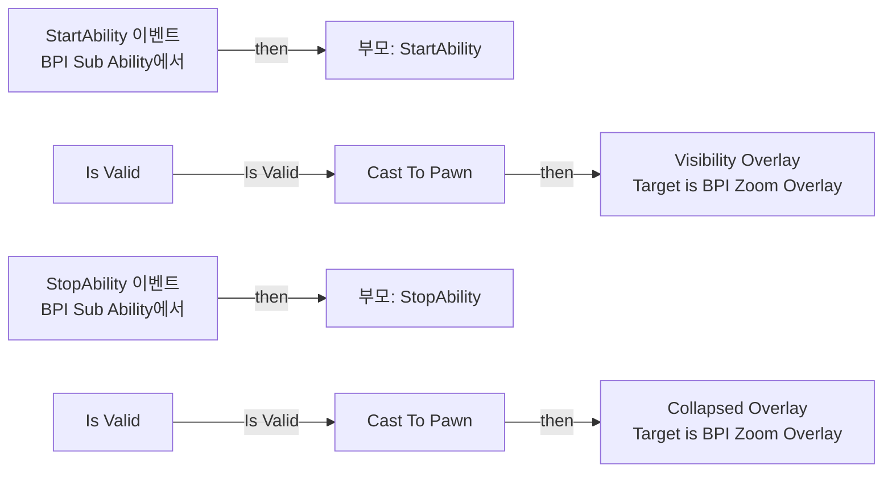
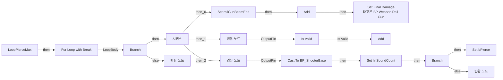
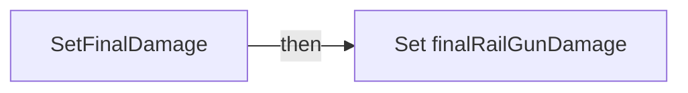
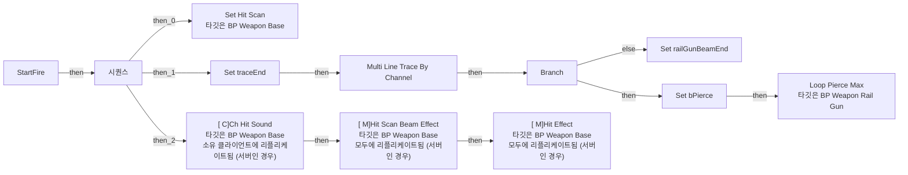
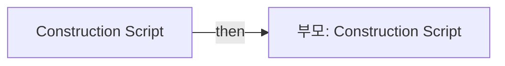

# BP_Weapon_RailGun

에셋: `/Game/QuakeLike_1_0/HeldItem/Gun/BP_Weapon_RailGun`

부모: `/Script/Engine.BlueprintGeneratedClass'/Game/QuakeLike_1_0/HeldItem/Gun/BP_WeaponBase.BP_WeaponBase_C'`

수집일: 2026-10-12. MCP에서 읽은 그래프·핀 연결의 자동 전사입니다. 상속된 그래프는 부모 문서를 함께 확인합니다.

정적 루트 참조 도달: 있음. 실행 여부 또는 삭제 가능 여부의 확정이 아닙니다.

컴포넌트 목록은 이 BP가 직접 정의한 SCS만 포함합니다. 부모·네이티브 생성 컴포넌트, 인스턴스 설정은 별도입니다.

## 직접 정의한 컴포넌트

| 이름 | 클래스 | 부모 컴포넌트 |
|---|---|---|
| `PointLight1` | `PointLightComponent` | `` |

## 변수와 기본값

| 이름 | 타입 | CDO 기본값 |
|---|---|---|
| `traceEnd` | `Vector` | &lt;Struct 'Vector' {x: 0.000000, y: 0.000000, z: 0.000000}&gt; |
| `railGunBeamEnd` | `Vector` | &lt;Struct 'Vector' {x: 0.000000, y: 0.000000, z: 0.000000}&gt; |
| `bPierce` | `bool` | False |
| `finalRailGunDamage` | `real` | 0.0 |

## 그래프 목록

| 그래프 | 전체 노드 수 |
|---|---|
| EventGraph | 16 |
| LoopPierceMax | 38 |
| SetFinalDamage | 9 |
| StartFire | 27 |
| UserConstructionScript | 2 |

## 그래프별 실행 연결

실선은 출력 exec 핀의 실제 연결입니다. 여러 분기는 출력 핀 이름을 표시합니다. 함수 호출·delegate·타이머의 다음 그래프 실행은 이 그림에서 자동으로 이어 붙이지 않습니다.

순수 계산 노드 및 데이터 핀은 아래 목록과 원본 JSON을 확인합니다. 연결되지 않은 이벤트도 표시되므로, 노드가 있다는 이유만으로 실행된다고 판단하면 안 됩니다.

### EventGraph

실행 핀 플로우차트

전체 노드·기본 입력 목록

| 노드 ID | 제목 | 미연결 기본 입력 / 에셋 입력 |
|---|---|---|
| `K2Node_Event_0` | StartAbility 이벤트 BPI Sub Ability에서 |  |
| `K2Node_CallParentFunction_0` | 부모: StartAbility |  |
| `K2Node_CallFunction_0` | Get Owner 타깃은 액터 |  |
| `K2Node_DynamicCast_0` | Cast To Pawn |  |
| `K2Node_CallFunction_1` | Get Controller 타깃은 폰 |  |
| `K2Node_Message_0` | Visibility Overlay Target is BPI Zoom Overlay |  |
| `K2Node_Event_1` | StopAbility 이벤트 BPI Sub Ability에서 |  |
| `K2Node_CallParentFunction_1` | 부모: StopAbility |  |
| `K2Node_CallFunction_2` | Get Owner 타깃은 액터 |  |
| `K2Node_DynamicCast_1` | Cast To Pawn |  |
| `K2Node_CallFunction_3` | Get Controller 타깃은 폰 |  |
| `K2Node_Message_1` | Collapsed Overlay Target is BPI Zoom Overlay |  |
| `K2Node_Knot_0` | 경유 노드 |  |
| `K2Node_MacroInstance_0` | Is Valid |  |
| `K2Node_Knot_1` | 경유 노드 |  |
| `K2Node_MacroInstance_1` | Is Valid |  |

### LoopPierceMax

실행 핀 플로우차트

전체 노드·기본 입력 목록

| 노드 ID | 제목 | 미연결 기본 입력 / 에셋 입력 |
|---|---|---|
| `K2Node_FunctionEntry_0` | LoopPierceMax |  |
| `K2Node_MacroInstance_0` | For Loop with Break |  |
| `K2Node_PromotableOperator_1` | integer &lt; integer |  |
| `K2Node_IfThenElse_1` | Branch |  |
| `K2Node_Knot_3` | 경유 노드 |  |
| `K2Node_GetArrayItem_0` | GET |  |
| `K2Node_Knot_5` | 경유 노드 |  |
| `K2Node_Knot_6` | 경유 노드 |  |
| `K2Node_CallFunction_4` | Break Hit Result | bBlockingHit=false; bInitialOverlap=false; Time=0.0; Distance=0.0; Location=0, 0, 0; Normal=0, 0, 0; HitBoneName=None; BoneName=None; HitItem=0; ElementIndex=0; FaceIndex=0; TraceStart=0, 0, 0; TraceEnd=0, 0, 0 |
| `K2Node_VariableSet_3` | Set railGunBeamEnd | Output_Get=0, 0, 0 |
| `K2Node_VariableGet_5` | Get effectVector |  |
| `K2Node_CallArrayFunction_1` | Add | ReturnValue=0 |
| `K2Node_MakeStruct_0` | Make ST Hit Effect Vector |  |
| `K2Node_Knot_7` | 경유 노드 |  |
| `K2Node_Knot_8` | 경유 노드 |  |
| `K2Node_CallFunction_5` | Set Final Damage 타깃은 BP Weapon Rail Gun |  |
| `K2Node_MacroInstance_1` | Is Valid |  |
| `K2Node_Knot_10` | 경유 노드 |  |
| `K2Node_VariableGet_6` | Get hitInfo |  |
| `K2Node_CallArrayFunction_2` | Add | ReturnValue=0 |
| `K2Node_Knot_11` | 경유 노드 |  |
| `K2Node_VariableGet_7` | Get finalRailGunDamage |  |
| `K2Node_VariableGet_8` | Get hitSoundCount |  |
| `K2Node_VariableSet_4` | Set hitSoundCount | Output_Get=0 |
| `K2Node_PromotableOperator_2` | int + int | B=1 |
| `K2Node_DynamicCast_0` | Cast To BP_ShooterBase |  |
| `K2Node_CallFunction_6` | Get Component by Class 타깃은 액터 | ComponentClass=/Game/QuakeLike_1_0/Life/BPC_Life.BPC_Life_C |
| `K2Node_CallFunction_7` | Is Fatal Damage 타깃은 BPC Life |  |
| `K2Node_VariableGet_9` | Get finalRailGunDamage |  |
| `K2Node_IfThenElse_2` | Branch |  |
| `K2Node_VariableSet_5` | Set bPierce | bPierce=true; Output_Get=false |
| `K2Node_ExecutionSequence_1` | 시퀀스 |  |
| `K2Node_Knot_14` | 경유 노드 |  |
| `K2Node_Knot_15` | 경유 노드 |  |
| `K2Node_VariableGet_2` | Get weaponData |  |
| `K2Node_VariableGet_3` | Get pierceMax |  |
| `K2Node_FunctionResult_1` | 반환 노드 |  |
| `K2Node_FunctionResult_2` | 반환 노드 |  |

### SetFinalDamage

실행 핀 플로우차트

전체 노드·기본 입력 목록

| 노드 ID | 제목 | 미연결 기본 입력 / 에셋 입력 |
|---|---|---|
| `K2Node_FunctionEntry_0` | SetFinalDamage |  |
| `K2Node_VariableGet_0` | Get weaponData |  |
| `K2Node_VariableGet_2` | Get damage |  |
| `K2Node_Knot_0` | 경유 노드 |  |
| `K2Node_VariableGet_3` | Get pierceMultiplier |  |
| `K2Node_PromotableOperator_0` | float * float |  |
| `K2Node_CallFunction_0` | Select Float |  |
| `K2Node_VariableGet_4` | Get bPierce |  |
| `K2Node_VariableSet_0` | Set finalRailGunDamage | Output_Get=0.0 |

### StartFire

실행 핀 플로우차트

전체 노드·기본 입력 목록

| 노드 ID | 제목 | 미연결 기본 입력 / 에셋 입력 |
|---|---|---|
| `K2Node_FunctionEntry_0` | StartFire |  |
| `K2Node_ExecutionSequence_0` | 시퀀스 |  |
| `K2Node_CallFunction_0` | Set Hit Scan 타깃은 BP Weapon Base |  |
| `K2Node_CallFunction_1` | Multi Line Trace By Channel | bTraceComplex=false; DrawDebugType=None; bIgnoreSelf=true; TraceColor=(R=1.000000,G=0.000000,B=0.000000,A=1.000000); TraceHitColor=(R=0.000000,G=1.000000,B=0.000000,A=1.000000); DrawTime=5.000000; ReturnValue=false |
| `K2Node_VariableSet_0` | Set traceEnd | Output_Get=0, 0, 0 |
| `K2Node_CallFunction_2` | Get Hit Scan Aim |  |
| `K2Node_Knot_0` | 경유 노드 |  |
| `K2Node_VariableGet_0` | Get weaponData |  |
| `K2Node_VariableGet_1` | Get traceChannel |  |
| `K2Node_CallFunction_3` | Get Owner 타깃은 액터 |  |
| `K2Node_MakeArray_0` | 배열 만들기 |  |
| `K2Node_CallArrayFunction_0` | Length |  |
| `K2Node_IfThenElse_0` | Branch |  |
| `K2Node_PromotableOperator_0` | integer &gt; integer |  |
| `K2Node_VariableSet_1` | Set railGunBeamEnd | Output_Get=0, 0, 0 |
| `K2Node_VariableGet_2` | Get traceEnd |  |
| `K2Node_VariableSet_2` | Set bPierce | bPierce=false; Output_Get=false |
| `K2Node_Knot_1` | 경유 노드 |  |
| `K2Node_Knot_2` | 경유 노드 |  |
| `K2Node_Knot_4` | 경유 노드 |  |
| `K2Node_CallFunction_8` | Loop Pierce Max 타깃은 BP Weapon Rail Gun |  |
| `K2Node_CallFunction_9` | [ C]Ch Hit Sound 타깃은 BP Weapon Base 소유 클라이언트에 리플리케이트됨 (서버인 경우) |  |
| `K2Node_CallFunction_10` | [ M]Hit Scan Beam Effect 타깃은 BP Weapon Base 모두에 리플리케이트됨 (서버인 경우) | beamPlayback=RailGun |
| `K2Node_VariableGet_10` | Get railGunBeamEnd |  |
| `K2Node_CallFunction_11` | [ M]Hit Effect 타깃은 BP Weapon Base 모두에 리플리케이트됨 (서버인 경우) |  |
| `K2Node_VariableGet_11` | Get effectVector |  |
| `K2Node_VariableGet_3` | Get hitSoundCount |  |

### UserConstructionScript

실행 핀 플로우차트

전체 노드·기본 입력 목록

| 노드 ID | 제목 | 미연결 기본 입력 / 에셋 입력 |
|---|---|---|
| `K2Node_FunctionEntry_0` | Construction Script |  |
| `K2Node_CallParentFunction_0` | 부모: Construction Script |  |

## 조회 범위의 한계

ObjectIterator로 발견했으나 MCP helper가 반환하지 않은 그래프입니다. delegate signature·컴파일된 중간 그래프·macro·애니메이션 내부 그래프가 섞일 수 있습니다.

- `StartAbility`: Graph 'StartAbility' not found in Blueprint.
- `StopAbility`: Graph 'StopAbility' not found in Blueprint.

[원본 MCP 스냅샷](../../../../Evidence/blueprints-105.json)
