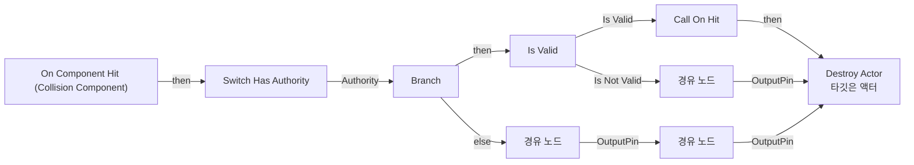
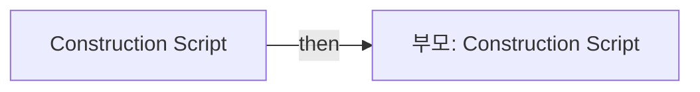

# BP_PistolProjectile

에셋: `/Game/QuakeLike_1_0/HeldItem/Projectile/BP_PistolProjectile`

부모: `/Script/Engine.BlueprintGeneratedClass'/Game/QuakeLike_1_0/HeldItem/Projectile/BP_ProjectileBase.BP_ProjectileBase_C'`

수집일: 2026-10-12. MCP에서 읽은 그래프·핀 연결의 자동 전사입니다. 상속된 그래프는 부모 문서를 함께 확인합니다.

정적 루트 참조 도달: 있음. 실행 여부 또는 삭제 가능 여부의 확정이 아닙니다.

컴포넌트 목록은 이 BP가 직접 정의한 SCS만 포함합니다. 부모·네이티브 생성 컴포넌트, 인스턴스 설정은 별도입니다.

## 직접 정의한 컴포넌트

| 이름 | 클래스 | 부모 컴포넌트 |
|---|---|---|
| `Sphere_0` | `StaticMeshComponent` | `` |

## 그래프 목록

| 그래프 | 전체 노드 수 |
|---|---|
| EventGraph | 14 |
| UserConstructionScript | 2 |

## 그래프별 실행 연결

실선은 출력 exec 핀의 실제 연결입니다. 여러 분기는 출력 핀 이름을 표시합니다. 함수 호출·delegate·타이머의 다음 그래프 실행은 이 그림에서 자동으로 이어 붙이지 않습니다.

순수 계산 노드 및 데이터 핀은 아래 목록과 원본 JSON을 확인합니다. 연결되지 않은 이벤트도 표시되므로, 노드가 있다는 이유만으로 실행된다고 판단하면 안 됩니다.

### EventGraph

실행 핀 플로우차트

전체 노드·기본 입력 목록

| 노드 ID | 제목 | 미연결 기본 입력 / 에셋 입력 |
|---|---|---|
| `K2Node_ComponentBoundEvent_0` | On Component Hit (Collision Component) | NormalImpulse=0, 0, 0; Hit_bBlockingHit=false; Hit_bInitialOverlap=false; Hit_Time=0.0; Hit_Distance=0.0; Hit_Location=0, 0, 0; Hit_ImpactPoint=0, 0, 0; Hit_Normal=0, 0, 0; Hit_ImpactNormal=0, 0, 0; Hit_HitBoneName=None; Hit_BoneName=None; Hit_HitItem=0; Hit_ElementIndex=0; Hit_FaceIndex=0; Hit_TraceStart=0, 0, 0; Hit_TraceEnd=0, 0, 0 |
| `K2Node_CallDelegate_0` | Call On Hit |  |
| `K2Node_MakeArray_0` | 배열 만들기 |  |
| `K2Node_VariableGet_2` | Get damage |  |
| `K2Node_CallFunction_2` | Destroy Actor 타깃은 액터 |  |
| `K2Node_MacroInstance_1` | Switch Has Authority |  |
| `K2Node_VariableGet_0` | Get |  |
| `K2Node_IfThenElse_0` | Branch |  |
| `K2Node_VariableGet_4` | Get canDealDamage |  |
| `K2Node_Knot_1` | 경유 노드 |  |
| `K2Node_MacroInstance_0` | Is Valid |  |
| `K2Node_Knot_2` | 경유 노드 |  |
| `K2Node_Knot_3` | 경유 노드 |  |
| `K2Node_Knot_4` | 경유 노드 |  |

### UserConstructionScript

실행 핀 플로우차트

전체 노드·기본 입력 목록

| 노드 ID | 제목 | 미연결 기본 입력 / 에셋 입력 |
|---|---|---|
| `K2Node_FunctionEntry_0` | Construction Script |  |
| `K2Node_CallParentFunction_0` | 부모: Construction Script |  |

## 조회 범위의 한계

ObjectIterator로 발견했으나 MCP helper가 반환하지 않은 그래프입니다. delegate signature·컴파일된 중간 그래프·macro·애니메이션 내부 그래프가 섞일 수 있습니다.

- `BndEvt__BP_PlasmaProjectile_Collision Component_K2Node_ComponentBoundEvent_0_ComponentHitSignature__DelegateSignature`: Graph 'BndEvt__BP_PlasmaProjectile_Collision Component_K2Node_ComponentBoundEvent_0_ComponentHitSignature__DelegateSignature' not found in Blueprint.

[원본 MCP 스냅샷](../../../../Evidence/blueprints-140.json)
