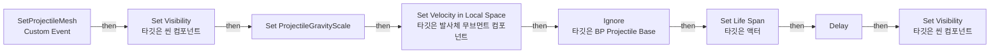
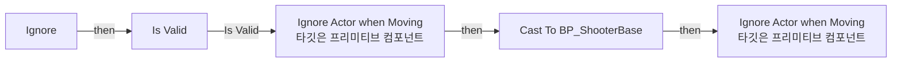
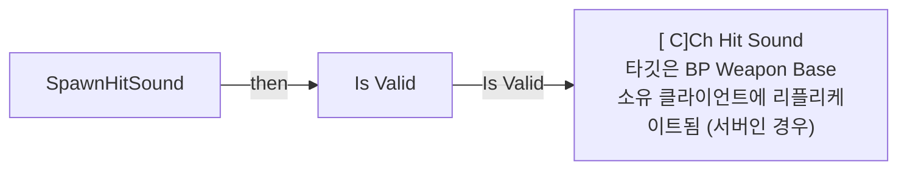
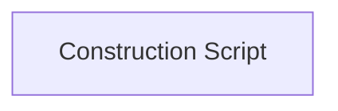

# BP_ProjectileBase

에셋: `/Game/QuakeLike_1_0/HeldItem/Projectile/BP_ProjectileBase`

부모: `/Script/CoreUObject.Class'/Script/Engine.Actor'`

수집일: 2026-10-12. MCP에서 읽은 그래프·핀 연결의 자동 전사입니다. 상속된 그래프는 부모 문서를 함께 확인합니다.

정적 루트 참조 도달: 있음. 실행 여부 또는 삭제 가능 여부의 확정이 아닙니다.

컴포넌트 목록은 이 BP가 직접 정의한 SCS만 포함합니다. 부모·네이티브 생성 컴포넌트, 인스턴스 설정은 별도입니다.

## 직접 정의한 컴포넌트

| 이름 | 클래스 | 부모 컴포넌트 |
|---|---|---|
| `ProjectileMovement` | `ProjectileMovementComponent` | `` |
| `Collision Component` | `SphereComponent` | `` |
| `SkeletalMesh` | `SkeletalMeshComponent` | `Collision Component` |
| `ProjectileMesh` | `StaticMeshComponent` | `Collision Component` |
| `Sphere` | `StaticMeshComponent` | `ProjectileMesh` |

## 변수와 기본값

| 이름 | 타입 | CDO 기본값 |
|---|---|---|
| `wConfig` | `ST_WeaponConfig` | &lt;Struct 'ST_WeaponConfig' {}&gt; |
| `canDealDamage` | `bool` | False |
| `projectileId` | `int` | 0 |

## 그래프 목록

| 그래프 | 전체 노드 수 |
|---|---|
| EventGraph | 24 |
| Ignore | 12 |
| SpawnHitSound | 8 |
| UserConstructionScript | 1 |

## 그래프별 실행 연결

실선은 출력 exec 핀의 실제 연결입니다. 여러 분기는 출력 핀 이름을 표시합니다. 함수 호출·delegate·타이머의 다음 그래프 실행은 이 그림에서 자동으로 이어 붙이지 않습니다.

순수 계산 노드 및 데이터 핀은 아래 목록과 원본 JSON을 확인합니다. 연결되지 않은 이벤트도 표시되므로, 노드가 있다는 이유만으로 실행된다고 판단하면 안 됩니다.

### EventGraph

실행 핀 플로우차트

전체 노드·기본 입력 목록

| 노드 ID | 제목 | 미연결 기본 입력 / 에셋 입력 |
|---|---|---|
| `K2Node_VariableGet_0` | Get ProjectileMovement |  |
| `K2Node_VariableSet_0` | Set ProjectileGravityScale | ProjectileGravityScale=0.0; Output_Get=0.0 |
| `K2Node_CallFunction_0` | Set Velocity in Local Space 타깃은 발사체 무브먼트 컴포넌트 | NewVelocity_Y=0.0; NewVelocity_Z=0.0 |
| `K2Node_Knot_0` | 경유 노드 |  |
| `K2Node_Knot_1` | 경유 노드 |  |
| `K2Node_CallFunction_2` | Set Life Span 타깃은 액터 |  |
| `K2Node_PromotableOperator_0` | float / float |  |
| `K2Node_VariableGet_5` | Get projectileSpeed |  |
| `K2Node_Knot_2` | 경유 노드 |  |
| `K2Node_Knot_3` | 경유 노드 |  |
| `K2Node_VariableGet_6` | Get range |  |
| `K2Node_Knot_4` | 경유 노드 |  |
| `K2Node_CallFunction_3` | Ignore 타깃은 BP Projectile Base |  |
| `K2Node_VariableGet_1` | Get |  |
| `K2Node_Knot_5` | 경유 노드 |  |
| `K2Node_Knot_6` | 경유 노드 |  |
| `K2Node_VariableGet_7` | Get projectileVisualForwardOffset |  |
| `K2Node_Knot_7` | 경유 노드 |  |
| `K2Node_Knot_8` | 경유 노드 |  |
| `K2Node_CallFunction_10` | Set Visibility 타깃은 씬 컴포넌트 | bNewVisibility=false; bPropagateToChildren=true |
| `K2Node_CallFunction_11` | Set Visibility 타깃은 씬 컴포넌트 | bNewVisibility=true; bPropagateToChildren=true |
| `K2Node_PromotableOperator_1` | float / float |  |
| `K2Node_CustomEvent_0` | SetProjectileMesh Custom Event |  |
| `K2Node_CallFunction_4` | Delay |  |

### Ignore

실행 핀 플로우차트

전체 노드·기본 입력 목록

| 노드 ID | 제목 | 미연결 기본 입력 / 에셋 입력 |
|---|---|---|
| `K2Node_FunctionEntry_0` | Ignore |  |
| `K2Node_CallFunction_3` | Ignore Actor when Moving 타깃은 프리미티브 컴포넌트 | bShouldIgnore=true |
| `K2Node_VariableGet_3` | Get Collision Component |  |
| `K2Node_VariableGet_5` | Get CapsuleComponent |  |
| `K2Node_CallFunction_6` | Ignore Actor when Moving 타깃은 프리미티브 컴포넌트 | bShouldIgnore=true |
| `K2Node_Self_1` | 셀프-레퍼런스 |  |
| `K2Node_Knot_2` | 경유 노드 |  |
| `K2Node_Knot_3` | 경유 노드 |  |
| `K2Node_DynamicCast_2` | Cast To BP_ShooterBase |  |
| `K2Node_CallFunction_0` | Get Instigator 타깃은 액터 |  |
| `K2Node_Knot_0` | 경유 노드 |  |
| `K2Node_MacroInstance_0` | Is Valid |  |

### SpawnHitSound

실행 핀 플로우차트

전체 노드·기본 입력 목록

| 노드 ID | 제목 | 미연결 기본 입력 / 에셋 입력 |
|---|---|---|
| `K2Node_FunctionEntry_0` | SpawnHitSound |  |
| `K2Node_MacroInstance_1` | Is Valid |  |
| `K2Node_VariableGet_2` | Get |  |
| `K2Node_Knot_2` | 경유 노드 |  |
| `K2Node_Knot_3` | 경유 노드 |  |
| `K2Node_Knot_4` | 경유 노드 |  |
| `K2Node_CallFunction_0` | [ C]Ch Hit Sound 타깃은 BP Weapon Base 소유 클라이언트에 리플리케이트됨 (서버인 경우) |  |
| `K2Node_Knot_0` | 경유 노드 |  |

### UserConstructionScript

실행 핀 플로우차트

전체 노드·기본 입력 목록

| 노드 ID | 제목 | 미연결 기본 입력 / 에셋 입력 |
|---|---|---|
| `K2Node_FunctionEntry_0` | Construction Script |  |

## 조회 범위의 한계

ObjectIterator로 발견했으나 MCP helper가 반환하지 않은 그래프입니다. delegate signature·컴파일된 중간 그래프·macro·애니메이션 내부 그래프가 섞일 수 있습니다.

- `SetProjectileMesh`: Graph 'SetProjectileMesh' not found in Blueprint.

[원본 MCP 스냅샷](../../../../Evidence/blueprints-070.json)
