# BP_RocketLauncherProjectile

에셋: `/Game/QuakeLike_1_0/HeldItem/Projectile/BP_RocketLauncherProjectile`

부모: `/Script/Engine.BlueprintGeneratedClass'/Game/QuakeLike_1_0/HeldItem/Projectile/BP_ProjectileBase.BP_ProjectileBase_C'`

수집일: 2026-10-12. MCP에서 읽은 그래프·핀 연결의 자동 전사입니다. 상속된 그래프는 부모 문서를 함께 확인합니다.

정적 루트 참조 도달: 있음. 실행 여부 또는 삭제 가능 여부의 확정이 아닙니다.

컴포넌트 목록은 이 BP가 직접 정의한 SCS만 포함합니다. 부모·네이티브 생성 컴포넌트, 인스턴스 설정은 별도입니다.

## 직접 정의한 컴포넌트

| 이름 | 클래스 | 부모 컴포넌트 |
|---|---|---|
| `ParticleSystem` | `ParticleSystemComponent` | `` |
| `FlightSound` | `AudioComponent` | `` |
| `ParticleSystem1` | `ParticleSystemComponent` | `ParticleSystem` |
| `ParticleSystem2` | `ParticleSystemComponent` | `ParticleSystem` |

## 변수와 기본값

| 이름 | 타입 | CDO 기본값 |
|---|---|---|
| `exploded` | `bool` | False |
| `objectTypes` | `EObjectTypeQuery` | [] |
| `explosionDamage` | `real` | 0.0 |
| `impactNormalEffect` | `Vector` | &lt;Struct 'Vector' {x: 0.000000, y: 0.000000, z: 0.000000}&gt; |
| `hitSoundCount` | `int` | 0 |
| `knockbackDamage` | `real` | 0.0 |

## 그래프 목록

| 그래프 | 전체 노드 수 |
|---|---|
| CanExplosionDamageTarget | 22 |
| EventGraph | 63 |
| Explode | 41 |
| GetMoveLockTime | 7 |
| LaunchCharacter | 26 |
| MackLaunchVelocity | 10 |
| MakeAlpha | 7 |
| MakeCapsuleSurfaceDistance | 31 |
| MakeDebugLineExplosionRadius | 4 |
| MakeDistance | 7 |
| MakeFinalExplosionDamage | 38 |
| MakeFinalKnockback | 6 |
| MakeHorizontalDir | 5 |
| MakeKnockbackDir | 18 |
| SelectDamageMultiplier | 8 |
| SelectKnockbackMultiplier | 9 |
| SetTraceStart | 4 |
| SpawnEffectAndSound | 21 |
| UserConstructionScript | 2 |

## 그래프별 실행 연결

실선은 출력 exec 핀의 실제 연결입니다. 여러 분기는 출력 핀 이름을 표시합니다. 함수 호출·delegate·타이머의 다음 그래프 실행은 이 그림에서 자동으로 이어 붙이지 않습니다.

순수 계산 노드 및 데이터 핀은 아래 목록과 원본 JSON을 확인합니다. 연결되지 않은 이벤트도 표시되므로, 노드가 있다는 이유만으로 실행된다고 판단하면 안 됩니다.

### CanExplosionDamageTarget

실행 핀 플로우차트

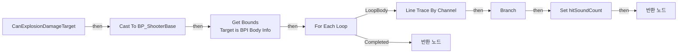

전체 노드·기본 입력 목록

| 노드 ID | 제목 | 미연결 기본 입력 / 에셋 입력 |
|---|---|---|
| `K2Node_FunctionEntry_0` | CanExplosionDamageTarget |  |
| `K2Node_FunctionResult_1` | 반환 노드 | canDamage=true |
| `K2Node_MacroInstance_0` | For Each Loop |  |
| `K2Node_CallFunction_1` | Line Trace By Channel | TraceChannel=TraceTypeQuery2; bTraceComplex=false; DrawDebugType=None; bIgnoreSelf=true; TraceColor=(R=1.000000,G=0.000000,B=0.000000,A=1.000000); TraceHitColor=(R=0.000000,G=1.000000,B=0.000000,A=1.000000); DrawTime=0.000000 |
| `K2Node_Knot_0` | 경유 노드 |  |
| `K2Node_Knot_1` | 경유 노드 |  |
| `K2Node_Knot_2` | 경유 노드 |  |
| `K2Node_Knot_3` | 경유 노드 |  |
| `K2Node_Knot_4` | 경유 노드 |  |
| `K2Node_IfThenElse_0` | Branch |  |
| `K2Node_CallFunction_2` | Break Hit Result | bBlockingHit=false; bInitialOverlap=false; Time=0.0; Distance=0.0; Location=0, 0, 0; ImpactPoint=0, 0, 0; Normal=0, 0, 0; ImpactNormal=0, 0, 0; HitBoneName=None; BoneName=None; HitItem=0; ElementIndex=0; FaceIndex=0; TraceStart=0, 0, 0; TraceEnd=0, 0, 0 |
| `K2Node_PromotableOperator_0` | Equal (Object) |  |
| `K2Node_Knot_5` | 경유 노드 |  |
| `K2Node_Knot_6` | 경유 노드 |  |
| `K2Node_Knot_7` | 경유 노드 |  |
| `K2Node_FunctionResult_2` | 반환 노드 | canDamage=false |
| `K2Node_DynamicCast_0` | Cast To BP_ShooterBase |  |
| `K2Node_Message_1` | Get Bounds Target is BPI Body Info |  |
| `K2Node_VariableSet_0` | Set hitSoundCount | Output_Get=0 |
| `K2Node_VariableGet_0` | Get hitSoundCount |  |
| `K2Node_PromotableOperator_1` | int + int | B=1 |
| `K2Node_CommutativeAssociativeBinaryOperator_0` | AND Boolean |  |

### EventGraph

실행 핀 플로우차트

```mermaid
flowchart LR
  n0["On Component Hit (Collision Component)"]
  n1["Branch"]
  n2["Destroy Actor<br/>타깃은 액터"]
  n3["Branch"]
  n4["Set exploded"]
  n5["Explode<br/>타깃은 BP Rocket Launcher Projectile"]
  n6["Destroy Actor<br/>타깃은 액터"]
  n7["Is Valid"]
  n8["Spawn Hit Sound<br/>타깃은 BP Projectile Base"]
  n9["시퀀스"]
  n10["Cast To Character"]
  n11["Is Valid"]
  n12["Destroy Actor<br/>타깃은 액터"]
  n13["Is Valid"]
  n14["Clear"]
  n15["Take Damage<br/>타깃은 BP Weapon Base"]
  n16["경유 노드"]
  n17["Cast To Character"]
  n18["Set impactNormalEffect"]
  n19["Set impactNormalEffect"]
  n20["Is Valid"]
  n21["Set hitSoundCount"]
  n22["BeginPlay 이벤트"]
  n23["Play<br/>타깃은 오디오 컴포넌트"]
  n24["End Play 이벤트"]
  n25["부모: End Play"]
  n26["Stop<br/>타깃은 오디오 컴포넌트"]
  n27["Deactivate<br/>타깃은 액터 컴포넌트"]
  n28["[ M]Spawn Destroy Effect<br/>타깃은 BP Weapon Base<br/>RELIABLE 모두에 리플리케이트됨 (서버인 경우)"]
  n29["경유 노드"]
  n30["Set Projectile Mesh<br/>타깃은 BP Projectile Base"]
  n0 -->|"then"| n16
  n1 -->|"then"| n9
  n1 -->|"else"| n2
  n3 -->|"then"| n12
  n3 -->|"else"| n4
  n4 -->|"then"| n7
  n5 -->|"then"| n17
  n7 -->|"Is Valid"| n11
  n7 -->|"Is Not Valid"| n5
  n9 -->|"then_0"| n20
  n9 -->|"then_1"| n29
  n10 -->|"then"| n8
  n11 -->|"Is Valid"| n15
  n13 -->|"Is Valid"| n28
  n13 -->|"Is Not Valid"| n6
  n14 -->|"then"| n10
  n15 -->|"then"| n5
  n16 -->|"OutputPin"| n1
  n17 -->|"then"| n19
  n17 -->|"CastFailed"| n18
  n18 -->|"then"| n13
  n19 -->|"then"| n13
  n20 -->|"Is Valid"| n21
  n21 -->|"then"| n14
  n22 -->|"then"| n30
  n24 -->|"then"| n25
  n25 -->|"then"| n26
  n26 -->|"then"| n27
  n28 -->|"then"| n6
  n29 -->|"OutputPin"| n3
  n30 -->|"then"| n23
```

전체 노드·기본 입력 목록

| 노드 ID | 제목 | 미연결 기본 입력 / 에셋 입력 |
|---|---|---|
| `K2Node_ComponentBoundEvent_1` | On Component Hit (Collision Component) | NormalImpulse=0, 0, 0 |
| `K2Node_IfThenElse_0` | Branch |  |
| `K2Node_VariableGet_8` | Get canDealDamage |  |
| `K2Node_CallFunction_16` | Destroy Actor 타깃은 액터 |  |
| `K2Node_IfThenElse_3` | Branch |  |
| `K2Node_VariableGet_5` | Get exploded |  |
| `K2Node_VariableSet_0` | Set exploded | exploded=true; Output_Get=false |
| `K2Node_CallFunction_17` | Explode 타깃은 BP Rocket Launcher Projectile |  |
| `K2Node_CallFunction_18` | Break Hit Result | bBlockingHit=false; bInitialOverlap=false; Time=0.0; Distance=0.0; Location=0, 0, 0; Normal=0, 0, 0; HitBoneName=None; BoneName=None; HitItem=0; ElementIndex=0; FaceIndex=0; TraceStart=0, 0, 0; TraceEnd=0, 0, 0 |
| `K2Node_Knot_7` | 경유 노드 |  |
| `K2Node_CallFunction_5` | Destroy Actor 타깃은 액터 |  |
| `K2Node_MacroInstance_1` | Is Valid |  |
| `K2Node_VariableGet_3` | Get |  |
| `K2Node_VariableGet_11` | Get damage |  |
| `K2Node_MakeArray_0` | 배열 만들기 |  |
| `K2Node_Knot_8` | 경유 노드 |  |
| `K2Node_Knot_23` | 경유 노드 |  |
| `K2Node_Knot_9` | 경유 노드 |  |
| `K2Node_Knot_10` | 경유 노드 |  |
| `K2Node_Knot_25` | 경유 노드 |  |
| `K2Node_CallFunction_6` | Spawn Hit Sound 타깃은 BP Projectile Base | hitSoundCount=1 |
| `K2Node_ExecutionSequence_0` | 시퀀스 |  |
| `K2Node_DynamicCast_0` | Cast To Character |  |
| `K2Node_Knot_11` | 경유 노드 |  |
| `K2Node_Knot_5` | 경유 노드 |  |
| `K2Node_MacroInstance_2` | Is Valid |  |
| `K2Node_CallFunction_23` | Destroy Actor 타깃은 액터 |  |
| `K2Node_Knot_0` | 경유 노드 |  |
| `K2Node_MacroInstance_0` | Is Valid |  |
| `K2Node_Knot_1` | 경유 노드 |  |
| `K2Node_Knot_2` | 경유 노드 |  |
| `K2Node_VariableGet_0` | Get |  |
| `K2Node_VariableGet_2` | Get hitInfo |  |
| `K2Node_CallArrayFunction_0` | Clear |  |
| `K2Node_CallFunction_1` | Take Damage 타깃은 BP Weapon Base |  |
| `K2Node_Knot_6` | 경유 노드 |  |
| `K2Node_Knot_16` | 경유 노드 |  |
| `K2Node_Knot_3` | 경유 노드 |  |
| `K2Node_Knot_4` | 경유 노드 |  |
| `K2Node_DynamicCast_1` | Cast To Character |  |
| `K2Node_Knot_12` | 경유 노드 |  |
| `K2Node_Knot_13` | 경유 노드 |  |
| `K2Node_VariableSet_2` | Set impactNormalEffect | Output_Get=0, 0, 0 |
| `K2Node_VariableSet_1` | Set impactNormalEffect | impactNormalEffect=0, 0, 0; Output_Get=0, 0, 0 |
| `K2Node_VariableGet_4` | Get impactNormalEffect |  |
| `K2Node_Knot_14` | 경유 노드 |  |
| `K2Node_Knot_15` | 경유 노드 |  |
| `K2Node_MacroInstance_3` | Is Valid |  |
| `K2Node_VariableSet_3` | Set hitSoundCount | hitSoundCount=0; Output_Get=0 |
| `K2Node_Event_0` | BeginPlay 이벤트 |  |
| `K2Node_VariableGet_6` | Get FlightSound |  |
| `K2Node_CallFunction_0` | Play 타깃은 오디오 컴포넌트 | StartTime=0.000000 |
| `K2Node_Event_1` | End Play 이벤트 | EndPlayReason=Destroyed |
| `K2Node_CallParentFunction_1` | 부모: End Play | EndPlayReason=Destroyed |
| `K2Node_VariableGet_7` | Get FlightSound |  |
| `K2Node_CallFunction_2` | Stop 타깃은 오디오 컴포넌트 |  |
| `K2Node_Knot_17` | 경유 노드 |  |
| `K2Node_CallFunction_3` | Deactivate 타깃은 액터 컴포넌트 |  |
| `K2Node_Knot_18` | 경유 노드 |  |
| `K2Node_CallFunction_7` | [ M]Spawn Destroy Effect 타깃은 BP Weapon Base RELIABLE 모두에 리플리케이트됨 (서버인 경우) |  |
| `K2Node_Knot_19` | 경유 노드 |  |
| `K2Node_CallFunction_4` | Set Projectile Mesh 타깃은 BP Projectile Base |  |
| `K2Node_VariableGet_1` | Get SkeletalMesh |  |

### Explode

실행 핀 플로우차트

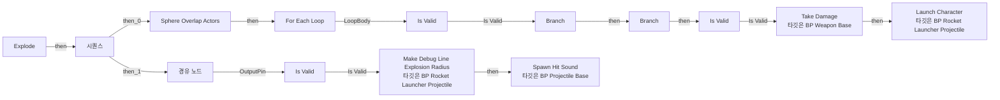

전체 노드·기본 입력 목록

| 노드 ID | 제목 | 미연결 기본 입력 / 에셋 입력 |
|---|---|---|
| `K2Node_FunctionEntry_0` | Explode |  |
| `K2Node_VariableGet_0` | Get |  |
| `K2Node_VariableGet_1` | Get explosionRadius |  |
| `K2Node_CallFunction_0` | Sphere Overlap Actors | ReturnValue=false |
| `K2Node_VariableGet_3` | Get objectTypes |  |
| `K2Node_MacroInstance_0` | For Each Loop |  |
| `K2Node_CallFunction_3` | Launch Character 타깃은 BP Rocket Launcher Projectile |  |
| `K2Node_Knot_0` | 경유 노드 |  |
| `K2Node_Knot_1` | 경유 노드 |  |
| `K2Node_MacroInstance_1` | Is Valid |  |
| `K2Node_Knot_4` | 경유 노드 |  |
| `K2Node_PromotableOperator_4` | float &gt; float |  |
| `K2Node_IfThenElse_1` | Branch |  |
| `K2Node_VariableGet_6` | Get |  |
| `K2Node_MakeArray_0` | 배열 만들기 |  |
| `K2Node_CallFunction_10` | Make Final Explosion Damage |  |
| `K2Node_Knot_5` | 경유 노드 |  |
| `K2Node_Knot_6` | 경유 노드 |  |
| `K2Node_Knot_7` | 경유 노드 |  |
| `K2Node_Knot_8` | 경유 노드 |  |
| `K2Node_Knot_9` | 경유 노드 |  |
| `K2Node_Knot_10` | 경유 노드 |  |
| `K2Node_Knot_11` | 경유 노드 |  |
| `K2Node_Knot_12` | 경유 노드 |  |
| `K2Node_Knot_13` | 경유 노드 |  |
| `K2Node_Knot_14` | 경유 노드 |  |
| `K2Node_Knot_15` | 경유 노드 |  |
| `K2Node_CallFunction_2` | Make Debug Line Explosion Radius 타깃은 BP Rocket Launcher Projectile |  |
| `K2Node_ExecutionSequence_0` | 시퀀스 |  |
| `K2Node_Knot_2` | 경유 노드 |  |
| `K2Node_MacroInstance_2` | Is Valid |  |
| `K2Node_CallFunction_1` | Take Damage 타깃은 BP Weapon Base |  |
| `K2Node_IfThenElse_0` | Branch |  |
| `K2Node_CallFunction_4` | Can Explosion Damage Target |  |
| `K2Node_CallFunction_6` | Set Trace Start | offset=10.000000 |
| `K2Node_Knot_17` | 경유 노드 |  |
| `K2Node_CallFunction_5` | Spawn Hit Sound 타깃은 BP Projectile Base |  |
| `K2Node_VariableGet_2` | Get hitSoundCount |  |
| `K2Node_VariableGet_4` | Get |  |
| `K2Node_MacroInstance_3` | Is Valid |  |
| `K2Node_Knot_3` | 경유 노드 |  |

### GetMoveLockTime

실행 핀 플로우차트

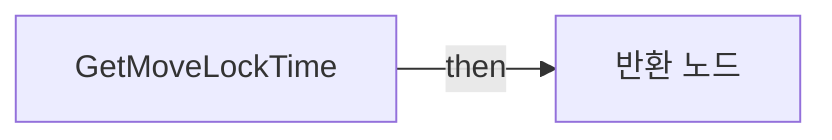

전체 노드·기본 입력 목록

| 노드 ID | 제목 | 미연결 기본 입력 / 에셋 입력 |
|---|---|---|
| `K2Node_FunctionEntry_0` | GetMoveLockTime |  |
| `K2Node_FunctionResult_0` | 반환 노드 |  |
| `K2Node_VariableGet_0` | Get |  |
| `K2Node_VariableGet_1` | Get lockTimeMultiplier |  |
| `K2Node_VariableGet_2` | Get explosionDamage |  |
| `K2Node_PromotableOperator_1` | float * float |  |
| `K2Node_PromotableOperator_0` | float * float | B=0.001000 |

### LaunchCharacter

실행 핀 플로우차트

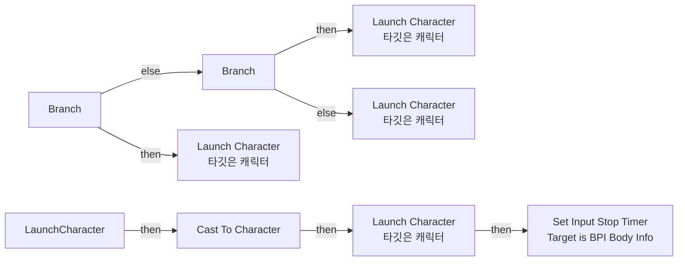

전체 노드·기본 입력 목록

| 노드 ID | 제목 | 미연결 기본 입력 / 에셋 입력 |
|---|---|---|
| `K2Node_FunctionEntry_0` | LaunchCharacter |  |
| `K2Node_DynamicCast_0` | Cast To Character |  |
| `K2Node_CallFunction_26` | Mack Launch Velocity |  |
| `K2Node_Knot_4` | 경유 노드 |  |
| `K2Node_CallFunction_6` | Launch Character 타깃은 캐릭터 | bXYOverride=true; bZOverride=true |
| `K2Node_Knot_5` | 경유 노드 |  |
| `K2Node_Knot_6` | 경유 노드 |  |
| `K2Node_Knot_0` | 경유 노드 |  |
| `K2Node_PromotableOperator_1` | Not Equal (Object) |  |
| `K2Node_CallFunction_1` | Get Instigator 타깃은 액터 |  |
| `K2Node_CallFunction_0` | Get Velocity 타깃은 액터 |  |
| `K2Node_CallFunction_3` | Vector Length XY Squared |  |
| `K2Node_PromotableOperator_0` | float &gt; float | B=10.000000 |
| `K2Node_IfThenElse_1` | Branch |  |
| `K2Node_CallFunction_5` | Launch Character 타깃은 캐릭터 | bXYOverride=false; bZOverride=true |
| `K2Node_IfThenElse_2` | Branch |  |
| `K2Node_CallFunction_29` | Launch Character 타깃은 캐릭터 | LaunchVelocity_X=0.0; LaunchVelocity_Y=0.0; bXYOverride=true; bZOverride=true |
| `K2Node_Knot_2` | 경유 노드 |  |
| `K2Node_Knot_3` | 경유 노드 |  |
| `K2Node_Knot_7` | 경유 노드 |  |
| `K2Node_Knot_8` | 경유 노드 |  |
| `K2Node_CallFunction_7` | Break Vector | X=0.0; Y=0.0 |
| `EdGraphNode_Comment_0` | 요청사항: 가만히 있으면 (Velocity &lt; 10 미만으로 판정) Z 값 크기만 적용 |  |
| `K2Node_CallFunction_4` | Launch Character 타깃은 캐릭터 | bXYOverride=false; bZOverride=false |
| `K2Node_Message_1` | Set Input Stop Timer Target is BPI Body Info |  |
| `K2Node_CallFunction_8` | Get Move Lock Time |  |

### MackLaunchVelocity

실행 핀 플로우차트

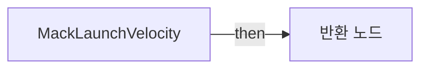

전체 노드·기본 입력 목록

| 노드 ID | 제목 | 미연결 기본 입력 / 에셋 입력 |
|---|---|---|
| `K2Node_FunctionEntry_0` | MackLaunchVelocity |  |
| `K2Node_CallFunction_22` | Make Final Knockback |  |
| `K2Node_VariableGet_8` | Get |  |
| `K2Node_PromotableOperator_14` | float * float |  |
| `K2Node_PromotableOperator_13` | vector * vector |  |
| `K2Node_Knot_0` | 경유 노드 |  |
| `K2Node_FunctionResult_1` | 반환 노드 |  |
| `K2Node_Knot_1` | 경유 노드 |  |
| `K2Node_CallFunction_0` | Make Knockback Dir |  |
| `K2Node_VariableGet_0` | Get explosionPhysicsForce |  |

### MakeAlpha

실행 핀 플로우차트

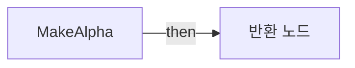

전체 노드·기본 입력 목록

| 노드 ID | 제목 | 미연결 기본 입력 / 에셋 입력 |
|---|---|---|
| `K2Node_FunctionEntry_0` | MakeAlpha |  |
| `K2Node_VariableGet_1` | Get explosionRadius |  |
| `K2Node_PromotableOperator_1` | float / float |  |
| `K2Node_PromotableOperator_2` | float - float | A=1.000000 |
| `K2Node_CallFunction_4` | Clamp (Float) | Min=0.0; Max=1.0 |
| `K2Node_FunctionResult_1` | 반환 노드 |  |
| `K2Node_VariableGet_0` | Get |  |

### MakeCapsuleSurfaceDistance

실행 핀 플로우차트

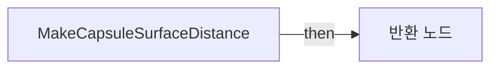

전체 노드·기본 입력 목록

| 노드 ID | 제목 | 미연결 기본 입력 / 에셋 입력 |
|---|---|---|
| `K2Node_FunctionEntry_0` | MakeCapsuleSurfaceDistance |  |
| `K2Node_FunctionResult_0` | 반환 노드 |  |
| `K2Node_VariableGet_0` | Get CapsuleComponent |  |
| `K2Node_CallFunction_1` | Get World Location 타깃은 씬 컴포넌트 |  |
| `K2Node_CallFunction_2` | Get Up Vector 타깃은 씬 컴포넌트 |  |
| `K2Node_CallFunction_3` | Get Scaled Capsule Half Height 타깃은 캡슐 콜리전 |  |
| `K2Node_CallFunction_4` | Get Scaled Capsule Radius 타깃은 캡슐 콜리전 |  |
| `K2Node_PromotableOperator_0` | float - float |  |
| `K2Node_PromotableOperator_2` | vector * vector |  |
| `K2Node_PromotableOperator_3` | vector + vector |  |
| `K2Node_PromotableOperator_4` | vector - vector |  |
| `K2Node_CallFunction_5` | Find Closest Point on Segment |  |
| `K2Node_Knot_0` | 경유 노드 |  |
| `K2Node_Knot_1` | 경유 노드 |  |
| `K2Node_Knot_2` | 경유 노드 |  |
| `K2Node_Knot_3` | 경유 노드 |  |
| `K2Node_Knot_4` | 경유 노드 |  |
| `K2Node_Knot_5` | 경유 노드 |  |
| `K2Node_Knot_6` | 경유 노드 |  |
| `K2Node_Knot_7` | 경유 노드 |  |
| `K2Node_Knot_8` | 경유 노드 |  |
| `K2Node_Knot_9` | 경유 노드 |  |
| `K2Node_Knot_10` | 경유 노드 |  |
| `K2Node_CallFunction_6` | Distance (Vector) |  |
| `K2Node_Knot_11` | 경유 노드 |  |
| `K2Node_Knot_12` | 경유 노드 |  |
| `K2Node_PromotableOperator_5` | float - float |  |
| `K2Node_Knot_13` | 경유 노드 |  |
| `K2Node_Knot_14` | 경유 노드 |  |
| `K2Node_CommutativeAssociativeBinaryOperator_0` | Max (Float) | B=0.0 |
| `K2Node_Knot_15` | 경유 노드 |  |

### MakeDebugLineExplosionRadius

실행 핀 플로우차트

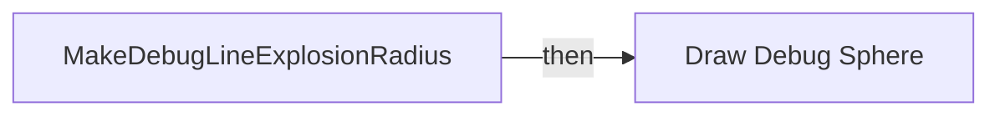

전체 노드·기본 입력 목록

| 노드 ID | 제목 | 미연결 기본 입력 / 에셋 입력 |
|---|---|---|
| `K2Node_FunctionEntry_0` | MakeDebugLineExplosionRadius |  |
| `K2Node_CallFunction_0` | Draw Debug Sphere | Segments=36; LineColor=(R=0.000000,G=0.000000,B=0.000000,A=1.000000); Duration=0.500000; Thickness=0.000000 |
| `K2Node_VariableGet_0` | Get |  |
| `K2Node_VariableGet_1` | Get explosionRadius |  |

### MakeDistance

실행 핀 플로우차트

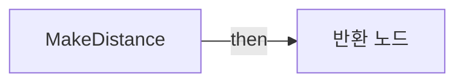

전체 노드·기본 입력 목록

| 노드 ID | 제목 | 미연결 기본 입력 / 에셋 입력 |
|---|---|---|
| `K2Node_FunctionEntry_0` | MakeDistance |  |
| `K2Node_CallFunction_0` | Get Actor Location 타깃은 액터 |  |
| `K2Node_PromotableOperator_0` | vector - vector |  |
| `K2Node_Knot_0` | 경유 노드 |  |
| `K2Node_CallFunction_1` | Vector Length |  |
| `K2Node_FunctionResult_1` | 반환 노드 |  |
| `K2Node_Knot_1` | 경유 노드 |  |

### MakeFinalExplosionDamage

실행 핀 플로우차트

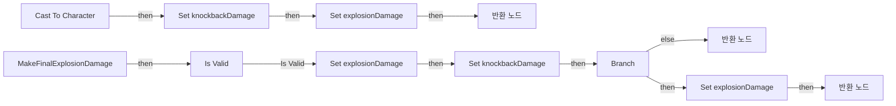

전체 노드·기본 입력 목록

| 노드 ID | 제목 | 미연결 기본 입력 / 에셋 입력 |
|---|---|---|
| `K2Node_FunctionEntry_0` | MakeFinalExplosionDamage |  |
| `K2Node_FunctionResult_0` | 반환 노드 |  |
| `K2Node_CallFunction_6` | Make Distance | delta=0, 0, 0 |
| `K2Node_CallFunction_7` | Make Alpha |  |
| `K2Node_VariableGet_4` | Get |  |
| `K2Node_VariableGet_5` | Get explosionDamage |  |
| `K2Node_PromotableOperator_1` | float * float |  |
| `K2Node_MacroInstance_0` | Is Valid |  |
| `K2Node_PromotableOperator_2` | Equal (Object) |  |
| `K2Node_CallFunction_1` | Get Instigator 타깃은 액터 |  |
| `K2Node_IfThenElse_0` | Branch |  |
| `K2Node_Knot_4` | 경유 노드 |  |
| `K2Node_Knot_5` | 경유 노드 |  |
| `K2Node_VariableGet_2` | Get |  |
| `K2Node_FunctionResult_1` | 반환 노드 |  |
| `K2Node_Knot_6` | 경유 노드 |  |
| `K2Node_VariableSet_1` | Set explosionDamage |  |
| `K2Node_Knot_7` | 경유 노드 |  |
| `K2Node_VariableSet_2` | Set explosionDamage |  |
| `K2Node_CallFunction_0` | Make Capsule Surface Distance | explosionLocation=0, 0, 0 |
| `K2Node_DynamicCast_0` | Cast To Character |  |
| `K2Node_CallFunction_2` | Make Alpha |  |
| `K2Node_PromotableOperator_0` | float * float |  |
| `K2Node_VariableGet_0` | Get selfDamageMultiplier |  |
| `K2Node_VariableGet_1` | Get explosionDamage |  |
| `K2Node_PromotableOperator_3` | float * float |  |
| `K2Node_Knot_0` | 경유 노드 |  |
| `K2Node_VariableSet_0` | Set knockbackDamage |  |
| `K2Node_VariableSet_3` | Set knockbackDamage |  |
| `K2Node_Knot_1` | 경유 노드 |  |
| `K2Node_Knot_2` | 경유 노드 |  |
| `K2Node_Knot_8` | 경유 노드 |  |
| `K2Node_Knot_9` | 경유 노드 |  |
| `K2Node_VariableGet_3` | Get selfDamageMultiplier |  |
| `K2Node_PromotableOperator_4` | float * float |  |
| `K2Node_VariableGet_6` | Get explosionDamage |  |
| `K2Node_VariableSet_4` | Set explosionDamage |  |
| `K2Node_FunctionResult_2` | 반환 노드 |  |

### MakeFinalKnockback

실행 핀 플로우차트

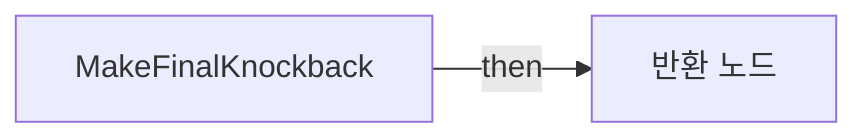

전체 노드·기본 입력 목록

| 노드 ID | 제목 | 미연결 기본 입력 / 에셋 입력 |
|---|---|---|
| `K2Node_FunctionEntry_0` | MakeFinalKnockback |  |
| `K2Node_PromotableOperator_10` | float * float | A=5.000000 |
| `K2Node_CallFunction_21` | Select Knockback Multiplier |  |
| `K2Node_PromotableOperator_11` | float * float |  |
| `K2Node_FunctionResult_1` | 반환 노드 |  |
| `K2Node_VariableGet_0` | Get knockbackDamage |  |

### MakeHorizontalDir

실행 핀 플로우차트

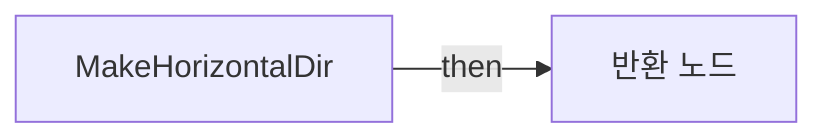

전체 노드·기본 입력 목록

| 노드 ID | 제목 | 미연결 기본 입력 / 에셋 입력 |
|---|---|---|
| `K2Node_FunctionEntry_0` | MakeHorizontalDir |  |
| `K2Node_CallFunction_6` | Break Vector | Z=0.0 |
| `K2Node_CallFunction_7` | Make Vector | Z=0.0 |
| `K2Node_CallFunction_9` | Normalize | Tolerance=0.000100 |
| `K2Node_FunctionResult_1` | 반환 노드 |  |

### MakeKnockbackDir

실행 핀 플로우차트

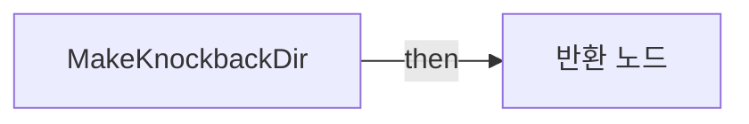

전체 노드·기본 입력 목록

| 노드 ID | 제목 | 미연결 기본 입력 / 에셋 입력 |
|---|---|---|
| `K2Node_FunctionEntry_0` | MakeKnockbackDir |  |
| `K2Node_FunctionResult_0` | 반환 노드 |  |
| `K2Node_CallFunction_0` | Get Actor Location 타깃은 액터 |  |
| `K2Node_CallFunction_2` | Get Instigator 타깃은 액터 |  |
| `K2Node_PromotableOperator_0` | Equal (Object) |  |
| `K2Node_Knot_0` | 경유 노드 |  |
| `K2Node_CallFunction_3` | Select Float | B=0.0 |
| `K2Node_VariableGet_0` | Get |  |
| `K2Node_VariableGet_1` | Get rocketJumpZOffset |  |
| `K2Node_CallFunction_4` | Make Vector | X=0.0; Y=0.0 |
| `K2Node_PromotableOperator_1` | vector + vector |  |
| `K2Node_PromotableOperator_2` | vector - vector |  |
| `K2Node_Knot_1` | 경유 노드 |  |
| `K2Node_Knot_2` | 경유 노드 |  |
| `K2Node_Knot_3` | 경유 노드 |  |
| `K2Node_Knot_4` | 경유 노드 |  |
| `K2Node_CallFunction_5` | Normalize | Tolerance=0.000100 |
| `K2Node_Knot_5` | 경유 노드 |  |

### SelectDamageMultiplier

실행 핀 플로우차트

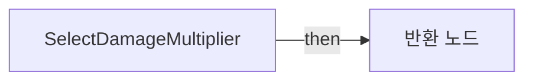

전체 노드·기본 입력 목록

| 노드 ID | 제목 | 미연결 기본 입력 / 에셋 입력 |
|---|---|---|
| `K2Node_FunctionEntry_0` | SelectDamageMultiplier |  |
| `K2Node_PromotableOperator_2` | Equal (Object) |  |
| `K2Node_CallFunction_0` | Select Float | A=1.000000 |
| `K2Node_FunctionResult_1` | 반환 노드 |  |
| `K2Node_Knot_0` | 경유 노드 |  |
| `K2Node_VariableGet_0` | Get |  |
| `K2Node_VariableGet_1` | Get selfDamageMultiplier |  |
| `K2Node_CallFunction_1` | Get Instigator 타깃은 액터 |  |

### SelectKnockbackMultiplier

실행 핀 플로우차트

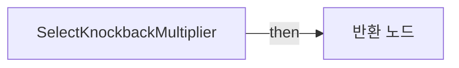

전체 노드·기본 입력 목록

| 노드 ID | 제목 | 미연결 기본 입력 / 에셋 입력 |
|---|---|---|
| `K2Node_FunctionEntry_0` | SelectKnockbackMultiplier |  |
| `K2Node_VariableGet_2` | Get selfKnockbackMultiplier |  |
| `K2Node_VariableGet_3` | Get otherKnockbackMultiplier |  |
| `K2Node_PromotableOperator_3` | Equal (Object) |  |
| `K2Node_CallFunction_11` | Select Float |  |
| `K2Node_FunctionResult_1` | 반환 노드 |  |
| `K2Node_Knot_0` | 경유 노드 |  |
| `K2Node_VariableGet_0` | Get |  |
| `K2Node_VariableGet_1` | Get Instigator |  |

### SetTraceStart

실행 핀 플로우차트

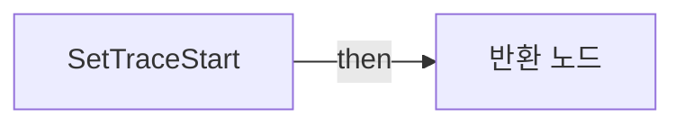

전체 노드·기본 입력 목록

| 노드 ID | 제목 | 미연결 기본 입력 / 에셋 입력 |
|---|---|---|
| `K2Node_FunctionEntry_0` | SetTraceStart |  |
| `K2Node_PromotableOperator_0` | vector + vector |  |
| `K2Node_PromotableOperator_1` | vector * vector |  |
| `K2Node_FunctionResult_1` | 반환 노드 |  |

### SpawnEffectAndSound

실행 핀 플로우차트

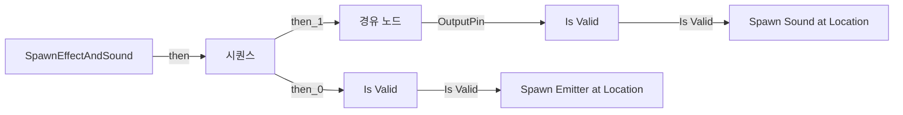

전체 노드·기본 입력 목록

| 노드 ID | 제목 | 미연결 기본 입력 / 에셋 입력 |
|---|---|---|
| `K2Node_FunctionEntry_0` | SpawnEffectAndSound |  |
| `K2Node_ExecutionSequence_0` | 시퀀스 |  |
| `K2Node_MacroInstance_6` | Is Valid |  |
| `K2Node_MacroInstance_2` | Is Valid |  |
| `K2Node_CallFunction_20` | Spawn Sound at Location | Rotation=0, 0, 0; VolumeMultiplier=1.000000; PitchMultiplier=1.000000; StartTime=0.000000; bAutoDestroy=true |
| `K2Node_Knot_7` | 경유 노드 |  |
| `K2Node_Knot_33` | 경유 노드 |  |
| `K2Node_Knot_12` | 경유 노드 |  |
| `K2Node_Knot_13` | 경유 노드 |  |
| `K2Node_Knot_14` | 경유 노드 |  |
| `K2Node_Knot_15` | 경유 노드 |  |
| `K2Node_Knot_18` | 경유 노드 |  |
| `K2Node_Knot_34` | 경유 노드 |  |
| `K2Node_Knot_35` | 경유 노드 |  |
| `K2Node_Knot_36` | 경유 노드 |  |
| `K2Node_Knot_6` | 경유 노드 |  |
| `K2Node_VariableGet_33` | Get projectileSound |  |
| `K2Node_VariableGet_34` | Get projectileDestroyEffect |  |
| `K2Node_CallFunction_38` | Spawn Emitter at Location | Rotation=0, 0, 0; Scale=1.000000,1.000000,1.000000; bAutoDestroy=true; PoolingMethod=None; bAutoActivateSystem=true |
| `K2Node_VariableGet_4` | Get |  |
| `K2Node_Knot_0` | 경유 노드 |  |

### UserConstructionScript

실행 핀 플로우차트

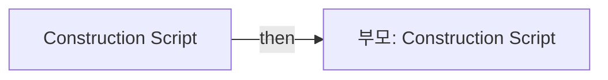

전체 노드·기본 입력 목록

| 노드 ID | 제목 | 미연결 기본 입력 / 에셋 입력 |
|---|---|---|
| `K2Node_FunctionEntry_0` | Construction Script |  |
| `K2Node_CallParentFunction_0` | 부모: Construction Script |  |

## 조회 범위의 한계

ObjectIterator로 발견했으나 MCP helper가 반환하지 않은 그래프입니다. delegate signature·컴파일된 중간 그래프·macro·애니메이션 내부 그래프가 섞일 수 있습니다.

- `BndEvt__BP_RocketLauncherProjectile_Collision Component_K2Node_ComponentBoundEvent_1_ComponentHitSignature__DelegateSignature`: Graph 'BndEvt__BP_RocketLauncherProjectile_Collision Component_K2Node_ComponentBoundEvent_1_ComponentHitSignature__DelegateSignature' not found in Blueprint.
- `ReceiveBeginPlay`: Graph 'ReceiveBeginPlay' not found in Blueprint.
- `ReceiveEndPlay`: Graph 'ReceiveEndPlay' not found in Blueprint.

[원본 MCP 스냅샷](../../../../Evidence/blueprints-140.json)
