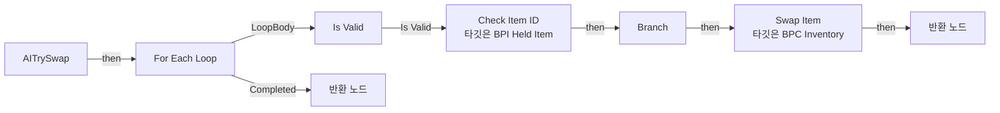
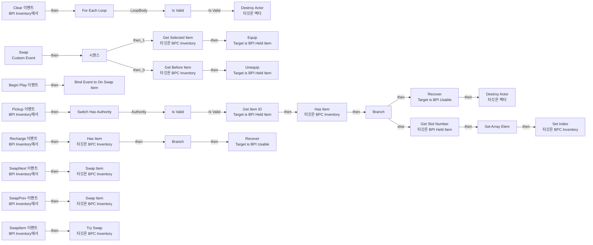
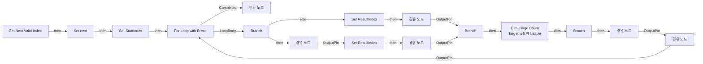
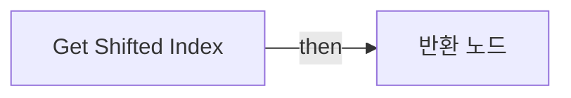
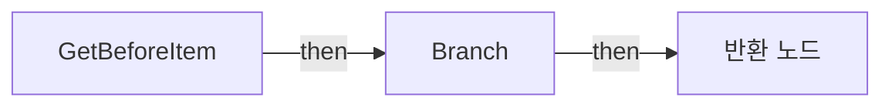
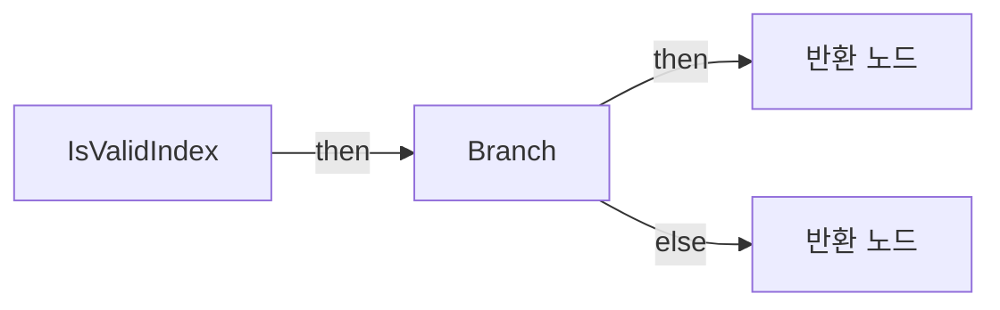
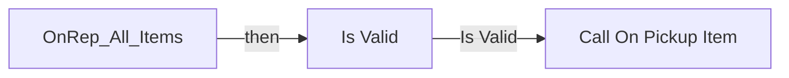
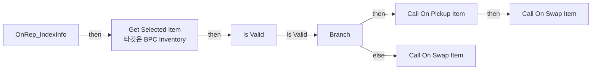
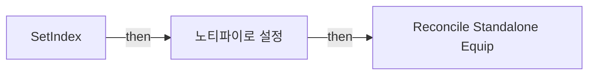
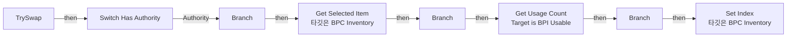

# BPC_Inventory

에셋: `/Game/QuakeLike_1_0/Inventory/BPC_Inventory`

부모: `/Script/CoreUObject.Class'/Script/Engine.ActorComponent'`

수집일: 2026-10-12. MCP에서 읽은 그래프·핀 연결의 자동 전사입니다. 상속된 그래프는 부모 문서를 함께 확인합니다.

정적 루트 참조 도달: 있음. 실행 여부 또는 삭제 가능 여부의 확정이 아닙니다.

컴포넌트 목록은 이 BP가 직접 정의한 SCS만 포함합니다. 부모·네이티브 생성 컴포넌트, 인스턴스 설정은 별도입니다.

## 변수와 기본값

| 이름 | 타입 | CDO 기본값 |
|---|---|---|
| `All_Items` | `BP_HeldItem_C` | [] |
| `OnPickupItem` | `mcdelegate` | &lt;Delegate 'DelegateBase' &lt;Unbound&gt;&gt; |
| `OnSwapItem` | `mcdelegate` | &lt;Delegate 'DelegateBase' &lt;Unbound&gt;&gt; |
| `IndexInfo` | `ST_InventoryInfo` | &lt;Struct 'ST_InventoryInfo' {}&gt; |

## 그래프 목록

| 그래프 | 전체 노드 수 |
|---|---|
| AITrySwap | 12 |
| EventGraph | 52 |
| Get Next Valid Index | 42 |
| Get Shifted Index | 8 |
| GetBeforeItem | 10 |
| IsValidIndex | 12 |
| OnRep_All_Items | 6 |
| OnRep_IndexInfo | 11 |
| SetIndex | 7 |
| TrySwap | 17 |

## 그래프별 실행 연결

실선은 출력 exec 핀의 실제 연결입니다. 여러 분기는 출력 핀 이름을 표시합니다. 함수 호출·delegate·타이머의 다음 그래프 실행은 이 그림에서 자동으로 이어 붙이지 않습니다.

순수 계산 노드 및 데이터 핀은 아래 목록과 원본 JSON을 확인합니다. 연결되지 않은 이벤트도 표시되므로, 노드가 있다는 이유만으로 실행된다고 판단하면 안 됩니다.

### AITrySwap

실행 핀 플로우차트

전체 노드·기본 입력 목록

| 노드 ID | 제목 | 미연결 기본 입력 / 에셋 입력 |
|---|---|---|
| `K2Node_FunctionEntry_1` | AITrySwap |  |
| `K2Node_MacroInstance_1` | For Each Loop |  |
| `K2Node_VariableGet_0` | Get All_Items |  |
| `K2Node_MacroInstance_2` | Is Valid |  |
| `K2Node_Knot_0` | 경유 노드 |  |
| `K2Node_CallFunction_2` | Check Item ID 타깃은 BPI Held Item |  |
| `K2Node_Knot_1` | 경유 노드 |  |
| `K2Node_Knot_2` | 경유 노드 |  |
| `K2Node_IfThenElse_2` | Branch |  |
| `K2Node_CallFunction_3` | Swap Item 타깃은 BPC Inventory |  |
| `K2Node_FunctionResult_1` | 반환 노드 | Success=true |
| `K2Node_FunctionResult_0` | 반환 노드 | Success=false |

### EventGraph

실행 핀 플로우차트

전체 노드·기본 입력 목록

| 노드 ID | 제목 | 미연결 기본 입력 / 에셋 입력 |
|---|---|---|
| `K2Node_IfThenElse_2` | Branch |  |
| `K2Node_Event_9` | Pickup 이벤트 BPI Inventory에서 |  |
| `K2Node_Event_6` | SwapItem 이벤트 BPI Inventory에서 |  |
| `K2Node_Knot_46` | 경유 노드 |  |
| `K2Node_Knot_47` | 경유 노드 |  |
| `K2Node_MacroInstance_2` | Is Valid |  |
| `EdGraphNode_Comment_0` | RPC설정 문제로 동기화가 잘 안되어있을 수 있음. |  |
| `K2Node_Event_0` | Recharge 이벤트 BPI Inventory에서 |  |
| `K2Node_CallFunction_3` | Has Item 타깃은 BPC Inventory |  |
| `K2Node_CallFunction_28` | Has Item 타깃은 BPC Inventory |  |
| `K2Node_Knot_0` | 경유 노드 |  |
| `K2Node_IfThenElse_3` | Branch |  |
| `K2Node_Knot_7` | 경유 노드 |  |
| `K2Node_Knot_8` | 경유 노드 |  |
| `K2Node_Knot_10` | 경유 노드 |  |
| `K2Node_Knot_3` | 경유 노드 |  |
| `K2Node_Knot_6` | 경유 노드 |  |
| `K2Node_Event_1` | SwapNext 이벤트 BPI Inventory에서 |  |
| `K2Node_Event_2` | SwapPrev 이벤트 BPI Inventory에서 |  |
| `K2Node_Event_3` | Clear 이벤트 BPI Inventory에서 |  |
| `K2Node_MacroInstance_1` | For Each Loop |  |
| `K2Node_VariableGet_3` | Get All_Items |  |
| `K2Node_CallFunction_12` | Destroy Actor 타깃은 액터 |  |
| `K2Node_CallFunction_10` | Set Index 타깃은 BPC Inventory | isPickup=true |
| `K2Node_Event_4` | Begin Play 이벤트 |  |
| `K2Node_AddDelegate_0` | Bind Event to On Swap Item |  |
| `K2Node_CustomEvent_0` | Swap Custom Event |  |
| `K2Node_CallFunction_15` | Get Before Item 타깃은 BPC Inventory |  |
| `K2Node_CallFunction_2` | Get Selected Item 타깃은 BPC Inventory |  |
| `K2Node_ExecutionSequence_0` | 시퀀스 |  |
| `K2Node_MacroInstance_0` | Switch Has Authority |  |
| `K2Node_CallFunction_8` | Swap Item 타깃은 BPC Inventory |  |
| `K2Node_CallFunction_4` | Swap Item 타깃은 BPC Inventory |  |
| `K2Node_CallFunction_16` | Try Swap 타깃은 BPC Inventory |  |
| `K2Node_Message_1` | Equip Target is BPI Held Item |  |
| `K2Node_Message_3` | Unequip Target is BPI Held Item |  |
| `K2Node_Message_7` | Get Item ID Target is BPI Held Item |  |
| `K2Node_Message_8` | Recover Target is BPI Usable |  |
| `K2Node_Message_9` | Recover Target is BPI Usable | recoverCount=30 |
| `K2Node_Knot_4` | 경유 노드 |  |
| `K2Node_CallFunction_1` | Destroy Actor 타깃은 액터 |  |
| `K2Node_Knot_5` | 경유 노드 |  |
| `K2Node_CallArrayFunction_2` | Set Array Elem | bSizeToFit=true |
| `K2Node_CallFunction_7` | Get Next Valid Index | Is Next=true |
| `K2Node_CallFunction_5` | Get Next Valid Index | Is Next=false |
| `K2Node_Knot_1` | 경유 노드 |  |
| `K2Node_MacroInstance_3` | Is Valid |  |
| `K2Node_CallFunction_0` | Get Slot Number 타깃은 BPI Held Item |  |
| `K2Node_VariableGet_1` | Get All_Items |  |
| `K2Node_Knot_2` | 경유 노드 |  |
| `K2Node_Knot_9` | 경유 노드 |  |
| `K2Node_Knot_11` | 경유 노드 |  |

### Get Next Valid Index

실행 핀 플로우차트

전체 노드·기본 입력 목록

| 노드 ID | 제목 | 미연결 기본 입력 / 에셋 입력 |
|---|---|---|
| `K2Node_FunctionEntry_0` | Get Next Valid Index |  |
| `K2Node_VariableGet_0` | Get |  |
| `K2Node_VariableSet_1` | Set StartIndex | Output_Get=0 |
| `K2Node_MacroInstance_2` | For Loop with Break | FirstIndex=1 |
| `K2Node_FunctionResult_1` | 반환 노드 |  |
| `K2Node_VariableGet_3` | Get All_Items |  |
| `K2Node_CallArrayFunction_0` | Length |  |
| `K2Node_VariableGet_17` | Get StartIndex |  |
| `K2Node_VariableSet_5` | Set next | Output_Get=false |
| `K2Node_VariableGet_16` | Get next |  |
| `K2Node_IfThenElse_1` | Branch |  |
| `K2Node_PromotableOperator_5` | int + int |  |
| `K2Node_Knot_5` | 경유 노드 |  |
| `K2Node_VariableGet_12` | Get StartIndex |  |
| `K2Node_Knot_4` | 경유 노드 |  |
| `K2Node_PromotableOperator_6` | int - int |  |
| `K2Node_PromotableOperator_7` | int + int |  |
| `K2Node_VariableGet_19` | Get All_Items |  |
| `K2Node_CallArrayFunction_3` | Length |  |
| `K2Node_Knot_6` | 경유 노드 |  |
| `K2Node_Knot_7` | 경유 노드 |  |
| `K2Node_CallFunction_5` | % (Integer) |  |
| `K2Node_VariableGet_14` | Get All_Items |  |
| `K2Node_CallArrayFunction_1` | Length |  |
| `K2Node_CallFunction_4` | % (Integer) |  |
| `K2Node_VariableSet_6` | Set ResultIndex | Output_Get=0 |
| `K2Node_Knot_8` | 경유 노드 |  |
| `K2Node_VariableSet_7` | Set ResultIndex | Output_Get=0 |
| `K2Node_Knot_9` | 경유 노드 |  |
| `K2Node_CallFunction_7` | Is Valid Index |  |
| `K2Node_VariableGet_20` | Get ResultIndex |  |
| `K2Node_IfThenElse_3` | Branch |  |
| `K2Node_Knot_10` | 경유 노드 |  |
| `K2Node_Knot_11` | 경유 노드 |  |
| `K2Node_Knot_12` | 경유 노드 |  |
| `K2Node_Knot_13` | 경유 노드 |  |
| `K2Node_Knot_14` | 경유 노드 |  |
| `K2Node_VariableGet_21` | Get ResultIndex |  |
| `K2Node_Message_0` | Get Usage Count Target is BPI Usable | maxCount=0 |
| `K2Node_PromotableOperator_1` | integer &gt; integer |  |
| `K2Node_IfThenElse_2` | Branch |  |
| `K2Node_Knot_0` | 경유 노드 |  |

### Get Shifted Index

실행 핀 플로우차트

전체 노드·기본 입력 목록

| 노드 ID | 제목 | 미연결 기본 입력 / 에셋 입력 |
|---|---|---|
| `K2Node_FunctionEntry_0` | Get Shifted Index |  |
| `K2Node_VariableGet_0` | Get All_Items |  |
| `K2Node_CallArrayFunction_1` | Length |  |
| `K2Node_PromotableOperator_1` | int + int |  |
| `K2Node_CallFunction_1` | % (Integer) |  |
| `K2Node_FunctionResult_1` | 반환 노드 |  |
| `K2Node_Knot_0` | 경유 노드 |  |
| `K2Node_VariableGet_1` | Get |  |

### GetBeforeItem

실행 핀 플로우차트

전체 노드·기본 입력 목록

| 노드 ID | 제목 | 미연결 기본 입력 / 에셋 입력 |
|---|---|---|
| `K2Node_FunctionEntry_0` | GetBeforeItem |  |
| `K2Node_FunctionResult_0` | 반환 노드 |  |
| `K2Node_VariableGet_0` | Get |  |
| `K2Node_VariableGet_1` | Get All_Items |  |
| `K2Node_CallArrayFunction_0` | Is Valid Index |  |
| `K2Node_Knot_1` | 경유 노드 |  |
| `K2Node_Knot_2` | 경유 노드 |  |
| `K2Node_GetArrayItem_1` | GET |  |
| `K2Node_Knot_3` | 경유 노드 |  |
| `K2Node_IfThenElse_0` | Branch |  |

### IsValidIndex

실행 핀 플로우차트

전체 노드·기본 입력 목록

| 노드 ID | 제목 | 미연결 기본 입력 / 에셋 입력 |
|---|---|---|
| `K2Node_FunctionEntry_0` | IsValidIndex |  |
| `K2Node_VariableGet_0` | Get All_Items |  |
| `K2Node_CallArrayFunction_0` | Is Valid Index |  |
| `K2Node_Knot_0` | 경유 노드 |  |
| `K2Node_Knot_1` | 경유 노드 |  |
| `K2Node_GetArrayItem_0` | GET |  |
| `K2Node_CallFunction_0` | Is Valid |  |
| `K2Node_FunctionResult_0` | 반환 노드 |  |
| `K2Node_Knot_3` | 경유 노드 |  |
| `K2Node_Knot_4` | 경유 노드 |  |
| `K2Node_IfThenElse_0` | Branch |  |
| `K2Node_FunctionResult_1` | 반환 노드 | valid=false |

### OnRep_All_Items

실행 핀 플로우차트

전체 노드·기본 입력 목록

| 노드 ID | 제목 | 미연결 기본 입력 / 에셋 입력 |
|---|---|---|
| `K2Node_FunctionEntry_0` | OnRep_All_Items |  |
| `K2Node_CallDelegate_1` | Call On Pickup Item |  |
| `K2Node_VariableGet_0` | Get All_Items |  |
| `K2Node_GetArrayItem_0` | GET |  |
| `K2Node_CallArrayFunction_0` | Last Index |  |
| `K2Node_MacroInstance_0` | Is Valid |  |

### OnRep_IndexInfo

실행 핀 플로우차트

전체 노드·기본 입력 목록

| 노드 ID | 제목 | 미연결 기본 입력 / 에셋 입력 |
|---|---|---|
| `K2Node_FunctionEntry_0` | OnRep_IndexInfo |  |
| `K2Node_VariableGet_0` | Get |  |
| `K2Node_IfThenElse_0` | Branch |  |
| `K2Node_Knot_5` | 경유 노드 |  |
| `K2Node_CallDelegate_0` | Call On Pickup Item |  |
| `K2Node_CallDelegate_2` | Call On Swap Item |  |
| `K2Node_CallFunction_0` | Get Selected Item 타깃은 BPC Inventory |  |
| `K2Node_MacroInstance_1` | Is Valid |  |
| `K2Node_Knot_6` | 경유 노드 |  |
| `K2Node_CallDelegate_1` | Call On Swap Item |  |
| `K2Node_Knot_7` | 경유 노드 |  |

### SetIndex

실행 핀 플로우차트

전체 노드·기본 입력 목록

| 노드 ID | 제목 | 미연결 기본 입력 / 에셋 입력 |
|---|---|---|
| `K2Node_FunctionEntry_0` | SetIndex |  |
| `K2Node_VariableGet_1` | Get |  |
| `K2Node_Knot_0` | 경유 노드 |  |
| `K2Node_Knot_1` | 경유 노드 |  |
| `K2Node_VariableSet_0` | 노티파이로 설정 |  |
| `K2Node_Knot_2` | 경유 노드 |  |
| `K2Node_CallFunction_0` | Reconcile Standalone Equip |  |

### TrySwap

실행 핀 플로우차트

전체 노드·기본 입력 목록

| 노드 ID | 제목 | 미연결 기본 입력 / 에셋 입력 |
|---|---|---|
| `K2Node_FunctionEntry_0` | TrySwap |  |
| `K2Node_CallFunction_0` | Is Valid Index |  |
| `K2Node_IfThenElse_0` | Branch |  |
| `K2Node_CallFunction_1` | Get Selected Item 타깃은 BPC Inventory |  |
| `K2Node_PromotableOperator_0` | Not Equal (Object) |  |
| `K2Node_IfThenElse_1` | Branch |  |
| `K2Node_Knot_4` | 경유 노드 |  |
| `K2Node_Knot_5` | 경유 노드 |  |
| `K2Node_CallFunction_4` | Set Index 타깃은 BPC Inventory | isPickup=false |
| `K2Node_Knot_9` | 경유 노드 |  |
| `K2Node_MacroInstance_0` | Switch Has Authority |  |
| `K2Node_Message_0` | Get Usage Count Target is BPI Usable | maxCount=0 |
| `K2Node_PromotableOperator_1` | integer &gt; integer |  |
| `K2Node_IfThenElse_2` | Branch |  |
| `K2Node_Knot_1` | 경유 노드 |  |
| `K2Node_Knot_2` | 경유 노드 |  |
| `K2Node_Knot_3` | 경유 노드 |  |

## 조회 범위의 한계

ObjectIterator로 발견했으나 MCP helper가 반환하지 않은 그래프입니다. delegate signature·컴파일된 중간 그래프·macro·애니메이션 내부 그래프가 섞일 수 있습니다.

- `Clear`: Graph 'Clear' not found in Blueprint.
- `GetSelectedItem`: Graph 'GetSelectedItem' not found in Blueprint.
- `HasItem`: Graph 'HasItem' not found in Blueprint.
- `OnPickupItem`: Graph 'OnPickupItem' not found in Blueprint.
- `OnSwapItem`: Graph 'OnSwapItem' not found in Blueprint.
- `Pickup`: Graph 'Pickup' not found in Blueprint.
- `ReceiveBeginPlay`: Graph 'ReceiveBeginPlay' not found in Blueprint.
- `Recharge`: Graph 'Recharge' not found in Blueprint.
- `Swap`: Graph 'Swap' not found in Blueprint.
- `SwapItem`: Graph 'SwapItem' not found in Blueprint.
- `SwapItemByTag`: Graph 'SwapItemByTag' not found in Blueprint.
- `SwapNext`: Graph 'SwapNext' not found in Blueprint.
- `SwapPrev`: Graph 'SwapPrev' not found in Blueprint.

[원본 MCP 스냅샷](../../../Evidence/blueprints-070.json)
