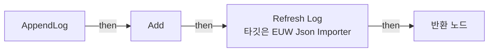
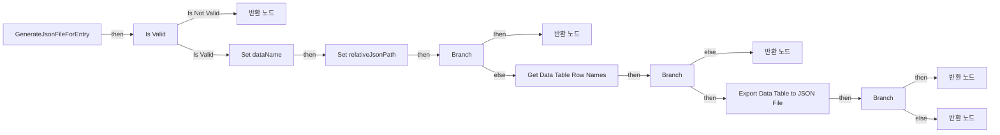
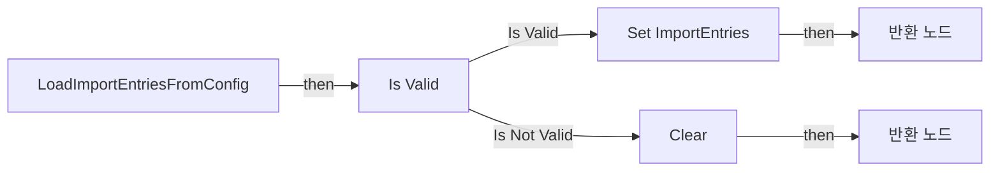
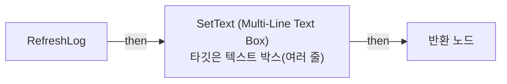
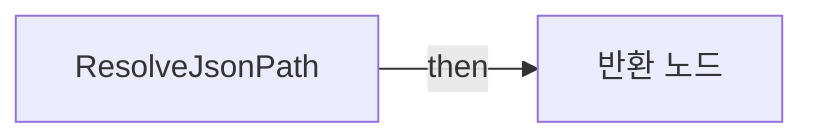
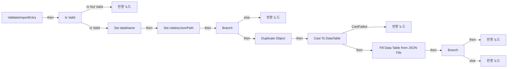

# EUW_JsonImporter

에셋: `/Game/QuakeLike_1_0/JsonParser/EUW_JsonImporter`

부모: `/Script/CoreUObject.Class'/Script/Blutility.EditorUtilityWidget'`

수집일: 2026-10-12. MCP에서 읽은 그래프·핀 연결의 자동 전사입니다. 상속된 그래프는 부모 문서를 함께 확인합니다.

정적 루트 참조 도달: 없음. 실행 여부 또는 삭제 가능 여부의 확정이 아닙니다.

컴포넌트 목록은 이 BP가 직접 정의한 SCS만 포함합니다. 부모·네이티브 생성 컴포넌트, 인스턴스 설정은 별도입니다.

## 변수와 기본값

| 이름 | 타입 | CDO 기본값 |
|---|---|---|
| `ImportEntries` | `ST_JsonImportEntry` | [] |
| `logLines` | `string` | [] |
| `validCount` | `int` | 0 |
| `invalidCount` | `int` | 0 |
| `appliedCount` | `int` | 0 |
| `isProcessing` | `bool` | False |
| `lineBreak` | `string` | 
  |
| `skippedCount` | `int` | 0 |
| `generatedCount` | `int` | 0 |
| `importConfig` | `PDA_JsonImporterConfig_C` | /Game/QuakeLike_1_0/Data/JsonParser/DA_JsonImporterConfig.DA_JsonImporterConfig |

## 그래프 목록

| 그래프 | 전체 노드 수 |
|---|---|
| AppendLog | 5 |
| ApplyImportEntry | 54 |
| EventGraph | 143 |
| GenerateJsonFileForEntry | 37 |
| LoadImportEntriesFromConfig | 9 |
| RefreshLog | 10 |
| ResetResult | 12 |
| ResolveJsonPath | 5 |
| ValidateImportEntry | 35 |

## 그래프별 실행 연결

실선은 출력 exec 핀의 실제 연결입니다. 여러 분기는 출력 핀 이름을 표시합니다. 함수 호출·delegate·타이머의 다음 그래프 실행은 이 그림에서 자동으로 이어 붙이지 않습니다.

순수 계산 노드 및 데이터 핀은 아래 목록과 원본 JSON을 확인합니다. 연결되지 않은 이벤트도 표시되므로, 노드가 있다는 이유만으로 실행된다고 판단하면 안 됩니다.

### AppendLog

실행 핀 플로우차트

전체 노드·기본 입력 목록

| 노드 ID | 제목 | 미연결 기본 입력 / 에셋 입력 |
|---|---|---|
| `K2Node_FunctionEntry_0` | AppendLog |  |
| `K2Node_VariableGet_0` | Get logLines |  |
| `K2Node_CallArrayFunction_0` | Add | ReturnValue=0 |
| `K2Node_CallFunction_0` | Refresh Log 타깃은 EUW Json Importer |  |
| `K2Node_FunctionResult_0` | 반환 노드 |  |

### ApplyImportEntry

```mermaid
flowchart LR
  n0["ApplyImportEntry"]
  n1["반환 노드"]
  n2["Validate Import Entry<br/>타깃은 EUW Json Importer"]
  n3["Branch"]
  n4["Export Data Table to JSON String"]
  n5["Set backupJson"]
  n6["Branch"]
  n7["반환 노드"]
  n8["Set dataName"]
  n9["Set relativeJsonPath"]
  n10["Fill Data Table from JSON File"]
  n11["Branch"]
  n12["Save Loaded Asset"]
  n13["Branch"]
  n14["반환 노드"]
  n15["Fill Data Table from JSON String"]
  n16["경유 노드"]
  n17["Branch"]
  n18["반환 노드"]
  n19["반환 노드"]
  n20["Fill Data Table from JSON String"]
  n21["Branch"]
  n22["반환 노드"]
  n23["경유 노드"]
  n24["반환 노드"]
  n0 -->|"then"| n2
  n2 -->|"then"| n3
  n3 -->|"then"| n8
  n3 -->|"else"| n1
  n4 -->|"then"| n5
  n5 -->|"then"| n6
  n6 -->|"then"| n10
  n6 -->|"else"| n7
  n8 -->|"then"| n9
  n9 -->|"then"| n4
  n10 -->|"then"| n11
  n11 -->|"then"| n12
  n11 -->|"else"| n16
  n12 -->|"then"| n13
  n13 -->|"then"| n14
  n13 -->|"else"| n20
  n15 -->|"then"| n17
  n16 -->|"OutputPin"| n15
  n17 -->|"then"| n18
  n17 -->|"else"| n19
  n20 -->|"then"| n21
  n21 -->|"then"| n23
  n21 -->|"else"| n24
  n23 -->|"OutputPin"| n22
```

실행 핀 플로우차트

전체 노드·기본 입력 목록

| 노드 ID | 제목 | 미연결 기본 입력 / 에셋 입력 |
|---|---|---|
| `K2Node_FunctionEntry_0` | ApplyImportEntry |  |
| `K2Node_FunctionResult_0` | 반환 노드 | wasApplied=false |
| `K2Node_CallFunction_0` | Validate Import Entry 타깃은 EUW Json Importer |  |
| `K2Node_IfThenElse_0` | Branch |  |
| `K2Node_Knot_0` | 경유 노드 |  |
| `K2Node_BreakStruct_0` | Break ST Json Import Entry |  |
| `K2Node_CallFunction_3` | Export Data Table to JSON String |  |
| `K2Node_Knot_1` | 경유 노드 |  |
| `K2Node_VariableSet_0` | Set backupJson |  |
| `K2Node_IfThenElse_1` | Branch |  |
| `K2Node_Knot_2` | 경유 노드 |  |
| `K2Node_FunctionResult_1` | 반환 노드 | wasApplied=false |
| `K2Node_CommutativeAssociativeBinaryOperator_0` | Append | A=[ 오류 ] ; C= - 적용 전 DataTable 백업 생성에 실패했습니다. |
| `K2Node_VariableSet_1` | Set dataName |  |
| `K2Node_VariableSet_2` | Set relativeJsonPath |  |
| `K2Node_Knot_3` | 경유 노드 |  |
| `K2Node_VariableGet_0` | Get dataName |  |
| `K2Node_CallFunction_4` | Fill Data Table from JSON File |  |
| `K2Node_CallFunction_5` | Resolve Json Path |  |
| `K2Node_VariableGet_1` | Get relativeJsonPath |  |
| `K2Node_Knot_4` | 경유 노드 |  |
| `K2Node_CallFunction_6` | Get Data Table Row Struct |  |
| `K2Node_IfThenElse_2` | Branch |  |
| `K2Node_CallFunction_7` | Save Loaded Asset | bOnlyIfIsDirty=true |
| `K2Node_IfThenElse_3` | Branch |  |
| `K2Node_FunctionResult_2` | 반환 노드 | wasApplied=true |
| `K2Node_CommutativeAssociativeBinaryOperator_1` | Append | A=[ 적용 ] ; C= /  |
| `K2Node_VariableGet_2` | Get dataName |  |
| `K2Node_VariableGet_3` | Get relativeJsonPath |  |
| `K2Node_CallFunction_8` | Fill Data Table from JSON String |  |
| `K2Node_Knot_5` | 경유 노드 |  |
| `K2Node_Knot_6` | 경유 노드 |  |
| `K2Node_VariableGet_4` | Get backupJson |  |
| `K2Node_Knot_7` | 경유 노드 |  |
| `K2Node_IfThenElse_4` | Branch |  |
| `K2Node_FunctionResult_3` | 반환 노드 | wasApplied=false |
| `K2Node_CommutativeAssociativeBinaryOperator_2` | Append | A=[ 오류 ] ; C= - JSON 적용에 실패하여 기존 DataTable 내용으로 복구했습니다. |
| `K2Node_VariableGet_5` | Get dataName |  |
| `K2Node_FunctionResult_4` | 반환 노드 | wasApplied=false |
| `K2Node_CommutativeAssociativeBinaryOperator_3` | Append | A=[ 치명적 오류 ] ; C= - JSON 적용과 기존 DataTable 복구가 모두 실패했습니다. 해당 DataTable을 저장하지 마세요. |
| `K2Node_VariableGet_6` | Get dataName |  |
| `K2Node_CallFunction_9` | Fill Data Table from JSON String |  |
| `K2Node_Knot_9` | 경유 노드 |  |
| `K2Node_VariableGet_7` | Get backupJson |  |
| `K2Node_Knot_10` | 경유 노드 |  |
| `K2Node_CallFunction_10` | Get Data Table Row Struct |  |
| `K2Node_IfThenElse_5` | Branch |  |
| `K2Node_FunctionResult_5` | 반환 노드 | wasApplied=false |
| `K2Node_CommutativeAssociativeBinaryOperator_4` | Append | A=[ 오류 ] ; C= - DataTable 저장에 실패하여 기존 내용으로 복구했습니다. |
| `K2Node_VariableGet_8` | Get dataName |  |
| `K2Node_Knot_11` | 경유 노드 |  |
| `K2Node_FunctionResult_6` | 반환 노드 | wasApplied=false |
| `K2Node_CommutativeAssociativeBinaryOperator_5` | Append | A=[ 치명적 오류 ] ; C= - DataTable 저장과 기존 내용 복구가 모두 실패했습니다. 해당 DataTable을 저장하지 마세요. |
| `K2Node_VariableGet_9` | Get dataName |  |

### EventGraph

```mermaid
flowchart LR
  n0["On Clicked (BTN_ValidateAll)"]
  n1["Branch"]
  n2["Set isProcessing"]
  n3["Reset Result<br/>타깃은 EUW Json Importer"]
  n4["Append Log<br/>타깃은 EUW Json Importer"]
  n5["For Each Loop"]
  n6["Branch"]
  n7["Set skippedCount"]
  n8["Append Log<br/>타깃은 EUW Json Importer"]
  n9["Validate Import Entry<br/>타깃은 EUW Json Importer"]
  n10["Branch"]
  n11["Set validCount"]
  n12["Append Log<br/>타깃은 EUW Json Importer"]
  n13["Set invalidCount"]
  n14["경유 노드"]
  n15["Append Log<br/>타깃은 EUW Json Importer"]
  n16["Append Log<br/>타깃은 EUW Json Importer"]
  n17["SetText (Text)<br/>타깃은 텍스트"]
  n18["Set isProcessing"]
  n19["On Clicked (BTN_GenerateJsonFiles)"]
  n20["Branch"]
  n21["Set isProcessing"]
  n22["Reset Result<br/>타깃은 EUW Json Importer"]
  n23["Append Log<br/>타깃은 EUW Json Importer"]
  n24["For Each Loop"]
  n25["Branch"]
  n26["Set skippedCount"]
  n27["Append Log<br/>타깃은 EUW Json Importer"]
  n28["Generate Json File for Entry<br/>타깃은 EUW Json Importer"]
  n29["Branch"]
  n30["Set generatedCount"]
  n31["Append Log<br/>타깃은 EUW Json Importer"]
  n32["Branch"]
  n33["Set skippedCount"]
  n34["Append Log<br/>타깃은 EUW Json Importer"]
  n35["Set invalidCount"]
  n36["경유 노드"]
  n37["Append Log<br/>타깃은 EUW Json Importer"]
  n38["Append Log<br/>타깃은 EUW Json Importer"]
  n39["SetText (Text)<br/>타깃은 텍스트"]
  n40["Set isProcessing"]
  n41["Load Import Entries from Config<br/>타깃은 EUW Json Importer"]
  n42["Branch"]
  n43["Append Log<br/>타깃은 EUW Json Importer"]
  n44["SetText (Text)<br/>타깃은 텍스트"]
  n45["Set isProcessing"]
  n46["Append Log<br/>타깃은 EUW Json Importer"]
  n47["SetText (Text)<br/>타깃은 텍스트"]
  n48["Set isProcessing"]
  n49["Load Import Entries from Config<br/>타깃은 EUW Json Importer"]
  n50["Branch"]
  n51["On Clicked (BTN_ApplyAll)"]
  n52["Branch"]
  n53["Set isProcessing"]
  n54["Reset Result<br/>타깃은 EUW Json Importer"]
  n55["Load Import Entries from Config<br/>타깃은 EUW Json Importer"]
  n56["Branch"]
  n57["Append Log<br/>타깃은 EUW Json Importer"]
  n58["SetText (Text)<br/>타깃은 텍스트"]
  n59["Set isProcessing"]
  n60["Append Log<br/>타깃은 EUW Json Importer"]
  n61["For Each Loop"]
  n62["Branch"]
  n63["Set skippedCount"]
  n64["Append Log<br/>타깃은 EUW Json Importer"]
  n65["Apply Import Entry<br/>타깃은 EUW Json Importer"]
  n66["Branch"]
  n67["Set appliedCount"]
  n68["Append Log<br/>타깃은 EUW Json Importer"]
  n69["Set invalidCount"]
  n70["Append Log<br/>타깃은 EUW Json Importer"]
  n71["Append Log<br/>타깃은 EUW Json Importer"]
  n72["SetText (Text)<br/>타깃은 텍스트"]
  n73["Set isProcessing"]
  n0 -->|"then"| n1
  n1 -->|"else"| n2
  n2 -->|"then"| n3
  n3 -->|"then"| n41
  n4 -->|"then"| n5
  n5 -->|"LoopBody"| n6
  n5 -->|"Completed"| n16
  n6 -->|"then"| n9
  n6 -->|"else"| n7
  n7 -->|"then"| n8
  n9 -->|"then"| n10
  n10 -->|"then"| n11
  n10 -->|"else"| n14
  n11 -->|"then"| n12
  n13 -->|"then"| n15
  n14 -->|"OutputPin"| n13
  n16 -->|"then"| n17
  n17 -->|"then"| n18
  n19 -->|"then"| n20
  n20 -->|"else"| n21
  n21 -->|"then"| n22
  n22 -->|"then"| n49
  n23 -->|"then"| n24
  n24 -->|"LoopBody"| n25
  n24 -->|"Completed"| n38
  n25 -->|"then"| n28
  n25 -->|"else"| n26
  n26 -->|"then"| n27
  n28 -->|"then"| n29
  n29 -->|"then"| n30
  n29 -->|"else"| n32
  n30 -->|"then"| n31
  n32 -->|"then"| n33
  n32 -->|"else"| n36
  n33 -->|"then"| n34
  n35 -->|"then"| n37
  n36 -->|"OutputPin"| n35
  n38 -->|"then"| n39
  n39 -->|"then"| n40
  n41 -->|"then"| n42
  n42 -->|"then"| n4
  n42 -->|"else"| n43
  n43 -->|"then"| n44
  n44 -->|"then"| n45
  n46 -->|"then"| n47
  n47 -->|"then"| n48
  n49 -->|"then"| n50
  n50 -->|"then"| n23
  n50 -->|"else"| n46
  n51 -->|"then"| n52
  n52 -->|"else"| n53
  n53 -->|"then"| n54
  n54 -->|"then"| n55
  n55 -->|"then"| n56
  n56 -->|"then"| n60
  n56 -->|"else"| n57
  n57 -->|"then"| n58
  n58 -->|"then"| n59
  n60 -->|"then"| n61
  n61 -->|"LoopBody"| n62
  n61 -->|"Completed"| n71
  n62 -->|"then"| n65
  n62 -->|"else"| n63
  n63 -->|"then"| n64
  n65 -->|"then"| n66
  n66 -->|"then"| n67
  n66 -->|"else"| n69
  n67 -->|"then"| n68
  n69 -->|"then"| n70
  n71 -->|"then"| n72
  n72 -->|"then"| n73
```

실행 핀 플로우차트

전체 노드·기본 입력 목록

| 노드 ID | 제목 | 미연결 기본 입력 / 에셋 입력 |
|---|---|---|
| `K2Node_ComponentBoundEvent_0` | On Clicked (BTN_ValidateAll) |  |
| `K2Node_IfThenElse_0` | Branch |  |
| `K2Node_VariableGet_0` | Get isProcessing |  |
| `K2Node_VariableSet_0` | Set isProcessing | isProcessing=true; Output_Get=false |
| `K2Node_CallFunction_0` | Reset Result 타깃은 EUW Json Importer |  |
| `K2Node_CallFunction_1` | Append Log 타깃은 EUW Json Importer | message====== 전체 검사 시작 ===== |
| `K2Node_MacroInstance_0` | For Each Loop |  |
| `K2Node_VariableGet_1` | Get ImportEntries |  |
| `K2Node_BreakStruct_0` | Break ST Json Import Entry |  |
| `K2Node_IfThenElse_1` | Branch |  |
| `K2Node_VariableGet_2` | Get skippedCount |  |
| `K2Node_VariableSet_1` | Set skippedCount | Output_Get=0 |
| `K2Node_PromotableOperator_0` | int + int | B=1 |
| `K2Node_CallFunction_2` | Append Log 타깃은 EUW Json Importer |  |
| `K2Node_CommutativeAssociativeBinaryOperator_0` | Append | A=[ 비활성 ]  |
| `K2Node_Knot_0` | 경유 노드 |  |
| `K2Node_CallFunction_3` | Validate Import Entry 타깃은 EUW Json Importer |  |
| `K2Node_Knot_1` | 경유 노드 |  |
| `K2Node_IfThenElse_2` | Branch |  |
| `K2Node_VariableSet_2` | Set validCount | Output_Get=0 |
| `K2Node_PromotableOperator_1` | int + int | B=1 |
| `K2Node_VariableGet_3` | Get validCount |  |
| `K2Node_CallFunction_4` | Append Log 타깃은 EUW Json Importer |  |
| `K2Node_VariableSet_3` | Set invalidCount | Output_Get=0 |
| `K2Node_Knot_2` | 경유 노드 |  |
| `K2Node_PromotableOperator_2` | int + int | B=1 |
| `K2Node_VariableGet_4` | Get invalidCount |  |
| `K2Node_CallFunction_5` | Append Log 타깃은 EUW Json Importer |  |
| `K2Node_Knot_3` | 경유 노드 |  |
| `K2Node_Knot_4` | 경유 노드 |  |
| `K2Node_CallFunction_6` | Append Log 타깃은 EUW Json Importer | message====== 전체 검사 완료 ===== |
| `K2Node_FormatText_0` | 포맷 텍스트 |  |
| `K2Node_VariableGet_5` | Get validCount |  |
| `K2Node_VariableGet_6` | Get invalidCount |  |
| `K2Node_VariableGet_7` | Get skippedCount |  |
| `K2Node_VariableGet_8` | Get TXT_Summary |  |
| `K2Node_CallFunction_7` | SetText (Text) 타깃은 텍스트 |  |
| `K2Node_VariableSet_4` | Set isProcessing | isProcessing=false; Output_Get=false |
| `K2Node_ComponentBoundEvent_1` | On Clicked (BTN_GenerateJsonFiles) |  |
| `K2Node_IfThenElse_3` | Branch |  |
| `K2Node_VariableGet_9` | Get isProcessing |  |
| `K2Node_VariableSet_5` | Set isProcessing | isProcessing=true; Output_Get=false |
| `K2Node_CallFunction_8` | Reset Result 타깃은 EUW Json Importer |  |
| `K2Node_CallFunction_9` | Append Log 타깃은 EUW Json Importer | message====== Json 파일 생성 시작 ===== |
| `K2Node_MacroInstance_1` | For Each Loop |  |
| `K2Node_VariableGet_10` | Get ImportEntries |  |
| `K2Node_IfThenElse_4` | Branch |  |
| `K2Node_BreakStruct_1` | Break ST Json Import Entry |  |
| `K2Node_VariableSet_6` | Set skippedCount | Output_Get=0 |
| `K2Node_VariableGet_11` | Get skippedCount |  |
| `K2Node_PromotableOperator_3` | int + int | B=1 |
| `K2Node_CallFunction_10` | Append Log 타깃은 EUW Json Importer |  |
| `K2Node_CommutativeAssociativeBinaryOperator_1` | Append | A=[ 비활성 ]  |
| `K2Node_Knot_5` | 경유 노드 |  |
| `K2Node_CallFunction_11` | Generate Json File for Entry 타깃은 EUW Json Importer |  |
| `K2Node_Knot_6` | 경유 노드 |  |
| `K2Node_Knot_7` | 경유 노드 |  |
| `K2Node_IfThenElse_5` | Branch |  |
| `K2Node_VariableSet_7` | Set generatedCount | Output_Get=0 |
| `K2Node_PromotableOperator_4` | int + int | B=1 |
| `K2Node_VariableGet_12` | Get generatedCount |  |
| `K2Node_CallFunction_12` | Append Log 타깃은 EUW Json Importer |  |
| `K2Node_Knot_8` | 경유 노드 |  |
| `K2Node_IfThenElse_6` | Branch |  |
| `K2Node_Knot_9` | 경유 노드 |  |
| `K2Node_VariableSet_8` | Set skippedCount | Output_Get=0 |
| `K2Node_VariableGet_13` | Get skippedCount |  |
| `K2Node_PromotableOperator_5` | int + int | B=1 |
| `K2Node_CallFunction_13` | Append Log 타깃은 EUW Json Importer |  |
| `K2Node_Knot_10` | 경유 노드 |  |
| `K2Node_Knot_11` | 경유 노드 |  |
| `K2Node_VariableGet_14` | Get invalidCount |  |
| `K2Node_VariableSet_9` | Set invalidCount | Output_Get=0 |
| `K2Node_Knot_12` | 경유 노드 |  |
| `K2Node_PromotableOperator_6` | int + int |  |
| `K2Node_CallFunction_14` | Append Log 타깃은 EUW Json Importer |  |
| `K2Node_Knot_13` | 경유 노드 |  |
| `K2Node_CallFunction_15` | Append Log 타깃은 EUW Json Importer | message====== Json 파일 생성 완료 ===== |
| `K2Node_FormatText_1` | 포맷 텍스트 |  |
| `K2Node_VariableGet_15` | Get generatedCount |  |
| `K2Node_VariableGet_16` | Get invalidCount |  |
| `K2Node_VariableGet_17` | Get skippedCount |  |
| `K2Node_VariableGet_18` | Get TXT_Summary |  |
| `K2Node_CallFunction_16` | SetText (Text) 타깃은 텍스트 |  |
| `K2Node_VariableSet_10` | Set isProcessing | isProcessing=false; Output_Get=false |
| `K2Node_CallFunction_17` | Load Import Entries from Config 타깃은 EUW Json Importer |  |
| `K2Node_IfThenElse_7` | Branch |  |
| `K2Node_CallFunction_20` | Append Log 타깃은 EUW Json Importer |  |
| `K2Node_Knot_15` | 경유 노드 |  |
| `K2Node_VariableGet_24` | Get TXT_Summary |  |
| `K2Node_CallFunction_21` | SetText (Text) 타깃은 텍스트 |  |
| `K2Node_VariableSet_12` | Set isProcessing | isProcessing=false; Output_Get=false |
| `K2Node_CallFunction_18` | Append Log 타깃은 EUW Json Importer |  |
| `K2Node_Knot_14` | 경유 노드 |  |
| `K2Node_VariableGet_23` | Get TXT_Summary |  |
| `K2Node_CallFunction_19` | SetText (Text) 타깃은 텍스트 |  |
| `K2Node_VariableSet_11` | Set isProcessing | isProcessing=false; Output_Get=false |
| `K2Node_CallFunction_22` | Load Import Entries from Config 타깃은 EUW Json Importer |  |
| `K2Node_IfThenElse_8` | Branch |  |
| `K2Node_ComponentBoundEvent_2` | On Clicked (BTN_ApplyAll) |  |
| `K2Node_IfThenElse_9` | Branch |  |
| `K2Node_VariableGet_25` | Get isProcessing |  |
| `K2Node_VariableSet_13` | Set isProcessing | isProcessing=true; Output_Get=false |
| `K2Node_CallFunction_23` | Reset Result 타깃은 EUW Json Importer |  |
| `K2Node_CallFunction_24` | Load Import Entries from Config 타깃은 EUW Json Importer |  |
| `K2Node_IfThenElse_10` | Branch |  |
| `K2Node_CallFunction_25` | Append Log 타깃은 EUW Json Importer |  |
| `K2Node_Knot_16` | 경유 노드 |  |
| `K2Node_VariableGet_26` | Get TXT_Summary |  |
| `K2Node_CallFunction_26` | SetText (Text) 타깃은 텍스트 |  |
| `K2Node_VariableSet_14` | Set isProcessing | isProcessing=false; Output_Get=false |
| `K2Node_CallFunction_27` | Append Log 타깃은 EUW Json Importer | message====== 전체 적용 시작 ===== |
| `K2Node_MacroInstance_2` | For Each Loop |  |
| `K2Node_VariableGet_27` | Get ImportEntries |  |
| `K2Node_BreakStruct_2` | Break ST Json Import Entry |  |
| `K2Node_IfThenElse_11` | Branch |  |
| `K2Node_VariableGet_28` | Get skippedCount |  |
| `K2Node_VariableSet_15` | Set skippedCount | Output_Get=0 |
| `K2Node_PromotableOperator_7` | int + int | B=1 |
| `K2Node_CallFunction_28` | Append Log 타깃은 EUW Json Importer |  |
| `K2Node_CommutativeAssociativeBinaryOperator_2` | Append | A=[ 비활성 ]  |
| `K2Node_Knot_17` | 경유 노드 |  |
| `K2Node_CallFunction_29` | Apply Import Entry 타깃은 EUW Json Importer |  |
| `K2Node_Knot_18` | 경유 노드 |  |
| `K2Node_Knot_19` | 경유 노드 |  |
| `K2Node_IfThenElse_12` | Branch |  |
| `K2Node_VariableSet_16` | Set appliedCount | Output_Get=0 |
| `K2Node_VariableGet_29` | Get appliedCount |  |
| `K2Node_PromotableOperator_8` | int + int | B=1 |
| `K2Node_CallFunction_30` | Append Log 타깃은 EUW Json Importer |  |
| `K2Node_VariableSet_17` | Set invalidCount | Output_Get=0 |
| `K2Node_PromotableOperator_9` | int + int | B=1 |
| `K2Node_VariableGet_30` | Get invalidCount |  |
| `K2Node_CallFunction_31` | Append Log 타깃은 EUW Json Importer |  |
| `K2Node_Knot_20` | 경유 노드 |  |
| `K2Node_CallFunction_32` | Append Log 타깃은 EUW Json Importer | message====== 전체 적용 완료 ===== |
| `K2Node_FormatText_2` | 포맷 텍스트 |  |
| `K2Node_VariableGet_31` | Get appliedCount |  |
| `K2Node_VariableGet_32` | Get invalidCount |  |
| `K2Node_VariableGet_33` | Get skippedCount |  |
| `K2Node_VariableGet_34` | Get TXT_Summary |  |
| `K2Node_CallFunction_33` | SetText (Text) 타깃은 텍스트 |  |
| `K2Node_VariableSet_18` | Set isProcessing | isProcessing=false; Output_Get=false |

### GenerateJsonFileForEntry

실행 핀 플로우차트

전체 노드·기본 입력 목록

| 노드 ID | 제목 | 미연결 기본 입력 / 에셋 입력 |
|---|---|---|
| `K2Node_FunctionEntry_0` | GenerateJsonFileForEntry |  |
| `K2Node_FunctionResult_0` | 반환 노드 | wasGenerated=false; wasSkipped=false |
| `K2Node_BreakStruct_0` | Break ST Json Import Entry |  |
| `K2Node_MacroInstance_0` | Is Valid |  |
| `K2Node_Knot_0` | 경유 노드 |  |
| `K2Node_CommutativeAssociativeBinaryOperator_0` | Append | A=[ 오류 ] ; C= - 대상 DataTable이 지정되지 않았습니다. |
| `K2Node_VariableSet_0` | Set dataName |  |
| `K2Node_VariableSet_1` | Set relativeJsonPath |  |
| `K2Node_Knot_1` | 경유 노드 |  |
| `K2Node_CallFunction_0` | Resolve Json Path |  |
| `K2Node_CallFunction_1` | File Exists |  |
| `K2Node_IfThenElse_0` | Branch |  |
| `K2Node_FunctionResult_1` | 반환 노드 | wasGenerated=false; wasSkipped=true |
| `K2Node_CommutativeAssociativeBinaryOperator_1` | Append | A=[ 건너뜀 ] ; C= - 이미 Json 파일이 존재합니다:  |
| `K2Node_VariableGet_0` | Get dataName |  |
| `K2Node_Knot_2` | 경유 노드 |  |
| `K2Node_Knot_3` | 경유 노드 |  |
| `K2Node_CallFunction_2` | Get Data Table Row Names |  |
| `K2Node_Knot_4` | 경유 노드 |  |
| `K2Node_CallArrayFunction_0` | Length |  |
| `K2Node_PromotableOperator_0` | integer &gt; integer |  |
| `K2Node_IfThenElse_1` | Branch |  |
| `K2Node_FunctionResult_2` | 반환 노드 | wasGenerated=false; wasSkipped=false |
| `K2Node_CommutativeAssociativeBinaryOperator_2` | Append | A=[ 오류 ] ; C= - DataTable이 비어 있습니다. 첫 번째 실제 데이터 행을 추가한 뒤 다시 생성하세요. |
| `K2Node_VariableGet_1` | Get dataName |  |
| `K2Node_CallFunction_3` | Export Data Table to JSON File |  |
| `K2Node_Knot_5` | 경유 노드 |  |
| `K2Node_Knot_6` | 경유 노드 |  |
| `K2Node_IfThenElse_3` | Branch |  |
| `K2Node_FunctionResult_4` | 반환 노드 | wasGenerated=true; wasSkipped=false |
| `K2Node_CommutativeAssociativeBinaryOperator_3` | Append | A=[ 생성 ] ; C= /  |
| `K2Node_VariableGet_2` | Get dataName |  |
| `K2Node_VariableGet_3` | Get relativeJsonPath |  |
| `K2Node_FunctionResult_5` | 반환 노드 | wasGenerated=false; wasSkipped=false |
| `K2Node_CommutativeAssociativeBinaryOperator_4` | Append | A=[ 오류 ] ; C= - JSON 파일 생성에 실패했습니다:  |
| `K2Node_VariableGet_4` | Get dataName |  |
| `K2Node_VariableGet_5` | Get relativeJsonPath |  |

### LoadImportEntriesFromConfig

실행 핀 플로우차트

전체 노드·기본 입력 목록

| 노드 ID | 제목 | 미연결 기본 입력 / 에셋 입력 |
|---|---|---|
| `K2Node_FunctionEntry_0` | LoadImportEntriesFromConfig |  |
| `K2Node_FunctionResult_1` | 반환 노드 | wasLoaded=false; message=[ 오류 ] JSON Importer 설정 에셋이 지정되지 않았습니다. |
| `K2Node_VariableGet_0` | Get importConfig |  |
| `K2Node_MacroInstance_0` | Is Valid |  |
| `K2Node_VariableGet_1` | Get ImportEntries |  |
| `K2Node_CallArrayFunction_0` | Clear |  |
| `K2Node_VariableGet_2` | Get importEntries |  |
| `K2Node_VariableSet_0` | Set ImportEntries |  |
| `K2Node_FunctionResult_0` | 반환 노드 | wasLoaded=true |

### RefreshLog

실행 핀 플로우차트

전체 노드·기본 입력 목록

| 노드 ID | 제목 | 미연결 기본 입력 / 에셋 입력 |
|---|---|---|
| `K2Node_FunctionEntry_0` | RefreshLog |  |
| `K2Node_VariableGet_0` | Get logLines |  |
| `K2Node_CallFunction_0` | Join String Array |  |
| `K2Node_VariableGet_1` | Get lineBreak |  |
| `K2Node_FormatText_0` | 포맷 텍스트 |  |
| `K2Node_VariableGet_2` | Get MTB_Log |  |
| `K2Node_CallFunction_2` | SetText (Multi-Line Text Box) 타깃은 텍스트 박스(여러 줄) |  |
| `K2Node_Knot_0` | 경유 노드 |  |
| `K2Node_Knot_1` | 경유 노드 |  |
| `K2Node_FunctionResult_0` | 반환 노드 |  |

### ResetResult

```mermaid
flowchart LR
  n0["ResetResult"]
  n1["Clear"]
  n2["Set validCount"]
  n3["Set invalidCount"]
  n4["Set appliedCount"]
  n5["SetText (Text)<br/>타깃은 텍스트"]
  n6["Refresh Log<br/>타깃은 EUW Json Importer"]
  n7["반환 노드"]
  n8["Set skippedCount"]
  n9["Set generatedCount"]
  n0 -->|"then"| n1
  n1 -->|"then"| n2
  n2 -->|"then"| n3
  n3 -->|"then"| n4
  n4 -->|"then"| n8
  n5 -->|"then"| n6
  n6 -->|"then"| n7
  n8 -->|"then"| n9
  n9 -->|"then"| n5
```

실행 핀 플로우차트

전체 노드·기본 입력 목록

| 노드 ID | 제목 | 미연결 기본 입력 / 에셋 입력 |
|---|---|---|
| `K2Node_FunctionEntry_0` | ResetResult |  |
| `K2Node_VariableGet_0` | Get logLines |  |
| `K2Node_CallArrayFunction_0` | Clear |  |
| `K2Node_VariableSet_0` | Set validCount | validCount=0; Output_Get=0 |
| `K2Node_VariableSet_1` | Set invalidCount | invalidCount=0; Output_Get=0 |
| `K2Node_VariableSet_2` | Set appliedCount | appliedCount=0; Output_Get=0 |
| `K2Node_VariableGet_1` | Get TXT_Summary |  |
| `K2Node_CallFunction_0` | SetText (Text) 타깃은 텍스트 |  |
| `K2Node_CallFunction_1` | Refresh Log 타깃은 EUW Json Importer |  |
| `K2Node_FunctionResult_0` | 반환 노드 |  |
| `K2Node_VariableSet_3` | Set skippedCount | skippedCount=0; Output_Get=0 |
| `K2Node_VariableSet_4` | Set generatedCount | generatedCount=0; Output_Get=0 |

### ResolveJsonPath

실행 핀 플로우차트

전체 노드·기본 입력 목록

| 노드 ID | 제목 | 미연결 기본 입력 / 에셋 입력 |
|---|---|---|
| `K2Node_FunctionEntry_0` | ResolveJsonPath |  |
| `K2Node_FunctionResult_0` | 반환 노드 |  |
| `K2Node_CallFunction_0` | Project Content Dir |  |
| `K2Node_MakeArray_0` | 배열 만들기 | [1]=QuakeLike_1_0; [2]=JsonParser; [3]=JsonFiles |
| `K2Node_CallFunction_1` | Combine |  |

### ValidateImportEntry

실행 핀 플로우차트

전체 노드·기본 입력 목록

| 노드 ID | 제목 | 미연결 기본 입력 / 에셋 입력 |
|---|---|---|
| `K2Node_FunctionEntry_0` | ValidateImportEntry |  |
| `K2Node_FunctionResult_0` | 반환 노드 | isValid=false |
| `K2Node_BreakStruct_0` | Break ST Json Import Entry |  |
| `K2Node_MacroInstance_0` | Is Valid |  |
| `K2Node_CommutativeAssociativeBinaryOperator_0` | Append | A=[ 오류 ] ; C= - 대상 DataTable이 지정되지 않았습니다. |
| `K2Node_Knot_0` | 경유 노드 |  |
| `K2Node_CallFunction_0` | Resolve Json Path |  |
| `K2Node_CallFunction_1` | File Exists |  |
| `K2Node_IfThenElse_0` | Branch |  |
| `K2Node_FunctionResult_1` | 반환 노드 | isValid=false |
| `K2Node_CommutativeAssociativeBinaryOperator_1` | Append | A=[ 오류 ] ; C= -  Json 파일을 찾을 수 없습니다:  |
| `K2Node_Knot_1` | 경유 노드 |  |
| `K2Node_Knot_2` | 경유 노드 |  |
| `K2Node_CallFunction_2` | Duplicate Object | Name=None |
| `K2Node_Self_0` | 셀프-레퍼런스 |  |
| `K2Node_DynamicCast_0` | Cast To DataTable |  |
| `K2Node_FunctionResult_2` | 반환 노드 | isValid=false |
| `K2Node_CommutativeAssociativeBinaryOperator_2` | Append | A=[ 오류 ] ; C= - 검사용 DataTable 복제에 실패했습니다. |
| `K2Node_CallFunction_3` | Get Data Table Row Struct |  |
| `K2Node_CallFunction_4` | Fill Data Table from JSON File |  |
| `K2Node_Knot_3` | 경유 노드 |  |
| `K2Node_IfThenElse_1` | Branch |  |
| `K2Node_FunctionResult_3` | 반환 노드 | isValid=true |
| `K2Node_CommutativeAssociativeBinaryOperator_3` | Append | A=[ 정상 ] ; C= /  |
| `K2Node_VariableSet_0` | Set dataName |  |
| `K2Node_VariableSet_1` | Set relativeJsonPath |  |
| `K2Node_Knot_4` | 경유 노드 |  |
| `K2Node_VariableGet_0` | Get dataName |  |
| `K2Node_VariableGet_1` | Get dataName |  |
| `K2Node_VariableGet_2` | Get dataName |  |
| `K2Node_VariableGet_3` | Get relativeJsonPath |  |
| `K2Node_FunctionResult_4` | 반환 노드 | isValid=false |
| `K2Node_CommutativeAssociativeBinaryOperator_4` | Append | A=[ 오류 ] ; C= / ; E= - Json 형식 또는 DataTable 구조가 일치하지 않습니다. |
| `K2Node_VariableGet_4` | Get dataName |  |
| `K2Node_VariableGet_5` | Get relativeJsonPath |  |

## 조회 범위의 한계

ObjectIterator로 발견했으나 MCP helper가 반환하지 않은 그래프입니다. delegate signature·컴파일된 중간 그래프·macro·애니메이션 내부 그래프가 섞일 수 있습니다.

- `AppendLog_MERGED`: Graph 'AppendLog_MERGED' not found in Blueprint.
- `ApplyImportEntry_MERGED`: Graph 'ApplyImportEntry_MERGED' not found in Blueprint.
- `BndEvt__EUW_JsonImporter_BTN_ApplyAll_K2Node_ComponentBoundEvent_2_OnButtonClickedEvent__DelegateSignature`: Graph 'BndEvt__EUW_JsonImporter_BTN_ApplyAll_K2Node_ComponentBoundEvent_2_OnButtonClickedEvent__DelegateSignature' not found in Blueprint.
- `BndEvt__EUW_JsonImporter_BTN_GenerateJsonFiles_K2Node_ComponentBoundEvent_1_OnButtonClickedEvent__DelegateSignature`: Graph 'BndEvt__EUW_JsonImporter_BTN_GenerateJsonFiles_K2Node_ComponentBoundEvent_1_OnButtonClickedEvent__DelegateSignature' not found in Blueprint.
- `BndEvt__EUW_JsonImporter_BTN_ValidateAll_K2Node_ComponentBoundEvent_0_OnButtonClickedEvent__DelegateSignature`: Graph 'BndEvt__EUW_JsonImporter_BTN_ValidateAll_K2Node_ComponentBoundEvent_0_OnButtonClickedEvent__DelegateSignature' not found in Blueprint.
- `EdGraph_0`: Graph 'EdGraph_0' not found in Blueprint.
- `EdGraph_1`: Graph 'EdGraph_1' not found in Blueprint.
- `EdGraph_2`: Graph 'EdGraph_2' not found in Blueprint.
- `EdGraph_3`: Graph 'EdGraph_3' not found in Blueprint.
- `EdGraph_4`: Graph 'EdGraph_4' not found in Blueprint.
- `EdGraph_5`: Graph 'EdGraph_5' not found in Blueprint.
- `ExecuteUbergraph_EUW_JsonImporter`: Graph 'ExecuteUbergraph_EUW_JsonImporter' not found in Blueprint.
- `GenerateJsonFileForEntry_MERGED`: Graph 'GenerateJsonFileForEntry_MERGED' not found in Blueprint.
- `LoadImportEntriesFromConfig_MERGED`: Graph 'LoadImportEntriesFromConfig_MERGED' not found in Blueprint.
- `RefreshLog_MERGED`: Graph 'RefreshLog_MERGED' not found in Blueprint.
- `ResetResult_MERGED`: Graph 'ResetResult_MERGED' not found in Blueprint.
- `ResolveJsonPath_MERGED`: Graph 'ResolveJsonPath_MERGED' not found in Blueprint.
- `ValidateImportEntry_MERGED`: Graph 'ValidateImportEntry_MERGED' not found in Blueprint.

[원본 MCP 스냅샷](../../../Evidence/blueprints-210.json)
