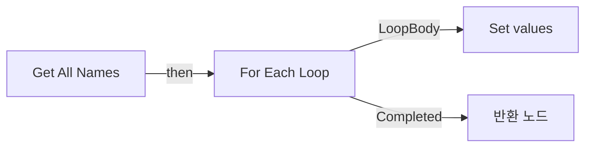
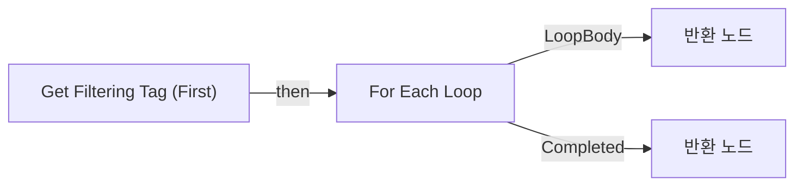
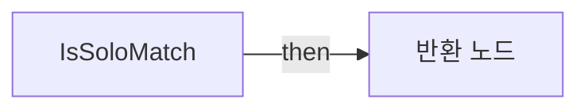
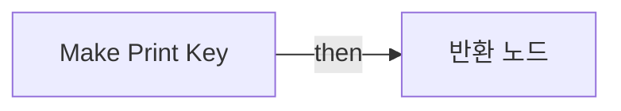
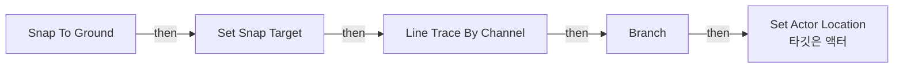

# BPL_Base

에셋: `/Game/QuakeLike_1_0/Library/BPL_Base`

부모: `/Script/CoreUObject.Class'/Script/Engine.BlueprintFunctionLibrary'`

수집일: 2026-10-12. MCP에서 읽은 그래프·핀 연결의 자동 전사입니다. 상속된 그래프는 부모 문서를 함께 확인합니다.

정적 루트 참조 도달: 있음. 실행 여부 또는 삭제 가능 여부의 확정이 아닙니다.

컴포넌트 목록은 이 BP가 직접 정의한 SCS만 포함합니다. 부모·네이티브 생성 컴포넌트, 인스턴스 설정은 별도입니다.

## 그래프 목록

| 그래프 | 전체 노드 수 |
|---|---|
| Debug Point | 12 |
| Get All Names | 8 |
| Get Filtering Tag (First) | 6 |
| Get Login Command | 3 |
| IsSoloMatch | 6 |
| Make Print Key | 5 |
| Snap To Ground | 14 |

## 그래프별 실행 연결

실선은 출력 exec 핀의 실제 연결입니다. 여러 분기는 출력 핀 이름을 표시합니다. 함수 호출·delegate·타이머의 다음 그래프 실행은 이 그림에서 자동으로 이어 붙이지 않습니다.

순수 계산 노드 및 데이터 핀은 아래 목록과 원본 JSON을 확인합니다. 연결되지 않은 이벤트도 표시되므로, 노드가 있다는 이유만으로 실행된다고 판단하면 안 됩니다.

### Debug Point

실행 핀 플로우차트

전체 노드·기본 입력 목록

| 노드 ID | 제목 | 미연결 기본 입력 / 에셋 입력 |
|---|---|---|
| `K2Node_FunctionEntry_0` | Debug Point |  |
| `K2Node_CallFunction_0` | Draw Debug Arrow | ArrowSize=300.000000; Thickness=10.000000 |
| `K2Node_Knot_0` | 경유 노드 |  |
| `K2Node_MacroInstance_0` | Is Valid |  |
| `K2Node_Knot_1` | 경유 노드 |  |
| `K2Node_CallFunction_1` | Get Actor Location 타깃은 액터 |  |
| `K2Node_Knot_2` | 경유 노드 |  |
| `K2Node_Knot_3` | 경유 노드 |  |
| `K2Node_PromotableOperator_0` | vector + vector | A=0.000000,0.000000,200.000000 |
| `K2Node_Knot_4` | 경유 노드 |  |
| `K2Node_Knot_5` | 경유 노드 |  |
| `K2Node_Knot_6` | 경유 노드 |  |

### Get All Names

실행 핀 플로우차트

전체 노드·기본 입력 목록

| 노드 ID | 제목 | 미연결 기본 입력 / 에셋 입력 |
|---|---|---|
| `K2Node_FunctionEntry_0` | Get All Names |  |
| `K2Node_MacroInstance_0` | For Each Loop |  |
| `K2Node_CommutativeAssociativeBinaryOperator_0` | Append | B= \|  |
| `K2Node_CallFunction_11` | Get Display Name |  |
| `K2Node_FunctionResult_0` | 반환 노드 |  |
| `K2Node_VariableGet_3` | Get values |  |
| `K2Node_VariableSet_1` | Set values |  |
| `K2Node_VariableGet_4` | Get values |  |

### Get Filtering Tag (First)

실행 핀 플로우차트

전체 노드·기본 입력 목록

| 노드 ID | 제목 | 미연결 기본 입력 / 에셋 입력 |
|---|---|---|
| `K2Node_FunctionEntry_0` | Get Filtering Tag (First) |  |
| `K2Node_CallFunction_0` | Filter |  |
| `K2Node_CallFunction_1` | Make Gameplay Tag Container from Tag |  |
| `K2Node_MacroInstance_0` | For Each Loop |  |
| `K2Node_FunctionResult_1` | 반환 노드 |  |
| `K2Node_FunctionResult_0` | 반환 노드 |  |

### Get Login Command

실행 핀 플로우차트

전체 노드·기본 입력 목록

| 노드 ID | 제목 | 미연결 기본 입력 / 에셋 입력 |
|---|---|---|
| `K2Node_FunctionEntry_0` | Get Login Command |  |
| `K2Node_CommutativeAssociativeBinaryOperator_0` | Append | A=open ; C=:; E=?Token= |
| `K2Node_FunctionResult_0` | 반환 노드 |  |

### IsSoloMatch

실행 핀 플로우차트

전체 노드·기본 입력 목록

| 노드 ID | 제목 | 미연결 기본 입력 / 에셋 입력 |
|---|---|---|
| `K2Node_FunctionEntry_0` | IsSoloMatch |  |
| `K2Node_FunctionResult_0` | 반환 노드 |  |
| `K2Node_VariableGet_0` | Get PlayerArray |  |
| `K2Node_CallArrayFunction_0` | Length |  |
| `K2Node_PromotableOperator_0` | integer &lt;= integer | B=1 |
| `K2Node_CallFunction_1` | Get Game State |  |

### Make Print Key

실행 핀 플로우차트

전체 노드·기본 입력 목록

| 노드 ID | 제목 | 미연결 기본 입력 / 에셋 입력 |
|---|---|---|
| `K2Node_FunctionEntry_0` | Make Print Key |  |
| `K2Node_FunctionResult_0` | 반환 노드 |  |
| `K2Node_CommutativeAssociativeBinaryOperator_0` | Append |  |
| `K2Node_CallFunction_59` | String To Name |  |
| `K2Node_CallFunction_0` | Get Display Name |  |

### Snap To Ground

실행 핀 플로우차트

전체 노드·기본 입력 목록

| 노드 ID | 제목 | 미연결 기본 입력 / 에셋 입력 |
|---|---|---|
| `K2Node_FunctionEntry_0` | Snap To Ground |  |
| `K2Node_CallFunction_9` | Get Actor Location 타깃은 액터 |  |
| `K2Node_Knot_1` | 경유 노드 |  |
| `K2Node_PromotableOperator_5` | vector + vector | B=0.000000,0.000000,-1000.000000 |
| `K2Node_IfThenElse_0` | Branch |  |
| `K2Node_CallFunction_5` | Line Trace By Channel | TraceChannel=TraceTypeQuery1; bTraceComplex=false; DrawDebugType=None; OutHit_bBlockingHit=false; OutHit_bInitialOverlap=false; OutHit_Time=0.0; OutHit_Distance=0.0; OutHit_Location_X=0.0; OutHit_Location_Y=0.0; OutHit_ImpactPoint=0, 0, 0; OutHit_Normal=0, 0, 0; OutHit_ImpactNormal=0, 0, 0; OutHit_HitBoneName=None; OutHit_BoneName=None; OutHit_HitItem=0; OutHit_ElementIndex=0; OutHit_FaceIndex=0; OutHit_TraceStart=0, 0, 0; OutHit_TraceEnd=0, 0, 0; bIgnoreSelf=true; TraceColor=(R=1.000000,G=0.000000,B=0.000000,A=1.000000); TraceHitColor=(R=0.000000,G=1.000000,B=0.000000,A=1.000000); DrawTime=5.000000 |
| `K2Node_CallFunction_8` | Set Actor Location 타깃은 액터 | bSweep=false; bTeleport=false; ReturnValue=false |
| `K2Node_PromotableOperator_2` | vector + vector | B=0.000000,0.000000,100.000000 |
| `K2Node_CallFunction_7` | Get Actor Location 타깃은 액터 | ReturnValue_Z=0.0 |
| `K2Node_Knot_6` | 경유 노드 |  |
| `K2Node_Knot_7` | 경유 노드 |  |
| `K2Node_VariableSet_0` | Set Snap Target |  |
| `K2Node_VariableGet_0` | Get Snap Target |  |
| `K2Node_VariableGet_1` | Get Snap Target |  |

[원본 MCP 스냅샷](../../../Evidence/blueprints-000.json)
