# BPC_Life

에셋: `/Game/QuakeLike_1_0/Life/BPC_Life`

부모: `/Script/CoreUObject.Class'/Script/Engine.ActorComponent'`

수집일: 2026-10-12. MCP에서 읽은 그래프·핀 연결의 자동 전사입니다. 상속된 그래프는 부모 문서를 함께 확인합니다.

정적 루트 참조 도달: 있음. 실행 여부 또는 삭제 가능 여부의 확정이 아닙니다.

컴포넌트 목록은 이 BP가 직접 정의한 SCS만 포함합니다. 부모·네이티브 생성 컴포넌트, 인스턴스 설정은 별도입니다.

## 변수와 기본값

| 이름 | 타입 | CDO 기본값 |
|---|---|---|
| `LifeData` | `PDA_Life_C` | /Game/QuakeLike_1_0/Data/Chracter/DA_DefaultLife.DA_DefaultLife |
| `OnLifeChanged` | `mcdelegate` | &lt;Delegate 'DelegateBase' &lt;Unbound&gt;&gt; |
| `OnDeath` | `mcdelegate` | &lt;Delegate 'DelegateBase' &lt;Unbound&gt;&gt; |
| `LifeInfo` | `S_DamageInfo` | &lt;Struct 'S_DamageInfo' {}&gt; |
| `OverLifeTimerHandle` | `TimerHandle` | &lt;Struct 'TimerHandle' {}&gt; |
| `DamageWeaponData` | `PDA_WeaponBase_C` | None |
| `MinimumDroppedBuffDuration` | `real` | 0.0 |

## 그래프 목록

| 그래프 | 전체 노드 수 |
|---|---|
| Apply Heal | 36 |
| Calc Dmg Distribution | 6 |
| DropBuffOnDeath | 18 |
| EventGraph | 109 |
| Get Max Health | 4 |
| Get Max Plate | 4 |
| Get Now Health | 3 |
| Get Now Plate | 3 |
| Get Over Max Health | 4 |
| Get Over Max Plate | 4 |
| Get Owning Controller | 5 |
| GetBuffTakeDamage | 9 |
| HandleOverLife | 33 |
| Init Info | 6 |
| Is Death | 4 |
| IsFatalDamage | 4 |
| OnRep_LifeInfo | 22 |

## 그래프별 실행 연결

실선은 출력 exec 핀의 실제 연결입니다. 여러 분기는 출력 핀 이름을 표시합니다. 함수 호출·delegate·타이머의 다음 그래프 실행은 이 그림에서 자동으로 이어 붙이지 않습니다.

순수 계산 노드 및 데이터 핀은 아래 목록과 원본 JSON을 확인합니다. 연결되지 않은 이벤트도 표시되므로, 노드가 있다는 이유만으로 실행된다고 판단하면 안 됩니다.

### Apply Heal

실행 핀 플로우차트

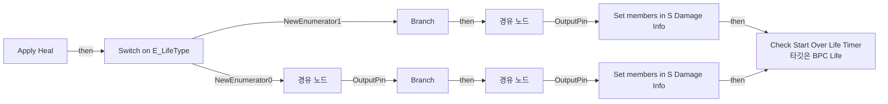

전체 노드·기본 입력 목록

| 노드 ID | 제목 | 미연결 기본 입력 / 에셋 입력 |
|---|---|---|
| `K2Node_FunctionEntry_0` | Apply Heal |  |
| `K2Node_PromotableOperator_0` | float + float |  |
| `K2Node_CallFunction_0` | Clamp (Float) | Min=0.0 |
| `K2Node_PromotableOperator_1` | float &lt; float |  |
| `K2Node_SwitchEnum_0` | Switch on E_LifeType |  |
| `K2Node_Knot_0` | 경유 노드 |  |
| `K2Node_IfThenElse_0` | Branch |  |
| `K2Node_IfThenElse_1` | Branch |  |
| `K2Node_Knot_1` | 경유 노드 |  |
| `K2Node_Knot_5` | 경유 노드 |  |
| `K2Node_Knot_6` | 경유 노드 |  |
| `K2Node_Knot_10` | 경유 노드 |  |
| `K2Node_PromotableOperator_7` | float + float |  |
| `K2Node_CallFunction_2` | Clamp (Float) | Min=0.0 |
| `K2Node_PromotableOperator_6` | float &lt; float |  |
| `K2Node_Knot_2` | 경유 노드 |  |
| `K2Node_Knot_3` | 경유 노드 |  |
| `K2Node_Knot_4` | 경유 노드 |  |
| `K2Node_Knot_11` | 경유 노드 |  |
| `K2Node_Knot_12` | 경유 노드 |  |
| `K2Node_CallFunction_10` | Get Over Max Health |  |
| `K2Node_CallFunction_11` | Get Over Max Plate |  |
| `K2Node_CallFunction_1` | Get Now Health |  |
| `K2Node_CallFunction_6` | Get Now Plate |  |
| `K2Node_VariableGet_2` | Get LifeInfo |  |
| `K2Node_SetFieldsInStruct_1` | Set members in S Damage Info |  |
| `K2Node_Knot_8` | 경유 노드 |  |
| `K2Node_Knot_9` | 경유 노드 |  |
| `K2Node_Select_1` | 선택 |  |
| `K2Node_CallFunction_13` | Get Max Health |  |
| `K2Node_Select_0` | 선택 |  |
| `K2Node_Knot_7` | 경유 노드 |  |
| `K2Node_CallFunction_15` | Get Max Plate |  |
| `K2Node_VariableGet_1` | Get LifeInfo |  |
| `K2Node_SetFieldsInStruct_0` | Set members in S Damage Info |  |
| `K2Node_CallFunction_3` | Check Start Over Life Timer 타깃은 BPC Life |  |

### Calc Dmg Distribution

실행 핀 플로우차트

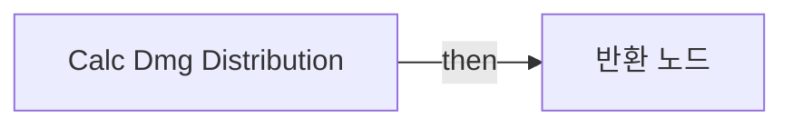

전체 노드·기본 입력 목록

| 노드 ID | 제목 | 미연결 기본 입력 / 에셋 입력 |
|---|---|---|
| `K2Node_FunctionEntry_0` | Calc Dmg Distribution |  |
| `K2Node_FunctionResult_0` | 반환 노드 |  |
| `K2Node_MathExpression_0` | max(0.000000, (NowPlate - (Dmg * 0.660000))) Math Expression |  |
| `K2Node_MathExpression_1` | max(0, (NowHealth - ((Dmg * 0.340000) + (max(0, ((Dmg * 0.660000) - NowPlate)))))) Math Expression |  |
| `K2Node_CallFunction_19` | Get Now Plate |  |
| `K2Node_CallFunction_20` | Get Now Health |  |

### DropBuffOnDeath

실행 핀 플로우차트

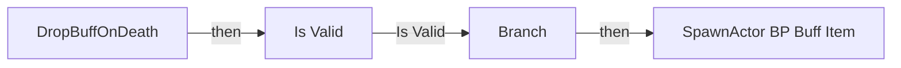

전체 노드·기본 입력 목록

| 노드 ID | 제목 | 미연결 기본 입력 / 에셋 입력 |
|---|---|---|
| `K2Node_FunctionEntry_0` | DropBuffOnDeath |  |
| `K2Node_CallFunction_0` | Get Owner 타깃은 액터 컴포넌트 |  |
| `K2Node_CallFunction_1` | Get Component by Class 타깃은 액터 | ComponentClass=/Game/QuakeLike_1_0/Buff/BPC_Buff.BPC_Buff_C |
| `K2Node_MacroInstance_0` | Is Valid |  |
| `K2Node_VariableGet_2` | Get buffEndServerTime |  |
| `K2Node_PromotableOperator_0` | float - float |  |
| `K2Node_CallFunction_2` | Get Game State |  |
| `K2Node_CallFunction_3` | Get Server World Time Seconds 타깃은 게임 스테이트 베이스 |  |
| `K2Node_PromotableOperator_1` | float &gt; float |  |
| `K2Node_IfThenElse_0` | Branch |  |
| `K2Node_SpawnActorFromClass_0` | SpawnActor BP Buff Item | Class=/Game/QuakeLike_1_0/DropItem/BP_BuffItem.BP_BuffItem_C; CollisionHandlingOverride=Undefined; TransformScaleMethod=MultiplyWithRoot; IsDroppedBuff=true; IsSnapToGround=False |
| `K2Node_CallFunction_4` | Get Owner 타깃은 액터 컴포넌트 |  |
| `K2Node_CallFunction_5` | Get Actor Transform 타깃은 액터 |  |
| `K2Node_MakeStruct_1` | Make Data Table Row Handle | DataTable=/Game/QuakeLike_1_0/Data/Item/DropTable/DT_BuffTable.DT_BuffTable |
| `K2Node_VariableGet_0` | Get currentBuffRowName |  |
| `K2Node_VariableGet_1` | Get MinimumDroppedBuffDuration |  |
| `K2Node_CallFunction_6` | float + float |  |
| `K2Node_CallFunction_7` | Max (Float) |  |

### EventGraph

실행 핀 플로우차트

```mermaid
flowchart LR
  n0["Begin Play 이벤트"]
  n1["Init Info<br/>타깃은 BPC Life"]
  n2["ApplyHeal 이벤트<br/>BPI Life에서"]
  n3["Apply Heal<br/>타깃은 BPC Life"]
  n4["Switch Has Authority"]
  n5["노티파이로 설정"]
  n6["OverLifeHandle<br/>Custom Event"]
  n7["Handle Over Life<br/>타깃은 BPC Life"]
  n8["OwnerTakeDamage 이벤트<br/>BPI Life에서"]
  n9["Switch Has Authority"]
  n10["Branch"]
  n11["Multicast_PlayHealFeedbackReplicated From Server<br/>Executes On All<br/>Custom Event"]
  n12["Play Sound at Location"]
  n13["경유 노드"]
  n14["Spawn System at Location"]
  n15["Multicast Play Heal Feedback<br/>타깃은 BPC Life<br/>모두에 리플리케이트됨 (서버인 경우)"]
  n16["Branch"]
  n17["Cast To BP_QuakeGameMode"]
  n18["Broadcast Kill Log<br/>타깃은 BP Quake Game Mode"]
  n19["시퀀스"]
  n20["CheckStartOverLifeTimer<br/>Custom Event"]
  n21["Branch"]
  n22["Branch"]
  n23["Set Timer by Event"]
  n24["Set OverLifeTimerHandle"]
  n25["Check Start Over Life Timer<br/>타깃은 BPC Life"]
  n26["Switch Has Authority"]
  n27["Set LifeData"]
  n28["Switch Has Authority"]
  n29["Cast To Pawn"]
  n30["Cast To BP_QuakePlayerState"]
  n31["Cast To Pawn"]
  n32["Cast To BP_QuakePlayerState"]
  n33["Get Selected Item<br/>Target is BPI Inventory"]
  n34["Is Valid"]
  n35["Get Weapon Data<br/>Target is BPI Weapon"]
  n36["Set DamageWeaponData"]
  n37["Set DamageWeaponData"]
  n38["Cast To BP_QuakePlayerController"]
  n39["Client Show Kill Message<br/>타깃은 BP Quake Player Controller<br/>RELIABLE 소유 클라이언트에 리플리케이트됨 (서버인 경우)"]
  n40["Cast To BP_QuakePlayerState"]
  n41["Get Display Name<br/>타깃은 BP Quake Player State"]
  n42["Get Display Name<br/>타깃은 BP Quake Player State"]
  n43["Get Display Name<br/>타깃은 BP Quake Player State"]
  n44["Cast To Pawn"]
  n45["Handle Fatal Damage"]
  n0 -->|"then"| n27
  n1 -->|"then"| n25
  n2 -->|"then"| n4
  n3 -->|"then"| n15
  n4 -->|"Authority"| n3
  n5 -->|"then"| n16
  n6 -->|"then"| n7
  n8 -->|"then"| n9
  n9 -->|"Authority"| n10
  n10 -->|"then"| n33
  n11 -->|"then"| n13
  n12 -->|"then"| n14
  n13 -->|"OutputPin"| n12
  n16 -->|"then"| n19
  n17 -->|"then"| n29
  n19 -->|"then_0"| n17
  n19 -->|"then_1"| n38
  n20 -->|"then"| n26
  n21 -->|"then"| n22
  n22 -->|"else"| n23
  n23 -->|"then"| n24
  n26 -->|"Authority"| n21
  n27 -->|"then"| n28
  n28 -->|"Authority"| n1
  n29 -->|"then"| n30
  n30 -->|"then"| n41
  n31 -->|"then"| n32
  n32 -->|"then"| n42
  n33 -->|"then"| n34
  n34 -->|"Is Valid"| n35
  n34 -->|"Is Not Valid"| n37
  n35 -->|"then"| n36
  n36 -->|"then"| n45
  n37 -->|"then"| n45
  n38 -->|"then"| n44
  n40 -->|"then"| n43
  n41 -->|"then"| n31
  n42 -->|"then"| n18
  n43 -->|"then"| n39
  n44 -->|"then"| n40
  n45 -->|"then"| n5
```

전체 노드·기본 입력 목록

| 노드 ID | 제목 | 미연결 기본 입력 / 에셋 입력 |
|---|---|---|
| `K2Node_Event_2` | Begin Play 이벤트 |  |
| `K2Node_CallFunction_6` | Init Info 타깃은 BPC Life |  |
| `K2Node_Event_3` | ApplyHeal 이벤트 BPI Life에서 |  |
| `K2Node_CallFunction_5` | Calc Dmg Distribution |  |
| `K2Node_CallFunction_7` | Apply Heal 타깃은 BPC Life |  |
| `K2Node_MacroInstance_1` | Switch Has Authority |  |
| `EdGraphNode_Comment_4` | 힐 적용 |  |
| `K2Node_VariableSet_0` | 노티파이로 설정 |  |
| `K2Node_CustomEvent_2` | OverLifeHandle Custom Event |  |
| `K2Node_CallFunction_3` | Handle Over Life 타깃은 BPC Life |  |
| `K2Node_VariableGet_4` | Get LifeData |  |
| `K2Node_VariableGet_5` | Get DecayRate |  |
| `K2Node_Event_0` | OwnerTakeDamage 이벤트 BPI Life에서 | yaw=0.0 |
| `K2Node_FormatText_0` | 포맷 텍스트 |  |
| `K2Node_CallFunction_9` | To String (Text) |  |
| `K2Node_CallFunction_0` | Get Now Health |  |
| `K2Node_CallFunction_24` | Get Now Plate |  |
| `K2Node_MacroInstance_3` | Switch Has Authority |  |
| `K2Node_CallFunction_1` | Is Death |  |
| `K2Node_CallFunction_2` | NOT Boolean |  |
| `K2Node_IfThenElse_0` | Branch |  |
| `K2Node_Knot_0` | 경유 노드 |  |
| `K2Node_Knot_1` | 경유 노드 |  |
| `K2Node_Knot_2` | 경유 노드 |  |
| `K2Node_CustomEvent_0` | Multicast_PlayHealFeedbackReplicated From Server Executes On All Custom Event |  |
| `K2Node_Select_4` | 선택 |  |
| `K2Node_Select_3` | 선택 |  |
| `K2Node_Select_2` | 선택 |  |
| `K2Node_Knot_3` | 경유 노드 |  |
| `K2Node_Knot_4` | 경유 노드 |  |
| `K2Node_Select_5` | 선택 |  |
| `K2Node_CallFunction_8` | Play Sound at Location | Rotation=0, 0, 0; VolumeMultiplier=1.000000; PitchMultiplier=1.000000; StartTime=0.000000; AttenuationSettings=/Game/QuakeLike_1_0/Spawner/SoundFX/SA_HealPickup.SA_HealPickup |
| `K2Node_Knot_5` | 경유 노드 |  |
| `K2Node_CallFunction_10` | Get Owner 타깃은 액터 컴포넌트 |  |
| `K2Node_CallFunction_11` | Get Actor Location 타깃은 액터 |  |
| `K2Node_CallFunction_12` | Spawn System at Location | Rotation=0, 0, 0; Scale=1.000000,1.000000,1.000000; bAutoDestroy=true; bAutoActivate=true; PoolingMethod=None; bPreCullCheck=true |
| `K2Node_CallFunction_13` | Multicast Play Heal Feedback 타깃은 BPC Life 모두에 리플리케이트됨 (서버인 경우) |  |
| `K2Node_Knot_6` | 경유 노드 |  |
| `K2Node_Knot_7` | 경유 노드 |  |
| `K2Node_VariableGet_10` | Get LifeData |  |
| `K2Node_VariableGet_11` | Get HealthSound |  |
| `K2Node_VariableGet_12` | Get OverHealthSound |  |
| `K2Node_VariableGet_13` | Get PlateSound |  |
| `K2Node_VariableGet_14` | Get OverPlateSound |  |
| `K2Node_VariableGet_15` | Get LifeData |  |
| `K2Node_VariableGet_16` | Get HealthFX |  |
| `K2Node_VariableGet_17` | Get PlateFX |  |
| `EdGraphNode_Comment_0` | 사운드, FX 출력 |  |
| `K2Node_CallFunction_14` | Get Buff Take Damage |  |
| `K2Node_IfThenElse_1` | Branch |  |
| `K2Node_VariableGet_2` | Get |  |
| `K2Node_PromotableOperator_0` | float &lt;= float |  |
| `K2Node_CallFunction_15` | Get Game Mode |  |
| `K2Node_DynamicCast_0` | Cast To BP_QuakeGameMode |  |
| `K2Node_CallFunction_16` | Broadcast Kill Log 타깃은 BP Quake Game Mode |  |
| `K2Node_CallFunction_17` | Get Owner 타깃은 액터 컴포넌트 |  |
| `K2Node_ExecutionSequence_1` | 시퀀스 |  |
| `K2Node_CustomEvent_1` | CheckStartOverLifeTimer Custom Event |  |
| `K2Node_IfThenElse_2` | Branch |  |
| `K2Node_PromotableOperator_1` | float &gt; float |  |
| `K2Node_CallFunction_22` | Get Max Health |  |
| `K2Node_PromotableOperator_2` | float &gt; float |  |
| `K2Node_CallFunction_23` | Get Max Plate |  |
| `K2Node_CommutativeAssociativeBinaryOperator_0` | OR Boolean |  |
| `K2Node_IfThenElse_3` | Branch |  |
| `K2Node_CallFunction_4` | Is Timer Active by Handle |  |
| `K2Node_VariableGet_0` | Get OverLifeTimerHandle |  |
| `K2Node_CallFunction_26` | Set Timer by Event | Time=1.000000; bLooping=true; bMaxOncePerFrame=false; InitialStartDelay=0.000000; InitialStartDelayVariance=0.000000 |
| `K2Node_CreateDelegate_0` | 이벤트 생성 |  |
| `K2Node_VariableSet_1` | Set OverLifeTimerHandle |  |
| `K2Node_CallFunction_27` | Check Start Over Life Timer 타깃은 BPC Life |  |
| `K2Node_MacroInstance_0` | Switch Has Authority |  |
| `K2Node_CallFunction_28` | Get Now Health |  |
| `K2Node_CallFunction_29` | Get Now Plate |  |
| `EdGraphNode_Comment_1` | overlife 감소 로직 |  |
| `K2Node_VariableSet_2` | Set LifeData | LifeData=/Game/QuakeLike_1_0/Data/Chracter/DA_DefaultLife.DA_DefaultLife |
| `K2Node_MacroInstance_2` | Switch Has Authority |  |
| `K2Node_DynamicCast_1` | Cast To Pawn |  |
| `K2Node_VariableGet_7` | Get PlayerState |  |
| `K2Node_DynamicCast_4` | Cast To BP_QuakePlayerState |  |
| `K2Node_DynamicCast_3` | Cast To Pawn |  |
| `K2Node_VariableGet_1` | Get PlayerState |  |
| `K2Node_DynamicCast_2` | Cast To BP_QuakePlayerState |  |
| `K2Node_CallFunction_25` | Get Controlled Pawn 타깃은 컨트롤러 |  |
| `K2Node_CallFunction_37` | Get Component by Class 타깃은 액터 | ComponentClass=/Game/QuakeLike_1_0/Inventory/BPC_Inventory.BPC_Inventory_C |
| `K2Node_Message_2` | Get Selected Item Target is BPI Inventory |  |
| `K2Node_MacroInstance_4` | Is Valid |  |
| `K2Node_Message_3` | Get Weapon Data Target is BPI Weapon |  |
| `K2Node_VariableSet_4` | Set DamageWeaponData |  |
| `K2Node_VariableSet_3` | Set DamageWeaponData |  |
| `K2Node_VariableGet_3` | Get DamageWeaponData |  |
| `K2Node_DynamicCast_5` | Cast To BP_QuakePlayerController |  |
| `K2Node_CallFunction_39` | Client Show Kill Message 타깃은 BP Quake Player Controller RELIABLE 소유 클라이언트에 리플리케이트됨 (서버인 경우) |  |
| `K2Node_VariableGet_9` | Get |  |
| `K2Node_CallFunction_20` | Get Owner 타깃은 액터 컴포넌트 |  |
| `K2Node_Knot_9` | 경유 노드 |  |
| `K2Node_Knot_10` | 경유 노드 |  |
| `K2Node_VariableGet_18` | Get PlayerState |  |
| `K2Node_DynamicCast_9` | Cast To BP_QuakePlayerState |  |
| `K2Node_CallFunction_21` | Get Display Name 타깃은 BP Quake Player State |  |
| `K2Node_CallFunction_38` | To Text (String) |  |
| `K2Node_VariableGet_21` | Get |  |
| `K2Node_CallFunction_40` | Get Display Name 타깃은 BP Quake Player State |  |
| `K2Node_CallFunction_45` | To Text (String) |  |
| `K2Node_CallFunction_46` | Get Display Name 타깃은 BP Quake Player State |  |
| `K2Node_CallFunction_47` | To Text (String) |  |
| `EdGraphNode_Comment_2` | 중앙의 킬로그 메시지 |  |
| `K2Node_DynamicCast_6` | Cast To Pawn |  |
| `K2Node_CallFunction_30` | Handle Fatal Damage | Settings=(DataTable="/Script/Engine.DataTable'/Game/QuakeLike_1_0/Data/Item/DeathDrop/DT_DropItemSetting.DT_DropItemSetting'",RowName="Default") |

### Get Max Health

실행 핀 플로우차트

전체 노드·기본 입력 목록

| 노드 ID | 제목 | 미연결 기본 입력 / 에셋 입력 |
|---|---|---|
| `K2Node_FunctionEntry_0` | Get Max Health |  |
| `K2Node_FunctionResult_0` | 반환 노드 |  |
| `K2Node_VariableGet_0` | Get LifeData |  |
| `K2Node_VariableGet_1` | Get maxHealth |  |

### Get Max Plate

실행 핀 플로우차트

전체 노드·기본 입력 목록

| 노드 ID | 제목 | 미연결 기본 입력 / 에셋 입력 |
|---|---|---|
| `K2Node_FunctionEntry_0` | Get Max Plate |  |
| `K2Node_FunctionResult_0` | 반환 노드 |  |
| `K2Node_VariableGet_0` | Get LifeData |  |
| `K2Node_VariableGet_1` | Get maxPlate |  |

### Get Now Health

실행 핀 플로우차트

전체 노드·기본 입력 목록

| 노드 ID | 제목 | 미연결 기본 입력 / 에셋 입력 |
|---|---|---|
| `K2Node_FunctionEntry_0` | Get Now Health |  |
| `K2Node_FunctionResult_0` | 반환 노드 |  |
| `K2Node_VariableGet_2` | Get |  |

### Get Now Plate

실행 핀 플로우차트

전체 노드·기본 입력 목록

| 노드 ID | 제목 | 미연결 기본 입력 / 에셋 입력 |
|---|---|---|
| `K2Node_FunctionEntry_0` | Get Now Plate |  |
| `K2Node_FunctionResult_0` | 반환 노드 |  |
| `K2Node_VariableGet_2` | Get |  |

### Get Over Max Health

실행 핀 플로우차트

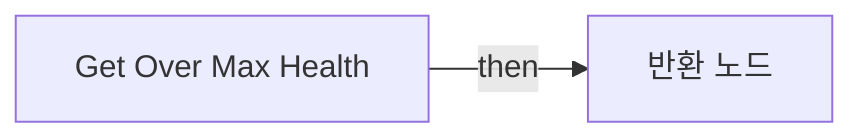

전체 노드·기본 입력 목록

| 노드 ID | 제목 | 미연결 기본 입력 / 에셋 입력 |
|---|---|---|
| `K2Node_FunctionEntry_0` | Get Over Max Health |  |
| `K2Node_FunctionResult_0` | 반환 노드 |  |
| `K2Node_VariableGet_0` | Get LifeData |  |
| `K2Node_VariableGet_2` | Get overMaxHealth |  |

### Get Over Max Plate

실행 핀 플로우차트

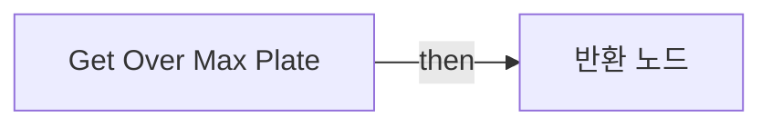

전체 노드·기본 입력 목록

| 노드 ID | 제목 | 미연결 기본 입력 / 에셋 입력 |
|---|---|---|
| `K2Node_FunctionEntry_0` | Get Over Max Plate |  |
| `K2Node_FunctionResult_0` | 반환 노드 |  |
| `K2Node_VariableGet_0` | Get LifeData |  |
| `K2Node_VariableGet_1` | Get overMaxPlate |  |

### Get Owning Controller

실행 핀 플로우차트

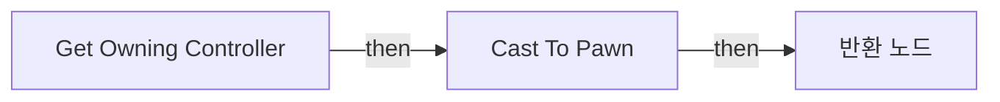

전체 노드·기본 입력 목록

| 노드 ID | 제목 | 미연결 기본 입력 / 에셋 입력 |
|---|---|---|
| `K2Node_FunctionEntry_0` | Get Owning Controller |  |
| `K2Node_FunctionResult_0` | 반환 노드 |  |
| `K2Node_DynamicCast_0` | Cast To Pawn |  |
| `K2Node_CallFunction_1` | Get Controller 타깃은 폰 |  |
| `K2Node_CallFunction_2` | Get Owner 타깃은 액터 컴포넌트 |  |

### GetBuffTakeDamage

실행 핀 플로우차트

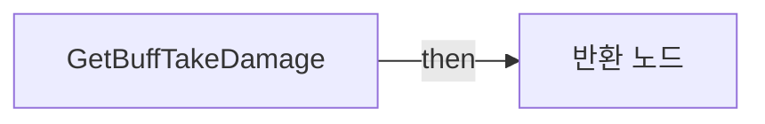

전체 노드·기본 입력 목록

| 노드 ID | 제목 | 미연결 기본 입력 / 에셋 입력 |
|---|---|---|
| `K2Node_FunctionEntry_0` | GetBuffTakeDamage |  |
| `K2Node_CallFunction_0` | Get Owner 타깃은 액터 컴포넌트 |  |
| `K2Node_CallFunction_1` | Get Component by Class 타깃은 액터 | ComponentClass=/Game/QuakeLike_1_0/Buff/BPC_Buff.BPC_Buff_C |
| `K2Node_FunctionResult_0` | 반환 노드 |  |
| `K2Node_CallFunction_3` | Is Valid |  |
| `K2Node_CallFunction_4` | Select Float |  |
| `K2Node_CallFunction_5` | Calc Defence Buff 타깃은 BPC Buff |  |
| `K2Node_Knot_1` | 경유 노드 |  |
| `K2Node_Knot_2` | 경유 노드 |  |

### HandleOverLife

실행 핀 플로우차트

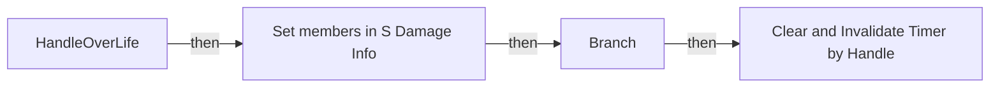

전체 노드·기본 입력 목록

| 노드 ID | 제목 | 미연결 기본 입력 / 에셋 입력 |
|---|---|---|
| `K2Node_FunctionEntry_0` | HandleOverLife |  |
| `K2Node_PromotableOperator_6` | float &gt; float |  |
| `K2Node_PromotableOperator_7` | float - float |  |
| `K2Node_CommutativeAssociativeBinaryOperator_3` | Max (Float) |  |
| `K2Node_CallFunction_14` | Get Max Health |  |
| `EdGraphNode_Comment_0` | 체력 감소 로직 |  |
| `K2Node_CommutativeAssociativeBinaryOperator_2` | AND Boolean |  |
| `K2Node_IfThenElse_2` | Branch |  |
| `K2Node_CallFunction_5` | Clear and Invalidate Timer by Handle |  |
| `K2Node_VariableGet_6` | Get OverLifeTimerHandle |  |
| `K2Node_PromotableOperator_5` | float &lt;= float |  |
| `K2Node_CallFunction_8` | Get Max Health |  |
| `K2Node_PromotableOperator_4` | float &lt;= float |  |
| `K2Node_CallFunction_9` | Get Max Plate |  |
| `EdGraphNode_Comment_2` | 타이머 조건 확인해서 끔 |  |
| `K2Node_CallFunction_15` | Get Now Health |  |
| `K2Node_CallFunction_11` | Get Now Health |  |
| `K2Node_CallFunction_12` | Get Now Plate |  |
| `K2Node_Select_2` | 선택 |  |
| `K2Node_Knot_4` | 경유 노드 |  |
| `K2Node_PromotableOperator_0` | float &gt; float |  |
| `K2Node_PromotableOperator_1` | float - float |  |
| `K2Node_CommutativeAssociativeBinaryOperator_0` | Max (Float) |  |
| `K2Node_Select_1` | 선택 |  |
| `K2Node_Knot_3` | 경유 노드 |  |
| `K2Node_CallFunction_16` | Get Now Plate |  |
| `K2Node_CallFunction_17` | Get Max Plate |  |
| `K2Node_Knot_5` | 경유 노드 |  |
| `K2Node_Knot_6` | 경유 노드 |  |
| `EdGraphNode_Comment_3` | 방어구 감소 로직 |  |
| `K2Node_SetFieldsInStruct_0` | Set members in S Damage Info |  |
| `K2Node_VariableGet_7` | Get LifeInfo |  |
| `K2Node_CallFunction_0` | Get Owner 타깃은 액터 컴포넌트 |  |

### Init Info

실행 핀 플로우차트

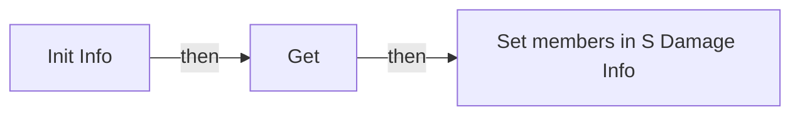

전체 노드·기본 입력 목록

| 노드 ID | 제목 | 미연결 기본 입력 / 에셋 입력 |
|---|---|---|
| `K2Node_FunctionEntry_0` | Init Info |  |
| `K2Node_VariableGet_0` | Get |  |
| `K2Node_VariableGet_1` | Get startHealth |  |
| `K2Node_VariableGet_2` | Get startPlate |  |
| `K2Node_VariableGet_3` | Get LifeInfo |  |
| `K2Node_SetFieldsInStruct_0` | Set members in S Damage Info |  |

### Is Death

실행 핀 플로우차트

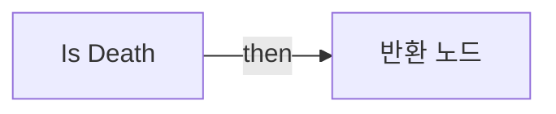

전체 노드·기본 입력 목록

| 노드 ID | 제목 | 미연결 기본 입력 / 에셋 입력 |
|---|---|---|
| `K2Node_FunctionEntry_0` | Is Death |  |
| `K2Node_FunctionResult_0` | 반환 노드 |  |
| `K2Node_PromotableOperator_0` | float &lt;= float |  |
| `K2Node_VariableGet_1` | Get |  |

### IsFatalDamage

실행 핀 플로우차트

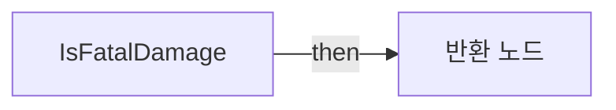

전체 노드·기본 입력 목록

| 노드 ID | 제목 | 미연결 기본 입력 / 에셋 입력 |
|---|---|---|
| `K2Node_FunctionEntry_0` | IsFatalDamage |  |
| `K2Node_FunctionResult_0` | 반환 노드 |  |
| `K2Node_CallFunction_2` | Calc Dmg Distribution | New Plate=0.0 |
| `K2Node_PromotableOperator_0` | float &lt;= float |  |

### OnRep_LifeInfo

실행 핀 플로우차트

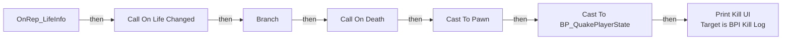

전체 노드·기본 입력 목록

| 노드 ID | 제목 | 미연결 기본 입력 / 에셋 입력 |
|---|---|---|
| `K2Node_FunctionEntry_0` | OnRep_LifeInfo |  |
| `K2Node_PromotableOperator_0` | float &lt;= float |  |
| `K2Node_IfThenElse_0` | Branch |  |
| `K2Node_CallDelegate_1` | Call On Death |  |
| `K2Node_CallDelegate_0` | Call On Life Changed |  |
| `K2Node_Self_1` | 셀프-레퍼런스 |  |
| `K2Node_VariableGet_0` | Get |  |
| `K2Node_Knot_0` | 경유 노드 |  |
| `K2Node_Knot_1` | 경유 노드 |  |
| `K2Node_Knot_2` | 경유 노드 |  |
| `K2Node_Knot_3` | 경유 노드 |  |
| `K2Node_Knot_4` | 경유 노드 |  |
| `K2Node_CallFunction_1` | Get Owner 타깃은 액터 컴포넌트 |  |
| `K2Node_CallFunction_19` | To Text (String) |  |
| `K2Node_Message_0` | Print Kill UI Target is BPI Kill Log |  |
| `K2Node_DynamicCast_0` | Cast To Pawn |  |
| `K2Node_CallFunction_30` | Get Player Name 타깃은 플레이어 스테이트 |  |
| `K2Node_VariableGet_1` | Get PlayerState |  |
| `K2Node_VariableGet_6` | Get CampaignName |  |
| `K2Node_DynamicCast_2` | Cast To BP_QuakePlayerState |  |
| `K2Node_CallFunction_31` | Is Empty |  |
| `K2Node_CallFunction_32` | Select String |  |

## 조회 범위의 한계

ObjectIterator로 발견했으나 MCP helper가 반환하지 않은 그래프입니다. delegate signature·컴파일된 중간 그래프·macro·애니메이션 내부 그래프가 섞일 수 있습니다.

- `ApplyHeal`: Graph 'ApplyHeal' not found in Blueprint.
- `CheckStartOverLifeTimer`: Graph 'CheckStartOverLifeTimer' not found in Blueprint.
- `GetLife`: Graph 'GetLife' not found in Blueprint.
- `Multicast_PlayHealFeedback`: Graph 'Multicast_PlayHealFeedback' not found in Blueprint.
- `OnDeath`: Graph 'OnDeath' not found in Blueprint.
- `OnLifeChanged`: Graph 'OnLifeChanged' not found in Blueprint.
- `OverLifeHandle`: Graph 'OverLifeHandle' not found in Blueprint.
- `OwnerTakeDamage`: Graph 'OwnerTakeDamage' not found in Blueprint.
- `ReceiveBeginPlay`: Graph 'ReceiveBeginPlay' not found in Blueprint.

[원본 MCP 스냅샷](../../../Evidence/blueprints-070.json)
