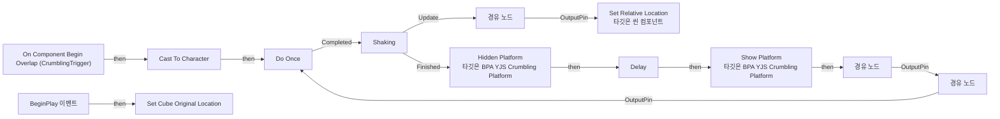
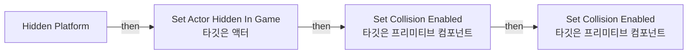
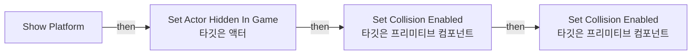
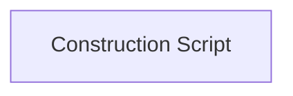

# BPA_YJS_CrumblingPlatform

에셋: `/Game/QuakeLike_1_0/MapDesign/MapGimmick/BPA_YJS_CrumblingPlatform`

부모: `/Script/CoreUObject.Class'/Script/Engine.Actor'`

수집일: 2026-10-12. MCP에서 읽은 그래프·핀 연결의 자동 전사입니다. 상속된 그래프는 부모 문서를 함께 확인합니다.

정적 루트 참조 도달: 없음. 실행 여부 또는 삭제 가능 여부의 확정이 아닙니다.

컴포넌트 목록은 이 BP가 직접 정의한 SCS만 포함합니다. 부모·네이티브 생성 컴포넌트, 인스턴스 설정은 별도입니다.

## 직접 정의한 컴포넌트

| 이름 | 클래스 | 부모 컴포넌트 |
|---|---|---|
| `DefaultSceneRoot` | `SceneComponent` | `` |
| `CrumblingCube` | `StaticMeshComponent` | `DefaultSceneRoot` |
| `CrumblingTrigger` | `BoxComponent` | `CrumblingCube` |

## 변수와 기본값

| 이름 | 타입 | CDO 기본값 |
|---|---|---|
| `ShakePlatform` | `real` | 2.0 |
| `CrumbleDelay` | `real` | 1.5 |
| `ResetTime` | `real` | 3.0 |
| `Cube Original Location ` | `Vector` | &lt;Struct 'Vector' {x: 0.000000, y: 0.000000, z: 0.000000}&gt; |

## 그래프 목록

| 그래프 | 전체 노드 수 |
|---|---|
| EventGraph | 21 |
| Hidden Platform | 6 |
| Show Platform | 6 |
| UserConstructionScript | 1 |

## 그래프별 실행 연결

실선은 출력 exec 핀의 실제 연결입니다. 여러 분기는 출력 핀 이름을 표시합니다. 함수 호출·delegate·타이머의 다음 그래프 실행은 이 그림에서 자동으로 이어 붙이지 않습니다.

순수 계산 노드 및 데이터 핀은 아래 목록과 원본 JSON을 확인합니다. 연결되지 않은 이벤트도 표시되므로, 노드가 있다는 이유만으로 실행된다고 판단하면 안 됩니다.

### EventGraph

실행 핀 플로우차트

전체 노드·기본 입력 목록

| 노드 ID | 제목 | 미연결 기본 입력 / 에셋 입력 |
|---|---|---|
| `K2Node_ComponentBoundEvent_0` | On Component Begin Overlap (CrumblingTrigger) | OtherBodyIndex=0; bFromSweep=false |
| `K2Node_DynamicCast_0` | Cast To Character |  |
| `K2Node_MacroInstance_0` | Do Once |  |
| `K2Node_Timeline_0` | Shaking | NewTime=0.0 |
| `K2Node_CallFunction_1` | Set Relative Location 타깃은 씬 컴포넌트 | bSweep=false; bTeleport=false |
| `K2Node_VariableGet_1` | Get CrumblingCube |  |
| `K2Node_CallFunction_5` | Delay |  |
| `K2Node_VariableGet_5` | Get ResetTime |  |
| `K2Node_Event_3` | BeginPlay 이벤트 |  |
| `K2Node_VariableGet_8` | Get CrumblingCube |  |
| `K2Node_VariableGet_9` | Get RelativeLocation |  |
| `K2Node_VariableSet_0` | Set Cube Original Location  | Output_Get=0, 0, 0 |
| `K2Node_PromotableOperator_2` | float * float |  |
| `K2Node_VariableGet_11` | Get ShakePlatform |  |
| `K2Node_PromotableOperator_3` | vector + vector |  |
| `K2Node_VariableGet_12` | Get | Cube Original Location _X=0.0; Cube Original Location _Y=0.0 |
| `K2Node_Knot_0` | 경유 노드 |  |
| `K2Node_CallFunction_15` | Hidden Platform 타깃은 BPA YJS Crumbling Platform |  |
| `K2Node_CallFunction_16` | Show Platform 타깃은 BPA YJS Crumbling Platform |  |
| `K2Node_Knot_2` | 경유 노드 |  |
| `K2Node_Knot_3` | 경유 노드 |  |

### Hidden Platform

실행 핀 플로우차트

전체 노드·기본 입력 목록

| 노드 ID | 제목 | 미연결 기본 입력 / 에셋 입력 |
|---|---|---|
| `K2Node_FunctionEntry_0` | Hidden Platform |  |
| `K2Node_CallFunction_2` | Set Actor Hidden In Game 타깃은 액터 | bNewHidden=true |
| `K2Node_CallFunction_7` | Set Collision Enabled 타깃은 프리미티브 컴포넌트 | NewType=NoCollision |
| `K2Node_VariableGet_6` | Get CrumblingCube |  |
| `K2Node_CallFunction_8` | Set Collision Enabled 타깃은 프리미티브 컴포넌트 | NewType=NoCollision |
| `K2Node_VariableGet_7` | Get CrumblingTrigger |  |

### Show Platform

실행 핀 플로우차트

전체 노드·기본 입력 목록

| 노드 ID | 제목 | 미연결 기본 입력 / 에셋 입력 |
|---|---|---|
| `K2Node_FunctionEntry_0` | Show Platform |  |
| `K2Node_CallFunction_6` | Set Actor Hidden In Game 타깃은 액터 | bNewHidden=false |
| `K2Node_CallFunction_3` | Set Collision Enabled 타깃은 프리미티브 컴포넌트 | NewType=QueryAndProbe |
| `K2Node_VariableGet_3` | Get CrumblingCube |  |
| `K2Node_CallFunction_4` | Set Collision Enabled 타깃은 프리미티브 컴포넌트 | NewType=QueryAndProbe |
| `K2Node_VariableGet_4` | Get CrumblingTrigger |  |

### UserConstructionScript

실행 핀 플로우차트

전체 노드·기본 입력 목록

| 노드 ID | 제목 | 미연결 기본 입력 / 에셋 입력 |
|---|---|---|
| `K2Node_FunctionEntry_0` | Construction Script |  |

## 조회 범위의 한계

ObjectIterator로 발견했으나 MCP helper가 반환하지 않은 그래프입니다. delegate signature·컴파일된 중간 그래프·macro·애니메이션 내부 그래프가 섞일 수 있습니다.

- `BndEvt__BPA_YJS_CrumblingPlatform_CrumblingTrigger_K2Node_ComponentBoundEvent_0_ComponentBeginOverlapSignature__DelegateSignature`: Graph 'BndEvt__BPA_YJS_CrumblingPlatform_CrumblingTrigger_K2Node_ComponentBoundEvent_0_ComponentBeginOverlapSignature__DelegateSignature' not found in Blueprint.
- `EdGraph_0`: Graph 'EdGraph_0' not found in Blueprint.
- `ExecuteUbergraph_BPA_YJS_CrumblingPlatform`: Graph 'ExecuteUbergraph_BPA_YJS_CrumblingPlatform' not found in Blueprint.
- `Hidden Platform_MERGED`: Graph 'Hidden Platform_MERGED' not found in Blueprint.
- `ReceiveBeginPlay`: Graph 'ReceiveBeginPlay' not found in Blueprint.
- `Shaking__FinishedFunc`: Graph 'Shaking__FinishedFunc' not found in Blueprint.
- `Shaking__UpdateFunc`: Graph 'Shaking__UpdateFunc' not found in Blueprint.
- `Show Platform_MERGED`: Graph 'Show Platform_MERGED' not found in Blueprint.
- `UserConstructionScript_MERGED`: Graph 'UserConstructionScript_MERGED' not found in Blueprint.

[원본 MCP 스냅샷](../../../../Evidence/blueprints-210.json)
