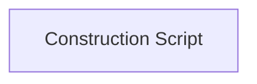

# BPA_YJS_Normal_JumpPad_Nav

에셋: `/Game/QuakeLike_1_0/MapDesign/MapGimmick/BPA_YJS_Normal_JumpPad_Nav`

부모: `/Script/CoreUObject.Class'/Script/Engine.Actor'`

수집일: 2026-10-12. MCP에서 읽은 그래프·핀 연결의 자동 전사입니다. 상속된 그래프는 부모 문서를 함께 확인합니다.

정적 루트 참조 도달: 없음. 실행 여부 또는 삭제 가능 여부의 확정이 아닙니다.

컴포넌트 목록은 이 BP가 직접 정의한 SCS만 포함합니다. 부모·네이티브 생성 컴포넌트, 인스턴스 설정은 별도입니다.

## 직접 정의한 컴포넌트

| 이름 | 클래스 | 부모 컴포넌트 |
|---|---|---|
| `DefaultSceneRoot` | `SceneComponent` | `` |
| `JumpPad` | `StaticMeshComponent` | `DefaultSceneRoot` |
| `JumpPadTrigger` | `BoxComponent` | `JumpPad` |

## 변수와 기본값

| 이름 | 타입 | CDO 기본값 |
|---|---|---|
| `JumpStrength` | `real` | 1000.0 |
| `Velocity` | `Vector` | &lt;Struct 'Vector' {x: 0.000000, y: 0.000000, z: 800.000000}&gt; |
| `JumpHeight` | `Vector` | &lt;Struct 'Vector' {x: 0.000000, y: 0.000000, z: 1000.000000}&gt; |
| `IgnoreInputTime` | `real` | 1.0 |
| `IsLaunching` | `bool` | False |
| `CachedController` | `Controller` | None |

## 그래프 목록

| 그래프 | 전체 노드 수 |
|---|---|
| EventGraph | 32 |
| UserConstructionScript | 1 |

## 그래프별 실행 연결

실선은 출력 exec 핀의 실제 연결입니다. 여러 분기는 출력 핀 이름을 표시합니다. 함수 호출·delegate·타이머의 다음 그래프 실행은 이 그림에서 자동으로 이어 붙이지 않습니다.

순수 계산 노드 및 데이터 핀은 아래 목록과 원본 JSON을 확인합니다. 연결되지 않은 이벤트도 표시되므로, 노드가 있다는 이유만으로 실행된다고 판단하면 안 됩니다.

### EventGraph

```mermaid
flowchart LR
  n0["On Component Begin Overlap (JumpPadTrigger)"]
  n1["Cast To Character"]
  n2["Set Velocity"]
  n3["Branch"]
  n4["Launch Character<br/>타깃은 캐릭터"]
  n5["Set Ignore Move Input<br/>타깃은 컨트롤러"]
  n6["Delay"]
  n7["Set Ignore Move Input<br/>타깃은 컨트롤러"]
  n8["Branch"]
  n9["Set IsLaunching"]
  n10["Set IsLaunching"]
  n11["Is Valid"]
  n12["Set CachedController"]
  n13["Is Valid"]
  n0 -->|"then"| n1
  n1 -->|"then"| n3
  n2 -->|"then"| n6
  n3 -->|"then"| n8
  n4 -->|"then"| n2
  n5 -->|"then"| n4
  n6 -->|"then"| n13
  n7 -->|"then"| n10
  n8 -->|"then"| n11
  n9 -->|"then"| n5
  n11 -->|"Is Valid"| n12
  n12 -->|"then"| n9
  n13 -->|"Is Valid"| n7
  n13 -->|"Is Not Valid"| n10
```

실행 핀 플로우차트

전체 노드·기본 입력 목록

| 노드 ID | 제목 | 미연결 기본 입력 / 에셋 입력 |
|---|---|---|
| `K2Node_ComponentBoundEvent_0` | On Component Begin Overlap (JumpPadTrigger) | OtherBodyIndex=0; bFromSweep=false |
| `K2Node_DynamicCast_1` | Cast To Character |  |
| `K2Node_VariableGet_2` | Get Velocity |  |
| `K2Node_VariableSet_1` | Set Velocity | Output_Get=0, 0, 0 |
| `K2Node_PromotableOperator_0` | vector * vector | B=1.000000,1.000000,0.000000 |
| `K2Node_PromotableOperator_3` | vector + vector |  |
| `K2Node_VariableGet_3` | Get CharacterMovement |  |
| `K2Node_VariableGet_5` | Get Velocity |  |
| `K2Node_CallFunction_0` | Is Player Controlled 타깃은 폰 |  |
| `K2Node_IfThenElse_1` | Branch |  |
| `K2Node_Knot_2` | 경유 노드 |  |
| `K2Node_Knot_1` | 경유 노드 |  |
| `K2Node_Knot_3` | 경유 노드 |  |
| `K2Node_Knot_4` | 경유 노드 |  |
| `K2Node_CallFunction_12` | Launch Character 타깃은 캐릭터 | bXYOverride=false; bZOverride=true |
| `K2Node_VariableGet_1` | Get JumpHeight |  |
| `K2Node_CallFunction_7` | Set Ignore Move Input 타깃은 컨트롤러 | bNewMoveInput=true |
| `K2Node_CallFunction_6` | Delay |  |
| `K2Node_CallFunction_2` | Set Ignore Move Input 타깃은 컨트롤러 | bNewMoveInput=false |
| `K2Node_CallFunction_1` | Get Controller 타깃은 폰 |  |
| `K2Node_VariableGet_0` | Get IgnoreInputTime |  |
| `K2Node_VariableGet_4` | Get IsLaunching |  |
| `K2Node_CallFunction_3` | NOT Boolean |  |
| `K2Node_IfThenElse_0` | Branch |  |
| `K2Node_VariableSet_2` | Set IsLaunching | IsLaunching=true; Output_Get=false |
| `K2Node_VariableSet_3` | Set IsLaunching | IsLaunching=false; Output_Get=false |
| `K2Node_MacroInstance_1` | Is Valid |  |
| `K2Node_VariableSet_0` | Set CachedController |  |
| `K2Node_MacroInstance_0` | Is Valid |  |
| `K2Node_VariableGet_6` | Get CachedController |  |
| `K2Node_VariableGet_7` | Get CachedController |  |
| `K2Node_VariableGet_8` | Get CachedController |  |

### UserConstructionScript

실행 핀 플로우차트

전체 노드·기본 입력 목록

| 노드 ID | 제목 | 미연결 기본 입력 / 에셋 입력 |
|---|---|---|
| `K2Node_FunctionEntry_0` | Construction Script |  |

## 조회 범위의 한계

ObjectIterator로 발견했으나 MCP helper가 반환하지 않은 그래프입니다. delegate signature·컴파일된 중간 그래프·macro·애니메이션 내부 그래프가 섞일 수 있습니다.

- `BndEvt__BPA_YJS_JumpPad_JumpPadTrigger_K2Node_ComponentBoundEvent_0_ComponentBeginOverlapSignature__DelegateSignature`: Graph 'BndEvt__BPA_YJS_JumpPad_JumpPadTrigger_K2Node_ComponentBoundEvent_0_ComponentBeginOverlapSignature__DelegateSignature' not found in Blueprint.
- `EdGraph_0`: Graph 'EdGraph_0' not found in Blueprint.
- `EdGraph_1`: Graph 'EdGraph_1' not found in Blueprint.
- `ExecuteUbergraph_BPA_YJS_Normal_JumpPad_Nav`: Graph 'ExecuteUbergraph_BPA_YJS_Normal_JumpPad_Nav' not found in Blueprint.
- `UserConstructionScript_MERGED`: Graph 'UserConstructionScript_MERGED' not found in Blueprint.

[원본 MCP 스냅샷](../../../../Evidence/blueprints-210.json)
