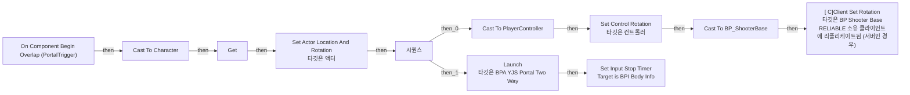
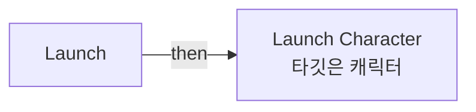
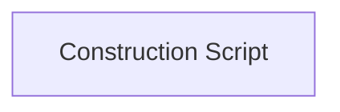

# BPA_YJS_Portal_TwoWay

에셋: `/Game/QuakeLike_1_0/MapDesign/MapGimmick/BPA_YJS_Portal_TwoWay`

부모: `/Script/CoreUObject.Class'/Script/Engine.Actor'`

수집일: 2026-10-12. MCP에서 읽은 그래프·핀 연결의 자동 전사입니다. 상속된 그래프는 부모 문서를 함께 확인합니다.

정적 루트 참조 도달: 있음. 실행 여부 또는 삭제 가능 여부의 확정이 아닙니다.

컴포넌트 목록은 이 BP가 직접 정의한 SCS만 포함합니다. 부모·네이티브 생성 컴포넌트, 인스턴스 설정은 별도입니다.

## 직접 정의한 컴포넌트

| 이름 | 클래스 | 부모 컴포넌트 |
|---|---|---|
| `DefaultSceneRoot` | `SceneComponent` | `` |
| `Portal` | `StaticMeshComponent` | `DefaultSceneRoot` |
| `PortalTrigger` | `BoxComponent` | `Portal` |
| `ExitDirection` | `ArrowComponent` | `DefaultSceneRoot` |

## 변수와 기본값

| 이름 | 타입 | CDO 기본값 |
|---|---|---|
| `TargetPortal` | `BPA_YJS_Portal_TwoWay_C` | None |
| `teleportDA` | `PDA_TeleportMapGimmick_C` | /Game/QuakeLike_1_0/Data/MapGimmick/DA_TeleportMapGimmick.DA_TeleportMapGimmick |

## 그래프 목록

| 그래프 | 전체 노드 수 |
|---|---|
| EventGraph | 33 |
| Launch | 15 |
| UserConstructionScript | 1 |

## 그래프별 실행 연결

실선은 출력 exec 핀의 실제 연결입니다. 여러 분기는 출력 핀 이름을 표시합니다. 함수 호출·delegate·타이머의 다음 그래프 실행은 이 그림에서 자동으로 이어 붙이지 않습니다.

순수 계산 노드 및 데이터 핀은 아래 목록과 원본 JSON을 확인합니다. 연결되지 않은 이벤트도 표시되므로, 노드가 있다는 이유만으로 실행된다고 판단하면 안 됩니다.

### EventGraph

실행 핀 플로우차트

전체 노드·기본 입력 목록

| 노드 ID | 제목 | 미연결 기본 입력 / 에셋 입력 |
|---|---|---|
| `K2Node_ComponentBoundEvent_0` | On Component Begin Overlap (PortalTrigger) | OtherBodyIndex=0; bFromSweep=false |
| `K2Node_DynamicCast_0` | Cast To Character |  |
| `K2Node_VariableGet_0` | Get |  |
| `K2Node_VariableGet_4` | Get ExitDirection |  |
| `K2Node_CallFunction_0` | Get World Location 타깃은 씬 컴포넌트 |  |
| `K2Node_CallFunction_1` | Get World Rotation 타깃은 씬 컴포넌트 |  |
| `K2Node_CallFunction_2` | Set Actor Location And Rotation 타깃은 액터 | bSweep=false; bTeleport=false; ReturnValue=false |
| `K2Node_Knot_1` | 경유 노드 |  |
| `K2Node_CallFunction_7` | Get Controller 타깃은 폰 |  |
| `K2Node_DynamicCast_1` | Cast To PlayerController |  |
| `K2Node_CallFunction_8` | Set Control Rotation 타깃은 컨트롤러 |  |
| `K2Node_Knot_2` | 경유 노드 |  |
| `K2Node_Knot_3` | 경유 노드 |  |
| `K2Node_Knot_4` | 경유 노드 |  |
| `K2Node_Knot_10` | 경유 노드 |  |
| `K2Node_Knot_17` | 경유 노드 |  |
| `K2Node_CallFunction_10` | Launch 타깃은 BPA YJS Portal Two Way |  |
| `K2Node_Knot_20` | 경유 노드 |  |
| `K2Node_Message_0` | Set Input Stop Timer Target is BPI Body Info |  |
| `K2Node_Knot_21` | 경유 노드 |  |
| `K2Node_VariableGet_11` | Get TargetPortal |  |
| `K2Node_VariableGet_12` | Get teleportDA |  |
| `K2Node_VariableGet_13` | Get moveLockTime |  |
| `K2Node_Knot_22` | 경유 노드 |  |
| `K2Node_ExecutionSequence_0` | 시퀀스 |  |
| `K2Node_Knot_24` | 경유 노드 |  |
| `K2Node_Knot_25` | 경유 노드 |  |
| `K2Node_DynamicCast_3` | Cast To BP_ShooterBase |  |
| `K2Node_CallFunction_5` | [ C]Client Set Rotation 타깃은 BP Shooter Base RELIABLE 소유 클라이언트에 리플리케이트됨 (서버인 경우) |  |
| `K2Node_Knot_0` | 경유 노드 |  |
| `K2Node_Knot_5` | 경유 노드 |  |
| `K2Node_Knot_6` | 경유 노드 |  |
| `K2Node_Knot_7` | 경유 노드 |  |

### Launch

실행 핀 플로우차트

전체 노드·기본 입력 목록

| 노드 ID | 제목 | 미연결 기본 입력 / 에셋 입력 |
|---|---|---|
| `K2Node_FunctionEntry_0` | Launch |  |
| `K2Node_CallFunction_5` | Launch Character 타깃은 캐릭터 | bXYOverride=true; bZOverride=true |
| `K2Node_VariableGet_5` | Get TargetPortal |  |
| `K2Node_VariableGet_6` | Get teleportDA |  |
| `K2Node_VariableGet_7` | Get launchPower |  |
| `K2Node_VariableGet_0` | Get TargetPortal |  |
| `K2Node_VariableGet_1` | Get ExitDirection |  |
| `K2Node_CallFunction_0` | Get World Rotation 타깃은 씬 컴포넌트 |  |
| `K2Node_CallFunction_3` | Break Rotator | Roll=0.0; Pitch=0.0 |
| `K2Node_Knot_1` | 경유 노드 |  |
| `K2Node_VariableGet_2` | Get launchAngle |  |
| `K2Node_CallFunction_4` | Make Rotator | Roll=0.0 |
| `K2Node_Knot_2` | 경유 노드 |  |
| `K2Node_CallFunction_7` | Get Forward Vector |  |
| `K2Node_PromotableOperator_2` | vector * vector |  |

### UserConstructionScript

실행 핀 플로우차트

전체 노드·기본 입력 목록

| 노드 ID | 제목 | 미연결 기본 입력 / 에셋 입력 |
|---|---|---|
| `K2Node_FunctionEntry_0` | Construction Script |  |

## 조회 범위의 한계

ObjectIterator로 발견했으나 MCP helper가 반환하지 않은 그래프입니다. delegate signature·컴파일된 중간 그래프·macro·애니메이션 내부 그래프가 섞일 수 있습니다.

- `BndEvt__BPA_YJS_Portal_PortalTrigger_K2Node_ComponentBoundEvent_0_ComponentBeginOverlapSignature__DelegateSignature`: Graph 'BndEvt__BPA_YJS_Portal_PortalTrigger_K2Node_ComponentBoundEvent_0_ComponentBeginOverlapSignature__DelegateSignature' not found in Blueprint.
- `ExecuteUbergraph_BPA_YJS_Portal_TwoWay`: Graph 'ExecuteUbergraph_BPA_YJS_Portal_TwoWay' not found in Blueprint.
- `Launch_MERGED`: Graph 'Launch_MERGED' not found in Blueprint.
- `UserConstructionScript_MERGED`: Graph 'UserConstructionScript_MERGED' not found in Blueprint.

[원본 MCP 스냅샷](../../../../Evidence/blueprints-210.json)
