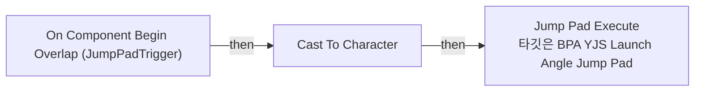
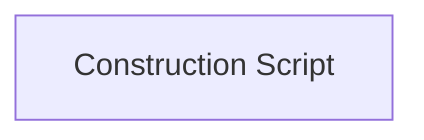

# BPA_YJS_LaunchAngle_JumpPad

에셋: `/Game/QuakeLike_1_0/MapDesign/MapGimmick/JumpPad/BPA_YJS_LaunchAngle_JumpPad`

부모: `/Script/CoreUObject.Class'/Script/Engine.Actor'`

수집일: 2026-10-12. MCP에서 읽은 그래프·핀 연결의 자동 전사입니다. 상속된 그래프는 부모 문서를 함께 확인합니다.

정적 루트 참조 도달: 없음. 실행 여부 또는 삭제 가능 여부의 확정이 아닙니다.

컴포넌트 목록은 이 BP가 직접 정의한 SCS만 포함합니다. 부모·네이티브 생성 컴포넌트, 인스턴스 설정은 별도입니다.

## 직접 정의한 컴포넌트

| 이름 | 클래스 | 부모 컴포넌트 |
|---|---|---|
| `DefaultSceneRoot` | `SceneComponent` | `` |
| `JumpPad` | `StaticMeshComponent` | `DefaultSceneRoot` |
| `Arrow` | `ArrowComponent` | `DefaultSceneRoot` |
| `JumpPadTrigger` | `BoxComponent` | `JumpPad` |

## 변수와 기본값

| 이름 | 타입 | CDO 기본값 |
|---|---|---|
| `Target Point` | `Actor` | None |
| `RiseGravityScale` | `real` | 3.0 |
| `FallGravityScale` | `real` | 0.8 |
| `Arc Angle` | `real` | 60.0 |
| `JumpPadCommonSettings` | `JumpPadCommonSettings` | /Game/QuakeLike_1_0/MapDesign/MapGimmick/JumpPad/DA_JumpPadCommon.DA_JumpPadCommon |

## 그래프 목록

| 그래프 | 전체 노드 수 |
|---|---|
| EventGraph | 3 |
| JumpPad Execute | 48 |
| UserConstructionScript | 1 |

## 그래프별 실행 연결

실선은 출력 exec 핀의 실제 연결입니다. 여러 분기는 출력 핀 이름을 표시합니다. 함수 호출·delegate·타이머의 다음 그래프 실행은 이 그림에서 자동으로 이어 붙이지 않습니다.

순수 계산 노드 및 데이터 핀은 아래 목록과 원본 JSON을 확인합니다. 연결되지 않은 이벤트도 표시되므로, 노드가 있다는 이유만으로 실행된다고 판단하면 안 됩니다.

### EventGraph

실행 핀 플로우차트

전체 노드·기본 입력 목록

| 노드 ID | 제목 | 미연결 기본 입력 / 에셋 입력 |
|---|---|---|
| `K2Node_ComponentBoundEvent_0` | On Component Begin Overlap (JumpPadTrigger) | OtherBodyIndex=0; bFromSweep=false |
| `K2Node_CallFunction_0` | Jump Pad Execute 타깃은 BPA YJS Launch Angle Jump Pad |  |
| `K2Node_DynamicCast_1` | Cast To Character |  |

### JumpPad Execute

```mermaid
flowchart LR
  n0["JumpPad Execute"]
  n1["Launch Character<br/>타깃은 캐릭터"]
  n2["Get"]
  n3["Set Input Stop Timer<br/>Target is BPI Body Info"]
  n4["Print String"]
  n5["Set L_Character"]
  n6["Get"]
  n7["Cast To AIController"]
  n8["Set VIAM"]
  n9["Suggest Jump Pad Velocity"]
  n10["Branch"]
  n11["Begin Flight<br/>타깃은 Jump Pad Flight Component"]
  n12["Is Valid"]
  n13["Is Valid"]
  n14["Touch Jump Pad<br/>Target is BPI Virtual Input AIMovement"]
  n15["Branch"]
  n16["Play Jump Pad Sound<br/>타깃은 Jump Pad Common Settings"]
  n0 -->|"then"| n5
  n1 -->|"then"| n16
  n2 -->|"then"| n9
  n2 -->|"else"| n4
  n3 -->|"then"| n7
  n5 -->|"then"| n6
  n6 -->|"then"| n2
  n7 -->|"then"| n8
  n8 -->|"then"| n15
  n9 -->|"then"| n10
  n10 -->|"then"| n12
  n11 -->|"then"| n1
  n12 -->|"Is Valid"| n11
  n13 -->|"Is Valid"| n3
  n15 -->|"then"| n14
  n16 -->|"then"| n13
```

실행 핀 플로우차트

전체 노드·기본 입력 목록

| 노드 ID | 제목 | 미연결 기본 입력 / 에셋 입력 |
|---|---|---|
| `K2Node_FunctionEntry_0` | JumpPad Execute |  |
| `K2Node_CallFunction_3` | Launch Character 타깃은 캐릭터 | bXYOverride=true; bZOverride=true |
| `K2Node_Knot_0` | 경유 노드 |  |
| `K2Node_VariableGet_0` | Get |  |
| `K2Node_CallFunction_9` | Get Actor Location 타깃은 액터 |  |
| `K2Node_CallFunction_10` | Get Actor Location 타깃은 액터 |  |
| `K2Node_Message_0` | Set Input Stop Timer Target is BPI Body Info |  |
| `K2Node_Knot_15` | 경유 노드 |  |
| `K2Node_Knot_1` | 경유 노드 |  |
| `K2Node_Knot_2` | 경유 노드 |  |
| `K2Node_CallFunction_0` | Print String | bPrintToScreen=true; bPrintToLog=true; TextColor=(R=1.000000,G=0.000000,B=0.017102,A=1.000000); Duration=2.000000; Key=None |
| `K2Node_Self_0` | 셀프-레퍼런스 |  |
| `K2Node_CallFunction_261` | Get Display Name |  |
| `K2Node_CommutativeAssociativeBinaryOperator_0` | Append | B=: Target Point가 지정되지 않았습니다!! |
| `K2Node_VariableSet_0` | Set L_Character |  |
| `K2Node_VariableGet_4` | Get |  |
| `K2Node_VariableGet_5` | Get L_Character |  |
| `K2Node_VariableGet_2` | Get L_Character |  |
| `K2Node_CallFunction_12` | Get Controller 타깃은 폰 |  |
| `K2Node_DynamicCast_0` | Cast To AIController |  |
| `K2Node_CallFunction_2` | Get Component by Class 타깃은 액터 | ComponentClass=/Game/QuakeLike_1_0/AI/VirtualInputMovement/BPC_VirtualInputAIMovement.BPC_VirtualInputAIMovement_C |
| `K2Node_VariableSet_2` | Set VIAM |  |
| `K2Node_Knot_4` | 경유 노드 |  |
| `K2Node_CallFunction_5` | Suggest Jump Pad Velocity |  |
| `K2Node_VariableGet_9` | Get FallGravityScale |  |
| `K2Node_VariableGet_10` | Get RiseGravityScale |  |
| `K2Node_IfThenElse_1` | Branch |  |
| `K2Node_CallFunction_8` | Get Component by Class 타깃은 액터 | ComponentClass=/Script/ShootingArena.JumpPadFlightComponent |
| `K2Node_Knot_7` | 경유 노드 |  |
| `K2Node_Knot_8` | 경유 노드 |  |
| `K2Node_CallFunction_11` | Begin Flight 타깃은 Jump Pad Flight Component |  |
| `K2Node_VariableGet_13` | Get RiseGravityScale |  |
| `K2Node_VariableGet_14` | Get FallGravityScale |  |
| `K2Node_MacroInstance_0` | Is Valid |  |
| `K2Node_Knot_9` | 경유 노드 |  |
| `K2Node_VariableGet_1` | Get Arc Angle |  |
| `K2Node_VariableGet_7` | Get JumpPadCommonSettings |  |
| `K2Node_VariableGet_11` | Get IgnoreInputTime |  |
| `K2Node_MacroInstance_1` | Is Valid |  |
| `K2Node_Message_1` | Touch Jump Pad Target is BPI Virtual Input AIMovement |  |
| `K2Node_CallFunction_6` | Project Point to Navigation | QueryExtent=2000.000000,2000.000000,2000.000000 |
| `K2Node_IfThenElse_0` | Branch |  |
| `K2Node_Knot_3` | 경유 노드 |  |
| `K2Node_CallFunction_4` | Get Actor Location 타깃은 액터 |  |
| `K2Node_VariableGet_6` | Get Target Point |  |
| `K2Node_VariableGet_8` | Get JumpPadCommonSettings |  |
| `K2Node_CallFunction_7` | Play Jump Pad Sound 타깃은 Jump Pad Common Settings |  |
| `K2Node_CallFunction_1` | Get Actor Location 타깃은 액터 |  |

### UserConstructionScript

실행 핀 플로우차트

전체 노드·기본 입력 목록

| 노드 ID | 제목 | 미연결 기본 입력 / 에셋 입력 |
|---|---|---|
| `K2Node_FunctionEntry_0` | Construction Script |  |

## 조회 범위의 한계

ObjectIterator로 발견했으나 MCP helper가 반환하지 않은 그래프입니다. delegate signature·컴파일된 중간 그래프·macro·애니메이션 내부 그래프가 섞일 수 있습니다.

- `BndEvt__BPA_YJS_Direction_JumpPad_JumpPadTrigger_K2Node_ComponentBoundEvent_0_ComponentBeginOverlapSignature__DelegateSignature`: Graph 'BndEvt__BPA_YJS_Direction_JumpPad_JumpPadTrigger_K2Node_ComponentBoundEvent_0_ComponentBeginOverlapSignature__DelegateSignature' not found in Blueprint.
- `EdGraph_0`: Graph 'EdGraph_0' not found in Blueprint.
- `EdGraph_1`: Graph 'EdGraph_1' not found in Blueprint.
- `ExecuteUbergraph_BPA_YJS_LaunchAngle_JumpPad`: Graph 'ExecuteUbergraph_BPA_YJS_LaunchAngle_JumpPad' not found in Blueprint.
- `JumpPad Execute_MERGED`: Graph 'JumpPad Execute_MERGED' not found in Blueprint.
- `UserConstructionScript_MERGED`: Graph 'UserConstructionScript_MERGED' not found in Blueprint.

[원본 MCP 스냅샷](../../../../../Evidence/blueprints-245.json)
