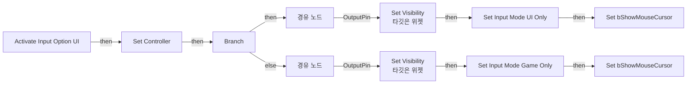
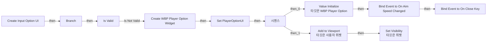
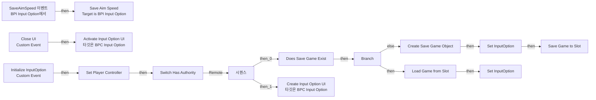

# BPC_InputOption

에셋: `/Game/QuakeLike_1_0/Player/BPC_InputOption`

부모: `/Script/CoreUObject.Class'/Script/Engine.ActorComponent'`

수집일: 2026-10-12. MCP에서 읽은 그래프·핀 연결의 자동 전사입니다. 상속된 그래프는 부모 문서를 함께 확인합니다.

정적 루트 참조 도달: 없음. 실행 여부 또는 삭제 가능 여부의 확정이 아닙니다.

컴포넌트 목록은 이 BP가 직접 정의한 SCS만 포함합니다. 부모·네이티브 생성 컴포넌트, 인스턴스 설정은 별도입니다.

## 변수와 기본값

| 이름 | 타입 | CDO 기본값 |
|---|---|---|
| `InputOption` | `SaveGame` | None |
| `PlayerOptionUI` | `WBP_PlayerOption_C` | None |
| `Player Controller` | `PlayerController` | None |

## 그래프 목록

| 그래프 | 전체 노드 수 |
|---|---|
| Activate Input Option UI | 19 |
| Create Input Option UI | 24 |
| EventGraph | 21 |
| Get Aim Speed As Pure | 3 |

## 그래프별 실행 연결

실선은 출력 exec 핀의 실제 연결입니다. 여러 분기는 출력 핀 이름을 표시합니다. 함수 호출·delegate·타이머의 다음 그래프 실행은 이 그림에서 자동으로 이어 붙이지 않습니다.

순수 계산 노드 및 데이터 핀은 아래 목록과 원본 JSON을 확인합니다. 연결되지 않은 이벤트도 표시되므로, 노드가 있다는 이유만으로 실행된다고 판단하면 안 됩니다.

### Activate Input Option UI

실행 핀 플로우차트

전체 노드·기본 입력 목록

| 노드 ID | 제목 | 미연결 기본 입력 / 에셋 입력 |
|---|---|---|
| `K2Node_FunctionEntry_0` | Activate Input Option UI |  |
| `K2Node_VariableGet_2` | Get PlayerOptionUI |  |
| `K2Node_CallFunction_2` | Set Visibility 타깃은 위젯 | InVisibility=Visible |
| `K2Node_IfThenElse_0` | Branch |  |
| `K2Node_Knot_0` | 경유 노드 |  |
| `K2Node_VariableSet_3` | Set Controller |  |
| `K2Node_Knot_1` | 경유 노드 |  |
| `K2Node_VariableGet_1` | Get Controller |  |
| `K2Node_CallFunction_1` | Set Input Mode UI Only | InMouseLockMode=DoNotLock; bFlushInput=true |
| `K2Node_VariableGet_4` | Get PlayerOptionUI |  |
| `K2Node_VariableGet_0` | Get PlayerOptionUI |  |
| `K2Node_CallFunction_0` | Set Visibility 타깃은 위젯 | InVisibility=Hidden |
| `K2Node_Knot_2` | 경유 노드 |  |
| `K2Node_VariableGet_3` | Get Controller |  |
| `K2Node_CallFunction_3` | Set Input Mode Game Only | bFlushInput=true |
| `K2Node_VariableGet_6` | Get Controller |  |
| `K2Node_VariableSet_1` | Set bShowMouseCursor | bShowMouseCursor=true; Output_Get=false |
| `K2Node_VariableGet_5` | Get Controller |  |
| `K2Node_VariableSet_0` | Set bShowMouseCursor | bShowMouseCursor=false; Output_Get=false |

### Create Input Option UI

실행 핀 플로우차트

전체 노드·기본 입력 목록

| 노드 ID | 제목 | 미연결 기본 입력 / 에셋 입력 |
|---|---|---|
| `K2Node_FunctionEntry_0` | Create Input Option UI |  |
| `K2Node_CallFunction_3` | Is Local Player Controller 타깃은 컨트롤러 |  |
| `K2Node_IfThenElse_1` | Branch |  |
| `K2Node_CreateWidget_0` | Create WBP Player Option Widget | Class=/Game/QuakeLike_1_0/Player/WBP_PlayerOption.WBP_PlayerOption_C |
| `K2Node_VariableSet_2` | Set PlayerOptionUI |  |
| `K2Node_AddDelegate_0` | Bind Event to On Aim Speed Changed |  |
| `K2Node_CreateDelegate_0` | 이벤트 생성 |  |
| `K2Node_CallFunction_0` | Value Initialize 타깃은 WBP Player Option |  |
| `K2Node_CallFunction_9` | Get Aim Speed as Pure |  |
| `K2Node_VariableGet_2` | Get PlayerOptionUI |  |
| `K2Node_MacroInstance_1` | Is Valid |  |
| `K2Node_Knot_1` | 경유 노드 |  |
| `K2Node_VariableGet_1` | Get PlayerOptionUI |  |
| `K2Node_CallFunction_1` | Set Visibility 타깃은 위젯 | InVisibility=Hidden |
| `K2Node_ExecutionSequence_0` | 시퀀스 |  |
| `K2Node_VariableGet_3` | Get PlayerOptionUI |  |
| `K2Node_Knot_4` | 경유 노드 |  |
| `K2Node_Knot_5` | 경유 노드 |  |
| `K2Node_CallFunction_4` | Add to Viewport 타깃은 사용자 위젯 | ZOrder=1 |
| `EdGraphNode_Comment_1` | 정보 초기화 |  |
| `EdGraphNode_Comment_2` | View 초기화 |  |
| `K2Node_Knot_6` | 경유 노드 |  |
| `K2Node_AddDelegate_2` | Bind Event to On Close Key |  |
| `K2Node_CreateDelegate_1` | 이벤트 생성 |  |

### EventGraph

실행 핀 플로우차트

전체 노드·기본 입력 목록

| 노드 ID | 제목 | 미연결 기본 입력 / 에셋 입력 |
|---|---|---|
| `K2Node_CallFunction_2` | Load Game from Slot | SlotName=InputOption; UserIndex=0 |
| `K2Node_CallFunction_1` | Save Game to Slot | SlotName=InputOption; UserIndex=0; ReturnValue=false |
| `K2Node_CallFunction_4` | Create Save Game Object | SaveGameClass=/Game/QuakeLike_1_0/Player/BP_SaveInputOption.BP_SaveInputOption_C |
| `K2Node_CallFunction_8` | Does Save Game Exist | SlotName=InputOption; UserIndex=0 |
| `K2Node_IfThenElse_0` | Branch |  |
| `K2Node_VariableSet_3` | Set InputOption |  |
| `K2Node_VariableSet_0` | Set InputOption |  |
| `K2Node_MacroInstance_0` | Switch Has Authority |  |
| `K2Node_CustomEvent_0` | Initialize InputOption Custom Event |  |
| `K2Node_Event_2` | SaveAimSpeed 이벤트 BPI Input Option에서 |  |
| `K2Node_VariableGet_1` | Get InputOption |  |
| `K2Node_Message_0` | Save Aim Speed Target is BPI Input Option |  |
| `K2Node_Knot_3` | 경유 노드 |  |
| `K2Node_Knot_1` | 경유 노드 |  |
| `K2Node_ExecutionSequence_0` | 시퀀스 |  |
| `K2Node_Knot_4` | 경유 노드 |  |
| `K2Node_CallFunction_10` | Create Input Option UI 타깃은 BPC Input Option |  |
| `K2Node_CustomEvent_2` | Close UI Custom Event |  |
| `K2Node_CallFunction_11` | Activate Input Option UI 타깃은 BPC Input Option | Activate=false |
| `K2Node_VariableGet_5` | Get Player Controller |  |
| `K2Node_VariableSet_2` | Set Player Controller |  |

### Get Aim Speed As Pure

실행 핀 플로우차트

전체 노드·기본 입력 목록

| 노드 ID | 제목 | 미연결 기본 입력 / 에셋 입력 |
|---|---|---|
| `K2Node_FunctionEntry_0` | Get Aim Speed As Pure |  |
| `K2Node_CallFunction_0` | Get Aim Speed 타깃은 BPC Input Option |  |
| `K2Node_FunctionResult_0` | 반환 노드 |  |

## 조회 범위의 한계

ObjectIterator로 발견했으나 MCP helper가 반환하지 않은 그래프입니다. delegate signature·컴파일된 중간 그래프·macro·애니메이션 내부 그래프가 섞일 수 있습니다.

- `Activate Input Option UI_MERGED`: Graph 'Activate Input Option UI_MERGED' not found in Blueprint.
- `Close UI`: Graph 'Close UI' not found in Blueprint.
- `Create Input Option UI_MERGED`: Graph 'Create Input Option UI_MERGED' not found in Blueprint.
- `EdGraph_0`: Graph 'EdGraph_0' not found in Blueprint.
- `EdGraph_1`: Graph 'EdGraph_1' not found in Blueprint.
- `ExecuteUbergraph_BPC_InputOption`: Graph 'ExecuteUbergraph_BPC_InputOption' not found in Blueprint.
- `Get Aim Speed As Pure_MERGED`: Graph 'Get Aim Speed As Pure_MERGED' not found in Blueprint.
- `GetAimSpeed`: Graph 'GetAimSpeed' not found in Blueprint.
- `GetAimSpeed_MERGED`: Graph 'GetAimSpeed_MERGED' not found in Blueprint.
- `Initialize InputOption`: Graph 'Initialize InputOption' not found in Blueprint.
- `SaveAimSpeed`: Graph 'SaveAimSpeed' not found in Blueprint.

[원본 MCP 스냅샷](../../../Evidence/blueprints-245.json)
