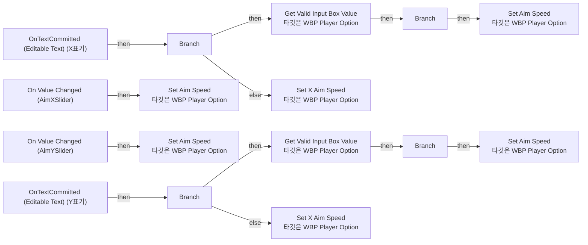
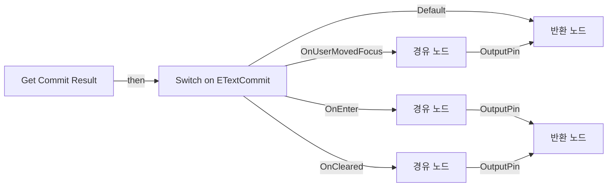
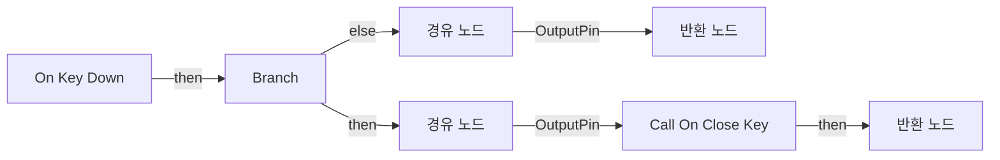
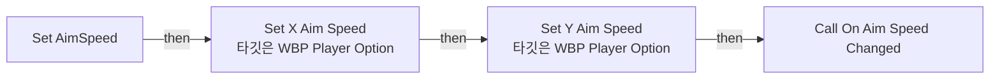
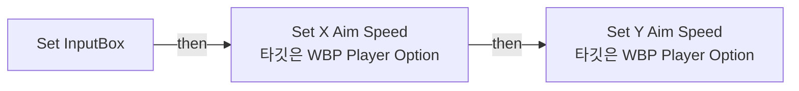
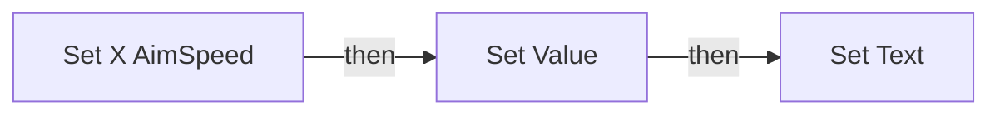
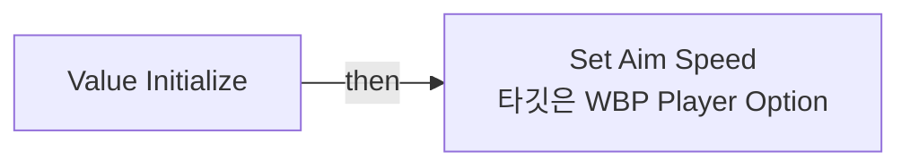

# WBP_PlayerOption

에셋: `/Game/QuakeLike_1_0/Player/WBP_PlayerOption`

부모: `/Script/CoreUObject.Class'/Script/UMG.UserWidget'`

수집일: 2026-10-12. MCP에서 읽은 그래프·핀 연결의 자동 전사입니다. 상속된 그래프는 부모 문서를 함께 확인합니다.

정적 루트 참조 도달: 없음. 실행 여부 또는 삭제 가능 여부의 확정이 아닙니다.

컴포넌트 목록은 이 BP가 직접 정의한 SCS만 포함합니다. 부모·네이티브 생성 컴포넌트, 인스턴스 설정은 별도입니다.

## 변수와 기본값

| 이름 | 타입 | CDO 기본값 |
|---|---|---|
| `OnAimSpeedChanged` | `mcdelegate` | &lt;Delegate 'DelegateBase' &lt;Unbound&gt;&gt; |
| `OnCloseKey` | `mcdelegate` | &lt;Delegate 'DelegateBase' &lt;Unbound&gt;&gt; |
| `Before X` | `real` | 0.0 |
| `Before Y` | `real` | 0.0 |

## 그래프 목록

| 그래프 | 전체 노드 수 |
|---|---|
| EventGraph | 30 |
| Get AimSpeed | 6 |
| Get Commit Result | 7 |
| Get Valid InputBox Value | 12 |
| OnKeyDown | 11 |
| Set AimSpeed | 9 |
| Set InputBox | 3 |
| Set X AimSpeed | 6 |
| Set Y AimSpeed | 6 |
| Value Initialize | 4 |

## 그래프별 실행 연결

실선은 출력 exec 핀의 실제 연결입니다. 여러 분기는 출력 핀 이름을 표시합니다. 함수 호출·delegate·타이머의 다음 그래프 실행은 이 그림에서 자동으로 이어 붙이지 않습니다.

순수 계산 노드 및 데이터 핀은 아래 목록과 원본 JSON을 확인합니다. 연결되지 않은 이벤트도 표시되므로, 노드가 있다는 이유만으로 실행된다고 판단하면 안 됩니다.

### EventGraph

실행 핀 플로우차트

전체 노드·기본 입력 목록

| 노드 ID | 제목 | 미연결 기본 입력 / 에셋 입력 |
|---|---|---|
| `K2Node_ComponentBoundEvent_0` | On Value Changed (AimXSlider) |  |
| `K2Node_VariableGet_1` | Get AimYSlider |  |
| `K2Node_VariableGet_2` | Get Value |  |
| `K2Node_ComponentBoundEvent_1` | On Value Changed (AimYSlider) |  |
| `K2Node_VariableGet_4` | Get Value |  |
| `K2Node_VariableGet_6` | Get AimXSlider |  |
| `K2Node_ComponentBoundEvent_4` | OnTextCommitted (Editable Text) (Y표기) |  |
| `K2Node_ComponentBoundEvent_5` | OnTextCommitted (Editable Text) (X표기) |  |
| `K2Node_CallFunction_32` | Get Commit Result |  |
| `K2Node_IfThenElse_5` | Branch |  |
| `K2Node_CallFunction_33` | Get Valid Input Box Value 타깃은 WBP Player Option |  |
| `K2Node_Knot_32` | 경유 노드 |  |
| `K2Node_VariableGet_18` | Get AimXSlider |  |
| `K2Node_IfThenElse_6` | Branch |  |
| `K2Node_CallFunction_34` | Set X Aim Speed 타깃은 WBP Player Option |  |
| `K2Node_CallFunction_35` | Get Aim Speed | Y=0.0 |
| `K2Node_CallFunction_29` | Set Aim Speed 타깃은 WBP Player Option |  |
| `K2Node_CallFunction_28` | Set Aim Speed 타깃은 WBP Player Option |  |
| `K2Node_CallFunction_36` | Set Aim Speed 타깃은 WBP Player Option |  |
| `K2Node_CallFunction_37` | Get Aim Speed | X=0.0 |
| `K2Node_CallFunction_21` | Get Commit Result |  |
| `K2Node_IfThenElse_3` | Branch |  |
| `K2Node_CallFunction_24` | Get Valid Input Box Value 타깃은 WBP Player Option |  |
| `K2Node_Knot_31` | 경유 노드 |  |
| `K2Node_VariableGet_17` | Get AimXSlider |  |
| `K2Node_IfThenElse_4` | Branch |  |
| `K2Node_CallFunction_26` | Set X Aim Speed 타깃은 WBP Player Option |  |
| `K2Node_CallFunction_31` | Get Aim Speed | X=0.0 |
| `K2Node_CallFunction_30` | Set Aim Speed 타깃은 WBP Player Option |  |
| `K2Node_CallFunction_27` | Get Aim Speed | Y=0.0 |

### Get AimSpeed

실행 핀 플로우차트

전체 노드·기본 입력 목록

| 노드 ID | 제목 | 미연결 기본 입력 / 에셋 입력 |
|---|---|---|
| `K2Node_FunctionEntry_0` | Get AimSpeed |  |
| `K2Node_FunctionResult_0` | 반환 노드 |  |
| `K2Node_VariableGet_0` | Get AimXSlider |  |
| `K2Node_VariableGet_1` | Get AimYSlider |  |
| `K2Node_VariableGet_2` | Get Value |  |
| `K2Node_VariableGet_3` | Get Value |  |

### Get Commit Result

실행 핀 플로우차트

전체 노드·기본 입력 목록

| 노드 ID | 제목 | 미연결 기본 입력 / 에셋 입력 |
|---|---|---|
| `K2Node_FunctionEntry_0` | Get Commit Result |  |
| `K2Node_FunctionResult_1` | 반환 노드 | Result=false |
| `K2Node_SwitchEnum_0` | Switch on ETextCommit |  |
| `K2Node_FunctionResult_0` | 반환 노드 | Result=true |
| `K2Node_Knot_0` | 경유 노드 |  |
| `K2Node_Knot_1` | 경유 노드 |  |
| `K2Node_Knot_2` | 경유 노드 |  |

### Get Valid InputBox Value

실행 핀 플로우차트

전체 노드·기본 입력 목록

| 노드 ID | 제목 | 미연결 기본 입력 / 에셋 입력 |
|---|---|---|
| `K2Node_FunctionEntry_0` | Get Valid InputBox Value |  |
| `K2Node_FunctionResult_0` | 반환 노드 |  |
| `K2Node_CallFunction_1` | To String (Text) |  |
| `K2Node_CallFunction_2` | String To Float |  |
| `K2Node_CallFunction_4` | Clamp (Float) |  |
| `K2Node_VariableGet_0` | Get MinValue |  |
| `K2Node_Knot_0` | 경유 노드 |  |
| `K2Node_VariableGet_1` | Get MaxValue |  |
| `K2Node_PromotableOperator_0` | float &gt; float |  |
| `K2Node_Knot_2` | 경유 노드 |  |
| `K2Node_Knot_3` | 경유 노드 |  |
| `K2Node_Knot_4` | 경유 노드 |  |

### OnKeyDown

실행 핀 플로우차트

전체 노드·기본 입력 목록

| 노드 ID | 제목 | 미연결 기본 입력 / 에셋 입력 |
|---|---|---|
| `K2Node_FunctionEntry_0` | On Key Down |  |
| `K2Node_FunctionResult_1` | 반환 노드 |  |
| `K2Node_CallFunction_0` | Get Key |  |
| `K2Node_PromotableOperator_0` | Equal (Key) | B=Q |
| `K2Node_IfThenElse_0` | Branch |  |
| `K2Node_CallFunction_2` | Unhandled |  |
| `K2Node_FunctionResult_2` | 반환 노드 |  |
| `K2Node_CallFunction_3` | Handled |  |
| `K2Node_Knot_0` | 경유 노드 |  |
| `K2Node_Knot_1` | 경유 노드 |  |
| `K2Node_CallDelegate_0` | Call On Close Key |  |

### Set AimSpeed

실행 핀 플로우차트

전체 노드·기본 입력 목록

| 노드 ID | 제목 | 미연결 기본 입력 / 에셋 입력 |
|---|---|---|
| `K2Node_FunctionEntry_0` | Set AimSpeed |  |
| `K2Node_CallFunction_0` | Set X Aim Speed 타깃은 WBP Player Option |  |
| `K2Node_CallFunction_1` | Set Y Aim Speed 타깃은 WBP Player Option |  |
| `K2Node_Knot_1` | 경유 노드 |  |
| `K2Node_CallDelegate_5` | Call On Aim Speed Changed |  |
| `K2Node_Knot_2` | 경유 노드 |  |
| `K2Node_Knot_3` | 경유 노드 |  |
| `K2Node_Knot_4` | 경유 노드 |  |
| `K2Node_Knot_5` | 경유 노드 |  |

### Set InputBox

실행 핀 플로우차트

전체 노드·기본 입력 목록

| 노드 ID | 제목 | 미연결 기본 입력 / 에셋 입력 |
|---|---|---|
| `K2Node_FunctionEntry_0` | Set InputBox |  |
| `K2Node_CallFunction_3` | Set X Aim Speed 타깃은 WBP Player Option |  |
| `K2Node_CallFunction_4` | Set Y Aim Speed 타깃은 WBP Player Option |  |

### Set X AimSpeed

실행 핀 플로우차트

전체 노드·기본 입력 목록

| 노드 ID | 제목 | 미연결 기본 입력 / 에셋 입력 |
|---|---|---|
| `K2Node_FunctionEntry_0` | Set X AimSpeed |  |
| `K2Node_VariableGet_0` | Get X표기 |  |
| `K2Node_VariableSet_1` | Set Text |  |
| `K2Node_CallFunction_0` | To Text (Float) | RoundingMode=HalfToEven; bAlwaysSign=false; bUseGrouping=true; MinimumIntegralDigits=1; MaximumIntegralDigits=324; MinimumFractionalDigits=2; MaximumFractionalDigits=2 |
| `K2Node_VariableGet_1` | Get AimXSlider |  |
| `K2Node_VariableSet_2` | Set Value |  |

### Set Y AimSpeed

실행 핀 플로우차트

전체 노드·기본 입력 목록

| 노드 ID | 제목 | 미연결 기본 입력 / 에셋 입력 |
|---|---|---|
| `K2Node_FunctionEntry_0` | Set Y AimSpeed |  |
| `K2Node_VariableSet_1` | Set Text |  |
| `K2Node_CallFunction_0` | To Text (Float) | RoundingMode=HalfToEven; bAlwaysSign=false; bUseGrouping=true; MinimumIntegralDigits=1; MaximumIntegralDigits=324; MinimumFractionalDigits=2; MaximumFractionalDigits=2 |
| `K2Node_VariableGet_19` | Get Y표기 |  |
| `K2Node_VariableSet_2` | Set Value |  |
| `K2Node_VariableGet_20` | Get AimYSlider |  |

### Value Initialize

실행 핀 플로우차트

전체 노드·기본 입력 목록

| 노드 ID | 제목 | 미연결 기본 입력 / 에셋 입력 |
|---|---|---|
| `K2Node_FunctionEntry_0` | Value Initialize |  |
| `K2Node_Knot_3` | 경유 노드 |  |
| `K2Node_Knot_4` | 경유 노드 |  |
| `K2Node_CallFunction_7` | Set Aim Speed 타깃은 WBP Player Option |  |

## 조회 범위의 한계

ObjectIterator로 발견했으나 MCP helper가 반환하지 않은 그래프입니다. delegate signature·컴파일된 중간 그래프·macro·애니메이션 내부 그래프가 섞일 수 있습니다.

- `BndEvt__WBP_PlayerOption_AimXSlider_K2Node_ComponentBoundEvent_0_OnFloatValueChangedEvent__DelegateSignature`: Graph 'BndEvt__WBP_PlayerOption_AimXSlider_K2Node_ComponentBoundEvent_0_OnFloatValueChangedEvent__DelegateSignature' not found in Blueprint.
- `BndEvt__WBP_PlayerOption_AimYSlider_K2Node_ComponentBoundEvent_1_OnFloatValueChangedEvent__DelegateSignature`: Graph 'BndEvt__WBP_PlayerOption_AimYSlider_K2Node_ComponentBoundEvent_1_OnFloatValueChangedEvent__DelegateSignature' not found in Blueprint.
- `BndEvt__WBP_PlayerOption_X표기_K2Node_ComponentBoundEvent_5_OnEditableTextCommittedEvent__DelegateSignature`: Graph 'BndEvt__WBP_PlayerOption_X표기_K2Node_ComponentBoundEvent_5_OnEditableTextCommittedEvent__DelegateSignature' not found in Blueprint.
- `BndEvt__WBP_PlayerOption_Y표기_K2Node_ComponentBoundEvent_4_OnEditableTextCommittedEvent__DelegateSignature`: Graph 'BndEvt__WBP_PlayerOption_Y표기_K2Node_ComponentBoundEvent_4_OnEditableTextCommittedEvent__DelegateSignature' not found in Blueprint.
- `ExecuteUbergraph_WBP_PlayerOption`: Graph 'ExecuteUbergraph_WBP_PlayerOption' not found in Blueprint.
- `Get AimSpeed_MERGED`: Graph 'Get AimSpeed_MERGED' not found in Blueprint.
- `Get Commit Result_MERGED`: Graph 'Get Commit Result_MERGED' not found in Blueprint.
- `Get Valid InputBox Value_MERGED`: Graph 'Get Valid InputBox Value_MERGED' not found in Blueprint.
- `OnAimSpeedChanged`: Graph 'OnAimSpeedChanged' not found in Blueprint.
- `OnAimSpeedChanged_MERGED`: Graph 'OnAimSpeedChanged_MERGED' not found in Blueprint.
- `OnCloseKey`: Graph 'OnCloseKey' not found in Blueprint.
- `OnCloseKey_MERGED`: Graph 'OnCloseKey_MERGED' not found in Blueprint.
- `OnKeyDown_MERGED`: Graph 'OnKeyDown_MERGED' not found in Blueprint.
- `Set AimSpeed_MERGED`: Graph 'Set AimSpeed_MERGED' not found in Blueprint.
- `Set InputBox_MERGED`: Graph 'Set InputBox_MERGED' not found in Blueprint.
- `Set X AimSpeed_MERGED`: Graph 'Set X AimSpeed_MERGED' not found in Blueprint.
- `Set Y AimSpeed_MERGED`: Graph 'Set Y AimSpeed_MERGED' not found in Blueprint.
- `Value Initialize_MERGED`: Graph 'Value Initialize_MERGED' not found in Blueprint.

[원본 MCP 스냅샷](../../../Evidence/blueprints-245.json)
