# BPC_TeleportSkill

에셋: `/Game/QuakeLike_1_0/Skill/BPC_TeleportSkill`

부모: `/Script/CoreUObject.Class'/Script/Engine.ActorComponent'`

수집일: 2026-10-12. MCP에서 읽은 그래프·핀 연결의 자동 전사입니다. 상속된 그래프는 부모 문서를 함께 확인합니다.

정적 루트 참조 도달: 있음. 실행 여부 또는 삭제 가능 여부의 확정이 아닙니다.

컴포넌트 목록은 이 BP가 직접 정의한 SCS만 포함합니다. 부모·네이티브 생성 컴포넌트, 인스턴스 설정은 별도입니다.

## 변수와 기본값

| 이름 | 타입 | CDO 기본값 |
|---|---|---|
| `skillCooldownEndTime` | `real` | 0.0 |
| `activeSkillProjectile` | `BP_ProjectileBase_C` | None |
| `skillData` | `PDA_TeleportSkill_C` | None |
| `ownerCharacter` | `BP_ShooterBase_C` | None |
| `projectileFireComponent` | `BPC_ProjectileFire_C` | None |
| `travelLoopAudio` | `AudioComponent` | None |

## 그래프 목록

| 그래프 | 전체 노드 수 |
|---|---|
| AddSkillGaugeByCooldownReduction | 11 |
| EventGraph | 122 |
| GetCooldownPercent | 18 |
| IsSkillReady | 5 |
| NotifyTeleportProjectileSpawned | 25 |
| OnRep_skillCooldownEndTime | 1 |
| ResetTeleportSkill | 9 |
| Server_FIreTeleportProjectile | 37 |
| Server_OnTeleportProjectileExpired | 8 |
| Server_OnTeleportProjectileImpact | 8 |
| Server_TeleportToProjectile | 30 |
| Server_UseTeleportSkillLogic | 15 |
| StopTravelLoopSound | 5 |
| TryUseTeleportSkill | 6 |

## 그래프별 실행 연결

실선은 출력 exec 핀의 실제 연결입니다. 여러 분기는 출력 핀 이름을 표시합니다. 함수 호출·delegate·타이머의 다음 그래프 실행은 이 그림에서 자동으로 이어 붙이지 않습니다.

순수 계산 노드 및 데이터 핀은 아래 목록과 원본 JSON을 확인합니다. 연결되지 않은 이벤트도 표시되므로, 노드가 있다는 이유만으로 실행된다고 판단하면 안 됩니다.

### AddSkillGaugeByCooldownReduction

실행 핀 플로우차트

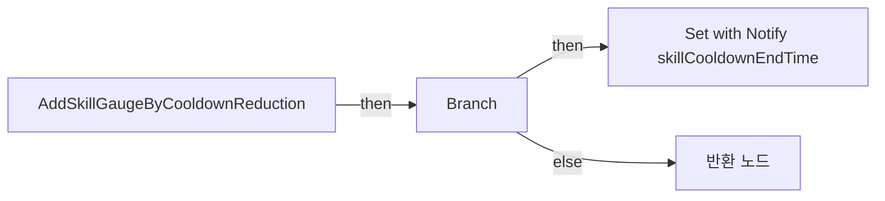

전체 노드·기본 입력 목록

| 노드 ID | 제목 | 미연결 기본 입력 / 에셋 입력 |
|---|---|---|
| `K2Node_FunctionEntry_0` | AddSkillGaugeByCooldownReduction |  |
| `K2Node_CallFunction_0` | Get Owner 타깃은 액터 컴포넌트 |  |
| `K2Node_CallFunction_1` | Has Authority 타깃은 액터 |  |
| `K2Node_IfThenElse_0` | Branch |  |
| `K2Node_FunctionResult_0` | 반환 노드 |  |
| `K2Node_VariableGet_0` | Get skillCooldownEndTime |  |
| `K2Node_PromotableOperator_0` | float - float |  |
| `K2Node_CallFunction_2` | Get Game Time in Seconds |  |
| `K2Node_CommutativeAssociativeBinaryOperator_0` | Max (Float) |  |
| `K2Node_VariableSet_0` | Set with Notify skillCooldownEndTime | Output_Get=0.0 |
| `K2Node_Knot_0` | 경유 노드 |  |

### EventGraph

실행 핀 플로우차트

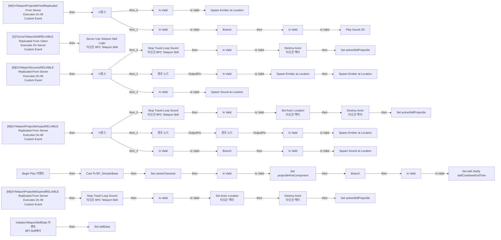

전체 노드·기본 입력 목록

| 노드 ID | 제목 | 미연결 기본 입력 / 에셋 입력 |
|---|---|---|
| `K2Node_Event_0` | Begin Play 이벤트 |  |
| `K2Node_CallFunction_2` | Get Owner 타깃은 액터 컴포넌트 |  |
| `K2Node_DynamicCast_1` | Cast To BP_ShooterBase |  |
| `K2Node_VariableSet_3` | Set ownerCharacter |  |
| `K2Node_CallFunction_5` | Get Component by Class 타깃은 액터 | ComponentClass=/Game/QuakeLike_1_0/HeldItem/Component/BPC_ProjectileFire.BPC_ProjectileFire_C |
| `K2Node_MacroInstance_0` | Is Valid |  |
| `K2Node_VariableSet_5` | Set projectileFireComponent |  |
| `K2Node_Knot_0` | 경유 노드 |  |
| `K2Node_Knot_1` | 경유 노드 |  |
| `K2Node_CallFunction_6` | Get Game Time in Seconds |  |
| `K2Node_VariableGet_1` | Get skillData |  |
| `K2Node_VariableGet_17` | Get skillCooldown |  |
| `K2Node_PromotableOperator_1` | float + float |  |
| `K2Node_VariableSet_6` | Set with Notify skillCooldownEndTime | Output_Get=0.0 |
| `K2Node_CustomEvent_2` | [S]TryUseTeleportSkillRELIABLE Replicated From Client Executes On Server Custom Event |  |
| `K2Node_CallFunction_7` | Get Owner 타깃은 액터 컴포넌트 |  |
| `K2Node_CallFunction_8` | Has Authority 타깃은 액터 |  |
| `K2Node_IfThenElse_0` | Branch |  |
| `K2Node_CallFunction_9` | Server Use Teleport Skill Logic 타깃은 BPC Teleport Skill |  |
| `K2Node_CustomEvent_10` | [M]OnTeleportProjectileFiredReplicated From Server Executes On All Custom Event |  |
| `K2Node_MacroInstance_4` | Is Valid |  |
| `K2Node_VariableGet_19` | Get skillData |  |
| `K2Node_VariableGet_20` | Get fireEffect |  |
| `K2Node_Knot_2` | 경유 노드 |  |
| `K2Node_CallFunction_11` | Spawn Emitter at Location | Scale=1.000000,1.000000,1.000000; bAutoDestroy=true; PoolingMethod=None; bAutoActivateSystem=true |
| `K2Node_Knot_3` | 경유 노드 |  |
| `K2Node_Knot_4` | 경유 노드 |  |
| `K2Node_Knot_5` | 경유 노드 |  |
| `K2Node_ExecutionSequence_0` | 시퀀스 |  |
| `K2Node_MacroInstance_5` | Is Valid |  |
| `K2Node_VariableGet_21` | Get ownerCharacter |  |
| `K2Node_Knot_6` | 경유 노드 |  |
| `K2Node_CallFunction_12` | Is Locally Controlled 타깃은 폰 |  |
| `K2Node_IfThenElse_1` | Branch |  |
| `K2Node_VariableGet_22` | Get skillData |  |
| `K2Node_VariableGet_23` | Get fireSound |  |
| `K2Node_MacroInstance_6` | Is Valid |  |
| `K2Node_Knot_18` | 경유 노드 |  |
| `K2Node_CallFunction_13` | Play Sound 2D | PitchMultiplier=1.000000; StartTime=0.000000; bIsUISound=true |
| `K2Node_Knot_19` | 경유 노드 |  |
| `K2Node_VariableGet_24` | Get fireSoundMultiplier |  |
| `K2Node_Knot_20` | 경유 노드 |  |
| `K2Node_CustomEvent_11` | [M]OnTeleportSuccessRELIABLE Replicated From Server Executes On All Custom Event |  |
| `K2Node_VariableGet_26` | Get activeSkillProjectile |  |
| `K2Node_MacroInstance_8` | Is Valid |  |
| `K2Node_CallFunction_15` | Destroy Actor 타깃은 액터 |  |
| `K2Node_VariableSet_8` | Set activeSkillProjectile |  |
| `K2Node_ExecutionSequence_1` | 시퀀스 |  |
| `K2Node_VariableGet_27` | Get skillData |  |
| `K2Node_VariableGet_28` | Get teleportEffect |  |
| `K2Node_MacroInstance_9` | Is Valid |  |
| `K2Node_Knot_23` | 경유 노드 |  |
| `K2Node_CallFunction_17` | Spawn Emitter at Location | Rotation=0, 0, 0; Scale=1.000000,1.000000,1.000000; bAutoDestroy=true; PoolingMethod=None; bAutoActivateSystem=true |
| `K2Node_CallFunction_16` | Spawn Emitter at Location | Rotation=0, 0, 0; Scale=1.000000,1.000000,1.000000; bAutoDestroy=true; PoolingMethod=None; bAutoActivateSystem=true |
| `K2Node_Knot_25` | 경유 노드 |  |
| `K2Node_Knot_26` | 경유 노드 |  |
| `K2Node_MacroInstance_10` | Is Valid |  |
| `K2Node_VariableGet_29` | Get skillData |  |
| `K2Node_VariableGet_30` | Get teleportSound |  |
| `K2Node_Knot_27` | 경유 노드 |  |
| `K2Node_CallFunction_18` | Spawn Sound at Location | Rotation=0, 0, 0; PitchMultiplier=1.000000; StartTime=0.000000; bAutoDestroy=true |
| `K2Node_Knot_28` | 경유 노드 |  |
| `K2Node_Knot_29` | 경유 노드 |  |
| `K2Node_Knot_30` | 경유 노드 |  |
| `K2Node_Knot_31` | 경유 노드 |  |
| `K2Node_VariableGet_31` | Get teleportSoundMultiplier |  |
| `K2Node_Knot_32` | 경유 노드 |  |
| `K2Node_CustomEvent_12` | [M]OnTeleportProjectileImpactRELIABLE Replicated From Server Executes On All Custom Event |  |
| `K2Node_CallFunction_19` | Stop Travel Loop Sound 타깃은 BPC Teleport Skill |  |
| `K2Node_CallFunction_20` | Stop Travel Loop Sound 타깃은 BPC Teleport Skill |  |
| `K2Node_VariableGet_32` | Get activeSkillProjectile |  |
| `K2Node_MacroInstance_11` | Is Valid |  |
| `K2Node_Knot_33` | 경유 노드 |  |
| `K2Node_CallFunction_21` | Set Actor Location 타깃은 액터 | bSweep=false; bTeleport=true; ReturnValue=false |
| `K2Node_Knot_34` | 경유 노드 |  |
| `K2Node_VariableGet_33` | Get activeSkillProjectile |  |
| `K2Node_CallFunction_22` | Destroy Actor 타깃은 액터 |  |
| `K2Node_VariableSet_9` | Set activeSkillProjectile |  |
| `K2Node_ExecutionSequence_2` | 시퀀스 |  |
| `K2Node_VariableGet_34` | Get skillData |  |
| `K2Node_VariableGet_35` | Get impactEffect |  |
| `K2Node_MacroInstance_12` | Is Valid |  |
| `K2Node_PromotableOperator_2` | vector * vector | B=3.000000 |
| `K2Node_PromotableOperator_3` | vector + vector |  |
| `K2Node_CallFunction_23` | Make Rot from Z |  |
| `K2Node_Knot_35` | 경유 노드 |  |
| `K2Node_CallFunction_25` | Spawn Emitter at Location | Scale=1.000000,1.000000,1.000000; bAutoDestroy=true; PoolingMethod=None; bAutoActivateSystem=true |
| `K2Node_Knot_36` | 경유 노드 |  |
| `K2Node_Knot_37` | 경유 노드 |  |
| `K2Node_Knot_38` | 경유 노드 |  |
| `K2Node_Knot_39` | 경유 노드 |  |
| `K2Node_Knot_40` | 경유 노드 |  |
| `K2Node_Knot_41` | 경유 노드 |  |
| `K2Node_VariableGet_36` | Get ownerCharacter |  |
| `K2Node_MacroInstance_13` | Is Valid |  |
| `K2Node_Knot_42` | 경유 노드 |  |
| `K2Node_CallFunction_26` | Is Locally Controlled 타깃은 폰 |  |
| `K2Node_IfThenElse_2` | Branch |  |
| `K2Node_VariableGet_37` | Get skillData |  |
| `K2Node_VariableGet_38` | Get impactSound |  |
| `K2Node_MacroInstance_14` | Is Valid |  |
| `K2Node_Knot_43` | 경유 노드 |  |
| `K2Node_CallFunction_27` | Spawn Sound at Location | Rotation=0, 0, 0; PitchMultiplier=1.000000; StartTime=0.000000; bAutoDestroy=true |
| `K2Node_Knot_44` | 경유 노드 |  |
| `K2Node_Knot_45` | 경유 노드 |  |
| `K2Node_Knot_46` | 경유 노드 |  |
| `K2Node_VariableGet_39` | Get impactSoundMultiplier |  |
| `K2Node_Knot_47` | 경유 노드 |  |
| `K2Node_Knot_48` | 경유 노드 |  |
| `K2Node_CustomEvent_13` | [M]OnTeleportProjectileExpiredRELIABLE Replicated From Server Executes On All Custom Event |  |
| `K2Node_CallFunction_28` | Stop Travel Loop Sound 타깃은 BPC Teleport Skill |  |
| `K2Node_VariableGet_40` | Get activeSkillProjectile |  |
| `K2Node_MacroInstance_15` | Is Valid |  |
| `K2Node_VariableGet_41` | Get activeSkillProjectile |  |
| `K2Node_CallFunction_29` | Set Actor Location 타깃은 액터 | bSweep=false; bTeleport=true; ReturnValue=false |
| `K2Node_Knot_49` | 경유 노드 |  |
| `K2Node_VariableGet_42` | Get activeSkillProjectile |  |
| `K2Node_CallFunction_30` | Destroy Actor 타깃은 액터 |  |
| `K2Node_VariableSet_10` | Set activeSkillProjectile |  |
| `K2Node_Event_1` | InitializeTeleportSkillData 이벤트 BPI Skill에서 |  |
| `K2Node_VariableSet_11` | Set skillData |  |
| `K2Node_MacroInstance_1` | Is Valid |  |

### GetCooldownPercent

실행 핀 플로우차트

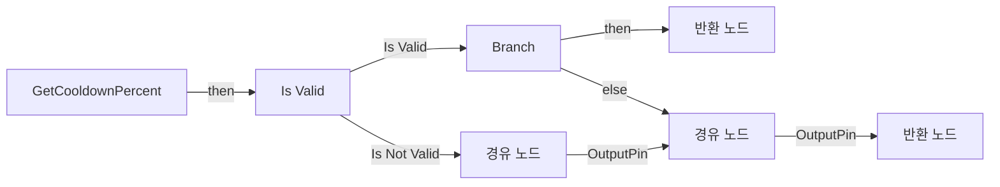

전체 노드·기본 입력 목록

| 노드 ID | 제목 | 미연결 기본 입력 / 에셋 입력 |
|---|---|---|
| `K2Node_FunctionEntry_0` | GetCooldownPercent |  |
| `K2Node_FunctionResult_0` | 반환 노드 | cooldownPercent=1.000000 |
| `K2Node_VariableGet_0` | Get skillData |  |
| `K2Node_MacroInstance_0` | Is Valid |  |
| `K2Node_Knot_0` | 경유 노드 |  |
| `K2Node_VariableGet_1` | Get skillCooldown |  |
| `K2Node_IfThenElse_0` | Branch |  |
| `K2Node_PromotableOperator_1` | float &gt; float |  |
| `K2Node_CallFunction_0` | Get Game Time in Seconds |  |
| `K2Node_Knot_1` | 경유 노드 |  |
| `K2Node_Knot_2` | 경유 노드 |  |
| `K2Node_PromotableOperator_2` | float - float |  |
| `K2Node_VariableGet_2` | Get skillCooldownEndTime |  |
| `K2Node_PromotableOperator_3` | float / float |  |
| `K2Node_Knot_3` | 경유 노드 |  |
| `K2Node_CallFunction_1` | Clamp (Float) | Min=0.0; Max=1.0 |
| `K2Node_PromotableOperator_4` | float - float | A=1.000000 |
| `K2Node_FunctionResult_1` | 반환 노드 |  |

### IsSkillReady

실행 핀 플로우차트

전체 노드·기본 입력 목록

| 노드 ID | 제목 | 미연결 기본 입력 / 에셋 입력 |
|---|---|---|
| `K2Node_FunctionEntry_0` | IsSkillReady |  |
| `K2Node_FunctionResult_0` | 반환 노드 |  |
| `K2Node_CallFunction_0` | Get Game Time in Seconds |  |
| `K2Node_PromotableOperator_0` | float &gt;= float |  |
| `K2Node_VariableGet_0` | Get skillCooldownEndTime |  |

### NotifyTeleportProjectileSpawned

실행 핀 플로우차트

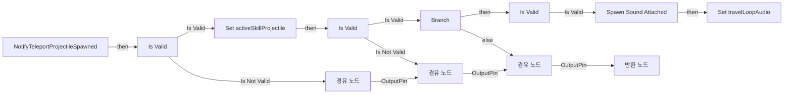

전체 노드·기본 입력 목록

| 노드 ID | 제목 | 미연결 기본 입력 / 에셋 입력 |
|---|---|---|
| `K2Node_FunctionEntry_0` | NotifyTeleportProjectileSpawned |  |
| `K2Node_VariableSet_0` | Set activeSkillProjectile |  |
| `K2Node_MacroInstance_0` | Is Valid |  |
| `K2Node_Knot_0` | 경유 노드 |  |
| `K2Node_Knot_1` | 경유 노드 |  |
| `K2Node_Knot_2` | 경유 노드 |  |
| `K2Node_Knot_3` | 경유 노드 |  |
| `K2Node_VariableGet_0` | Get ownerCharacter |  |
| `K2Node_MacroInstance_1` | Is Valid |  |
| `K2Node_Knot_4` | 경유 노드 |  |
| `K2Node_CallFunction_0` | Is Locally Controlled 타깃은 폰 |  |
| `K2Node_IfThenElse_0` | Branch |  |
| `K2Node_FunctionResult_0` | 반환 노드 |  |
| `K2Node_VariableGet_1` | Get skillData |  |
| `K2Node_VariableGet_2` | Get travelLoopSound |  |
| `K2Node_MacroInstance_2` | Is Valid |  |
| `K2Node_CallFunction_1` | Spawn Sound Attached | AttachPointName=None; Location=0, 0, 0; Rotation=0, 0, 0; LocationType=KeepRelativeOffset; bStopWhenAttachedToDestroyed=false; VolumeMultiplier=1.000000; PitchMultiplier=1.000000; StartTime=0.000000; bAutoDestroy=true |
| `K2Node_VariableGet_3` | Get activeSkillProjectile |  |
| `K2Node_VariableGet_4` | Get RootComponent |  |
| `K2Node_Knot_5` | 경유 노드 |  |
| `K2Node_Knot_6` | 경유 노드 |  |
| `K2Node_VariableSet_1` | Set travelLoopAudio |  |
| `K2Node_Knot_7` | 경유 노드 |  |
| `K2Node_Knot_8` | 경유 노드 |  |
| `K2Node_Knot_9` | 경유 노드 |  |

### OnRep_skillCooldownEndTime

실행 핀 플로우차트

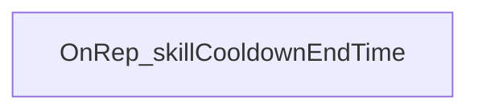

전체 노드·기본 입력 목록

| 노드 ID | 제목 | 미연결 기본 입력 / 에셋 입력 |
|---|---|---|
| `K2Node_FunctionEntry_0` | OnRep_skillCooldownEndTime |  |

### ResetTeleportSkill

실행 핀 플로우차트

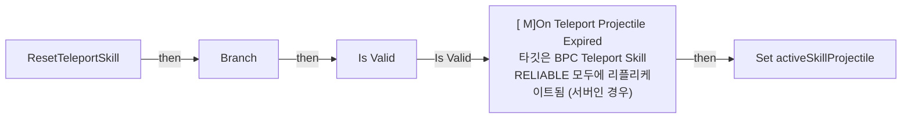

전체 노드·기본 입력 목록

| 노드 ID | 제목 | 미연결 기본 입력 / 에셋 입력 |
|---|---|---|
| `K2Node_FunctionEntry_0` | ResetTeleportSkill |  |
| `K2Node_CallFunction_0` | Get Owner 타깃은 액터 컴포넌트 |  |
| `K2Node_CallFunction_1` | Has Authority 타깃은 액터 |  |
| `K2Node_IfThenElse_0` | Branch |  |
| `K2Node_CallFunction_2` | [ M]On Teleport Projectile Expired 타깃은 BPC Teleport Skill RELIABLE 모두에 리플리케이트됨 (서버인 경우) |  |
| `K2Node_VariableGet_0` | Get ownerCharacter |  |
| `K2Node_MacroInstance_0` | Is Valid |  |
| `K2Node_CallFunction_3` | Get Actor Location 타깃은 액터 |  |
| `K2Node_VariableSet_0` | Set activeSkillProjectile |  |

### Server_FIreTeleportProjectile

실행 핀 플로우차트

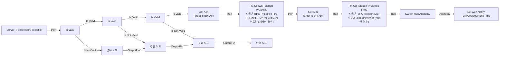

전체 노드·기본 입력 목록

| 노드 ID | 제목 | 미연결 기본 입력 / 에셋 입력 |
|---|---|---|
| `K2Node_FunctionEntry_0` | Server_FIreTeleportProjectile |  |
| `K2Node_VariableGet_0` | Get skillData |  |
| `K2Node_MacroInstance_0` | Is Valid |  |
| `K2Node_FunctionResult_0` | 반환 노드 |  |
| `K2Node_VariableGet_1` | Get projectileFireComponent |  |
| `K2Node_MacroInstance_1` | Is Valid |  |
| `K2Node_VariableGet_10` | Get ownerCharacter |  |
| `K2Node_MacroInstance_2` | Is Valid |  |
| `K2Node_Message_0` | Get Aim Target is BPI Aim |  |
| `K2Node_Knot_0` | 경유 노드 |  |
| `K2Node_Knot_1` | 경유 노드 |  |
| `K2Node_Knot_2` | 경유 노드 |  |
| `K2Node_Knot_3` | 경유 노드 |  |
| `K2Node_Knot_4` | 경유 노드 |  |
| `K2Node_Knot_5` | 경유 노드 |  |
| `K2Node_CallFunction_0` | Get Forward Vector |  |
| `K2Node_VariableGet_3` | Get skillData |  |
| `K2Node_VariableGet_4` | Get maxDistance |  |
| `K2Node_PromotableOperator_0` | vector * vector |  |
| `K2Node_PromotableOperator_1` | vector + vector |  |
| `K2Node_VariableGet_9` | Get projectileFireComponent |  |
| `K2Node_CallFunction_1` | [ M]Spawn Teleport Projectile 타깃은 BPC Projectile Fire RELIABLE 모두에 리플리케이트됨 (서버인 경우) |  |
| `K2Node_Knot_6` | 경유 노드 |  |
| `K2Node_Knot_7` | 경유 노드 |  |
| `K2Node_Knot_8` | 경유 노드 |  |
| `K2Node_Knot_9` | 경유 노드 |  |
| `K2Node_Knot_10` | 경유 노드 |  |
| `K2Node_VariableGet_6` | Get skillData |  |
| `K2Node_CallFunction_2` | Get Game Time in Seconds |  |
| `K2Node_VariableGet_7` | Get skillData |  |
| `K2Node_VariableGet_8` | Get skillCooldown |  |
| `K2Node_VariableSet_0` | Set with Notify skillCooldownEndTime | Output_Get=0.0 |
| `K2Node_PromotableOperator_2` | float + float |  |
| `K2Node_MacroInstance_3` | Switch Has Authority |  |
| `K2Node_CallFunction_3` | [ M]On Teleport Projectile Fired 타깃은 BPC Teleport Skill 모두에 리플리케이트됨 (서버인 경우) |  |
| `K2Node_Message_1` | Get Aim Target is BPI Aim |  |
| `K2Node_VariableGet_2` | Get ownerCharacter |  |

### Server_OnTeleportProjectileExpired

실행 핀 플로우차트

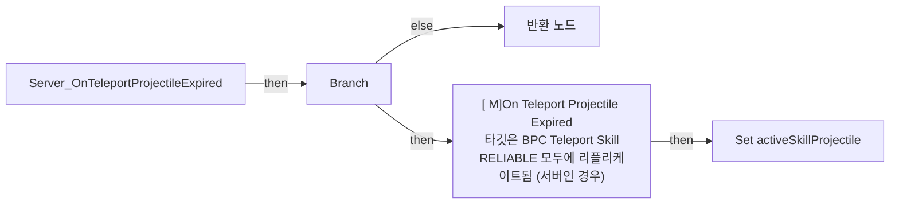

전체 노드·기본 입력 목록

| 노드 ID | 제목 | 미연결 기본 입력 / 에셋 입력 |
|---|---|---|
| `K2Node_FunctionEntry_0` | Server_OnTeleportProjectileExpired |  |
| `K2Node_VariableGet_0` | Get activeSkillProjectile |  |
| `K2Node_PromotableOperator_0` | Equal (Object) |  |
| `K2Node_IfThenElse_0` | Branch |  |
| `K2Node_Knot_0` | 경유 노드 |  |
| `K2Node_FunctionResult_0` | 반환 노드 |  |
| `K2Node_CallFunction_0` | [ M]On Teleport Projectile Expired 타깃은 BPC Teleport Skill RELIABLE 모두에 리플리케이트됨 (서버인 경우) |  |
| `K2Node_VariableSet_0` | Set activeSkillProjectile |  |

### Server_OnTeleportProjectileImpact

실행 핀 플로우차트

전체 노드·기본 입력 목록

| 노드 ID | 제목 | 미연결 기본 입력 / 에셋 입력 |
|---|---|---|
| `K2Node_FunctionEntry_0` | Server_OnTeleportProjectileImpact |  |
| `K2Node_VariableGet_0` | Get activeSkillProjectile |  |
| `K2Node_PromotableOperator_0` | Equal (Object) |  |
| `K2Node_IfThenElse_0` | Branch |  |
| `K2Node_Knot_0` | 경유 노드 |  |
| `K2Node_FunctionResult_0` | 반환 노드 |  |
| `K2Node_CallFunction_0` | [ M]On Teleport Projectile Impact 타깃은 BPC Teleport Skill RELIABLE 모두에 리플리케이트됨 (서버인 경우) |  |
| `K2Node_VariableSet_0` | Set activeSkillProjectile |  |

### Server_TeleportToProjectile

실행 핀 플로우차트

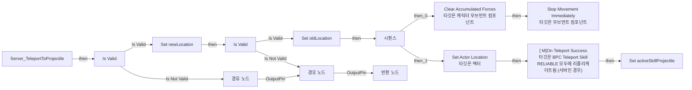

전체 노드·기본 입력 목록

| 노드 ID | 제목 | 미연결 기본 입력 / 에셋 입력 |
|---|---|---|
| `K2Node_FunctionEntry_0` | Server_TeleportToProjectile |  |
| `K2Node_VariableGet_0` | Get activeSkillProjectile |  |
| `K2Node_MacroInstance_0` | Is Valid |  |
| `K2Node_FunctionResult_0` | 반환 노드 |  |
| `K2Node_Knot_0` | 경유 노드 |  |
| `K2Node_CallFunction_0` | Get Actor Location 타깃은 액터 |  |
| `K2Node_VariableGet_1` | Get ownerCharacter |  |
| `K2Node_MacroInstance_1` | Is Valid |  |
| `K2Node_Knot_1` | 경유 노드 |  |
| `K2Node_CallFunction_2` | Set Actor Location 타깃은 액터 | bSweep=false; bTeleport=true; ReturnValue=false |
| `K2Node_Knot_2` | 경유 노드 |  |
| `K2Node_Knot_3` | 경유 노드 |  |
| `K2Node_CallFunction_3` | Get Actor Location 타깃은 액터 |  |
| `K2Node_VariableSet_0` | Set newLocation | Output_Get=0, 0, 0 |
| `K2Node_Knot_5` | 경유 노드 |  |
| `K2Node_VariableSet_1` | Set oldLocation | Output_Get=0, 0, 0 |
| `K2Node_VariableGet_2` | Get newLocation |  |
| `K2Node_CallFunction_4` | [ M]On Teleport Success 타깃은 BPC Teleport Skill RELIABLE 모두에 리플리케이트됨 (서버인 경우) |  |
| `K2Node_VariableGet_3` | Get newLocation |  |
| `K2Node_VariableGet_4` | Get oldLocation |  |
| `K2Node_VariableSet_2` | Set activeSkillProjectile |  |
| `K2Node_VariableGet_5` | Get ownerCharacter |  |
| `K2Node_VariableGet_6` | Get CharacterMovement |  |
| `K2Node_CallFunction_1` | Clear Accumulated Forces 타깃은 캐릭터 무브먼트 컴포넌트 |  |
| `K2Node_ExecutionSequence_0` | 시퀀스 |  |
| `K2Node_Knot_4` | 경유 노드 |  |
| `K2Node_Knot_6` | 경유 노드 |  |
| `K2Node_Knot_7` | 경유 노드 |  |
| `K2Node_CallFunction_5` | Stop Movement Immediately 타깃은 무브먼트 컴포넌트 |  |
| `K2Node_Knot_8` | 경유 노드 |  |

### Server_UseTeleportSkillLogic

실행 핀 플로우차트

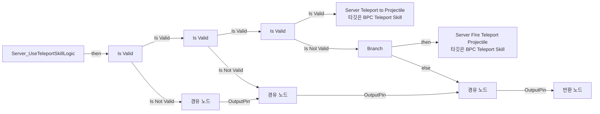

전체 노드·기본 입력 목록

| 노드 ID | 제목 | 미연결 기본 입력 / 에셋 입력 |
|---|---|---|
| `K2Node_FunctionEntry_0` | Server_UseTeleportSkillLogic |  |
| `K2Node_VariableGet_0` | Get skillData |  |
| `K2Node_MacroInstance_0` | Is Valid |  |
| `K2Node_FunctionResult_0` | 반환 노드 |  |
| `K2Node_VariableGet_1` | Get projectileFireComponent |  |
| `K2Node_MacroInstance_1` | Is Valid |  |
| `K2Node_CallFunction_1` | Server Teleport to Projectile 타깃은 BPC Teleport Skill |  |
| `K2Node_IfThenElse_2` | Branch |  |
| `K2Node_CallFunction_2` | Is Skill Ready |  |
| `K2Node_CallFunction_3` | Server FIre Teleport Projectile 타깃은 BPC Teleport Skill |  |
| `K2Node_Knot_0` | 경유 노드 |  |
| `K2Node_Knot_1` | 경유 노드 |  |
| `K2Node_Knot_2` | 경유 노드 |  |
| `K2Node_VariableGet_4` | Get activeSkillProjectile |  |
| `K2Node_MacroInstance_3` | Is Valid |  |

### StopTravelLoopSound

실행 핀 플로우차트

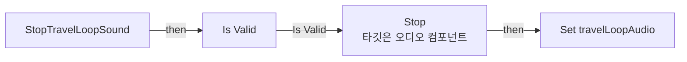

전체 노드·기본 입력 목록

| 노드 ID | 제목 | 미연결 기본 입력 / 에셋 입력 |
|---|---|---|
| `K2Node_FunctionEntry_0` | StopTravelLoopSound |  |
| `K2Node_VariableGet_25` | Get travelLoopAudio |  |
| `K2Node_MacroInstance_7` | Is Valid |  |
| `K2Node_CallFunction_14` | Stop 타깃은 오디오 컴포넌트 |  |
| `K2Node_VariableSet_7` | Set travelLoopAudio |  |

### TryUseTeleportSkill

실행 핀 플로우차트

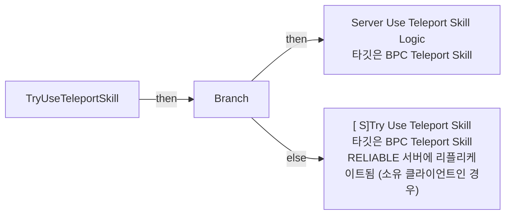

전체 노드·기본 입력 목록

| 노드 ID | 제목 | 미연결 기본 입력 / 에셋 입력 |
|---|---|---|
| `K2Node_FunctionEntry_0` | TryUseTeleportSkill |  |
| `K2Node_CallFunction_0` | Get Owner 타깃은 액터 컴포넌트 |  |
| `K2Node_CallFunction_1` | Has Authority 타깃은 액터 |  |
| `K2Node_IfThenElse_0` | Branch |  |
| `K2Node_CallFunction_2` | [ S]Try Use Teleport Skill 타깃은 BPC Teleport Skill RELIABLE 서버에 리플리케이트됨 (소유 클라이언트인 경우) |  |
| `K2Node_CallFunction_3` | Server Use Teleport Skill Logic 타깃은 BPC Teleport Skill |  |

## 조회 범위의 한계

ObjectIterator로 발견했으나 MCP helper가 반환하지 않은 그래프입니다. delegate signature·컴파일된 중간 그래프·macro·애니메이션 내부 그래프가 섞일 수 있습니다.

- `InitializeTeleportSkillData`: Graph 'InitializeTeleportSkillData' not found in Blueprint.
- `ReceiveBeginPlay`: Graph 'ReceiveBeginPlay' not found in Blueprint.
- `[M]OnTeleportProjectileExpired`: Graph '[M]OnTeleportProjectileExpired' not found in Blueprint.
- `[M]OnTeleportProjectileFired`: Graph '[M]OnTeleportProjectileFired' not found in Blueprint.
- `[M]OnTeleportProjectileImpact`: Graph '[M]OnTeleportProjectileImpact' not found in Blueprint.
- `[M]OnTeleportSuccess`: Graph '[M]OnTeleportSuccess' not found in Blueprint.
- `[S]TryUseTeleportSkill`: Graph '[S]TryUseTeleportSkill' not found in Blueprint.

[원본 MCP 스냅샷](../../../Evidence/blueprints-070.json)
