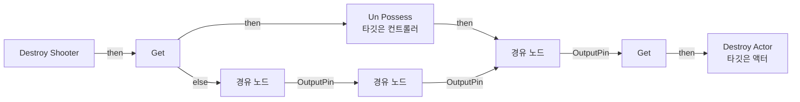
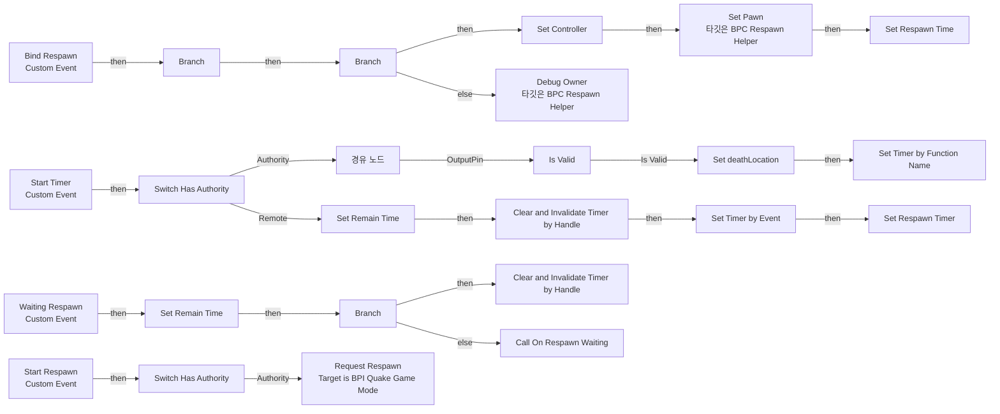
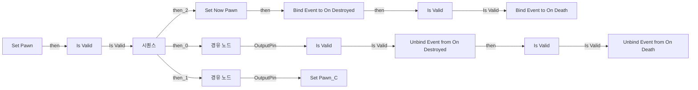

# BPC_RespawnHelper

에셋: `/Game/QuakeLike_1_0/Spawner/Component/BPC_RespawnHelper`

부모: `/Script/CoreUObject.Class'/Script/Engine.ActorComponent'`

수집일: 2026-10-12. MCP에서 읽은 그래프·핀 연결의 자동 전사입니다. 상속된 그래프는 부모 문서를 함께 확인합니다.

정적 루트 참조 도달: 있음. 실행 여부 또는 삭제 가능 여부의 확정이 아닙니다.

컴포넌트 목록은 이 BP가 직접 정의한 SCS만 포함합니다. 부모·네이티브 생성 컴포넌트, 인스턴스 설정은 별도입니다.

## 변수와 기본값

| 이름 | 타입 | CDO 기본값 |
|---|---|---|
| `Controller` | `Controller` | None |
| `Pawn_C` | `Pawn` | None |
| `Respawn Time` | `real` | 0.0 |
| `Now Pawn` | `Pawn` | None |
| `OnRespawnWaiting` | `mcdelegate` | &lt;Delegate 'DelegateBase' &lt;Unbound&gt;&gt; |
| `Respawn Timer` | `TimerHandle` | &lt;Struct 'TimerHandle' {}&gt; |
| `Remain Time` | `real` | 0.0 |
| `TickRate` | `real` | 0.1 |
| `deathLocation` | `Vector` | &lt;Struct 'Vector' {x: 0.000000, y: 0.000000, z: 0.000000}&gt; |
| `respawnDA` | `PDA_Respawn_C` | /Game/QuakeLike_1_0/Data/Respawn/DA_Respawn.DA_Respawn |

## 그래프 목록

| 그래프 | 전체 노드 수 |
|---|---|
| Debug_Owner | 8 |
| Destroy Shooter | 8 |
| EventGraph | 52 |
| Set Pawn | 32 |

## 그래프별 실행 연결

실선은 출력 exec 핀의 실제 연결입니다. 여러 분기는 출력 핀 이름을 표시합니다. 함수 호출·delegate·타이머의 다음 그래프 실행은 이 그림에서 자동으로 이어 붙이지 않습니다.

순수 계산 노드 및 데이터 핀은 아래 목록과 원본 JSON을 확인합니다. 연결되지 않은 이벤트도 표시되므로, 노드가 있다는 이유만으로 실행된다고 판단하면 안 됩니다.

### Debug_Owner

실행 핀 플로우차트

전체 노드·기본 입력 목록

| 노드 ID | 제목 | 미연결 기본 입력 / 에셋 입력 |
|---|---|---|
| `K2Node_FunctionEntry_0` | Debug_Owner |  |
| `K2Node_CallFunction_0` | Print String | bPrintToScreen=true; bPrintToLog=true; TextColor=(R=0.000000,G=0.660000,B=1.000000,A=1.000000); Duration=10.000000 |
| `K2Node_CallFunction_2` | Make Print Key | string=Respawn Helper Owner |
| `K2Node_CallFunction_3` | Get Owner 타깃은 액터 컴포넌트 |  |
| `K2Node_Knot_0` | 경유 노드 |  |
| `K2Node_CommutativeAssociativeBinaryOperator_0` | Append | B=: Respawn Helper \|  |
| `K2Node_CallFunction_4` | Get Display Name |  |
| `K2Node_Knot_1` | 경유 노드 |  |

### Destroy Shooter

실행 핀 플로우차트

전체 노드·기본 입력 목록

| 노드 ID | 제목 | 미연결 기본 입력 / 에셋 입력 |
|---|---|---|
| `K2Node_FunctionEntry_0` | Destroy Shooter |  |
| `K2Node_CallFunction_3` | Un Possess 타깃은 컨트롤러 |  |
| `K2Node_VariableGet_0` | Get |  |
| `K2Node_VariableGet_1` | Get |  |
| `K2Node_CallFunction_0` | Destroy Actor 타깃은 액터 |  |
| `K2Node_Knot_0` | 경유 노드 |  |
| `K2Node_Knot_1` | 경유 노드 |  |
| `K2Node_Knot_2` | 경유 노드 |  |

### EventGraph

실행 핀 플로우차트

전체 노드·기본 입력 목록

| 노드 ID | 제목 | 미연결 기본 입력 / 에셋 입력 |
|---|---|---|
| `K2Node_CustomEvent_0` | Start Respawn Custom Event |  |
| `K2Node_CallFunction_3` | Get Game Mode |  |
| `K2Node_CustomEvent_1` | Bind Respawn Custom Event |  |
| `K2Node_VariableSet_0` | Set Controller |  |
| `K2Node_VariableGet_1` | Get Pawn_C |  |
| `K2Node_VariableGet_2` | Get Controller |  |
| `K2Node_CallFunction_8` | Set Pawn 타깃은 BPC Respawn Helper |  |
| `K2Node_Knot_7` | 경유 노드 |  |
| `K2Node_MacroInstance_3` | Switch Has Authority |  |
| `K2Node_CustomEvent_2` | Start Timer Custom Event |  |
| `K2Node_VariableSet_1` | Set Respawn Time | Output_Get=0.0 |
| `K2Node_Knot_0` | 경유 노드 |  |
| `K2Node_CallFunction_2` | Set Timer by Event | bLooping=true; bMaxOncePerFrame=false; InitialStartDelay=0.000000; InitialStartDelayVariance=0.000000 |
| `K2Node_VariableSet_2` | Set Respawn Timer |  |
| `K2Node_CreateDelegate_0` | 이벤트 생성 |  |
| `K2Node_CustomEvent_3` | Waiting Respawn Custom Event |  |
| `K2Node_PromotableOperator_0` | float - float |  |
| `K2Node_PromotableOperator_2` | float &lt;= float |  |
| `K2Node_VariableGet_6` | Get TickRate |  |
| `K2Node_VariableGet_7` | Get TickRate |  |
| `K2Node_VariableGet_8` | Get Respawn Timer |  |
| `K2Node_CallFunction_5` | Clear and Invalidate Timer by Handle |  |
| `K2Node_VariableSet_5` | Set Remain Time | Output_Get=0.0 |
| `K2Node_VariableGet_9` | Get Respawn Time |  |
| `K2Node_MacroInstance_0` | Switch Has Authority |  |
| `K2Node_VariableSet_6` | Set Remain Time |  |
| `K2Node_VariableGet_10` | Get Remain Time |  |
| `K2Node_IfThenElse_0` | Branch |  |
| `K2Node_CallDelegate_0` | Call On Respawn Waiting |  |
| `K2Node_VariableGet_11` | Get Remain Time |  |
| `K2Node_VariableGet_0` | Get Respawn Timer |  |
| `K2Node_CallFunction_0` | Clear and Invalidate Timer by Handle |  |
| `K2Node_Knot_1` | 경유 노드 |  |
| `K2Node_CallFunction_11` | Is Valid |  |
| `K2Node_CallFunction_12` | Is Valid |  |
| `K2Node_CommutativeAssociativeBinaryOperator_0` | AND Boolean |  |
| `K2Node_IfThenElse_1` | Branch |  |
| `K2Node_Knot_2` | 경유 노드 |  |
| `K2Node_PromotableOperator_1` | float &gt; float |  |
| `K2Node_IfThenElse_2` | Branch |  |
| `K2Node_CallFunction_15` | Debug Owner 타깃은 BPC Respawn Helper | debug text=Bind : 리스폰 시간이 0초 이하 |
| `K2Node_Knot_4` | 경유 노드 |  |
| `K2Node_VariableGet_12` | Get Respawn Time |  |
| `K2Node_Message_0` | Request Respawn Target is BPI Quake Game Mode |  |
| `K2Node_VariableGet_3` | Get Now Pawn |  |
| `K2Node_MacroInstance_1` | Is Valid |  |
| `K2Node_CallFunction_1` | Get Actor Location 타깃은 액터 |  |
| `K2Node_VariableSet_3` | Set deathLocation | Output_Get=0, 0, 0 |
| `K2Node_VariableGet_4` | Get deathLocation |  |
| `K2Node_VariableGet_13` | Get respawnDA |  |
| `K2Node_VariableGet_14` | Get respawnTime |  |
| `K2Node_CallFunction_4` | Set Timer by Function Name | FunctionName=Destroy Shooter; bLooping=false; bMaxOncePerFrame=false; InitialStartDelay=0.000000; InitialStartDelayVariance=0.000000 |

### Set Pawn

실행 핀 플로우차트

전체 노드·기본 입력 목록

| 노드 ID | 제목 | 미연결 기본 입력 / 에셋 입력 |
|---|---|---|
| `K2Node_FunctionEntry_0` | Set Pawn |  |
| `K2Node_VariableGet_3` | Get Now Pawn |  |
| `K2Node_MacroInstance_2` | Is Valid |  |
| `K2Node_Knot_5` | 경유 노드 |  |
| `K2Node_Knot_6` | 경유 노드 |  |
| `K2Node_RemoveDelegate_0` | Unbind Event from On Destroyed |  |
| `K2Node_CreateDelegate_1` | 이벤트 생성 |  |
| `K2Node_ExecutionSequence_0` | 시퀀스 |  |
| `K2Node_AddDelegate_2` | Bind Event to On Destroyed |  |
| `K2Node_VariableSet_3` | Set Now Pawn |  |
| `K2Node_CreateDelegate_0` | 이벤트 생성 |  |
| `K2Node_Knot_3` | 경유 노드 |  |
| `K2Node_CallFunction_2` | Get Component by Class 타깃은 액터 | ComponentClass=/Game/QuakeLike_1_0/Life/BPC_Life.BPC_Life_C |
| `K2Node_RemoveDelegate_1` | Unbind Event from On Death |  |
| `K2Node_CreateDelegate_4` | 이벤트 생성 |  |
| `K2Node_Knot_10` | 경유 노드 |  |
| `K2Node_MacroInstance_0` | Is Valid |  |
| `K2Node_VariableSet_0` | Set Pawn_C |  |
| `K2Node_CallFunction_72` | Get Class |  |
| `K2Node_Knot_12` | 경유 노드 |  |
| `K2Node_Knot_13` | 경유 노드 |  |
| `K2Node_Knot_14` | 경유 노드 |  |
| `K2Node_CallFunction_5` | Get Component by Class 타깃은 액터 | ComponentClass=/Game/QuakeLike_1_0/Life/BPC_Life.BPC_Life_C |
| `K2Node_AddDelegate_3` | Bind Event to On Death |  |
| `K2Node_CreateDelegate_5` | 이벤트 생성 |  |
| `K2Node_Knot_15` | 경유 노드 |  |
| `K2Node_MacroInstance_1` | Is Valid |  |
| `K2Node_Knot_16` | 경유 노드 |  |
| `K2Node_MacroInstance_3` | Is Valid |  |
| `K2Node_Knot_17` | 경유 노드 |  |
| `EdGraphNode_Comment_0` | Bind |  |
| `EdGraphNode_Comment_1` | Unbind |  |

## 조회 범위의 한계

ObjectIterator로 발견했으나 MCP helper가 반환하지 않은 그래프입니다. delegate signature·컴파일된 중간 그래프·macro·애니메이션 내부 그래프가 섞일 수 있습니다.

- `Bind Respawn`: Graph 'Bind Respawn' not found in Blueprint.
- `OnRespawnWaiting`: Graph 'OnRespawnWaiting' not found in Blueprint.
- `Start Respawn`: Graph 'Start Respawn' not found in Blueprint.
- `Start Timer`: Graph 'Start Timer' not found in Blueprint.
- `Waiting Respawn`: Graph 'Waiting Respawn' not found in Blueprint.

[원본 MCP 스냅샷](../../../../Evidence/blueprints-070.json)
