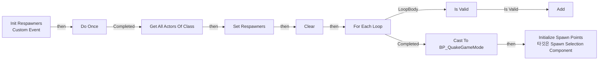
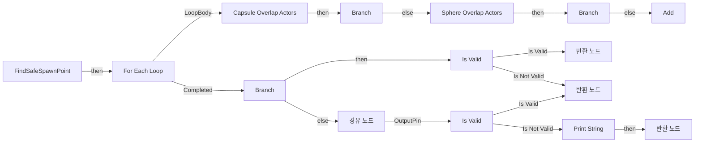
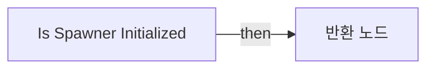

# BPC_SpawnerManager

에셋: `/Game/QuakeLike_1_0/Spawner/Component/BPC_SpawnerManager`

부모: `/Script/CoreUObject.Class'/Script/Engine.ActorComponent'`

수집일: 2026-10-12. MCP에서 읽은 그래프·핀 연결의 자동 전사입니다. 상속된 그래프는 부모 문서를 함께 확인합니다.

정적 루트 참조 도달: 있음. 실행 여부 또는 삭제 가능 여부의 확정이 아닙니다.

컴포넌트 목록은 이 BP가 직접 정의한 SCS만 포함합니다. 부모·네이티브 생성 컴포넌트, 인스턴스 설정은 별도입니다.

## 변수와 기본값

| 이름 | 타입 | CDO 기본값 |
|---|---|---|
| `Respawners` | `BP_PlayerSpawnPoint_C` | [] |
| `spawnPointComponents` | `SceneComponent` | [] |

## 그래프 목록

| 그래프 | 전체 노드 수 |
|---|---|
| EventGraph | 19 |
| FindSafeSpawnPoint | 38 |
| Is Spawner Initialized | 4 |

## 그래프별 실행 연결

실선은 출력 exec 핀의 실제 연결입니다. 여러 분기는 출력 핀 이름을 표시합니다. 함수 호출·delegate·타이머의 다음 그래프 실행은 이 그림에서 자동으로 이어 붙이지 않습니다.

순수 계산 노드 및 데이터 핀은 아래 목록과 원본 JSON을 확인합니다. 연결되지 않은 이벤트도 표시되므로, 노드가 있다는 이유만으로 실행된다고 판단하면 안 됩니다.

### EventGraph

실행 핀 플로우차트

전체 노드·기본 입력 목록

| 노드 ID | 제목 | 미연결 기본 입력 / 에셋 입력 |
|---|---|---|
| `K2Node_CustomEvent_0` | Init Respawners Custom Event |  |
| `K2Node_CallFunction_0` | Get All Actors Of Class | ActorClass=/Game/QuakeLike_1_0/Spawner/SpawnPoint/BP_PlayerSpawnPoint.BP_PlayerSpawnPoint_C |
| `K2Node_VariableSet_0` | Set Respawners |  |
| `K2Node_MacroInstance_0` | Do Once |  |
| `K2Node_VariableGet_0` | Get spawnPointComponents |  |
| `K2Node_CallArrayFunction_0` | Clear |  |
| `K2Node_MacroInstance_1` | For Each Loop |  |
| `K2Node_VariableGet_1` | Get Respawners |  |
| `K2Node_VariableGet_2` | Get SpawnPoint |  |
| `K2Node_VariableGet_3` | Get spawnPointComponents |  |
| `K2Node_CallArrayFunction_1` | Add | ReturnValue=0 |
| `K2Node_Knot_0` | 경유 노드 |  |
| `K2Node_MacroInstance_2` | Is Valid |  |
| `K2Node_Knot_1` | 경유 노드 |  |
| `K2Node_CallFunction_1` | Get Owner 타깃은 액터 컴포넌트 |  |
| `K2Node_DynamicCast_0` | Cast To BP_QuakeGameMode |  |
| `K2Node_VariableGet_4` | Get SpawnSelection |  |
| `K2Node_CallFunction_2` | Initialize Spawn Points 타깃은 Spawn Selection Component |  |
| `K2Node_VariableGet_5` | Get spawnPointComponents |  |

### FindSafeSpawnPoint

실행 핀 플로우차트

전체 노드·기본 입력 목록

| 노드 ID | 제목 | 미연결 기본 입력 / 에셋 입력 |
|---|---|---|
| `K2Node_FunctionEntry_0` | FindSafeSpawnPoint |  |
| `K2Node_FunctionResult_2` | 반환 노드 |  |
| `K2Node_CallFunction_1` | Sphere Overlap Actors | SphereRadius=1000.000000; ActorClassFilter=/Script/Engine.Character |
| `K2Node_CallFunction_2` | Get Actor Location 타깃은 액터 |  |
| `K2Node_MakeArray_0` | 배열 만들기 | [0]=ObjectTypeQuery3 |
| `K2Node_MacroInstance_3` | Is Valid |  |
| `EdGraphNode_Comment_0` | 캐릭터 필터로 근처에 캐릭터 수의 따라서 위험도 검사 |  |
| `K2Node_VariableGet_4` | Get BestSpawnPointsArray |  |
| `K2Node_IfThenElse_3` | Branch |  |
| `K2Node_CallArrayFunction_5` | Random Array Item | OutIndex=0 |
| `K2Node_Knot_6` | 경유 노드 |  |
| `K2Node_Knot_7` | 경유 노드 |  |
| `K2Node_VariableGet_5` | Get Respawners |  |
| `K2Node_CallArrayFunction_6` | Is Not Empty |  |
| `K2Node_Knot_8` | 경유 노드 |  |
| `K2Node_Knot_11` | 경유 노드 |  |
| `K2Node_Knot_12` | 경유 노드 |  |
| `K2Node_Knot_13` | 경유 노드 |  |
| `K2Node_IfThenElse_4` | Branch |  |
| `K2Node_VariableGet_6` | Get BestSpawnPointsArray |  |
| `K2Node_CallArrayFunction_7` | Add | ReturnValue=0 |
| `K2Node_MacroInstance_0` | For Each Loop |  |
| `K2Node_FunctionResult_1` | 반환 노드 |  |
| `K2Node_VariableGet_7` | Get Respawners |  |
| `K2Node_CallArrayFunction_8` | Random Array Item | OutIndex=0 |
| `K2Node_Knot_14` | 경유 노드 |  |
| `K2Node_MacroInstance_1` | Is Valid |  |
| `K2Node_CallFunction_13` | Print String | InString=Error : Respawn Point가 존재하지 않습니다.; bPrintToScreen=true; bPrintToLog=true; TextColor=(R=1.000000,G=0.000000,B=0.002121,A=1.000000); Duration=10.000000; Key=None |
| `K2Node_FunctionResult_3` | 반환 노드 | SafeTransform_Location=0, 0, 0; SafeTransform_Rotation=0, 0, 0; SafeTransform_Scale=1.000000,1.000000,1.000000 |
| `K2Node_CallFunction_4` | Capsule Overlap Actors | Radius=34.000000; HalfHeight=88.000000 |
| `K2Node_CallFunction_5` | Get Actor Location 타깃은 액터 |  |
| `K2Node_MakeArray_1` | 배열 만들기 | [0]=ObjectTypeQuery1; [1]=ObjectTypeQuery2 |
| `K2Node_IfThenElse_0` | Branch |  |
| `K2Node_Knot_0` | 경유 노드 |  |
| `K2Node_VariableGet_1` | Get SpawnPoint |  |
| `K2Node_CallFunction_7` | Get World Transform 타깃은 씬 컴포넌트 |  |
| `K2Node_VariableGet_0` | Get SpawnPoint |  |
| `K2Node_CallFunction_6` | Get World Transform 타깃은 씬 컴포넌트 |  |

### Is Spawner Initialized

실행 핀 플로우차트

전체 노드·기본 입력 목록

| 노드 ID | 제목 | 미연결 기본 입력 / 에셋 입력 |
|---|---|---|
| `K2Node_FunctionEntry_0` | Is Spawner Initialized |  |
| `K2Node_FunctionResult_0` | 반환 노드 |  |
| `K2Node_VariableGet_0` | Get Respawners |  |
| `K2Node_CallArrayFunction_1` | Is Not Empty |  |

## 조회 범위의 한계

ObjectIterator로 발견했으나 MCP helper가 반환하지 않은 그래프입니다. delegate signature·컴파일된 중간 그래프·macro·애니메이션 내부 그래프가 섞일 수 있습니다.

- `Init Respawners`: Graph 'Init Respawners' not found in Blueprint.

[원본 MCP 스냅샷](../../../../Evidence/blueprints-070.json)
