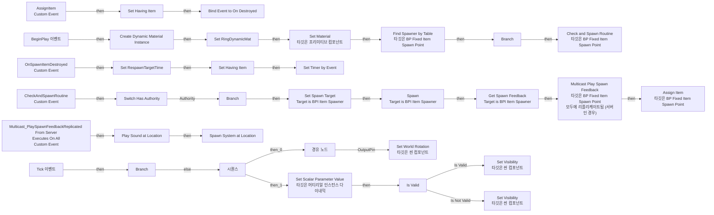
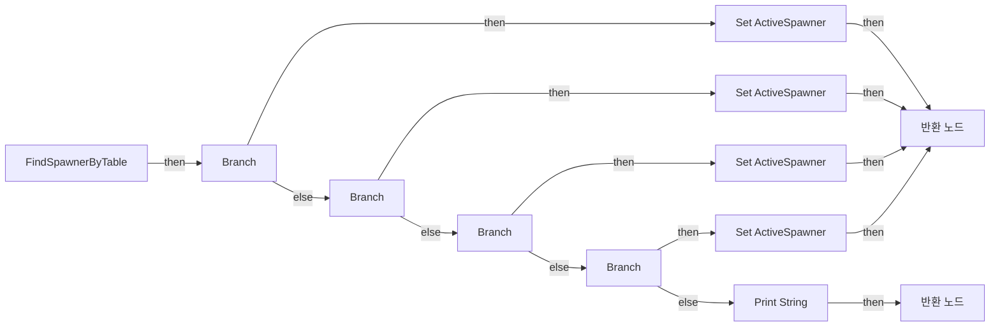
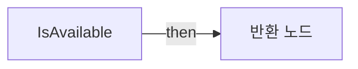
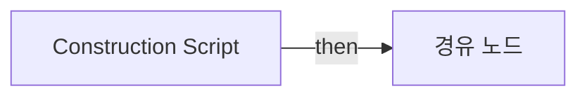

# BP_FixedItemSpawnPoint

에셋: `/Game/QuakeLike_1_0/Spawner/SpawnPoint/BP_FixedItemSpawnPoint`

부모: `/Script/Engine.BlueprintGeneratedClass'/Game/QuakeLike_1_0/Spawner/SpawnPoint/BP_SpawnPointBase.BP_SpawnPointBase_C'`

수집일: 2026-10-12. MCP에서 읽은 그래프·핀 연결의 자동 전사입니다. 상속된 그래프는 부모 문서를 함께 확인합니다.

정적 루트 참조 도달: 없음. 실행 여부 또는 삭제 가능 여부의 확정이 아닙니다.

컴포넌트 목록은 이 BP가 직접 정의한 SCS만 포함합니다. 부모·네이티브 생성 컴포넌트, 인스턴스 설정은 별도입니다.

## 직접 정의한 컴포넌트

| 이름 | 클래스 | 부모 컴포넌트 |
|---|---|---|
| `BPC_LifeItemSpawner` | `BPC_LifeItemSpawner_C` | `` |
| `BPC_HeldItemSpawner` | `BPC_HeldItemSpawner_C` | `` |
| `BPC_AmmoItemSpawner` | `BPC_AmmoItemSpawner_C` | `` |
| `RespawnRing` | `StaticMeshComponent` | `` |
| `BPC_BuffSpawner` | `BPC_BuffSpawner_C` | `` |

## 변수와 기본값

| 이름 | 타입 | CDO 기본값 |
|---|---|---|
| `Having Item` | `BP_DropItem_C` | None |
| `ActiveSpawner` | `BPI_ItemSpawner_C` | None |
| `SpawnItemTable` | `DataTableRowHandle` | &lt;Struct 'DataTableRowHandle' {data_table: None, row_name: ""}&gt; |
| `Spawn Time` | `real` | 1.0 |
| `RespawnTargetTime` | `real` | 0.0 |
| `RingDynamicMat` | `MaterialInstanceDynamic` | None |

## 그래프 목록

| 그래프 | 전체 노드 수 |
|---|---|
| EventGraph | 72 |
| FindSpawnerByTable | 21 |
| IsAvailable | 5 |
| UserConstructionScript | 2 |

## 그래프별 실행 연결

실선은 출력 exec 핀의 실제 연결입니다. 여러 분기는 출력 핀 이름을 표시합니다. 함수 호출·delegate·타이머의 다음 그래프 실행은 이 그림에서 자동으로 이어 붙이지 않습니다.

순수 계산 노드 및 데이터 핀은 아래 목록과 원본 JSON을 확인합니다. 연결되지 않은 이벤트도 표시되므로, 노드가 있다는 이유만으로 실행된다고 판단하면 안 됩니다.

### EventGraph

실행 핀 플로우차트

전체 노드·기본 입력 목록

| 노드 ID | 제목 | 미연결 기본 입력 / 에셋 입력 |
|---|---|---|
| `K2Node_CustomEvent_0` | AssignItem Custom Event |  |
| `K2Node_VariableSet_0` | Set Having Item |  |
| `K2Node_AddDelegate_0` | Bind Event to On Destroyed |  |
| `K2Node_CustomEvent_1` | OnSpawnItemDestroyed Custom Event |  |
| `K2Node_VariableSet_1` | Set Having Item |  |
| `K2Node_Event_0` | BeginPlay 이벤트 |  |
| `K2Node_Message_1` | Set Spawn Target Target is BPI Item Spawner |  |
| `K2Node_Message_2` | Spawn Target is BPI Item Spawner |  |
| `K2Node_CallFunction_13` | Find Spawner by Table 타깃은 BP Fixed Item Spawn Point |  |
| `K2Node_VariableGet_10` | Get SpawnItemTable |  |
| `K2Node_VariableGet_11` | Get ActiveSpawner |  |
| `K2Node_CallFunction_23` | To Object (Interface) |  |
| `K2Node_CallFunction_14` | Get World Transform 타깃은 씬 컴포넌트 |  |
| `K2Node_VariableGet_12` | Get SpawnPoint |  |
| `K2Node_CustomEvent_2` | CheckAndSpawnRoutine Custom Event |  |
| `K2Node_MacroInstance_1` | Switch Has Authority |  |
| `K2Node_CallFunction_2` | Is Available |  |
| `K2Node_IfThenElse_0` | Branch |  |
| `K2Node_Knot_4` | 경유 노드 |  |
| `K2Node_IfThenElse_1` | Branch |  |
| `K2Node_CallFunction_15` | Check and Spawn Routine 타깃은 BP Fixed Item Spawn Point |  |
| `K2Node_CallFunction_16` | Assign Item 타깃은 BP Fixed Item Spawn Point |  |
| `K2Node_CallFunction_6` | Set Timer by Event | bLooping=false; bMaxOncePerFrame=false; InitialStartDelay=0.000000; InitialStartDelayVariance=0.000000 |
| `K2Node_VariableGet_9` | Get Spawn Time |  |
| `K2Node_VariableGet_14` | Get SpawnItemTable |  |
| `K2Node_CallFunction_12` | Get Game State |  |
| `K2Node_CallFunction_7` | Get Server World Time Seconds 타깃은 게임 스테이트 베이스 |  |
| `K2Node_PromotableOperator_3` | float + float |  |
| `K2Node_VariableSet_2` | Set RespawnTargetTime | Output_Get=0.0 |
| `K2Node_VariableGet_3` | Get Spawn Time |  |
| `K2Node_Event_1` | Tick 이벤트 | DeltaSeconds=0.0 |
| `K2Node_CallFunction_18` | Is Dedicated Server |  |
| `K2Node_IfThenElse_3` | Branch |  |
| `K2Node_CallMaterialParameterCollectionFunction_0` | Create Dynamic Material Instance | Parent=/Game/QuakeLike_1_0/Spawner/Materials/M_RespawnTimer.M_RespawnTimer; OptionalName=None; CreationFlags=None |
| `K2Node_CallFunction_3` | Clamp (Float) | Min=0.0; Max=1.0 |
| `K2Node_CallFunction_0` | Get Game State |  |
| `K2Node_CallFunction_1` | Get Server World Time Seconds 타깃은 게임 스테이트 베이스 |  |
| `K2Node_VariableGet_15` | Get RespawnTargetTime |  |
| `K2Node_PromotableOperator_4` | float - float |  |
| `K2Node_VariableGet_16` | Get Spawn Time |  |
| `K2Node_PromotableOperator_5` | float / float |  |
| `K2Node_PromotableOperator_6` | float - float | A=1.000000 |
| `K2Node_VariableGet_17` | Get RingDynamicMat |  |
| `K2Node_CallFunction_20` | Set Scalar Parameter Value 타깃은 머티리얼 인스턴스 다이내믹 | ParameterName=Percent |
| `K2Node_VariableSet_6` | Set RingDynamicMat |  |
| `K2Node_VariableGet_18` | Get RespawnRing |  |
| `K2Node_CallFunction_29` | Set Material 타깃은 프리미티브 컴포넌트 | ElementIndex=0 |
| `K2Node_VariableGet_25` | Get Having Item |  |
| `K2Node_MacroInstance_0` | Is Valid |  |
| `K2Node_VariableGet_27` | Get RespawnRing |  |
| `K2Node_CallFunction_40` | Set Visibility 타깃은 씬 컴포넌트 | bNewVisibility=false; bPropagateToChildren=false |
| `K2Node_CallFunction_39` | Set Visibility 타깃은 씬 컴포넌트 | bNewVisibility=true; bPropagateToChildren=false |
| `K2Node_CustomEvent_3` | Multicast_PlaySpawnFeedbackReplicated From Server Executes On All Custom Event |  |
| `K2Node_CallFunction_4` | Play Sound at Location | Rotation=0, 0, 0; VolumeMultiplier=1.000000; PitchMultiplier=1.000000; StartTime=0.000000; AttenuationSettings=/Game/QuakeLike_1_0/Spawner/SoundFX/SA_SpawnSound.SA_SpawnSound |
| `K2Node_VariableGet_0` | Get SpawnPoint |  |
| `K2Node_CallFunction_5` | Get World Location 타깃은 씬 컴포넌트 |  |
| `K2Node_Message_0` | Get Spawn Feedback Target is BPI Item Spawner | Spawn Volume=0.0 |
| `K2Node_Knot_0` | 경유 노드 |  |
| `K2Node_Knot_1` | 경유 노드 |  |
| `K2Node_Knot_2` | 경유 노드 |  |
| `K2Node_VariableGet_1` | Get |  |
| `K2Node_CallFunction_8` | Multicast Play Spawn Feedback 타깃은 BP Fixed Item Spawn Point 모두에 리플리케이트됨 (서버인 경우) |  |
| `K2Node_CallFunction_9` | Spawn System at Location | Rotation=0, 0, 0; Scale=1.000000,1.000000,1.000000; bAutoDestroy=true; bAutoActivate=true; PoolingMethod=None; bPreCullCheck=true |
| `K2Node_Knot_3` | 경유 노드 |  |
| `K2Node_Knot_5` | 경유 노드 |  |
| `K2Node_ExecutionSequence_0` | 시퀀스 |  |
| `K2Node_CallFunction_10` | Get Player Controller | PlayerIndex=0 |
| `K2Node_CallFunction_11` | Get Control Rotation 타깃은 컨트롤러 | ReturnValue_Roll=0.0; ReturnValue_Pitch=0.0 |
| `K2Node_CallFunction_19` | Make Rotator | Roll=0.0; Pitch=90.000000 |
| `K2Node_CallFunction_21` | Set World Rotation 타깃은 씬 컴포넌트 | bSweep=false; bTeleport=false |
| `K2Node_VariableGet_2` | Get RespawnRing |  |
| `K2Node_Knot_6` | 경유 노드 |  |

### FindSpawnerByTable

실행 핀 플로우차트

전체 노드·기본 입력 목록

| 노드 ID | 제목 | 미연결 기본 입력 / 에셋 입력 |
|---|---|---|
| `K2Node_FunctionEntry_0` | FindSpawnerByTable |  |
| `K2Node_BreakStruct_0` | Break Data Table Row Handle |  |
| `K2Node_PromotableOperator_0` | Equal (Object) | B=/Game/QuakeLike_1_0/Data/Item/DropTable/DT_HeldItemTable.DT_HeldItemTable |
| `K2Node_IfThenElse_0` | Branch |  |
| `K2Node_IfThenElse_1` | Branch |  |
| `K2Node_PromotableOperator_3` | Equal (Object) | B=/Game/QuakeLike_1_0/Data/Item/DropTable/DT_LifeItemTable.DT_LifeItemTable |
| `K2Node_VariableSet_0` | Set ActiveSpawner |  |
| `K2Node_FunctionResult_4` | 반환 노드 | isFind=true |
| `K2Node_VariableGet_1` | Get BPC_HeldItemSpawner |  |
| `K2Node_VariableSet_1` | Set ActiveSpawner |  |
| `K2Node_VariableSet_2` | Set ActiveSpawner |  |
| `K2Node_VariableGet_2` | Get BPC_LifeItemSpawner |  |
| `K2Node_VariableGet_3` | Get BPC_AmmoItemSpawner |  |
| `K2Node_IfThenElse_3` | Branch |  |
| `K2Node_PromotableOperator_1` | Equal (Object) | B=/Game/QuakeLike_1_0/Data/Item/DropTable/DT_AmmoItemTable.DT_AmmoItemTable |
| `K2Node_CallFunction_0` | Print String | InString=경고! BP_ItemSpawnPoint에 설정된 데이터 테이블이 잘못되었습니다!; bPrintToScreen=true; bPrintToLog=true; TextColor=(R=1.000000,G=0.000000,B=0.041791,A=1.000000); Duration=5.000000; Key=None |
| `K2Node_FunctionResult_2` | 반환 노드 | isFind=false |
| `K2Node_PromotableOperator_2` | Equal (Object) | B=/Game/QuakeLike_1_0/Data/Item/DropTable/DT_BuffTable.DT_BuffTable |
| `K2Node_IfThenElse_2` | Branch |  |
| `K2Node_VariableSet_3` | Set ActiveSpawner |  |
| `K2Node_VariableGet_0` | Get BPC_BuffSpawner |  |

### IsAvailable

실행 핀 플로우차트

전체 노드·기본 입력 목록

| 노드 ID | 제목 | 미연결 기본 입력 / 에셋 입력 |
|---|---|---|
| `K2Node_FunctionEntry_0` | IsAvailable |  |
| `K2Node_FunctionResult_1` | 반환 노드 |  |
| `K2Node_VariableGet_0` | Get Having Item |  |
| `K2Node_CallFunction_0` | Is Valid |  |
| `K2Node_CallFunction_1` | NOT Boolean |  |

### UserConstructionScript

실행 핀 플로우차트

전체 노드·기본 입력 목록

| 노드 ID | 제목 | 미연결 기본 입력 / 에셋 입력 |
|---|---|---|
| `K2Node_FunctionEntry_0` | Construction Script |  |
| `K2Node_Knot_1` | 경유 노드 |  |

## 조회 범위의 한계

ObjectIterator로 발견했으나 MCP helper가 반환하지 않은 그래프입니다. delegate signature·컴파일된 중간 그래프·macro·애니메이션 내부 그래프가 섞일 수 있습니다.

- `AssignItem`: Graph 'AssignItem' not found in Blueprint.
- `CheckAndSpawnRoutine`: Graph 'CheckAndSpawnRoutine' not found in Blueprint.
- `EdGraph_0`: Graph 'EdGraph_0' not found in Blueprint.
- `EdGraph_1`: Graph 'EdGraph_1' not found in Blueprint.
- `ExecuteUbergraph_BP_FixedItemSpawnPoint`: Graph 'ExecuteUbergraph_BP_FixedItemSpawnPoint' not found in Blueprint.
- `FindSpawnerByTable_MERGED`: Graph 'FindSpawnerByTable_MERGED' not found in Blueprint.
- `IsAvailable_MERGED`: Graph 'IsAvailable_MERGED' not found in Blueprint.
- `Multicast_PlaySpawnFeedback`: Graph 'Multicast_PlaySpawnFeedback' not found in Blueprint.
- `OnSpawnItemDestroyed`: Graph 'OnSpawnItemDestroyed' not found in Blueprint.
- `ReceiveBeginPlay`: Graph 'ReceiveBeginPlay' not found in Blueprint.
- `ReceiveTick`: Graph 'ReceiveTick' not found in Blueprint.
- `UserConstructionScript_MERGED`: Graph 'UserConstructionScript_MERGED' not found in Blueprint.

[원본 MCP 스냅샷](../../../../Evidence/blueprints-245.json)
