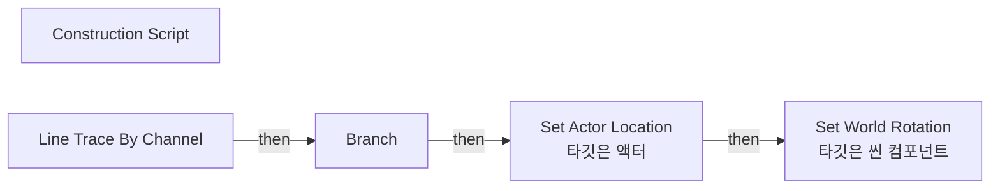

# BP_SpawnPointBase

에셋: `/Game/QuakeLike_1_0/Spawner/SpawnPoint/BP_SpawnPointBase`

부모: `/Script/CoreUObject.Class'/Script/Engine.Actor'`

수집일: 2026-10-12. MCP에서 읽은 그래프·핀 연결의 자동 전사입니다. 상속된 그래프는 부모 문서를 함께 확인합니다.

정적 루트 참조 도달: 있음. 실행 여부 또는 삭제 가능 여부의 확정이 아닙니다.

컴포넌트 목록은 이 BP가 직접 정의한 SCS만 포함합니다. 부모·네이티브 생성 컴포넌트, 인스턴스 설정은 별도입니다.

## 직접 정의한 컴포넌트

| 이름 | 클래스 | 부모 컴포넌트 |
|---|---|---|
| `DefaultSceneRoot` | `SceneComponent` | `` |
| `BasePlate` | `StaticMeshComponent` | `DefaultSceneRoot` |
| `Arrow` | `ArrowComponent` | `DefaultSceneRoot` |
| `SpawnPoint` | `SceneComponent` | `DefaultSceneRoot` |

## 그래프 목록

| 그래프 | 전체 노드 수 |
|---|---|
| EventGraph | 0 |
| Get Spawn Transform | 3 |
| Toggle Base Plate | 12 |
| UserConstructionScript | 12 |

## 그래프별 실행 연결

실선은 출력 exec 핀의 실제 연결입니다. 여러 분기는 출력 핀 이름을 표시합니다. 함수 호출·delegate·타이머의 다음 그래프 실행은 이 그림에서 자동으로 이어 붙이지 않습니다.

순수 계산 노드 및 데이터 핀은 아래 목록과 원본 JSON을 확인합니다. 연결되지 않은 이벤트도 표시되므로, 노드가 있다는 이유만으로 실행된다고 판단하면 안 됩니다.

### EventGraph

전체 노드·기본 입력 목록

| 노드 ID | 제목 | 미연결 기본 입력 / 에셋 입력 |
|---|---|---|

### Get Spawn Transform

실행 핀 플로우차트

전체 노드·기본 입력 목록

| 노드 ID | 제목 | 미연결 기본 입력 / 에셋 입력 |
|---|---|---|
| `K2Node_FunctionEntry_0` | Get Spawn Transform |  |
| `K2Node_FunctionResult_0` | 반환 노드 |  |
| `K2Node_CallFunction_0` | Get Actor Transform 타깃은 액터 |  |

### Toggle Base Plate

실행 핀 플로우차트

전체 노드·기본 입력 목록

| 노드 ID | 제목 | 미연결 기본 입력 / 에셋 입력 |
|---|---|---|
| `K2Node_FunctionEntry_1` | Toggle Base Plate |  |
| `K2Node_VariableGet_4` | Get BasePlate |  |
| `K2Node_CallFunction_4` | Set Visibility 타깃은 씬 컴포넌트 | bPropagateToChildren=false |
| `K2Node_Knot_2` | 경유 노드 |  |
| `K2Node_VariableGet_3` | Get bVisible |  |
| `K2Node_Knot_3` | 경유 노드 |  |
| `K2Node_CallFunction_5` | NOT Boolean |  |
| `K2Node_VariableGet_0` | Get BasePlate |  |
| `K2Node_CallFunction_6` | Set Collision Enabled 타깃은 프리미티브 컴포넌트 |  |
| `K2Node_Select_0` | 선택 | Option 0=NoCollision; Option 1=QueryAndPhysics |
| `K2Node_VariableSet_0` | Set NewLocalVar |  |
| `K2Node_VariableGet_5` | Get NewLocalVar |  |

### UserConstructionScript

실행 핀 플로우차트

전체 노드·기본 입력 목록

| 노드 ID | 제목 | 미연결 기본 입력 / 에셋 입력 |
|---|---|---|
| `K2Node_FunctionEntry_1` | Construction Script |  |
| `K2Node_CallFunction_12` | Get Actor Location 타깃은 액터 |  |
| `K2Node_CallFunction_11` | Line Trace By Channel | TraceChannel=TraceTypeQuery1; bTraceComplex=false; DrawDebugType=None; OutHit_bBlockingHit=false; OutHit_bInitialOverlap=false; OutHit_Time=0.0; OutHit_Distance=0.0; OutHit_Location=0, 0, 0; OutHit_Normal=0, 0, 0; OutHit_HitBoneName=None; OutHit_BoneName=None; OutHit_HitItem=0; OutHit_ElementIndex=0; OutHit_FaceIndex=0; OutHit_TraceStart=0, 0, 0; OutHit_TraceEnd=0, 0, 0; bIgnoreSelf=true; TraceColor=(R=1.000000,G=0.000000,B=0.000000,A=1.000000); TraceHitColor=(R=0.000000,G=1.000000,B=0.000000,A=1.000000); DrawTime=5.000000 |
| `K2Node_CallFunction_10` | Get Actor Location 타깃은 액터 |  |
| `K2Node_PromotableOperator_1` | vector + vector | B=0.000000,0.000000,-10000.000000 |
| `K2Node_IfThenElse_0` | Branch |  |
| `K2Node_PromotableOperator_0` | vector + vector | B=0.000000,0.000000,50.000000 |
| `K2Node_CallFunction_2` | Make Rot from ZX |  |
| `K2Node_CallFunction_3` | Get Actor Forward Vector 타깃은 액터 |  |
| `K2Node_CallFunction_4` | Set Actor Location 타깃은 액터 | bSweep=false; bTeleport=false; ReturnValue=false |
| `K2Node_CallFunction_5` | Set World Rotation 타깃은 씬 컴포넌트 | bSweep=false; bTeleport=false |
| `K2Node_VariableGet_1` | Get BasePlate |  |

[원본 MCP 스냅샷](../../../../Evidence/blueprints-035.json)
