# BPC_DebugAI_AttachToPlayerController

에셋: `/Game/QuakeLike_1_0/Test/BPC_DebugAI_AttachToPlayerController`

부모: `/Script/CoreUObject.Class'/Script/Engine.ActorComponent'`

수집일: 2026-10-12. MCP에서 읽은 그래프·핀 연결의 자동 전사입니다. 상속된 그래프는 부모 문서를 함께 확인합니다.

정적 루트 참조 도달: 있음. 실행 여부 또는 삭제 가능 여부의 확정이 아닙니다.

컴포넌트 목록은 이 BP가 직접 정의한 SCS만 포함합니다. 부모·네이티브 생성 컴포넌트, 인스턴스 설정은 별도입니다.

## 변수와 기본값

| 이름 | 타입 | CDO 기본값 |
|---|---|---|
| `AIControllers` | `BP_QuakeAIController2_C` | [] |
| `DebugIndex` | `int` | -1 |
| `Player Controller` | `BP_QuakePlayerController_C` | None |
| `Player Pawn` | `Pawn` | None |
| `Follow Camera` | `BP_DebugFollowCamera_C` | None |
| `NewVar` | `BPC_VirtualInputAIMovement_C` | None |
| `DebugToggleStates` | `name` | {} |
| `DebugAI UI` | `WBP_DebugAI_C` | None |
| `Toggle Input UI` | `bool` | False |

## 그래프 목록

| 그래프 | 전체 노드 수 |
|---|---|
| Custom Draw Line | 21 |
| Debug AI State | 21 |
| Debug LIne As BlackBoard | 23 |
| Debug Off Mesh | 17 |
| Debug Path Link Route | 31 |
| Debug Points | 28 |
| EventGraph | 211 |
| Get AI State | 7 |
| Get Valid Debug Target | 20 |
| Get Widget | 7 |
| Is Debug View Enabled | 8 |
| Make Key | 5 |

## 그래프별 실행 연결

실선은 출력 exec 핀의 실제 연결입니다. 여러 분기는 출력 핀 이름을 표시합니다. 함수 호출·delegate·타이머의 다음 그래프 실행은 이 그림에서 자동으로 이어 붙이지 않습니다.

순수 계산 노드 및 데이터 핀은 아래 목록과 원본 JSON을 확인합니다. 연결되지 않은 이벤트도 표시되므로, 노드가 있다는 이유만으로 실행된다고 판단하면 안 됩니다.

### Custom Draw Line

실행 핀 플로우차트

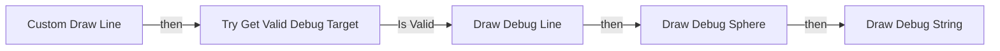

전체 노드·기본 입력 목록

| 노드 ID | 제목 | 미연결 기본 입력 / 에셋 입력 |
|---|---|---|
| `K2Node_FunctionEntry_0` | Custom Draw Line |  |
| `K2Node_MacroInstance_0` | Try Get Valid Debug Target |  |
| `K2Node_CallFunction_1` | Get Actor Eyes View Point 타깃은 액터 | OutRotation=0, 0, 0 |
| `K2Node_Knot_2` | 경유 노드 |  |
| `K2Node_Knot_3` | 경유 노드 |  |
| `K2Node_CallFunction_4` | Draw Debug Line | Thickness=3.000000 |
| `K2Node_Knot_4` | 경유 노드 |  |
| `K2Node_Knot_5` | 경유 노드 |  |
| `K2Node_CallFunction_5` | Draw Debug Sphere | Segments=12; Thickness=3.000000 |
| `K2Node_Knot_8` | 경유 노드 |  |
| `K2Node_Knot_9` | 경유 노드 |  |
| `K2Node_Knot_10` | 경유 노드 |  |
| `K2Node_Knot_11` | 경유 노드 |  |
| `K2Node_Knot_12` | 경유 노드 |  |
| `K2Node_CallFunction_0` | Draw Debug String |  |
| `K2Node_Knot_0` | 경유 노드 |  |
| `K2Node_PromotableOperator_0` | vector - vector | B=0.000000,0.000000,50.000000 |
| `K2Node_Knot_1` | 경유 노드 |  |
| `K2Node_Knot_6` | 경유 노드 |  |
| `K2Node_Knot_7` | 경유 노드 |  |
| `K2Node_Knot_13` | 경유 노드 |  |

### Debug AI State

실행 핀 플로우차트

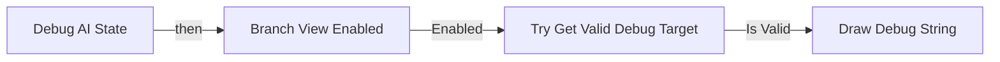

전체 노드·기본 입력 목록

| 노드 ID | 제목 | 미연결 기본 입력 / 에셋 입력 |
|---|---|---|
| `K2Node_FunctionEntry_0` | Debug AI State |  |
| `K2Node_CallFunction_5` | Get Actor Eyes View Point 타깃은 액터 | OutRotation=0, 0, 0 |
| `K2Node_PromotableOperator_0` | vector + vector | B=0.000000,0.000000,100.000000 |
| `K2Node_Knot_1` | 경유 노드 |  |
| `K2Node_Knot_2` | 경유 노드 |  |
| `K2Node_CallFunction_8` | Draw Debug String |  |
| `K2Node_Knot_8` | 경유 노드 |  |
| `K2Node_Knot_9` | 경유 노드 |  |
| `K2Node_MacroInstance_0` | Try Get Valid Debug Target |  |
| `K2Node_CallFunction_7` | Get Active Behavior Tree Node | ReturnValue=false |
| `K2Node_GetEnumeratorNameAsString_0` | 열거형을 스트링으로 |  |
| `K2Node_CallFunction_0` | Get AI State |  |
| `K2Node_CommutativeAssociativeBinaryOperator_1` | Append | A=[; C=]; D=
  |
| `K2Node_Knot_13` | 경유 노드 |  |
| `K2Node_CommutativeAssociativeBinaryOperator_0` | Append | G=
  |
| `K2Node_Knot_3` | 경유 노드 |  |
| `K2Node_CallFunction_6` | Get Object Name |  |
| `K2Node_CallFunction_33` | To String (Name) |  |
| `K2Node_CallFunction_10` | Get Display Name |  |
| `K2Node_VariableGet_5` | Get CharacteristicRowNameOverride |  |
| `K2Node_MacroInstance_1` | Branch View Enabled | Debug ID=AIState |

### Debug LIne As BlackBoard

실행 핀 플로우차트

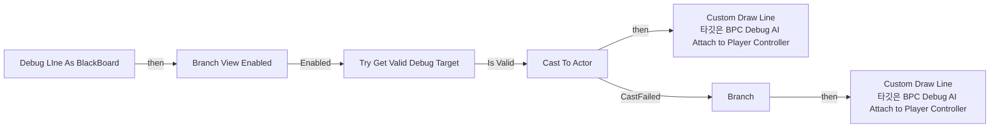

전체 노드·기본 입력 목록

| 노드 ID | 제목 | 미연결 기본 입력 / 에셋 입력 |
|---|---|---|
| `K2Node_FunctionEntry_0` | Debug LIne As BlackBoard |  |
| `K2Node_CallFunction_6` | Custom Draw Line 타깃은 BPC Debug AI Attach to Player Controller |  |
| `K2Node_CallFunction_1` | Get Blackboard |  |
| `K2Node_CallFunction_2` | Make Literal Name |  |
| `K2Node_CallFunction_3` | Get Value as Object 타깃은 블랙보드 컴포넌트 |  |
| `K2Node_DynamicCast_0` | Cast To Actor |  |
| `K2Node_MacroInstance_0` | Try Get Valid Debug Target |  |
| `K2Node_CallFunction_0` | Get Actor Location 타깃은 액터 |  |
| `K2Node_CallFunction_9` | Get Blackboard |  |
| `K2Node_CallFunction_13` | Make Literal Name |  |
| `K2Node_CallFunction_5` | Get Value as Vector 타깃은 블랙보드 컴포넌트 |  |
| `K2Node_Knot_0` | 경유 노드 |  |
| `K2Node_Knot_1` | 경유 노드 |  |
| `K2Node_Knot_2` | 경유 노드 |  |
| `K2Node_CallFunction_4` | Custom Draw Line 타깃은 BPC Debug AI Attach to Player Controller |  |
| `K2Node_CallFunction_7` | Is Vector Value Set 타깃은 블랙보드 컴포넌트 |  |
| `K2Node_IfThenElse_0` | Branch |  |
| `K2Node_Knot_3` | 경유 노드 |  |
| `K2Node_Knot_4` | 경유 노드 |  |
| `K2Node_Knot_5` | 경유 노드 |  |
| `K2Node_Knot_6` | 경유 노드 |  |
| `K2Node_MacroInstance_1` | Branch View Enabled |  |
| `K2Node_Knot_7` | 경유 노드 |  |

### Debug Off Mesh

실행 핀 플로우차트

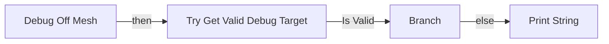

전체 노드·기본 입력 목록

| 노드 ID | 제목 | 미연결 기본 입력 / 에셋 입력 |
|---|---|---|
| `K2Node_FunctionEntry_0` | Debug Off Mesh |  |
| `K2Node_MacroInstance_0` | Try Get Valid Debug Target |  |
| `K2Node_CallFunction_0` | Project Point to Navigation | ProjectedLocation=0, 0, 0; QueryExtent=20.000000,20.000000,180.000000 |
| `K2Node_CallFunction_1` | Get Actor Location 타깃은 액터 |  |
| `K2Node_IfThenElse_0` | Branch |  |
| `K2Node_CallFunction_2` | Print String | bPrintToScreen=true; bPrintToLog=true |
| `K2Node_CallFunction_4` | Make Print Key | string=Off Mesh 디버깅 |
| `K2Node_Knot_0` | 경유 노드 |  |
| `K2Node_Knot_1` | 경유 노드 |  |
| `K2Node_Knot_2` | 경유 노드 |  |
| `K2Node_CallFunction_20` | Get Display Name |  |
| `K2Node_CommutativeAssociativeBinaryOperator_0` | Append | B=: ; C=Off Mesh |
| `K2Node_Knot_3` | 경유 노드 |  |
| `K2Node_Knot_4` | 경유 노드 |  |
| `K2Node_Knot_5` | 경유 노드 |  |
| `K2Node_Knot_6` | 경유 노드 |  |
| `K2Node_Knot_7` | 경유 노드 |  |

### Debug Path Link Route

실행 핀 플로우차트

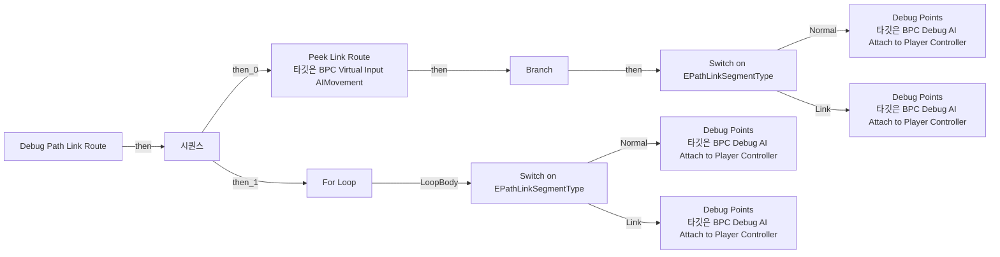

전체 노드·기본 입력 목록

| 노드 ID | 제목 | 미연결 기본 입력 / 에셋 입력 |
|---|---|---|
| `K2Node_FunctionEntry_0` | Debug Path Link Route |  |
| `K2Node_VariableGet_1` | Get Path Link Route |  |
| `K2Node_Knot_15` | 경유 노드 |  |
| `K2Node_Knot_16` | 경유 노드 |  |
| `K2Node_Knot_2` | 경유 노드 |  |
| `K2Node_Knot_7` | 경유 노드 |  |
| `K2Node_CallFunction_2` | Debug Points 타깃은 BPC Debug AI Attach to Player Controller |  |
| `K2Node_Knot_9` | 경유 노드 |  |
| `K2Node_MacroInstance_2` | For Loop | FirstIndex=1 |
| `K2Node_CallArrayFunction_0` | Last Index |  |
| `K2Node_Knot_10` | 경유 노드 |  |
| `K2Node_GetArrayItem_0` | GET |  |
| `K2Node_Knot_11` | 경유 노드 |  |
| `K2Node_Knot_12` | 경유 노드 |  |
| `K2Node_SwitchEnum_3` | Switch on EPathLinkSegmentType |  |
| `K2Node_ExecutionSequence_0` | 시퀀스 |  |
| `K2Node_Knot_13` | 경유 노드 |  |
| `K2Node_CallFunction_6` | Peek Link Route 타깃은 BPC Virtual Input AIMovement |  |
| `K2Node_Knot_14` | 경유 노드 |  |
| `K2Node_IfThenElse_0` | Branch |  |
| `K2Node_Knot_0` | 경유 노드 |  |
| `K2Node_CallFunction_5` | Debug Points 타깃은 BPC Debug AI Attach to Player Controller | Line Color=(R=0.995000,G=1.000000,B=0.990000,A=1.000000) |
| `K2Node_SwitchEnum_2` | Switch on EPathLinkSegmentType |  |
| `K2Node_Knot_17` | 경유 노드 |  |
| `K2Node_Knot_18` | 경유 노드 |  |
| `K2Node_Knot_19` | 경유 노드 |  |
| `K2Node_Knot_22` | 경유 노드 |  |
| `K2Node_CallFunction_3` | Debug Points 타깃은 BPC Debug AI Attach to Player Controller |  |
| `K2Node_MakeArray_1` | 배열 만들기 |  |
| `K2Node_CallFunction_8` | Debug Points 타깃은 BPC Debug AI Attach to Player Controller | Line Color=(R=0.995000,G=1.000000,B=0.990000,A=1.000000) |
| `K2Node_MakeArray_0` | 배열 만들기 |  |

### Debug Points

실행 핀 플로우차트

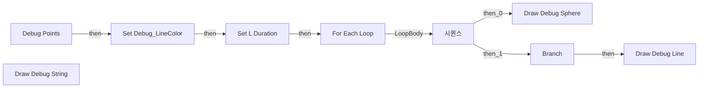

전체 노드·기본 입력 목록

| 노드 ID | 제목 | 미연결 기본 입력 / 에셋 입력 |
|---|---|---|
| `K2Node_FunctionEntry_1` | Debug Points |  |
| `K2Node_MacroInstance_2` | For Each Loop |  |
| `K2Node_CallFunction_0` | Draw Debug Sphere | Radius=37.500000; Segments=12; Thickness=0.000000 |
| `K2Node_PromotableOperator_1` | int - int | B=1 |
| `K2Node_CallArrayFunction_1` | Is Valid Index |  |
| `K2Node_IfThenElse_0` | Branch |  |
| `K2Node_GetArrayItem_0` | GET |  |
| `K2Node_Knot_1` | 경유 노드 |  |
| `K2Node_ExecutionSequence_1` | 시퀀스 |  |
| `K2Node_CallFunction_2` | Draw Debug Line | Thickness=3.000000 |
| `K2Node_Knot_2` | 경유 노드 |  |
| `K2Node_VariableSet_0` | Set Debug_LineColor |  |
| `K2Node_Knot_0` | 경유 노드 |  |
| `K2Node_Knot_3` | 경유 노드 |  |
| `K2Node_VariableSet_2` | Set L Duration | Output_Get=0.0 |
| `K2Node_Knot_4` | 경유 노드 |  |
| `K2Node_VariableGet_8` | Get L Duration |  |
| `K2Node_VariableGet_3` | Get L Duration |  |
| `K2Node_CallFunction_3` | Draw Debug String | TextColor=(R=1.000000,G=1.000000,B=1.000000,A=1.000000) |
| `K2Node_VariableGet_9` | Get L Duration |  |
| `K2Node_Knot_5` | 경유 노드 |  |
| `K2Node_Knot_6` | 경유 노드 |  |
| `K2Node_CallFunction_27` | To String (Integer) |  |
| `K2Node_Knot_7` | 경유 노드 |  |
| `K2Node_Knot_8` | 경유 노드 |  |
| `K2Node_Knot_9` | 경유 노드 |  |
| `K2Node_VariableGet_2` | Get Debug_LineColor |  |
| `K2Node_VariableGet_5` | Get Debug_LineColor |  |

### EventGraph

실행 핀 플로우차트

```mermaid
flowchart LR
  n0["Get All Actors Of Class"]
  n1["Begin Play 이벤트"]
  n2["Set AIControllers"]
  n3["Branch"]
  n4["Is Valid"]
  n5["Set DebugIndex"]
  n6["Set DebugIndex"]
  n7["Call Debug AIReplicated From Client<br/>Executes On Server<br/>Custom Event"]
  n8["Call Debug AI<br/>타깃은 BPC Debug AI Attach to Player Controller<br/>서버에 리플리케이트됨 (소유 클라이언트인 경우)"]
  n9["Debug View AIReplicated From Server<br/>Executes on Owning Client<br/>Custom Event"]
  n10["Debug View AI<br/>타깃은 BPC Debug AI Attach to Player Controller<br/>소유 클라이언트에 리플리케이트됨 (서버인 경우)"]
  n11["Set View Target with Blend<br/>타깃은 플레이어 컨트롤러"]
  n12["Is Valid"]
  n13["SpawnActor BP Debug Follow Camera"]
  n14["Set Follow Camera"]
  n15["Set TargetPawn"]
  n16["Set Player Controller"]
  n17["Get"]
  n18["Get"]
  n19["Enable Follow Camera<br/>타깃은 BP Debug Follow Camera"]
  n20["Debug EndReplicated From Server<br/>Executes on Owning Client<br/>Custom Event"]
  n21["Disable Follow Camera<br/>타깃은 BP Debug Follow Camera"]
  n22["Debug End<br/>타깃은 BPC Debug AI Attach to Player Controller<br/>소유 클라이언트에 리플리케이트됨 (서버인 경우)"]
  n23["Set View Target with Blend<br/>타깃은 플레이어 컨트롤러"]
  n24["Bind Event to On Possessed Pawn Changed"]
  n25["OnPossessed<br/>Custom Event"]
  n26["Set Player Pawn"]
  n27["Get"]
  n28["Set Player Pawn"]
  n29["Tick 이벤트"]
  n30["Switch Has Authority"]
  n31["시퀀스"]
  n32["경유 노드"]
  n33["Try Get Valid Debug Target"]
  n34["Debug LIne as Black Board<br/>타깃은 BPC Debug AI Attach to Player Controller"]
  n35["Debug Input Direction<br/>타깃은 BPC Virtual Input AIMovement"]
  n36["Debug LIne as Black Board<br/>타깃은 BPC Debug AI Attach to Player Controller"]
  n37["Get"]
  n38["Debug LIne as Black Board<br/>타깃은 BPC Debug AI Attach to Player Controller"]
  n39["Debug AI State<br/>타깃은 BPC Debug AI Attach to Player Controller"]
  n40["Debug LIne as Black Board<br/>타깃은 BPC Debug AI Attach to Player Controller"]
  n41["Debug Path Link Route<br/>타깃은 BPC Debug AI Attach to Player Controller"]
  n42["For Each Loop"]
  n43["경유 노드"]
  n44["Is Valid"]
  n45["Get Goal Weight<br/>타깃은 BP Quake AIController 2"]
  n46["Draw Debug String"]
  n47["Branch"]
  n48["Cast To BP_QuakePlayerController"]
  n49["Try Get Widget"]
  n50["Initialize UI<br/>타깃은 WBP Player HUD Sdm"]
  n51["Initialize UI<br/>타깃은 WBP Player HUD Sdm"]
  n52["Try Get Widget"]
  n53["Request Debug ViewReplicated From Client<br/>Executes On Server<br/>Custom Event"]
  n54["Add"]
  n55["Branch"]
  n56["Create WBP Debug AI Widget"]
  n57["Add to Viewport<br/>타깃은 사용자 위젯"]
  n58["Set DebugAI UI"]
  n59["Set Visibility<br/>타깃은 위젯"]
  n60["Set Visibility<br/>타깃은 위젯"]
  n61["시퀀스"]
  n62["Set Visibility<br/>타깃은 위젯"]
  n63["시퀀스"]
  n64["Bind Event to On View Requested"]
  n65["Debug Key Y"]
  n66["For Each Loop"]
  n67["Debug Key U"]
  n68["Set Value as Bool<br/>타깃은 블랙보드 컴포넌트"]
  n69["Kill All AIsReplicated From Client<br/>Executes On Server<br/>Custom Event"]
  n70["Kill All AIs<br/>타깃은 BPC Debug AI Attach to Player Controller<br/>서버에 리플리케이트됨 (소유 클라이언트인 경우)"]
  n71["Clear Nav Path<br/>Target is BPI Virtual Input AIMovement"]
  n72["Debug Key H"]
  n73["Get"]
  n74["Set Input Mode Game Only"]
  n75["Get"]
  n76["Get"]
  n77["Set Input Mode Game Only"]
  n78["경유 노드"]
  n79["Set Toggle Input UI"]
  n80["Set bShowMouseCursor"]
  n81["경유 노드"]
  n82["Set Input Mode Game And UI"]
  n83["Branch View Enabled"]
  n84["Branch View Enabled"]
  n85["Print String"]
  n86["Add Debug RowReplicated From Client<br/>Executes On Server<br/>Custom Event"]
  n87["Add Debug Rows<br/>Custom Event"]
  n88["Add Debug Rows<br/>타깃은 BPC Debug AI Attach to Player Controller"]
  n89["For Each Loop"]
  n90["Add Debug Row<br/>타깃은 BPC Debug AI Attach to Player Controller<br/>서버에 리플리케이트됨 (소유 클라이언트인 경우)"]
  n91["Get"]
  n92["Add Toggle Row<br/>타깃은 WBP Debug AI"]
  n93["Add"]
  n94["Branch View Enabled"]
  n95["시퀀스"]
  n96["Cast To BP_AIShooter"]
  n97["Get Target Drone<br/>타깃은 BPI Get Target Drone"]
  n98["Cast To BP_OrbitalTargetDrone"]
  n99["Custom Draw Line<br/>타깃은 BPC Debug AI Attach to Player Controller"]
  n100["시퀀스"]
  n101["Get Value as Object<br/>타깃은 블랙보드 컴포넌트"]
  n102["Try Get Valid Debug Target"]
  n103["Get Heart<br/>Target is BPI Body Info"]
  n104["Draw Debug Box"]
  n105["Cast To BP_ShooterBase"]
  n0 -->|"then"| n2
  n1 -->|"then"| n0
  n2 -->|"then"| n48
  n3 -->|"then"| n4
  n3 -->|"else"| n5
  n4 -->|"Is Valid"| n10
  n5 -->|"then"| n22
  n6 -->|"then"| n3
  n7 -->|"then"| n18
  n9 -->|"then"| n12
  n11 -->|"then"| n19
  n12 -->|"Is Valid"| n17
  n13 -->|"then"| n14
  n14 -->|"then"| n56
  n15 -->|"then"| n37
  n16 -->|"then"| n24
  n17 -->|"then"| n15
  n18 -->|"then"| n6
  n19 -->|"then"| n63
  n20 -->|"then"| n21
  n21 -->|"then"| n27
  n23 -->|"then"| n61
  n24 -->|"then"| n28
  n25 -->|"then"| n26
  n27 -->|"then"| n23
  n28 -->|"then"| n47
  n29 -->|"then"| n30
  n30 -->|"Authority"| n33
  n31 -->|"then_0"| n39
  n31 -->|"then_1"| n32
  n31 -->|"then_2"| n43
  n32 -->|"OutputPin"| n83
  n33 -->|"Is Valid"| n31
  n34 -->|"then"| n40
  n35 -->|"then"| n41
  n36 -->|"then"| n34
  n37 -->|"then"| n11
  n39 -->|"then"| n36
  n40 -->|"then"| n38
  n42 -->|"LoopBody"| n44
  n43 -->|"OutputPin"| n95
  n44 -->|"Is Valid"| n45
  n45 -->|"then"| n46
  n47 -->|"then"| n13
  n48 -->|"then"| n16
  n49 -->|"valid"| n50
  n52 -->|"valid"| n51
  n53 -->|"then"| n55
  n55 -->|"then"| n54
  n56 -->|"then"| n58
  n57 -->|"then"| n59
  n58 -->|"then"| n57
  n59 -->|"then"| n64
  n60 -->|"then"| n73
  n61 -->|"then_0"| n52
  n61 -->|"then_1"| n60
  n63 -->|"then_0"| n49
  n63 -->|"then_1"| n62
  n64 -->|"then"| n88
  n65 -->|"Pressed"| n8
  n66 -->|"LoopBody"| n71
  n67 -->|"Pressed"| n70
  n69 -->|"then"| n66
  n71 -->|"then"| n68
  n72 -->|"Pressed"| n79
  n73 -->|"then"| n74
  n75 -->|"then"| n82
  n75 -->|"else"| n78
  n76 -->|"then"| n75
  n77 -->|"then"| n81
  n78 -->|"OutputPin"| n77
  n79 -->|"then"| n76
  n81 -->|"OutputPin"| n80
  n82 -->|"then"| n81
  n83 -->|"Enabled"| n35
  n84 -->|"Enabled"| n42
  n86 -->|"then"| n93
  n87 -->|"then"| n89
  n89 -->|"LoopBody"| n90
  n90 -->|"then"| n91
  n91 -->|"then"| n92
  n94 -->|"Enabled"| n96
  n95 -->|"then_0"| n84
  n95 -->|"then_1"| n94
  n96 -->|"then"| n100
  n97 -->|"then"| n98
  n98 -->|"then"| n99
  n100 -->|"then_0"| n97
  n100 -->|"then_1"| n102
  n101 -->|"then"| n105
  n102 -->|"Is Valid"| n101
  n103 -->|"then"| n104
  n105 -->|"then"| n103
```

전체 노드·기본 입력 목록

| 노드 ID | 제목 | 미연결 기본 입력 / 에셋 입력 |
|---|---|---|
| `K2Node_CallFunction_31` | Get All Actors Of Class | ActorClass=/Game/QuakeLike_1_0/AI/AIC/BP_QuakeAIController2.BP_QuakeAIController2_C |
| `K2Node_Event_2` | Begin Play 이벤트 |  |
| `K2Node_VariableSet_0` | Set AIControllers |  |
| `K2Node_VariableGet_0` | Get DebugIndex |  |
| `K2Node_VariableGet_1` | Get AIControllers |  |
| `K2Node_CallArrayFunction_1` | Is Valid Index |  |
| `K2Node_IfThenElse_0` | Branch |  |
| `K2Node_VariableGet_17` | Get AIControllers |  |
| `K2Node_GetArrayItem_0` | GET |  |
| `K2Node_VariableGet_4` | Get DebugIndex |  |
| `K2Node_CallFunction_2` | Get Controlled Pawn 타깃은 컨트롤러 |  |
| `K2Node_MacroInstance_1` | Is Valid |  |
| `K2Node_VariableSet_1` | Set DebugIndex | DebugIndex=-1; Output_Get=0 |
| `K2Node_Knot_51` | 경유 노드 |  |
| `K2Node_PromotableOperator_2` | int + int | B=1 |
| `K2Node_VariableSet_3` | Set DebugIndex |  |
| `K2Node_CustomEvent_0` | Call Debug AIReplicated From Client Executes On Server Custom Event |  |
| `K2Node_CallFunction_11` | Call Debug AI 타깃은 BPC Debug AI Attach to Player Controller 서버에 리플리케이트됨 (소유 클라이언트인 경우) |  |
| `K2Node_CustomEvent_1` | Debug View AIReplicated From Server Executes on Owning Client Custom Event |  |
| `K2Node_CallFunction_12` | Debug View AI 타깃은 BPC Debug AI Attach to Player Controller 소유 클라이언트에 리플리케이트됨 (서버인 경우) |  |
| `K2Node_CallFunction_49` | Set View Target with Blend 타깃은 플레이어 컨트롤러 | BlendTime=0.150000; BlendFunc=VTBlend_PreBlended; BlendExp=0.000000; bLockOutgoing=false |
| `K2Node_MacroInstance_4` | Is Valid |  |
| `K2Node_Knot_49` | 경유 노드 |  |
| `K2Node_Knot_9` | 경유 노드 |  |
| `K2Node_SpawnActorFromClass_0` | SpawnActor BP Debug Follow Camera | Class=/Game/QuakeLike_1_0/Test/BP_DebugFollowCamera.BP_DebugFollowCamera_C; SpawnTransform_Location=0, 0, 0; SpawnTransform_Rotation=0, 0, 0; SpawnTransform_Scale=1.000000,1.000000,1.000000; CollisionHandlingOverride=Undefined; TransformScaleMethod=MultiplyWithRoot |
| `K2Node_VariableSet_7` | Set Follow Camera |  |
| `K2Node_CallFunction_17` | Get Owner 타깃은 액터 컴포넌트 |  |
| `K2Node_VariableGet_7` | Get Follow Camera |  |
| `K2Node_VariableSet_12` | Set TargetPawn |  |
| `K2Node_Knot_10` | 경유 노드 |  |
| `K2Node_Knot_11` | 경유 노드 |  |
| `K2Node_Knot_12` | 경유 노드 |  |
| `K2Node_Knot_13` | 경유 노드 |  |
| `K2Node_CallFunction_24` | Get Owner 타깃은 액터 컴포넌트 |  |
| `K2Node_VariableSet_10` | Set Player Controller |  |
| `K2Node_VariableGet_3` | Get |  |
| `K2Node_VariableGet_15` | Get |  |
| `K2Node_VariableGet_27` | Get Follow Camera |  |
| `K2Node_CallFunction_40` | Enable Follow Camera 타깃은 BP Debug Follow Camera |  |
| `K2Node_VariableGet_12` | Get Player Controller |  |
| `K2Node_CustomEvent_2` | Debug EndReplicated From Server Executes on Owning Client Custom Event |  |
| `K2Node_VariableGet_11` | Get Follow Camera |  |
| `K2Node_CallFunction_23` | Disable Follow Camera 타깃은 BP Debug Follow Camera |  |
| `K2Node_VariableGet_16` | Get Player Controller |  |
| `K2Node_CallFunction_25` | Debug End 타깃은 BPC Debug AI Attach to Player Controller 소유 클라이언트에 리플리케이트됨 (서버인 경우) |  |
| `K2Node_VariableGet_19` | Get Player Controller |  |
| `K2Node_CallFunction_26` | Set View Target with Blend 타깃은 플레이어 컨트롤러 | BlendTime=0.000000; BlendFunc=VTBlend_Linear; BlendExp=0.000000; bLockOutgoing=false |
| `K2Node_AddDelegate_0` | Bind Event to On Possessed Pawn Changed |  |
| `K2Node_CreateDelegate_0` | 이벤트 생성 |  |
| `K2Node_CustomEvent_3` | OnPossessed Custom Event |  |
| `K2Node_VariableSet_4` | Set Player Pawn |  |
| `K2Node_VariableGet_18` | Get |  |
| `K2Node_Knot_4` | 경유 노드 |  |
| `K2Node_VariableSet_2` | Set Player Pawn |  |
| `K2Node_CallFunction_30` | Get Controlled Pawn 타깃은 컨트롤러 |  |
| `K2Node_Event_0` | Tick 이벤트 | DeltaSeconds=0.0 |
| `K2Node_MacroInstance_7` | Switch Has Authority |  |
| `K2Node_ExecutionSequence_0` | 시퀀스 |  |
| `K2Node_Knot_3` | 경유 노드 |  |
| `K2Node_MacroInstance_2` | Try Get Valid Debug Target |  |
| `K2Node_VariableGet_22` | Get BPC_VirtualInputAIMovement |  |
| `K2Node_Knot_5` | 경유 노드 |  |
| `K2Node_CallFunction_38` | Debug LIne as Black Board 타깃은 BPC Debug AI Attach to Player Controller | LineColor=(R=1.000000,G=0.000000,B=0.772613,A=1.000000); Duration=0.0; Key Name=LTG; Name=LTG; Radius=100.000000 |
| `K2Node_Knot_52` | 경유 노드 |  |
| `K2Node_CallFunction_9` | Debug Input Direction 타깃은 BPC Virtual Input AIMovement | Stuck Color=(R=1.000000,G=0.000000,B=0.012693,A=1.000000); Normal Color=(R=1.000000,G=0.962494,B=0.000000,A=1.000000); Duration=0.0 |
| `K2Node_CallFunction_16` | Debug LIne as Black Board 타깃은 BPC Debug AI Attach to Player Controller | LineColor=(R=0.915734,G=1.000000,B=0.000000,A=1.000000); Duration=0.0; Key Name=STG; Name=STG; Radius=100.000000 |
| `K2Node_VariableGet_24` | Get |  |
| `K2Node_CallFunction_15` | Debug LIne as Black Board 타깃은 BPC Debug AI Attach to Player Controller | LineColor=(R=1.000000,G=0.549098,B=0.000000,A=1.000000); Duration=0.0; Key Name=EnemyLastLocation; Name=EnemyLastLocation; Radius=100.000000 |
| `K2Node_CallFunction_7` | Debug AI State 타깃은 BPC Debug AI Attach to Player Controller | TextColor=(R=0.977639,G=1.000000,B=0.990100,A=1.000000); Duration=0.0 |
| `K2Node_CallFunction_47` | Debug LIne as Black Board 타깃은 BPC Debug AI Attach to Player Controller | LineColor=(R=0.000000,G=0.000000,B=0.000000,A=1.000000); Duration=0.0; Key Name=Enemy; Name=Enemy; Radius=100.000000 |
| `K2Node_Knot_31` | 경유 노드 |  |
| `K2Node_CallFunction_43` | Debug Path Link Route 타깃은 BPC Debug AI Attach to Player Controller | Points Color=(R=0.052278,G=0.000000,B=1.000000,A=1.000000); Arrow Color=(R=1.000000,G=0.017960,B=0.000000,A=1.000000); Duration=0.0 |
| `K2Node_Knot_38` | 경유 노드 |  |
| `K2Node_VariableGet_23` | Get CachedSpawners |  |
| `K2Node_MacroInstance_9` | For Each Loop |  |
| `K2Node_Knot_6` | 경유 노드 |  |
| `K2Node_VariableGet_5` | Get Having Item |  |
| `K2Node_MacroInstance_13` | Is Valid |  |
| `K2Node_Knot_50` | 경유 노드 |  |
| `K2Node_Knot_2` | 경유 노드 |  |
| `K2Node_Knot_43` | 경유 노드 |  |
| `K2Node_Knot_44` | 경유 노드 |  |
| `K2Node_CallFunction_41` | Get Goal Weight 타깃은 BP Quake AIController 2 |  |
| `K2Node_Knot_45` | 경유 노드 |  |
| `K2Node_CallFunction_45` | Draw Debug String | TextLocation=0.000000,0.000000,50.000000; TextColor=(R=0.797702,G=1.000000,B=0.989491,A=1.000000); Duration=0.000000 |
| `K2Node_Knot_46` | 경유 노드 |  |
| `K2Node_CallFunction_35` | To Text (Float) | RoundingMode=HalfToEven; bAlwaysSign=false; bUseGrouping=true; MinimumIntegralDigits=1; MaximumIntegralDigits=324; MinimumFractionalDigits=0; MaximumFractionalDigits=3 |
| `K2Node_CallFunction_44` | To String (Text) |  |
| `K2Node_Knot_20` | 경유 노드 |  |
| `K2Node_CallFunction_22` | Is Local Controller 타깃은 컨트롤러 |  |
| `K2Node_IfThenElse_5` | Branch |  |
| `K2Node_Knot_57` | 경유 노드 |  |
| `K2Node_DynamicCast_0` | Cast To BP_QuakePlayerController |  |
| `K2Node_MacroInstance_12` | Try Get Widget |  |
| `K2Node_CallFunction_66` | Initialize UI 타깃은 WBP Player HUD Sdm |  |
| `K2Node_VariableGet_13` | Get Follow Camera |  |
| `K2Node_VariableGet_9` | Get TargetPawn |  |
| `K2Node_CallFunction_48` | Initialize UI 타깃은 WBP Player HUD Sdm |  |
| `K2Node_MacroInstance_6` | Try Get Widget |  |
| `K2Node_VariableGet_21` | Get Player Pawn |  |
| `K2Node_CustomEvent_4` | Request Debug ViewReplicated From Client Executes On Server Custom Event |  |
| `K2Node_VariableGet_6` | Get DebugToggleStates |  |
| `K2Node_CallFunction_50` | Add |  |
| `K2Node_Knot_0` | 경유 노드 |  |
| `K2Node_Knot_1` | 경유 노드 |  |
| `K2Node_VariableGet_2` | Get DebugToggleStates |  |
| `K2Node_CallFunction_4` | Contains |  |
| `K2Node_Knot_7` | 경유 노드 |  |
| `K2Node_IfThenElse_1` | Branch |  |
| `K2Node_CreateWidget_0` | Create WBP Debug AI Widget | Class=/Game/QuakeLike_1_0/Test/UI/WBP_DebugAI.WBP_DebugAI_C |
| `K2Node_VariableGet_8` | Get Player Controller |  |
| `K2Node_CallFunction_5` | Add to Viewport 타깃은 사용자 위젯 | ZOrder=0 |
| `K2Node_VariableSet_5` | Set DebugAI UI |  |
| `K2Node_VariableGet_14` | Get DebugAI UI |  |
| `K2Node_CallFunction_8` | Set Visibility 타깃은 위젯 | InVisibility=Collapsed |
| `K2Node_VariableGet_20` | Get DebugAI UI |  |
| `K2Node_CallFunction_10` | Set Visibility 타깃은 위젯 | InVisibility=Collapsed |
| `K2Node_ExecutionSequence_1` | 시퀀스 |  |
| `K2Node_VariableGet_10` | Get DebugAI UI |  |
| `K2Node_CallFunction_13` | Set Visibility 타깃은 위젯 | InVisibility=Visible |
| `K2Node_ExecutionSequence_2` | 시퀀스 |  |
| `K2Node_VariableGet_25` | Get DebugAI UI |  |
| `K2Node_AddDelegate_1` | Bind Event to On View Requested |  |
| `K2Node_CreateDelegate_2` | 이벤트 생성 |  |
| `K2Node_InputDebugKey_1` | Debug Key Y |  |
| `K2Node_VariableGet_26` | Get AIControllers |  |
| `K2Node_MacroInstance_3` | For Each Loop |  |
| `K2Node_InputDebugKey_2` | Debug Key U |  |
| `K2Node_CallFunction_20` | Get Blackboard |  |
| `K2Node_CallFunction_21` | Get Value as Bool 타깃은 블랙보드 컴포넌트 |  |
| `K2Node_CallFunction_32` | Make Literal Name | Value=Debug_KillSwitch |
| `K2Node_CallFunction_28` | NOT Boolean |  |
| `K2Node_Knot_8` | 경유 노드 |  |
| `K2Node_CallFunction_29` | Set Value as Bool 타깃은 블랙보드 컴포넌트 |  |
| `K2Node_Knot_14` | 경유 노드 |  |
| `K2Node_CallFunction_27` | Make Literal Name | Value=Debug_KillSwitch |
| `K2Node_CustomEvent_5` | Kill All AIsReplicated From Client Executes On Server Custom Event |  |
| `K2Node_CallFunction_36` | Kill All AIs 타깃은 BPC Debug AI Attach to Player Controller 서버에 리플리케이트됨 (소유 클라이언트인 경우) |  |
| `K2Node_Knot_15` | 경유 노드 |  |
| `K2Node_VariableGet_29` | Get BPC_VirtualInputAIMovement |  |
| `K2Node_Message_0` | Clear Nav Path Target is BPI Virtual Input AIMovement |  |
| `K2Node_InputDebugKey_0` | Debug Key H |  |
| `K2Node_VariableGet_28` | Get |  |
| `K2Node_CallFunction_33` | Set Input Mode Game Only | bFlushInput=true |
| `K2Node_VariableGet_37` | Get |  |
| `K2Node_VariableGet_38` | Get |  |
| `K2Node_Knot_23` | 경유 노드 |  |
| `K2Node_Knot_25` | 경유 노드 |  |
| `K2Node_Knot_26` | 경유 노드 |  |
| `K2Node_CallFunction_46` | Set Input Mode Game Only | bFlushInput=true |
| `K2Node_Knot_27` | 경유 노드 |  |
| `K2Node_VariableGet_40` | Get Toggle Input UI |  |
| `K2Node_CallFunction_39` | NOT Boolean |  |
| `K2Node_VariableSet_11` | Set Toggle Input UI | Output_Get=false |
| `K2Node_VariableGet_41` | Get Player Controller |  |
| `K2Node_VariableSet_14` | Set bShowMouseCursor | Output_Get=false |
| `K2Node_Knot_28` | 경유 노드 |  |
| `K2Node_CallFunction_51` | Set Input Mode Game And UI | InMouseLockMode=DoNotLock; bHideCursorDuringCapture=true; bFlushInput=true |
| `K2Node_VariableGet_42` | Get DebugAI UI |  |
| `K2Node_MacroInstance_5` | Branch View Enabled | Debug ID=MoveRoute |
| `K2Node_MacroInstance_11` | Branch View Enabled | Debug ID=GoalWeights |
| `K2Node_CallFunction_74` | Print String | bPrintToScreen=true; bPrintToLog=true; TextColor=(R=0.000000,G=0.660000,B=1.000000,A=1.000000); Duration=2.000000; Key=None |
| `K2Node_CommutativeAssociativeBinaryOperator_1` | Append | B= \|  |
| `K2Node_CallFunction_75` | To String (Name) |  |
| `K2Node_CallFunction_76` | To String (Boolean) |  |
| `K2Node_MakeArray_0` | 배열 만들기 | [0]=AIState; [1]=STG; [2]=LTG; [3]=Enemy; [4]=EnemyLastLocation; [5]=MoveRoute; [6]=GoalWeights; [7]=AimBoundary |
| `K2Node_CustomEvent_6` | Add Debug RowReplicated From Client Executes On Server Custom Event |  |
| `K2Node_CustomEvent_7` | Add Debug Rows Custom Event |  |
| `K2Node_CallFunction_83` | Add Debug Rows 타깃은 BPC Debug AI Attach to Player Controller |  |
| `K2Node_MacroInstance_10` | For Each Loop |  |
| `K2Node_CallFunction_84` | Add Debug Row 타깃은 BPC Debug AI Attach to Player Controller 서버에 리플리케이트됨 (소유 클라이언트인 경우) |  |
| `K2Node_Knot_29` | 경유 노드 |  |
| `K2Node_Knot_30` | 경유 노드 |  |
| `K2Node_VariableGet_53` | Get |  |
| `K2Node_CallFunction_85` | Add Toggle Row 타깃은 WBP Debug AI | View=true |
| `K2Node_VariableGet_54` | Get DebugToggleStates |  |
| `K2Node_CallFunction_86` | Add | Value=true |
| `K2Node_Knot_32` | 경유 노드 |  |
| `K2Node_MacroInstance_8` | Branch View Enabled | Debug ID=AimBoundary |
| `K2Node_ExecutionSequence_3` | 시퀀스 |  |
| `K2Node_Knot_17` | 경유 노드 |  |
| `K2Node_DynamicCast_1` | Cast To BP_AIShooter |  |
| `K2Node_Knot_18` | 경유 노드 |  |
| `K2Node_CallFunction_14` | Get Target Drone 타깃은 BPI Get Target Drone |  |
| `K2Node_DynamicCast_2` | Cast To BP_OrbitalTargetDrone |  |
| `K2Node_VariableGet_30` | Get NextAimTarget |  |
| `K2Node_Knot_19` | 경유 노드 |  |
| `K2Node_CallFunction_18` | Get Actor Eyes View Point 타깃은 액터 | OutRotation=0, 0, 0 |
| `K2Node_CallFunction_19` | Distance (Vector) |  |
| `K2Node_Knot_22` | 경유 노드 |  |
| `K2Node_PromotableOperator_0` | vector + vector |  |
| `K2Node_Knot_24` | 경유 노드 |  |
| `K2Node_VariableGet_31` | Get CurrentRotation |  |
| `K2Node_CallFunction_34` | Get Forward Vector |  |
| `K2Node_PromotableOperator_1` | vector * vector |  |
| `K2Node_Knot_33` | 경유 노드 |  |
| `K2Node_CallFunction_6` | Custom Draw Line 타깃은 BPC Debug AI Attach to Player Controller | Radius=5.000000; LineColor=(R=1.000000,G=0.687355,B=0.000000,A=1.000000); Duration=0.0; Text=Current Aim |
| `K2Node_ExecutionSequence_4` | 시퀀스 |  |
| `K2Node_Knot_34` | 경유 노드 |  |
| `K2Node_CallFunction_1` | Get Blackboard |  |
| `K2Node_CallFunction_3` | Get Value as Object 타깃은 블랙보드 컴포넌트 |  |
| `K2Node_MacroInstance_0` | Try Get Valid Debug Target |  |
| `K2Node_CallFunction_57` | Make Literal Name | Value=Enemy |
| `K2Node_Message_1` | Get Heart Target is BPI Body Info |  |
| `K2Node_CallFunction_53` | Draw Debug Box | Duration=0.000000; Thickness=0.000000 |
| `K2Node_DynamicCast_4` | Cast To BP_ShooterBase |  |
| `K2Node_Knot_41` | 경유 노드 |  |
| `K2Node_CallFunction_55` | Get Actor Rotation 타깃은 액터 |  |
| `K2Node_Knot_42` | 경유 노드 |  |
| `K2Node_CallFunction_56` | Get Value as Vector 타깃은 블랙보드 컴포넌트 |  |
| `K2Node_CallFunction_52` | Make Literal Name | Value=Debug_AimBoundary |

### Get AI State

실행 핀 플로우차트

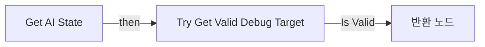

전체 노드·기본 입력 목록

| 노드 ID | 제목 | 미연결 기본 입력 / 에셋 입력 |
|---|---|---|
| `K2Node_FunctionEntry_0` | Get AI State |  |
| `K2Node_CallFunction_1` | Get Blackboard |  |
| `K2Node_CallFunction_2` | Make Literal Name | Value=Debug_NowState |
| `K2Node_CallFunction_3` | Get Value as Enum 타깃은 블랙보드 컴포넌트 |  |
| `K2Node_MacroInstance_0` | Try Get Valid Debug Target |  |
| `K2Node_FunctionResult_0` | 반환 노드 |  |
| `K2Node_CastByteToEnum_1` | Byte to Enum E_AIState_Debug |  |

### Get Valid Debug Target

실행 핀 플로우차트

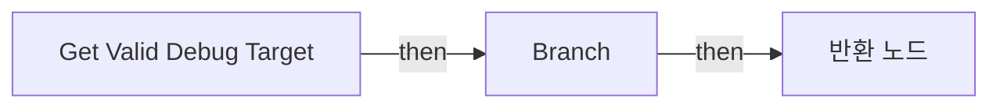

전체 노드·기본 입력 목록

| 노드 ID | 제목 | 미연결 기본 입력 / 에셋 입력 |
|---|---|---|
| `K2Node_FunctionEntry_0` | Get Valid Debug Target |  |
| `K2Node_VariableGet_0` | Get AIControllers |  |
| `K2Node_VariableGet_1` | Get DebugIndex |  |
| `K2Node_CallArrayFunction_0` | Is Valid Index |  |
| `K2Node_IfThenElse_0` | Branch |  |
| `K2Node_VariableGet_6` | Get AIControllers |  |
| `K2Node_GetArrayItem_2` | GET |  |
| `K2Node_VariableGet_7` | Get DebugIndex |  |
| `K2Node_CallFunction_3` | Get Controlled Pawn 타깃은 컨트롤러 |  |
| `K2Node_FunctionResult_0` | 반환 노드 |  |
| `K2Node_Knot_0` | 경유 노드 |  |
| `K2Node_Knot_1` | 경유 노드 |  |
| `K2Node_CallFunction_1` | Is Valid |  |
| `K2Node_CommutativeAssociativeBinaryOperator_0` | AND Boolean |  |
| `K2Node_Knot_3` | 경유 노드 |  |
| `K2Node_VariableGet_4` | Get AIControllers |  |
| `K2Node_GetArrayItem_1` | GET |  |
| `K2Node_VariableGet_5` | Get DebugIndex |  |
| `K2Node_CallFunction_0` | Get Controlled Pawn 타깃은 컨트롤러 |  |
| `K2Node_Knot_4` | 경유 노드 |  |

### Get Widget

실행 핀 플로우차트

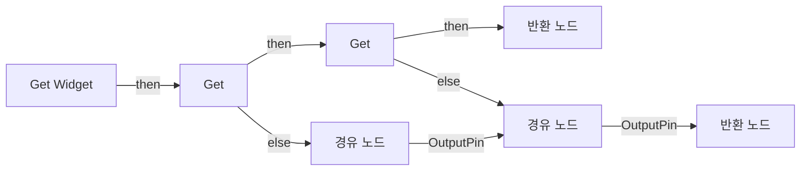

전체 노드·기본 입력 목록

| 노드 ID | 제목 | 미연결 기본 입력 / 에셋 입력 |
|---|---|---|
| `K2Node_FunctionEntry_0` | Get Widget |  |
| `K2Node_VariableGet_2` | Get |  |
| `K2Node_VariableGet_14` | Get |  |
| `K2Node_FunctionResult_1` | 반환 노드 | valid=true |
| `K2Node_FunctionResult_0` | 반환 노드 | valid=false |
| `K2Node_Knot_0` | 경유 노드 |  |
| `K2Node_Knot_1` | 경유 노드 |  |

### Is Debug View Enabled

실행 핀 플로우차트

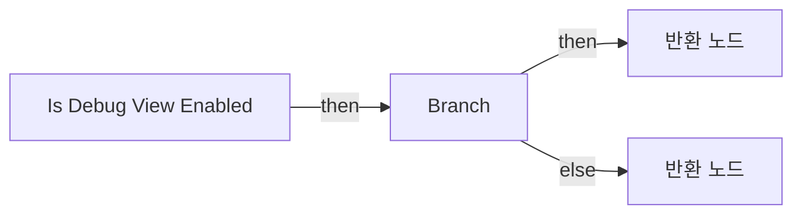

전체 노드·기본 입력 목록

| 노드 ID | 제목 | 미연결 기본 입력 / 에셋 입력 |
|---|---|---|
| `K2Node_FunctionEntry_0` | Is Debug View Enabled |  |
| `K2Node_FunctionResult_1` | 반환 노드 |  |
| `K2Node_VariableGet_1` | Get DebugToggleStates |  |
| `K2Node_CallFunction_0` | Find |  |
| `K2Node_IfThenElse_0` | Branch |  |
| `K2Node_Knot_0` | 경유 노드 |  |
| `K2Node_FunctionResult_0` | 반환 노드 | Enabled=false |
| `K2Node_Knot_1` | 경유 노드 |  |

### Make Key

실행 핀 플로우차트

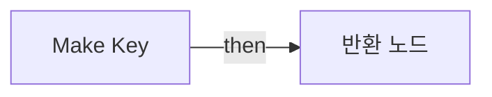

전체 노드·기본 입력 목록

| 노드 ID | 제목 | 미연결 기본 입력 / 에셋 입력 |
|---|---|---|
| `K2Node_FunctionEntry_0` | Make Key |  |
| `K2Node_FunctionResult_0` | 반환 노드 |  |
| `K2Node_CallFunction_0` | Make Print Key |  |
| `K2Node_Knot_0` | 경유 노드 |  |
| `K2Node_VariableGet_0` | Get Player Controller |  |

## 조회 범위의 한계

ObjectIterator로 발견했으나 MCP helper가 반환하지 않은 그래프입니다. delegate signature·컴파일된 중간 그래프·macro·애니메이션 내부 그래프가 섞일 수 있습니다.

- `Add Debug Row`: Graph 'Add Debug Row' not found in Blueprint.
- `Add Debug Rows`: Graph 'Add Debug Rows' not found in Blueprint.
- `Branch View Enabled`: Graph 'Branch View Enabled' not found in Blueprint.
- `Call Debug AI`: Graph 'Call Debug AI' not found in Blueprint.
- `Debug End`: Graph 'Debug End' not found in Blueprint.
- `Debug View AI`: Graph 'Debug View AI' not found in Blueprint.
- `InpActEvt_H_K2Node_InputDebugKeyEvent_0`: Graph 'InpActEvt_H_K2Node_InputDebugKeyEvent_0' not found in Blueprint.
- `InpActEvt_U_K2Node_InputDebugKeyEvent_1`: Graph 'InpActEvt_U_K2Node_InputDebugKeyEvent_1' not found in Blueprint.
- `InpActEvt_Y_K2Node_InputDebugKeyEvent_2`: Graph 'InpActEvt_Y_K2Node_InputDebugKeyEvent_2' not found in Blueprint.
- `Kill All AIs`: Graph 'Kill All AIs' not found in Blueprint.
- `OnPossessed`: Graph 'OnPossessed' not found in Blueprint.
- `ReceiveBeginPlay`: Graph 'ReceiveBeginPlay' not found in Blueprint.
- `ReceiveTick`: Graph 'ReceiveTick' not found in Blueprint.
- `Request Debug View`: Graph 'Request Debug View' not found in Blueprint.
- `Try Get Valid Debug Target`: Graph 'Try Get Valid Debug Target' not found in Blueprint.
- `Try Get Widget`: Graph 'Try Get Widget' not found in Blueprint.

[원본 MCP 스냅샷](../../../Evidence/blueprints-070.json)
