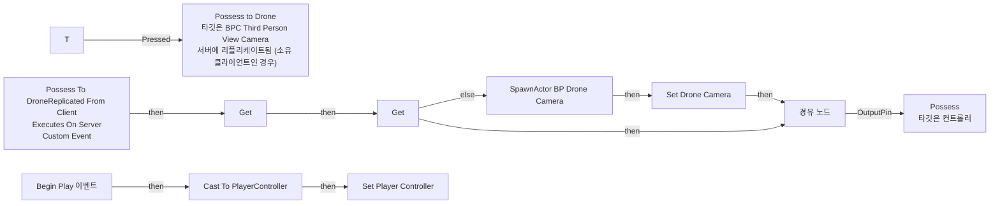

# BPC_ThirdPersonViewCamera

에셋: `/Game/QuakeLike_1_0/Test/BPC_ThirdPersonViewCamera`

부모: `/Script/CoreUObject.Class'/Script/Engine.ActorComponent'`

수집일: 2026-10-12. MCP에서 읽은 그래프·핀 연결의 자동 전사입니다. 상속된 그래프는 부모 문서를 함께 확인합니다.

정적 루트 참조 도달: 있음. 실행 여부 또는 삭제 가능 여부의 확정이 아닙니다.

컴포넌트 목록은 이 BP가 직접 정의한 SCS만 포함합니다. 부모·네이티브 생성 컴포넌트, 인스턴스 설정은 별도입니다.

## 변수와 기본값

| 이름 | 타입 | CDO 기본값 |
|---|---|---|
| `Drone Camera` | `BP_DroneCamera_C` | None |
| `Player Controller` | `PlayerController` | None |

## 그래프 목록

| 그래프 | 전체 노드 수 |
|---|---|
| EventGraph | 17 |

## 그래프별 실행 연결

실선은 출력 exec 핀의 실제 연결입니다. 여러 분기는 출력 핀 이름을 표시합니다. 함수 호출·delegate·타이머의 다음 그래프 실행은 이 그림에서 자동으로 이어 붙이지 않습니다.

순수 계산 노드 및 데이터 핀은 아래 목록과 원본 JSON을 확인합니다. 연결되지 않은 이벤트도 표시되므로, 노드가 있다는 이유만으로 실행된다고 판단하면 안 됩니다.

### EventGraph

실행 핀 플로우차트

전체 노드·기본 입력 목록

| 노드 ID | 제목 | 미연결 기본 입력 / 에셋 입력 |
|---|---|---|
| `K2Node_InputKey_0` | T |  |
| `K2Node_SpawnActorFromClass_0` | SpawnActor BP Drone Camera | Class=/Game/QuakeLike_1_0/Test/BP_DroneCamera.BP_DroneCamera_C; CollisionHandlingOverride=Undefined; TransformScaleMethod=MultiplyWithRoot |
| `K2Node_VariableSet_0` | Set Drone Camera |  |
| `K2Node_VariableGet_0` | Get |  |
| `K2Node_Knot_3` | 경유 노드 |  |
| `K2Node_CallFunction_1` | Get Owner 타깃은 액터 컴포넌트 |  |
| `K2Node_CallFunction_3` | Get Actor Transform 타깃은 액터 |  |
| `K2Node_VariableGet_1` | Get Drone Camera |  |
| `K2Node_Event_3` | Begin Play 이벤트 |  |
| `K2Node_CustomEvent_1` | Possess To DroneReplicated From Client Executes On Server Custom Event |  |
| `K2Node_CallFunction_5` | Possess to Drone 타깃은 BPC Third Person View Camera 서버에 리플리케이트됨 (소유 클라이언트인 경우) |  |
| `K2Node_CallFunction_6` | Get Owner 타깃은 액터 컴포넌트 |  |
| `K2Node_DynamicCast_0` | Cast To PlayerController |  |
| `K2Node_VariableSet_1` | Set Player Controller |  |
| `K2Node_VariableGet_2` | Get |  |
| `K2Node_VariableGet_3` | Get Player Controller |  |
| `K2Node_CallFunction_7` | Possess 타깃은 컨트롤러 |  |

## 조회 범위의 한계

ObjectIterator로 발견했으나 MCP helper가 반환하지 않은 그래프입니다. delegate signature·컴파일된 중간 그래프·macro·애니메이션 내부 그래프가 섞일 수 있습니다.

- `InpActEvt_T_K2Node_InputKeyEvent_0`: Graph 'InpActEvt_T_K2Node_InputKeyEvent_0' not found in Blueprint.
- `Possess To Drone`: Graph 'Possess To Drone' not found in Blueprint.
- `ReceiveBeginPlay`: Graph 'ReceiveBeginPlay' not found in Blueprint.

[원본 MCP 스냅샷](../../../Evidence/blueprints-035.json)
