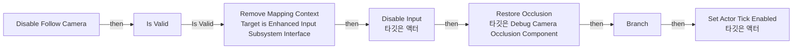
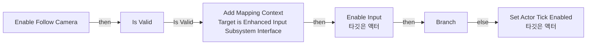
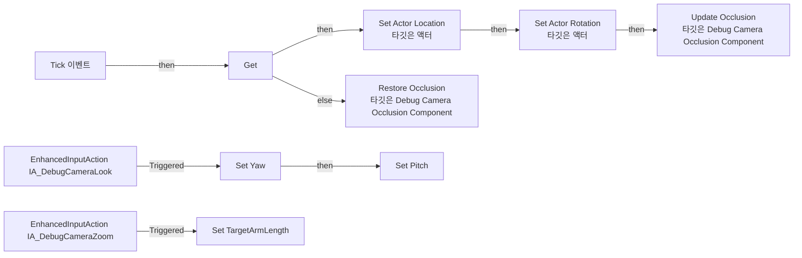
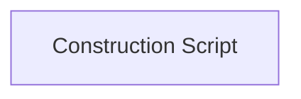

# BP_DebugFollowCamera

에셋: `/Game/QuakeLike_1_0/Test/BP_DebugFollowCamera`

부모: `/Script/CoreUObject.Class'/Script/Engine.Actor'`

수집일: 2026-10-12. MCP에서 읽은 그래프·핀 연결의 자동 전사입니다. 상속된 그래프는 부모 문서를 함께 확인합니다.

정적 루트 참조 도달: 있음. 실행 여부 또는 삭제 가능 여부의 확정이 아닙니다.

컴포넌트 목록은 이 BP가 직접 정의한 SCS만 포함합니다. 부모·네이티브 생성 컴포넌트, 인스턴스 설정은 별도입니다.

## 직접 정의한 컴포넌트

| 이름 | 클래스 | 부모 컴포넌트 |
|---|---|---|
| `DefaultSceneRoot` | `SceneComponent` | `` |
| `SpringArm` | `SpringArmComponent` | `DefaultSceneRoot` |
| `Camera` | `CameraComponent` | `SpringArm` |
| `DebugCameraOcclusion` | `DebugCameraOcclusionComponent` | `` |

## 변수와 기본값

| 이름 | 타입 | CDO 기본값 |
|---|---|---|
| `TargetPawn` | `Pawn` | None |
| `Yaw` | `real` | 0.0 |
| `Pitch` | `real` | 0.0 |

## 그래프 목록

| 그래프 | 전체 노드 수 |
|---|---|
| Disable Follow Camera | 12 |
| Enable Follow Camera | 9 |
| EventGraph | 31 |
| UserConstructionScript | 1 |

## 그래프별 실행 연결

실선은 출력 exec 핀의 실제 연결입니다. 여러 분기는 출력 핀 이름을 표시합니다. 함수 호출·delegate·타이머의 다음 그래프 실행은 이 그림에서 자동으로 이어 붙이지 않습니다.

순수 계산 노드 및 데이터 핀은 아래 목록과 원본 JSON을 확인합니다. 연결되지 않은 이벤트도 표시되므로, 노드가 있다는 이유만으로 실행된다고 판단하면 안 됩니다.

### Disable Follow Camera

실행 핀 플로우차트

전체 노드·기본 입력 목록

| 노드 ID | 제목 | 미연결 기본 입력 / 에셋 입력 |
|---|---|---|
| `K2Node_FunctionEntry_0` | Disable Follow Camera |  |
| `K2Node_Knot_0` | 경유 노드 |  |
| `K2Node_MacroInstance_0` | Is Valid |  |
| `K2Node_Message_1` | Remove Mapping Context Target is Enhanced Input Subsystem Interface | MappingContext=/Game/QuakeLike_1_0/Test/IMC_DebugCamera.IMC_DebugCamera; Options=(bIgnoreAllPressedKeysUntilRelease=True,bForceImmediately=False,bNotifyUserSettings=False) |
| `K2Node_CallFunction_0` | Disable Input 타깃은 액터 |  |
| `K2Node_GetSubsystemFromPC_0` | 향상된 입력 로컬 플레이어 서브시스템 |  |
| `K2Node_CallFunction_2` | Is Actor Tick Enabled 타깃은 액터 |  |
| `K2Node_CallFunction_3` | Set Actor Tick Enabled 타깃은 액터 | bEnabled=false |
| `K2Node_IfThenElse_0` | Branch |  |
| `K2Node_CallFunction_1` | Restore Occlusion 타깃은 Debug Camera Occlusion Component |  |
| `K2Node_Self_0` | 셀프-레퍼런스 |  |
| `K2Node_VariableGet_1` | Get DebugCameraOcclusion |  |

### Enable Follow Camera

실행 핀 플로우차트

전체 노드·기본 입력 목록

| 노드 ID | 제목 | 미연결 기본 입력 / 에셋 입력 |
|---|---|---|
| `K2Node_FunctionEntry_0` | Enable Follow Camera |  |
| `K2Node_Message_0` | Add Mapping Context Target is Enhanced Input Subsystem Interface | MappingContext=/Game/QuakeLike_1_0/Test/IMC_DebugCamera.IMC_DebugCamera; Priority=100; Options=(bIgnoreAllPressedKeysUntilRelease=True,bForceImmediately=False,bNotifyUserSettings=False) |
| `K2Node_Knot_0` | 경유 노드 |  |
| `K2Node_MacroInstance_0` | Is Valid |  |
| `K2Node_CallFunction_4` | Enable Input 타깃은 액터 |  |
| `K2Node_GetSubsystemFromPC_0` | 향상된 입력 로컬 플레이어 서브시스템 |  |
| `K2Node_CallFunction_2` | Is Actor Tick Enabled 타깃은 액터 |  |
| `K2Node_CallFunction_3` | Set Actor Tick Enabled 타깃은 액터 | bEnabled=true |
| `K2Node_IfThenElse_0` | Branch |  |

### EventGraph

실행 핀 플로우차트

전체 노드·기본 입력 목록

| 노드 ID | 제목 | 미연결 기본 입력 / 에셋 입력 |
|---|---|---|
| `K2Node_Event_3` | Tick 이벤트 | DeltaSeconds=0.0 |
| `K2Node_VariableGet_0` | Get |  |
| `K2Node_CallFunction_0` | Get Actor Location 타깃은 액터 |  |
| `K2Node_CallFunction_1` | Set Actor Location 타깃은 액터 | bSweep=false; bTeleport=false; ReturnValue=false |
| `K2Node_CallFunction_2` | Make Rotator | Roll=0.0 |
| `K2Node_VariableGet_2` | Get Yaw |  |
| `K2Node_VariableGet_1` | Get Pitch |  |
| `K2Node_CallFunction_3` | Set Actor Rotation 타깃은 액터 | bTeleportPhysics=false; ReturnValue=false |
| `K2Node_EnhancedInputAction_0` | EnhancedInputAction IA_DebugCameraLook | InputAction=/Game/QuakeLike_1_0/Test/IA_DebugCameraLook.IA_DebugCameraLook |
| `K2Node_VariableSet_2` | Set Yaw | Output_Get=0.0 |
| `K2Node_VariableSet_3` | Set Pitch | Output_Get=0.0 |
| `K2Node_VariableGet_4` | Get Yaw |  |
| `K2Node_PromotableOperator_1` | float + float |  |
| `K2Node_PromotableOperator_0` | float + float |  |
| `K2Node_VariableGet_5` | Get Pitch |  |
| `K2Node_CallFunction_5` | Clamp (Float) | Min=-80.000000; Max=80.000000 |
| `K2Node_CallFunction_6` | Update Occlusion 타깃은 Debug Camera Occlusion Component |  |
| `K2Node_VariableGet_6` | Get Camera |  |
| `K2Node_VariableGet_7` | Get TargetPawn |  |
| `K2Node_Self_0` | 셀프-레퍼런스 |  |
| `K2Node_VariableGet_9` | Get DebugCameraOcclusion |  |
| `K2Node_CallFunction_9` | Restore Occlusion 타깃은 Debug Camera Occlusion Component |  |
| `K2Node_VariableGet_10` | Get DebugCameraOcclusion |  |
| `K2Node_Self_1` | 셀프-레퍼런스 |  |
| `K2Node_EnhancedInputAction_1` | EnhancedInputAction IA_DebugCameraZoom | InputAction=/Game/QuakeLike_1_0/Test/IA_DebugCameraZoom.IA_DebugCameraZoom |
| `K2Node_VariableGet_3` | Get SpringArm |  |
| `K2Node_VariableGet_8` | Get TargetArmLength |  |
| `K2Node_VariableGet_12` | Get SpringArm |  |
| `K2Node_VariableSet_0` | Set TargetArmLength | Output_Get=0.0 |
| `K2Node_PromotableOperator_2` | float * float | B=-20.000000 |
| `K2Node_PromotableOperator_3` | float + float |  |

### UserConstructionScript

실행 핀 플로우차트

전체 노드·기본 입력 목록

| 노드 ID | 제목 | 미연결 기본 입력 / 에셋 입력 |
|---|---|---|
| `K2Node_FunctionEntry_0` | Construction Script |  |

## 조회 범위의 한계

ObjectIterator로 발견했으나 MCP helper가 반환하지 않은 그래프입니다. delegate signature·컴파일된 중간 그래프·macro·애니메이션 내부 그래프가 섞일 수 있습니다.

- `InpActEvt_IA_DebugCameraLook_K2Node_EnhancedInputActionEvent_1`: Graph 'InpActEvt_IA_DebugCameraLook_K2Node_EnhancedInputActionEvent_1' not found in Blueprint.
- `InpActEvt_IA_DebugCameraZoom_K2Node_EnhancedInputActionEvent_0`: Graph 'InpActEvt_IA_DebugCameraZoom_K2Node_EnhancedInputActionEvent_0' not found in Blueprint.
- `ReceiveTick`: Graph 'ReceiveTick' not found in Blueprint.

[원본 MCP 스냅샷](../../../Evidence/blueprints-035.json)
