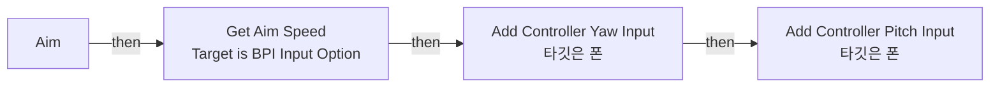
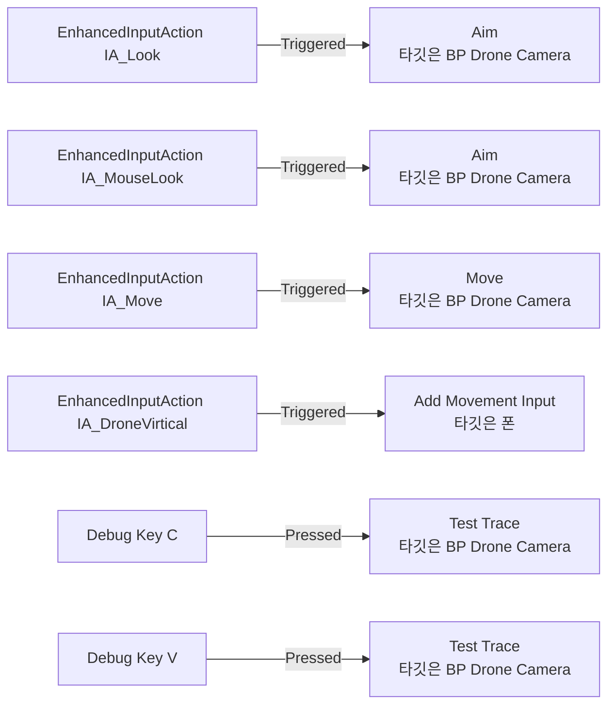
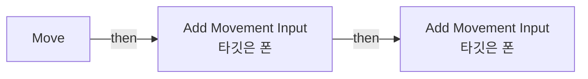
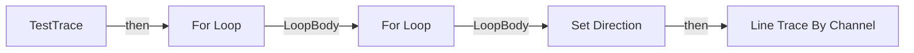
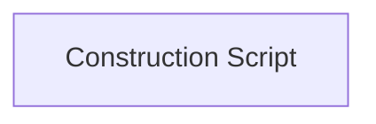

# BP_DroneCamera

에셋: `/Game/QuakeLike_1_0/Test/BP_DroneCamera`

부모: `/Script/CoreUObject.Class'/Script/Engine.Pawn'`

수집일: 2026-10-12. MCP에서 읽은 그래프·핀 연결의 자동 전사입니다. 상속된 그래프는 부모 문서를 함께 확인합니다.

정적 루트 참조 도달: 있음. 실행 여부 또는 삭제 가능 여부의 확정이 아닙니다.

컴포넌트 목록은 이 BP가 직접 정의한 SCS만 포함합니다. 부모·네이티브 생성 컴포넌트, 인스턴스 설정은 별도입니다.

## 직접 정의한 컴포넌트

| 이름 | 클래스 | 부모 컴포넌트 |
|---|---|---|
| `DefaultSceneRoot` | `SceneComponent` | `` |
| `Camera` | `CameraComponent` | `DefaultSceneRoot` |
| `FloatingPawnMovement` | `FloatingPawnMovement` | `` |

## 변수와 기본값

| 이름 | 타입 | CDO 기본값 |
|---|---|---|
| `Pitch` | `real` | 0.0 |
| `Yaw` | `real` | 0.0 |
| `TraceDistance` | `real` | 5000.0 |
| `GridCount` | `int` | 5 |
| `Spread` | `real` | 0.15 |

## 그래프 목록

| 그래프 | 전체 노드 수 |
|---|---|
| Aim | 12 |
| EventGraph | 12 |
| Move | 10 |
| TestTrace | 27 |
| UserConstructionScript | 1 |

## 그래프별 실행 연결

실선은 출력 exec 핀의 실제 연결입니다. 여러 분기는 출력 핀 이름을 표시합니다. 함수 호출·delegate·타이머의 다음 그래프 실행은 이 그림에서 자동으로 이어 붙이지 않습니다.

순수 계산 노드 및 데이터 핀은 아래 목록과 원본 JSON을 확인합니다. 연결되지 않은 이벤트도 표시되므로, 노드가 있다는 이유만으로 실행된다고 판단하면 안 됩니다.

### Aim

실행 핀 플로우차트

전체 노드·기본 입력 목록

| 노드 ID | 제목 | 미연결 기본 입력 / 에셋 입력 |
|---|---|---|
| `K2Node_FunctionEntry_0` | Aim |  |
| `K2Node_CallFunction_8428` | Add Controller Pitch Input 타깃은 폰 |  |
| `K2Node_CallFunction_8427` | Add Controller Yaw Input 타깃은 폰 |  |
| `K2Node_Knot_0` | 경유 노드 |  |
| `EdGraphNode_Comment_7` | Left/Right |  |
| `EdGraphNode_Comment_2` | Up/Down |  |
| `K2Node_CallFunction_3` | Get Controller 타깃은 폰 |  |
| `K2Node_Message_0` | Get Aim Speed Target is BPI Input Option |  |
| `K2Node_PromotableOperator_3` | float * float |  |
| `K2Node_PromotableOperator_2` | float * float |  |
| `K2Node_Knot_6` | 경유 노드 |  |
| `K2Node_Knot_10` | 경유 노드 |  |

### EventGraph

실행 핀 플로우차트

전체 노드·기본 입력 목록

| 노드 ID | 제목 | 미연결 기본 입력 / 에셋 입력 |
|---|---|---|
| `K2Node_EnhancedInputAction_3` | EnhancedInputAction IA_Look | InputAction=/Game/SciFiRocketLauncher_AK9/Input/IA_Look.IA_Look |
| `K2Node_CallFunction_10` | Move 타깃은 BP Drone Camera |  |
| `K2Node_CallFunction_15` | Aim 타깃은 BP Drone Camera |  |
| `K2Node_EnhancedInputAction_1` | EnhancedInputAction IA_MouseLook | InputAction=/Game/Input/Actions/IA_MouseLook.IA_MouseLook |
| `K2Node_CallFunction_12` | Aim 타깃은 BP Drone Camera |  |
| `K2Node_CallFunction_16` | Add Movement Input 타깃은 폰 | WorldDirection_X=0.0; WorldDirection_Y=0.0; ScaleValue=1.000000; bForce=false |
| `K2Node_EnhancedInputAction_6` | EnhancedInputAction IA_Move | InputAction=/Game/Input/Actions/IA_Move.IA_Move |
| `K2Node_EnhancedInputAction_8` | EnhancedInputAction IA_DroneVirtical | InputAction=/Game/QuakeLike_1_0/Test/IA_DroneVirtical.IA_DroneVirtical |
| `K2Node_InputDebugKey_0` | Debug Key C |  |
| `K2Node_CallFunction_5` | Test Trace 타깃은 BP Drone Camera | Complex=false |
| `K2Node_InputDebugKey_1` | Debug Key V |  |
| `K2Node_CallFunction_4` | Test Trace 타깃은 BP Drone Camera | Complex=true |

### Move

실행 핀 플로우차트

전체 노드·기본 입력 목록

| 노드 ID | 제목 | 미연결 기본 입력 / 에셋 입력 |
|---|---|---|
| `K2Node_FunctionEntry_0` | Move |  |
| `K2Node_CallFunction_6` | Add Movement Input 타깃은 폰 | bForce=false |
| `K2Node_CallFunction_1` | Get Control Rotation 타깃은 폰 | ReturnValue_Roll=0.0; ReturnValue_Pitch=0.0 |
| `K2Node_CallFunction_3` | Make Rotator | Roll=0.0; Pitch=0.0 |
| `K2Node_CallFunction_4` | Get Forward Vector |  |
| `K2Node_Knot_0` | 경유 노드 |  |
| `K2Node_CallFunction_5` | Get Right Vector |  |
| `K2Node_CallFunction_0` | Add Movement Input 타깃은 폰 | bForce=false |
| `K2Node_Knot_9` | 경유 노드 |  |
| `K2Node_Knot_10` | 경유 노드 |  |

### TestTrace

실행 핀 플로우차트

전체 노드·기본 입력 목록

| 노드 ID | 제목 | 미연결 기본 입력 / 에셋 입력 |
|---|---|---|
| `K2Node_FunctionEntry_0` | TestTrace |  |
| `K2Node_VariableGet_0` | Get Camera |  |
| `K2Node_CallFunction_0` | Get World Location 타깃은 씬 컴포넌트 |  |
| `K2Node_CallFunction_1` | Get Forward Vector 타깃은 씬 컴포넌트 |  |
| `K2Node_CallFunction_2` | Get Right Vector 타깃은 씬 컴포넌트 |  |
| `K2Node_CallFunction_3` | Get Up Vector 타깃은 씬 컴포넌트 |  |
| `K2Node_MacroInstance_0` | For Loop | FirstIndex=-2; LastIndex=2 |
| `K2Node_MacroInstance_1` | For Loop | FirstIndex=-2; LastIndex=2 |
| `K2Node_PromotableOperator_1` | vector * vector |  |
| `K2Node_VariableGet_2` | Get Spread |  |
| `K2Node_PromotableOperator_0` | vector * vector |  |
| `K2Node_VariableGet_1` | Get Spread |  |
| `K2Node_Knot_0` | 경유 노드 |  |
| `K2Node_PromotableOperator_2` | vector + vector |  |
| `K2Node_Knot_1` | 경유 노드 |  |
| `K2Node_Knot_2` | 경유 노드 |  |
| `K2Node_Knot_3` | 경유 노드 |  |
| `K2Node_CallFunction_4` | Normalize | Tolerance=0.000100 |
| `K2Node_VariableSet_1` | Set Direction |  |
| `K2Node_VariableGet_3` | Get TraceDistance |  |
| `K2Node_PromotableOperator_3` | vector * vector |  |
| `K2Node_CallFunction_5` | Line Trace By Channel | TraceChannel=TraceTypeQuery1; DrawDebugType=ForDuration; bIgnoreSelf=true; TraceColor=(R=1.000000,G=0.000000,B=0.000000,A=1.000000); TraceHitColor=(R=0.000000,G=1.000000,B=0.000000,A=1.000000); DrawTime=8.000000; ReturnValue=false |
| `K2Node_VariableGet_4` | Get Camera |  |
| `K2Node_Knot_4` | 경유 노드 |  |
| `K2Node_PromotableOperator_4` | vector + vector |  |
| `K2Node_Knot_5` | 경유 노드 |  |
| `K2Node_Knot_6` | 경유 노드 |  |

### UserConstructionScript

실행 핀 플로우차트

전체 노드·기본 입력 목록

| 노드 ID | 제목 | 미연결 기본 입력 / 에셋 입력 |
|---|---|---|
| `K2Node_FunctionEntry_0` | Construction Script |  |

## 조회 범위의 한계

ObjectIterator로 발견했으나 MCP helper가 반환하지 않은 그래프입니다. delegate signature·컴파일된 중간 그래프·macro·애니메이션 내부 그래프가 섞일 수 있습니다.

- `InpActEvt_C_K2Node_InputDebugKeyEvent_1`: Graph 'InpActEvt_C_K2Node_InputDebugKeyEvent_1' not found in Blueprint.
- `InpActEvt_IA_DroneVirtical_K2Node_EnhancedInputActionEvent_0`: Graph 'InpActEvt_IA_DroneVirtical_K2Node_EnhancedInputActionEvent_0' not found in Blueprint.
- `InpActEvt_IA_Look_K2Node_EnhancedInputActionEvent_3`: Graph 'InpActEvt_IA_Look_K2Node_EnhancedInputActionEvent_3' not found in Blueprint.
- `InpActEvt_IA_MouseLook_K2Node_EnhancedInputActionEvent_2`: Graph 'InpActEvt_IA_MouseLook_K2Node_EnhancedInputActionEvent_2' not found in Blueprint.
- `InpActEvt_IA_Move_K2Node_EnhancedInputActionEvent_1`: Graph 'InpActEvt_IA_Move_K2Node_EnhancedInputActionEvent_1' not found in Blueprint.
- `InpActEvt_V_K2Node_InputDebugKeyEvent_0`: Graph 'InpActEvt_V_K2Node_InputDebugKeyEvent_0' not found in Blueprint.

[원본 MCP 스냅샷](../../../Evidence/blueprints-035.json)
