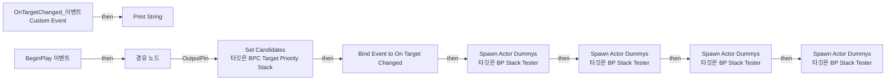
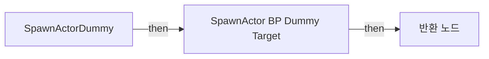
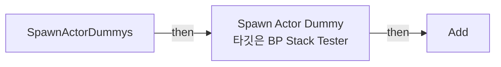
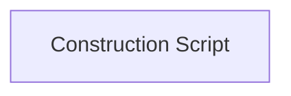

# BP_StackTester

에셋: `/Game/QuakeLike_1_0/Test/BP_StackTester`

부모: `/Script/CoreUObject.Class'/Script/Engine.Actor'`

수집일: 2026-10-12. MCP에서 읽은 그래프·핀 연결의 자동 전사입니다. 상속된 그래프는 부모 문서를 함께 확인합니다.

정적 루트 참조 도달: 없음. 실행 여부 또는 삭제 가능 여부의 확정이 아닙니다.

컴포넌트 목록은 이 BP가 직접 정의한 SCS만 포함합니다. 부모·네이티브 생성 컴포넌트, 인스턴스 설정은 별도입니다.

## 직접 정의한 컴포넌트

| 이름 | 클래스 | 부모 컴포넌트 |
|---|---|---|
| `DefaultSceneRoot` | `SceneComponent` | `` |
| `BPC_TargetPriorityStack` | `BPC_TargetPriorityStack_C` | `` |

## 변수와 기본값

| 이름 | 타입 | CDO 기본값 |
|---|---|---|
| `MockInventory` | `GameplayTag` | [] |
| `SensedActors` | `Actor` | [] |
| `myCharacter` | `BP_ShooterBase_C` | None |
| `NewVar1` | `BP_ShooterBase_C` | None |

## 그래프 목록

| 그래프 | 전체 노드 수 |
|---|---|
| EventGraph | 17 |
| SpawnActorDummy | 5 |
| SpawnActorDummys | 4 |
| UserConstructionScript | 1 |

## 그래프별 실행 연결

실선은 출력 exec 핀의 실제 연결입니다. 여러 분기는 출력 핀 이름을 표시합니다. 함수 호출·delegate·타이머의 다음 그래프 실행은 이 그림에서 자동으로 이어 붙이지 않습니다.

순수 계산 노드 및 데이터 핀은 아래 목록과 원본 JSON을 확인합니다. 연결되지 않은 이벤트도 표시되므로, 노드가 있다는 이유만으로 실행된다고 판단하면 안 됩니다.

### EventGraph

실행 핀 플로우차트

전체 노드·기본 입력 목록

| 노드 ID | 제목 | 미연결 기본 입력 / 에셋 입력 |
|---|---|---|
| `K2Node_Event_0` | BeginPlay 이벤트 |  |
| `K2Node_CustomEvent_1` | OnTargetChanged_이벤트 Custom Event |  |
| `K2Node_AssignDelegate_1` | Bind Event to On Target Changed |  |
| `K2Node_CallFunction_4` | Print String | bPrintToScreen=true; bPrintToLog=true; TextColor=(R=0.000000,G=0.660000,B=1.000000,A=1.000000); Duration=20.000000; Key=None |
| `K2Node_CallFunction_8` | Get Best Target 타깃은 BPC Target Priority Stack | Result Weight=0.0 |
| `K2Node_CallFunction_9` | Set Candidates 타깃은 BPC Target Priority Stack |  |
| `K2Node_Self_0` | 셀프-레퍼런스 |  |
| `K2Node_VariableGet_8` | Get BPC_TargetPriorityStack |  |
| `K2Node_VariableGet_9` | Get BPC_TargetPriorityStack |  |
| `K2Node_Knot_1` | 경유 노드 |  |
| `K2Node_Knot_2` | 경유 노드 |  |
| `K2Node_CallFunction_10` | Get Display Name |  |
| `K2Node_VariableGet_6` | Get SensedActors |  |
| `K2Node_CallFunction_1` | Spawn Actor Dummys 타깃은 BP Stack Tester | Spawn Location=10.000000,0.000000,0.000000; Tag=(TagName="AITargetable.DropItem.Ammo") |
| `K2Node_CallFunction_2` | Spawn Actor Dummys 타깃은 BP Stack Tester | Spawn Location=10.000000,0.000000,0.000000; Tag=(TagName="AITargetable.DropItem.Health") |
| `K2Node_CallFunction_3` | Spawn Actor Dummys 타깃은 BP Stack Tester | Spawn Location=10.000000,0.000000,0.000000; Tag=(TagName="AITargetable.DropItem.Weapon") |
| `K2Node_CallFunction_0` | Spawn Actor Dummys 타깃은 BP Stack Tester | Spawn Location=10.000000,0.000000,0.000000; Tag=(TagName="AITargetable.DropItem.Plate") |

### SpawnActorDummy

실행 핀 플로우차트

전체 노드·기본 입력 목록

| 노드 ID | 제목 | 미연결 기본 입력 / 에셋 입력 |
|---|---|---|
| `K2Node_FunctionEntry_0` | SpawnActorDummy |  |
| `K2Node_FunctionResult_0` | 반환 노드 |  |
| `K2Node_SpawnActorFromClass_0` | SpawnActor BP Dummy Target | Class=/Game/QuakeLike_1_0/Test/BP_DummyTarget.BP_DummyTarget_C; SpawnTransform_Rotation=0, 0, 0; SpawnTransform_Scale=1.000000,1.000000,1.000000; CollisionHandlingOverride=Undefined; TransformScaleMethod=MultiplyWithRoot |
| `K2Node_CallFunction_2` | Get Actor Location 타깃은 액터 |  |
| `K2Node_PromotableOperator_1` | vector + vector |  |

### SpawnActorDummys

실행 핀 플로우차트

전체 노드·기본 입력 목록

| 노드 ID | 제목 | 미연결 기본 입력 / 에셋 입력 |
|---|---|---|
| `K2Node_FunctionEntry_0` | SpawnActorDummys |  |
| `K2Node_VariableGet_0` | Get SensedActors |  |
| `K2Node_CallArrayFunction_1` | Add | ReturnValue=0 |
| `K2Node_CallFunction_16` | Spawn Actor Dummy 타깃은 BP Stack Tester |  |

### UserConstructionScript

실행 핀 플로우차트

전체 노드·기본 입력 목록

| 노드 ID | 제목 | 미연결 기본 입력 / 에셋 입력 |
|---|---|---|
| `K2Node_FunctionEntry_0` | Construction Script |  |

## 조회 범위의 한계

ObjectIterator로 발견했으나 MCP helper가 반환하지 않은 그래프입니다. delegate signature·컴파일된 중간 그래프·macro·애니메이션 내부 그래프가 섞일 수 있습니다.

- `ApplyHeal`: Graph 'ApplyHeal' not found in Blueprint.
- `Clear`: Graph 'Clear' not found in Blueprint.
- `CompleteTarget`: Graph 'CompleteTarget' not found in Blueprint.
- `EdGraph_1`: Graph 'EdGraph_1' not found in Blueprint.
- `ExecuteUbergraph_BP_StackTester`: Graph 'ExecuteUbergraph_BP_StackTester' not found in Blueprint.
- `GetCharacterTargets`: Graph 'GetCharacterTargets' not found in Blueprint.
- `GetCharacterTargets_MERGED`: Graph 'GetCharacterTargets_MERGED' not found in Blueprint.
- `GetChaserInventory`: Graph 'GetChaserInventory' not found in Blueprint.
- `GetChaserInventory_MERGED`: Graph 'GetChaserInventory_MERGED' not found in Blueprint.
- `GetChaserLife`: Graph 'GetChaserLife' not found in Blueprint.
- `GetChaserLife_MERGED`: Graph 'GetChaserLife_MERGED' not found in Blueprint.
- `GetChaserLocation`: Graph 'GetChaserLocation' not found in Blueprint.
- `GetChaserLocation_MERGED`: Graph 'GetChaserLocation_MERGED' not found in Blueprint.
- `GetChaserSpeed`: Graph 'GetChaserSpeed' not found in Blueprint.
- `GetChaserSpeed_MERGED`: Graph 'GetChaserSpeed_MERGED' not found in Blueprint.
- `GetCurrentTargetInfo`: Graph 'GetCurrentTargetInfo' not found in Blueprint.
- `GetCurrentTargetInfo_MERGED`: Graph 'GetCurrentTargetInfo_MERGED' not found in Blueprint.
- `GetLife`: Graph 'GetLife' not found in Blueprint.
- `GetLife_MERGED`: Graph 'GetLife_MERGED' not found in Blueprint.
- `GetSelectedItem`: Graph 'GetSelectedItem' not found in Blueprint.
- `GetSelectedItem_MERGED`: Graph 'GetSelectedItem_MERGED' not found in Blueprint.
- `HasItem`: Graph 'HasItem' not found in Blueprint.
- `HasItem_MERGED`: Graph 'HasItem_MERGED' not found in Blueprint.
- `OnTargetChanged_이벤트`: Graph 'OnTargetChanged_이벤트' not found in Blueprint.
- `OwnerTakeDamage`: Graph 'OwnerTakeDamage' not found in Blueprint.
- `Pickup`: Graph 'Pickup' not found in Blueprint.
- `ReceiveBeginPlay`: Graph 'ReceiveBeginPlay' not found in Blueprint.
- `Recharge`: Graph 'Recharge' not found in Blueprint.
- `SpawnActorDummy_MERGED`: Graph 'SpawnActorDummy_MERGED' not found in Blueprint.
- `SpawnActorDummys_MERGED`: Graph 'SpawnActorDummys_MERGED' not found in Blueprint.
- `SwapItem`: Graph 'SwapItem' not found in Blueprint.
- `SwapItemByTag`: Graph 'SwapItemByTag' not found in Blueprint.
- `SwapItemByTag_MERGED`: Graph 'SwapItemByTag_MERGED' not found in Blueprint.
- `SwapNext`: Graph 'SwapNext' not found in Blueprint.
- `SwapPrev`: Graph 'SwapPrev' not found in Blueprint.
- `UserConstructionScript_MERGED`: Graph 'UserConstructionScript_MERGED' not found in Blueprint.

[원본 MCP 스냅샷](../../../Evidence/blueprints-245.json)
