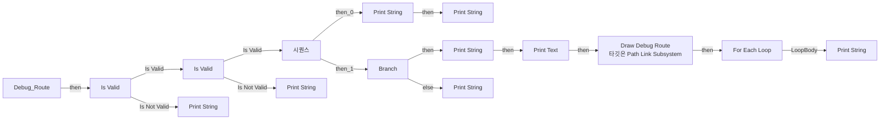
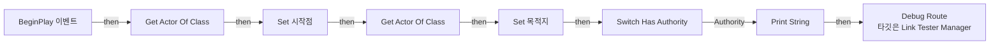

# LinkTesterManager

에셋: `/Game/QuakeLike_1_0/Test/LinkTester/LinkTesterManager`

부모: `/Script/CoreUObject.Class'/Script/Engine.Actor'`

수집일: 2026-10-12. MCP에서 읽은 그래프·핀 연결의 자동 전사입니다. 상속된 그래프는 부모 문서를 함께 확인합니다.

정적 루트 참조 도달: 없음. 실행 여부 또는 삭제 가능 여부의 확정이 아닙니다.

컴포넌트 목록은 이 BP가 직접 정의한 SCS만 포함합니다. 부모·네이티브 생성 컴포넌트, 인스턴스 설정은 별도입니다.

## 직접 정의한 컴포넌트

| 이름 | 클래스 | 부모 컴포넌트 |
|---|---|---|
| `DefaultSceneRoot` | `SceneComponent` | `` |

## 변수와 기본값

| 이름 | 타입 | CDO 기본값 |
|---|---|---|
| `시작점` | `LinkTesterStart_C` | None |
| `목적지` | `LinkTesterDestination_C` | None |

## 그래프 목록

| 그래프 | 전체 노드 수 |
|---|---|
| Debug_Route | 44 |
| EventGraph | 8 |
| UserConstructionScript | 1 |

## 그래프별 실행 연결

실선은 출력 exec 핀의 실제 연결입니다. 여러 분기는 출력 핀 이름을 표시합니다. 함수 호출·delegate·타이머의 다음 그래프 실행은 이 그림에서 자동으로 이어 붙이지 않습니다.

순수 계산 노드 및 데이터 핀은 아래 목록과 원본 JSON을 확인합니다. 연결되지 않은 이벤트도 표시되므로, 노드가 있다는 이유만으로 실행된다고 판단하면 안 됩니다.

### Debug_Route

실행 핀 플로우차트

전체 노드·기본 입력 목록

| 노드 ID | 제목 | 미연결 기본 입력 / 에셋 입력 |
|---|---|---|
| `K2Node_FunctionEntry_0` | Debug_Route |  |
| `K2Node_VariableGet_0` | Get 시작점 |  |
| `K2Node_VariableGet_1` | Get 목적지 |  |
| `K2Node_GetSubsystem_0` | Path Link Subsystem |  |
| `K2Node_CallFunction_0` | Find Shortest Route to Actor 타깃은 Path Link Subsystem | ReturnValue=false |
| `K2Node_CallFunction_1` | Get Actor Location 타깃은 액터 |  |
| `K2Node_IfThenElse_0` | Branch |  |
| `K2Node_CallFunction_2` | Print String | InString=Not Find Route; bPrintToScreen=true; bPrintToLog=true; TextColor=(R=0.000000,G=0.660000,B=1.000000,A=1.000000); Duration=2.000000; Key=None |
| `K2Node_MacroInstance_0` | For Each Loop |  |
| `K2Node_CallFunction_3` | Print String | bPrintToScreen=true; bPrintToLog=true; TextColor=(R=0.000000,G=0.660000,B=1.000000,A=1.000000); Duration=5.000000; Key=None |
| `K2Node_CallFunction_25` | Get Display Name |  |
| `K2Node_MacroInstance_1` | Is Valid |  |
| `K2Node_CallFunction_4` | Print String | InString=Not Valid StartPoint; bPrintToScreen=true; bPrintToLog=true; TextColor=(R=0.000000,G=0.660000,B=1.000000,A=1.000000); Duration=2.000000; Key=None |
| `K2Node_MacroInstance_2` | Is Valid |  |
| `K2Node_CallFunction_5` | Print String | InString=Not Valid EndPoint; bPrintToScreen=true; bPrintToLog=true; TextColor=(R=0.000000,G=0.660000,B=1.000000,A=1.000000); Duration=2.000000; Key=None |
| `K2Node_VariableGet_2` | Get 시작점 |  |
| `K2Node_VariableGet_3` | Get 목적지 |  |
| `K2Node_Knot_0` | 경유 노드 |  |
| `K2Node_ExecutionSequence_0` | 시퀀스 |  |
| `K2Node_Knot_1` | 경유 노드 |  |
| `K2Node_CallFunction_6` | Get Link Count 타깃은 Path Link Subsystem |  |
| `K2Node_CallFunction_7` | Print String | bPrintToScreen=true; bPrintToLog=true; TextColor=(R=0.000000,G=0.660000,B=1.000000,A=1.000000); Duration=2.000000; Key=None |
| `K2Node_CallFunction_26` | To String (Integer) |  |
| `K2Node_Knot_2` | 경유 노드 |  |
| `K2Node_CallFunction_8` | Get Enabled Links 타깃은 Path Link Subsystem |  |
| `K2Node_CallArrayFunction_0` | Length |  |
| `K2Node_CallFunction_9` | Print String | bPrintToScreen=true; bPrintToLog=true; TextColor=(R=0.000000,G=0.660000,B=1.000000,A=1.000000); Duration=2.000000; Key=None |
| `K2Node_CallFunction_27` | To String (Integer) |  |
| `K2Node_CommutativeAssociativeBinaryOperator_0` | Append | A=Link Count:  |
| `K2Node_Knot_3` | 경유 노드 |  |
| `K2Node_CommutativeAssociativeBinaryOperator_1` | Append | A=Enabled Links:  |
| `K2Node_Knot_4` | 경유 노드 |  |
| `K2Node_CallFunction_10` | Print String | InString=Find Route; bPrintToScreen=true; bPrintToLog=true; TextColor=(R=0.000000,G=0.660000,B=1.000000,A=1.000000); Duration=2.000000; Key=None |
| `K2Node_FormatText_0` | 포맷 텍스트 |  |
| `K2Node_CallFunction_11` | Print Text | bPrintToScreen=true; bPrintToLog=true; TextColor=(R=0.000000,G=0.660000,B=1.000000,A=1.000000); Duration=2.000000; Key=None |
| `K2Node_Knot_5` | 경유 노드 |  |
| `K2Node_Knot_6` | 경유 노드 |  |
| `K2Node_CallArrayFunction_1` | Length |  |
| `K2Node_CallArrayFunction_2` | Length |  |
| `K2Node_CallFunction_12` | Draw Debug Route 타깃은 Path Link Subsystem | Duration=20.000000; Thickness=5.000000; PersistentLines=false |
| `K2Node_Knot_8` | 경유 노드 |  |
| `K2Node_Knot_9` | 경유 노드 |  |
| `K2Node_Knot_10` | 경유 노드 |  |
| `K2Node_Knot_7` | 경유 노드 |  |

### EventGraph

실행 핀 플로우차트

전체 노드·기본 입력 목록

| 노드 ID | 제목 | 미연결 기본 입력 / 에셋 입력 |
|---|---|---|
| `K2Node_Event_3` | BeginPlay 이벤트 |  |
| `K2Node_CallFunction_0` | Get Actor Of Class | ActorClass=/Game/QuakeLike_1_0/Test/LinkTester/LinkTesterStart.LinkTesterStart_C |
| `K2Node_CallFunction_1` | Get Actor Of Class | ActorClass=/Game/QuakeLike_1_0/Test/LinkTester/LinkTesterDestination.LinkTesterDestination_C |
| `K2Node_VariableSet_0` | Set 시작점 |  |
| `K2Node_VariableSet_1` | Set 목적지 |  |
| `K2Node_CallFunction_2` | Debug Route 타깃은 Link Tester Manager |  |
| `K2Node_MacroInstance_0` | Switch Has Authority |  |
| `K2Node_CallFunction_3` | Print String | InString=Server Debug Start; bPrintToScreen=true; bPrintToLog=true; TextColor=(R=0.000000,G=0.660000,B=1.000000,A=1.000000); Duration=2.000000; Key=None |

### UserConstructionScript

실행 핀 플로우차트

전체 노드·기본 입력 목록

| 노드 ID | 제목 | 미연결 기본 입력 / 에셋 입력 |
|---|---|---|
| `K2Node_FunctionEntry_0` | Construction Script |  |

## 조회 범위의 한계

ObjectIterator로 발견했으나 MCP helper가 반환하지 않은 그래프입니다. delegate signature·컴파일된 중간 그래프·macro·애니메이션 내부 그래프가 섞일 수 있습니다.

- `Debug_Route_MERGED`: Graph 'Debug_Route_MERGED' not found in Blueprint.
- `EdGraph_0`: Graph 'EdGraph_0' not found in Blueprint.
- `EdGraph_1`: Graph 'EdGraph_1' not found in Blueprint.
- `EdGraph_2`: Graph 'EdGraph_2' not found in Blueprint.
- `EdGraph_3`: Graph 'EdGraph_3' not found in Blueprint.
- `ExecuteUbergraph_LinkTesterManager`: Graph 'ExecuteUbergraph_LinkTesterManager' not found in Blueprint.
- `ReceiveBeginPlay`: Graph 'ReceiveBeginPlay' not found in Blueprint.
- `UserConstructionScript_MERGED`: Graph 'UserConstructionScript_MERGED' not found in Blueprint.

[원본 MCP 스냅샷](../../../../Evidence/blueprints-245.json)
