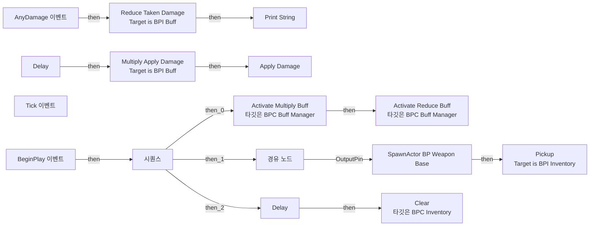
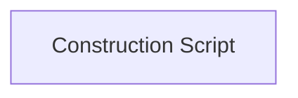

# Test_Char

에셋: `/Game/QuakeLike_1_0/Test/Test_Char`

부모: `/Script/CoreUObject.Class'/Script/Engine.Character'`

수집일: 2026-10-12. MCP에서 읽은 그래프·핀 연결의 자동 전사입니다. 상속된 그래프는 부모 문서를 함께 확인합니다.

정적 루트 참조 도달: 없음. 실행 여부 또는 삭제 가능 여부의 확정이 아닙니다.

컴포넌트 목록은 이 BP가 직접 정의한 SCS만 포함합니다. 부모·네이티브 생성 컴포넌트, 인스턴스 설정은 별도입니다.

## 직접 정의한 컴포넌트

| 이름 | 클래스 | 부모 컴포넌트 |
|---|---|---|
| `BPC_Buff_Manager` | `BPC_Buff_Manager_C` | `` |
| `BPC_Life` | `BPC_Life_C` | `` |
| `BPC_Inventory` | `BPC_Inventory_C` | `` |

## 그래프 목록

| 그래프 | 전체 노드 수 |
|---|---|
| EventGraph | 30 |
| UserConstructionScript | 1 |

## 그래프별 실행 연결

실선은 출력 exec 핀의 실제 연결입니다. 여러 분기는 출력 핀 이름을 표시합니다. 함수 호출·delegate·타이머의 다음 그래프 실행은 이 그림에서 자동으로 이어 붙이지 않습니다.

순수 계산 노드 및 데이터 핀은 아래 목록과 원본 JSON을 확인합니다. 연결되지 않은 이벤트도 표시되므로, 노드가 있다는 이유만으로 실행된다고 판단하면 안 됩니다.

### EventGraph

실행 핀 플로우차트

전체 노드·기본 입력 목록

| 노드 ID | 제목 | 미연결 기본 입력 / 에셋 입력 |
|---|---|---|
| `K2Node_Event_0` | BeginPlay 이벤트 |  |
| `K2Node_Event_4` | AnyDamage 이벤트 |  |
| `K2Node_CallFunction_14` | Print String | bPrintToScreen=true; bPrintToLog=true; TextColor=(R=0.000000,G=0.660000,B=1.000000,A=1.000000); Duration=2.000000; Key=damage |
| `K2Node_CommutativeAssociativeBinaryOperator_0` | Append | A=받은 피해 :  |
| `K2Node_VariableGet_10` | Get BPC_Buff_Manager |  |
| `K2Node_CallFunction_17` | To String (Float) |  |
| `K2Node_Knot_2` | 경유 노드 |  |
| `K2Node_VariableGet_0` | Get BPC_Buff_Manager |  |
| `K2Node_CallFunction_3` | Activate Multiply Buff 타깃은 BPC Buff Manager | Duration=15.000000 |
| `K2Node_Event_5` | Tick 이벤트 | DeltaSeconds=0.0 |
| `K2Node_CallFunction_19` | Delay | Duration=2.000000 |
| `K2Node_CallFunction_20` | Apply Damage | ReturnValue=0.0 |
| `K2Node_Self_2` | 셀프-레퍼런스 |  |
| `K2Node_VariableGet_6` | Get BPC_Buff_Manager |  |
| `K2Node_Knot_4` | 경유 노드 |  |
| `K2Node_CallFunction_23` | Activate Reduce Buff 타깃은 BPC Buff Manager | Duration=15.000000 |
| `K2Node_VariableGet_7` | Get BPC_Buff_Manager |  |
| `K2Node_VariableGet_8` | Get BPC_Inventory |  |
| `K2Node_CallFunction_24` | Clear 타깃은 BPC Inventory |  |
| `K2Node_CallFunction_25` | Delay | Duration=5.000000 |
| `K2Node_ExecutionSequence_1` | 시퀀스 |  |
| `K2Node_VariableGet_4` | Get BPC_Inventory |  |
| `K2Node_Message_8` | Pickup Target is BPI Inventory |  |
| `K2Node_SpawnActorFromClass_1` | SpawnActor BP Weapon Base | Class=/Game/QuakeLike_1_0/HeldItem/Gun/BP_WeaponBase.BP_WeaponBase_C; CollisionHandlingOverride=Undefined; TransformScaleMethod=MultiplyWithRoot; bUseScope=False; bZoomIn=True |
| `K2Node_CallFunction_6` | Get Actor Transform 타깃은 액터 |  |
| `K2Node_Self_1` | 셀프-레퍼런스 |  |
| `K2Node_Knot_3` | 경유 노드 |  |
| `K2Node_Knot_5` | 경유 노드 |  |
| `K2Node_Message_3` | Multiply Apply Damage Target is BPI Buff | Base=0.0 |
| `K2Node_Message_4` | Reduce Taken Damage Target is BPI Buff |  |

### UserConstructionScript

실행 핀 플로우차트

전체 노드·기본 입력 목록

| 노드 ID | 제목 | 미연결 기본 입력 / 에셋 입력 |
|---|---|---|
| `K2Node_FunctionEntry_0` | Construction Script |  |

## 조회 범위의 한계

ObjectIterator로 발견했으나 MCP helper가 반환하지 않은 그래프입니다. delegate signature·컴파일된 중간 그래프·macro·애니메이션 내부 그래프가 섞일 수 있습니다.

- `ExecuteUbergraph_Test_Char`: Graph 'ExecuteUbergraph_Test_Char' not found in Blueprint.
- `ReceiveAnyDamage`: Graph 'ReceiveAnyDamage' not found in Blueprint.
- `ReceiveBeginPlay`: Graph 'ReceiveBeginPlay' not found in Blueprint.
- `ReceiveTick`: Graph 'ReceiveTick' not found in Blueprint.
- `UserConstructionScript_MERGED`: Graph 'UserConstructionScript_MERGED' not found in Blueprint.

[원본 MCP 스냅샷](../../../Evidence/blueprints-245.json)
