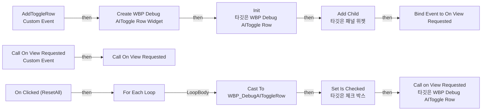

# WBP_DebugAI

에셋: `/Game/QuakeLike_1_0/Test/UI/WBP_DebugAI`

부모: `/Script/CoreUObject.Class'/Script/UMG.UserWidget'`

수집일: 2026-10-12. MCP에서 읽은 그래프·핀 연결의 자동 전사입니다. 상속된 그래프는 부모 문서를 함께 확인합니다.

정적 루트 참조 도달: 있음. 실행 여부 또는 삭제 가능 여부의 확정이 아닙니다.

컴포넌트 목록은 이 BP가 직접 정의한 SCS만 포함합니다. 부모·네이티브 생성 컴포넌트, 인스턴스 설정은 별도입니다.

## 변수와 기본값

| 이름 | 타입 | CDO 기본값 |
|---|---|---|
| `On View Requested` | `mcdelegate` | &lt;Delegate 'DelegateBase' &lt;Unbound&gt;&gt; |

## 그래프 목록

| 그래프 | 전체 노드 수 |
|---|---|
| EventGraph | 27 |

## 그래프별 실행 연결

실선은 출력 exec 핀의 실제 연결입니다. 여러 분기는 출력 핀 이름을 표시합니다. 함수 호출·delegate·타이머의 다음 그래프 실행은 이 그림에서 자동으로 이어 붙이지 않습니다.

순수 계산 노드 및 데이터 핀은 아래 목록과 원본 JSON을 확인합니다. 연결되지 않은 이벤트도 표시되므로, 노드가 있다는 이유만으로 실행된다고 판단하면 안 됩니다.

### EventGraph

실행 핀 플로우차트

전체 노드·기본 입력 목록

| 노드 ID | 제목 | 미연결 기본 입력 / 에셋 입력 |
|---|---|---|
| `K2Node_CustomEvent_0` | AddToggleRow Custom Event |  |
| `K2Node_CreateWidget_0` | Create WBP Debug AIToggle Row Widget | Class=/Game/QuakeLike_1_0/Test/UI/WBP_DebugAIToggleRow.WBP_DebugAIToggleRow_C |
| `K2Node_CallFunction_0` | Init 타깃은 WBP Debug AIToggle Row |  |
| `K2Node_Knot_0` | 경유 노드 |  |
| `K2Node_Knot_1` | 경유 노드 |  |
| `K2Node_Knot_2` | 경유 노드 |  |
| `K2Node_Knot_3` | 경유 노드 |  |
| `K2Node_VariableGet_1` | Get VB_ToggleRows |  |
| `K2Node_CallFunction_2` | Add Child 타깃은 패널 위젯 |  |
| `K2Node_Knot_4` | 경유 노드 |  |
| `K2Node_Knot_5` | 경유 노드 |  |
| `K2Node_Knot_6` | 경유 노드 |  |
| `K2Node_AddDelegate_0` | Bind Event to On View Requested |  |
| `K2Node_Knot_7` | 경유 노드 |  |
| `K2Node_CallDelegate_0` | Call On View Requested |  |
| `K2Node_CreateDelegate_1` | 이벤트 생성 |  |
| `K2Node_CustomEvent_2` | Call On View Requested Custom Event |  |
| `K2Node_ComponentBoundEvent_0` | On Clicked (ResetAll) |  |
| `K2Node_VariableGet_0` | Get VB_ToggleRows |  |
| `K2Node_CallFunction_1` | Get All Children 타깃은 패널 위젯 |  |
| `K2Node_MacroInstance_0` | For Each Loop |  |
| `K2Node_DynamicCast_0` | Cast To WBP_DebugAIToggleRow |  |
| `K2Node_VariableGet_2` | Get CB_Active |  |
| `K2Node_CallFunction_3` | Set Is Checked 타깃은 체크 박스 | InIsChecked=false |
| `K2Node_Knot_9` | 경유 노드 |  |
| `K2Node_CallFunction_9` | Call on View Requested 타깃은 WBP Debug AIToggle Row | View=false |
| `K2Node_Knot_10` | 경유 노드 |  |

## 조회 범위의 한계

ObjectIterator로 발견했으나 MCP helper가 반환하지 않은 그래프입니다. delegate signature·컴파일된 중간 그래프·macro·애니메이션 내부 그래프가 섞일 수 있습니다.

- `AddToggleRow`: Graph 'AddToggleRow' not found in Blueprint.
- `BndEvt__WBP_DebugAI_ResetAll_K2Node_ComponentBoundEvent_0_OnButtonClickedEvent__DelegateSignature`: Graph 'BndEvt__WBP_DebugAI_ResetAll_K2Node_ComponentBoundEvent_0_OnButtonClickedEvent__DelegateSignature' not found in Blueprint.
- `Call On View Requested`: Graph 'Call On View Requested' not found in Blueprint.
- `On View Requested`: Graph 'On View Requested' not found in Blueprint.

[원본 MCP 스냅샷](../../../../Evidence/blueprints-035.json)
