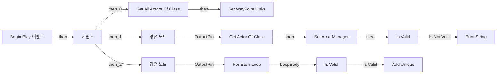
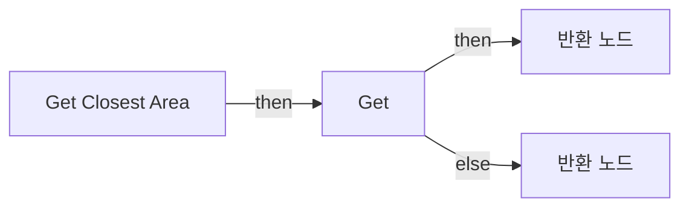
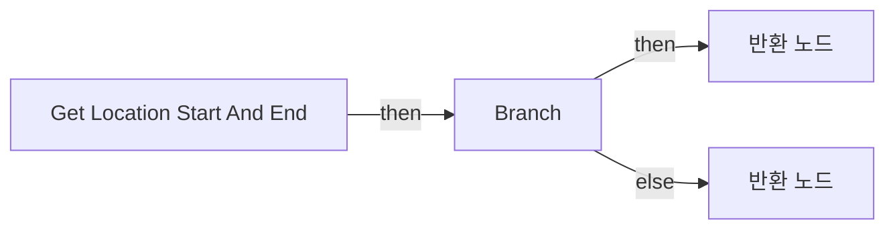

# BPC_WayPointLinkManager

에셋: `/Game/QuakeLike_1_0/Test/YesItWillBeNotEasy/BPC_WayPointLinkManager`

부모: `/Script/CoreUObject.Class'/Script/Engine.ActorComponent'`

수집일: 2026-10-12. MCP에서 읽은 그래프·핀 연결의 자동 전사입니다. 상속된 그래프는 부모 문서를 함께 확인합니다.

정적 루트 참조 도달: 없음. 실행 여부 또는 삭제 가능 여부의 확정이 아닙니다.

컴포넌트 목록은 이 BP가 직접 정의한 SCS만 포함합니다. 부모·네이티브 생성 컴포넌트, 인스턴스 설정은 별도입니다.

## 변수와 기본값

| 이름 | 타입 | CDO 기본값 |
|---|---|---|
| `WayPoint Links` | `BP_WayPointLink_C` | [] |
| `Area Manager` | `BP_AreaManager_C` | None |

## 그래프 목록

| 그래프 | 전체 노드 수 |
|---|---|
| EventGraph | 20 |
| Get Closest Area | 6 |
| Get Location Start And End | 12 |
| Get WayPoint | 63 |

## 그래프별 실행 연결

실선은 출력 exec 핀의 실제 연결입니다. 여러 분기는 출력 핀 이름을 표시합니다. 함수 호출·delegate·타이머의 다음 그래프 실행은 이 그림에서 자동으로 이어 붙이지 않습니다.

순수 계산 노드 및 데이터 핀은 아래 목록과 원본 JSON을 확인합니다. 연결되지 않은 이벤트도 표시되므로, 노드가 있다는 이유만으로 실행된다고 판단하면 안 됩니다.

### EventGraph

실행 핀 플로우차트

전체 노드·기본 입력 목록

| 노드 ID | 제목 | 미연결 기본 입력 / 에셋 입력 |
|---|---|---|
| `K2Node_Event_0` | Begin Play 이벤트 |  |
| `K2Node_CallFunction_1` | Get All Actors Of Class | ActorClass=/Game/QuakeLike_1_0/Test/YesItWillBeNotEasy/BP_WayPointLink.BP_WayPointLink_C |
| `K2Node_VariableSet_0` | Set WayPoint Links |  |
| `K2Node_CallFunction_0` | Get Actor Of Class | ActorClass=/Game/QuakeLike_1_0/AI/Area/BP_AreaManager.BP_AreaManager_C |
| `K2Node_ExecutionSequence_0` | 시퀀스 |  |
| `K2Node_VariableSet_1` | Set Area Manager |  |
| `K2Node_Knot_0` | 경유 노드 |  |
| `K2Node_MacroInstance_0` | Is Valid |  |
| `K2Node_Knot_3` | 경유 노드 |  |
| `K2Node_CallFunction_4` | Get Area by Position 타깃은 BP Area Manager |  |
| `K2Node_CallFunction_5` | Get Actor Location 타깃은 액터 |  |
| `K2Node_VariableGet_5` | Get WayPoint Links |  |
| `K2Node_MacroInstance_3` | For Each Loop |  |
| `K2Node_VariableGet_6` | Get Area Manager |  |
| `K2Node_Knot_14` | 경유 노드 |  |
| `EdGraphNode_Comment_2` | 모든 Area Set |  |
| `K2Node_MacroInstance_4` | Is Valid |  |
| `K2Node_CallFunction_12` | Print String | InString=Area Manager가 레벨에 부재 중; bPrintToScreen=true; bPrintToLog=true; TextColor=(R=1.000000,G=0.000000,B=0.000722,A=1.000000); Duration=10.000000; Key=None |
| `K2Node_VariableGet_7` | Get Way Points |  |
| `K2Node_CallArrayFunction_0` | Add Unique | ReturnValue=0 |

### Get Closest Area

실행 핀 플로우차트

전체 노드·기본 입력 목록

| 노드 ID | 제목 | 미연결 기본 입력 / 에셋 입력 |
|---|---|---|
| `K2Node_FunctionEntry_0` | Get Closest Area |  |
| `K2Node_VariableGet_0` | Get |  |
| `K2Node_FunctionResult_0` | 반환 노드 |  |
| `K2Node_CallFunction_0` | Get Area by Position 타깃은 BP Area Manager |  |
| `K2Node_Knot_0` | 경유 노드 |  |
| `K2Node_FunctionResult_1` | 반환 노드 |  |

### Get Location Start And End

실행 핀 플로우차트

전체 노드·기본 입력 목록

| 노드 ID | 제목 | 미연결 기본 입력 / 에셋 입력 |
|---|---|---|
| `K2Node_FunctionEntry_0` | Get Location Start And End |  |
| `K2Node_CallFunction_7` | Is Valid |  |
| `K2Node_CallFunction_8` | Is Valid |  |
| `K2Node_CommutativeAssociativeBinaryOperator_1` | AND Boolean |  |
| `K2Node_IfThenElse_1` | Branch |  |
| `K2Node_FunctionResult_2` | 반환 노드 | Is Valid=true |
| `K2Node_FunctionResult_1` | 반환 노드 | Is Valid=false; Start Location=0, 0, 0; End Location=0, 0, 0 |
| `K2Node_Knot_6` | 경유 노드 |  |
| `K2Node_CallFunction_9` | Get Actor Location 타깃은 액터 |  |
| `K2Node_Knot_7` | 경유 노드 |  |
| `K2Node_Knot_8` | 경유 노드 |  |
| `K2Node_CallFunction_10` | Get Actor Location 타깃은 액터 |  |

### Get WayPoint

```mermaid
flowchart LR
  n0["Get WayPoint"]
  n1["Test Path Exists Sync"]
  n2["Try Get Location Start and End"]
  n3["Set L_Start"]
  n4["Set L_Goal"]
  n5["Set L_Goal Area"]
  n6["Get"]
  n7["For Each Loop"]
  n8["For Each Loop"]
  n9["Set L_EndPoint"]
  n10["Set L_StartPoint"]
  n11["Get"]
  n12["Get"]
  n13["Branch"]
  n14["시퀀스"]
  n15["반환 노드"]
  n16["Set L_Final WayPoint"]
  n17["Set L_MinDistance"]
  n18["Set L_PathTestResult"]
  n19["Switch on ENavPathTestResult"]
  n20["Set L_Current Distance"]
  n21["경유 노드"]
  n22["Branch"]
  n23["Switch on ENavPathTestResult"]
  n24["경유 노드"]
  n25["경유 노드"]
  n26["반환 노드"]
  n27["Set L_Distance Start To Goal"]
  n28["경유 노드"]
  n29["경유 노드"]
  n30["경유 노드"]
  n31["Get"]
  n32["반환 노드"]
  n0 -->|"then"| n2
  n1 -->|"then"| n18
  n2 -->|"Is Valid"| n3
  n2 -->|"Is Not Valid"| n26
  n3 -->|"then"| n4
  n4 -->|"then"| n5
  n5 -->|"then"| n31
  n6 -->|"then"| n7
  n7 -->|"LoopBody"| n9
  n8 -->|"LoopBody"| n10
  n9 -->|"then"| n11
  n10 -->|"then"| n12
  n11 -->|"then"| n8
  n12 -->|"then"| n20
  n13 -->|"then"| n17
  n14 -->|"then_0"| n6
  n14 -->|"then_1"| n25
  n17 -->|"then"| n16
  n18 -->|"then"| n23
  n19 -->|"PathExists"| n22
  n19 -->|"Islands"| n21
  n20 -->|"then"| n19
  n21 -->|"OutputPin"| n13
  n22 -->|"then"| n13
  n23 -->|"PathExists"| n27
  n23 -->|"Islands"| n28
  n23 -->|"OffMesh"| n24
  n24 -->|"OutputPin"| n25
  n25 -->|"OutputPin"| n15
  n27 -->|"then"| n30
  n28 -->|"OutputPin"| n29
  n29 -->|"OutputPin"| n30
  n30 -->|"OutputPin"| n14
  n31 -->|"then"| n1
  n31 -->|"else"| n32
```

실행 핀 플로우차트

전체 노드·기본 입력 목록

| 노드 ID | 제목 | 미연결 기본 입력 / 에셋 입력 |
|---|---|---|
| `K2Node_FunctionEntry_0` | Get WayPoint |  |
| `K2Node_CallFunction_0` | Test Path Exists Sync |  |
| `K2Node_MacroInstance_1` | Try Get Location Start and End |  |
| `K2Node_VariableSet_8` | Set L_Start | Output_Get=0, 0, 0 |
| `K2Node_VariableSet_9` | Set L_Goal |  |
| `K2Node_Knot_0` | 경유 노드 |  |
| `K2Node_VariableSet_10` | Set L_Goal Area |  |
| `K2Node_VariableGet_5` | Get L_Goal |  |
| `K2Node_VariableGet_6` | Get |  |
| `K2Node_VariableGet_7` | Get Way Points |  |
| `K2Node_MacroInstance_4` | For Each Loop |  |
| `K2Node_VariableGet_8` | Get Starting Points |  |
| `K2Node_MacroInstance_6` | For Each Loop |  |
| `K2Node_VariableSet_12` | Set L_EndPoint |  |
| `K2Node_VariableSet_13` | Set L_StartPoint |  |
| `K2Node_VariableGet_10` | Get |  |
| `K2Node_VariableGet_11` | Get |  |
| `K2Node_VariableGet_15` | Get L_MinDistance |  |
| `K2Node_PromotableOperator_1` | float &lt; float |  |
| `K2Node_IfThenElse_2` | Branch |  |
| `K2Node_VariableGet_16` | Get L_StartPoint |  |
| `K2Node_ExecutionSequence_0` | 시퀀스 |  |
| `K2Node_FunctionResult_1` | 반환 노드 |  |
| `K2Node_VariableSet_15` | Set L_Final WayPoint |  |
| `K2Node_VariableGet_18` | Get L_Final WayPoint |  |
| `K2Node_VariableSet_17` | Set L_MinDistance | Output_Get=0.0 |
| `K2Node_VariableGet_19` | Get L_Current Distance |  |
| `K2Node_VariableGet_20` | Get L_Start |  |
| `K2Node_VariableSet_18` | Set L_PathTestResult |  |
| `K2Node_VariableGet_24` | Get L_PathTestResult |  |
| `K2Node_SwitchEnum_2` | Switch on ENavPathTestResult |  |
| `K2Node_CallFunction_17` | Get Actor Location 타깃은 액터 |  |
| `K2Node_VariableGet_25` | Get L_Start |  |
| `K2Node_VariableGet_26` | Get L_Goal |  |
| `K2Node_VariableGet_27` | Get L_EndPoint |  |
| `K2Node_CallFunction_18` | Get Actor Location 타깃은 액터 |  |
| `K2Node_CallFunction_19` | Distance (Vector) |  |
| `K2Node_CallFunction_20` | Distance (Vector) |  |
| `K2Node_PromotableOperator_0` | float + float |  |
| `K2Node_VariableSet_16` | Set L_Current Distance | Output_Get=0.0 |
| `K2Node_VariableGet_28` | Get L_StartPoint |  |
| `K2Node_VariableGet_33` | Get L_Current Distance |  |
| `K2Node_Knot_8` | 경유 노드 |  |
| `K2Node_VariableGet_36` | Get L_Current Distance |  |
| `K2Node_PromotableOperator_3` | float &lt; float |  |
| `K2Node_IfThenElse_3` | Branch |  |
| `K2Node_SwitchEnum_3` | Switch on ENavPathTestResult |  |
| `K2Node_Knot_9` | 경유 노드 |  |
| `K2Node_Knot_11` | 경유 노드 |  |
| `K2Node_FunctionResult_2` | 반환 노드 |  |
| `EdGraphNode_Comment_0` | 기본 설정 |  |
| `K2Node_VariableGet_34` | Get L_Start |  |
| `K2Node_VariableGet_35` | Get L_Goal |  |
| `K2Node_CallFunction_25` | Distance (Vector) |  |
| `K2Node_VariableSet_20` | Set L_Distance Start To Goal | Output_Get=0.0 |
| `K2Node_Knot_13` | 경유 노드 |  |
| `K2Node_Knot_14` | 경유 노드 |  |
| `K2Node_Knot_15` | 경유 노드 |  |
| `K2Node_VariableGet_41` | Get L_Distance Start To Goal |  |
| `K2Node_CallFunction_28` | Get Closest Area |  |
| `K2Node_VariableGet_43` | Get |  |
| `K2Node_FunctionResult_0` | 반환 노드 |  |
| `EdGraphNode_Comment_1` | (Start --&gt; WayPoint Start) + (Goal --&gt; WayPoint End) |  |

## 조회 범위의 한계

ObjectIterator로 발견했으나 MCP helper가 반환하지 않은 그래프입니다. delegate signature·컴파일된 중간 그래프·macro·애니메이션 내부 그래프가 섞일 수 있습니다.

- `EdGraph_0`: Graph 'EdGraph_0' not found in Blueprint.
- `EdGraph_1`: Graph 'EdGraph_1' not found in Blueprint.
- `EdGraph_2`: Graph 'EdGraph_2' not found in Blueprint.
- `EdGraph_3`: Graph 'EdGraph_3' not found in Blueprint.
- `EdGraph_4`: Graph 'EdGraph_4' not found in Blueprint.
- `EdGraph_5`: Graph 'EdGraph_5' not found in Blueprint.
- `ExecuteUbergraph_BPC_WayPointLinkManager`: Graph 'ExecuteUbergraph_BPC_WayPointLinkManager' not found in Blueprint.
- `Get Closest Area_MERGED`: Graph 'Get Closest Area_MERGED' not found in Blueprint.
- `Get Location Start And End_MERGED`: Graph 'Get Location Start And End_MERGED' not found in Blueprint.
- `Get WayPoint_MERGED`: Graph 'Get WayPoint_MERGED' not found in Blueprint.
- `ReceiveBeginPlay`: Graph 'ReceiveBeginPlay' not found in Blueprint.
- `Try Get Location Start And End`: Graph 'Try Get Location Start And End' not found in Blueprint.

[원본 MCP 스냅샷](../../../../Evidence/blueprints-245.json)
