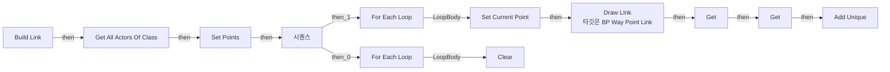
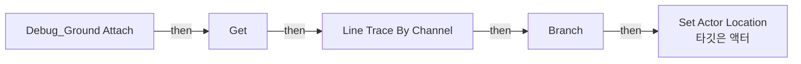
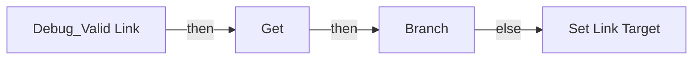
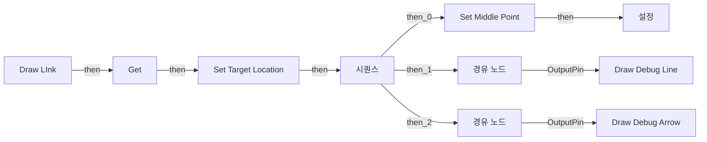
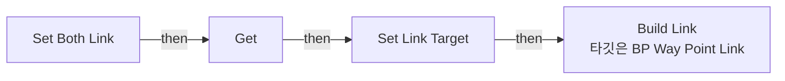
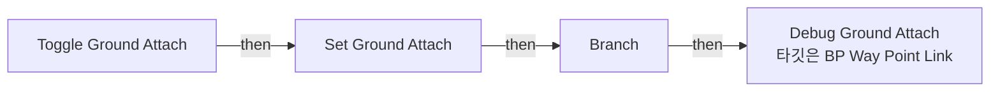
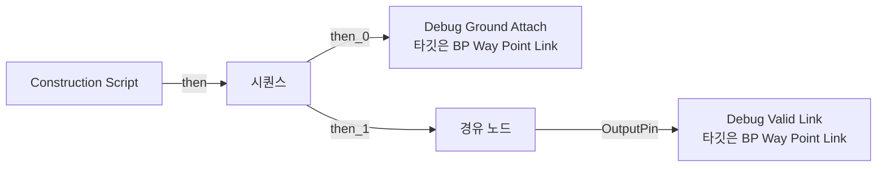

# BP_WayPointLink

에셋: `/Game/QuakeLike_1_0/Test/YesItWillBeNotEasy/BP_WayPointLink`

부모: `/Script/CoreUObject.Class'/Script/Engine.Actor'`

수집일: 2026-10-12. MCP에서 읽은 그래프·핀 연결의 자동 전사입니다. 상속된 그래프는 부모 문서를 함께 확인합니다.

정적 루트 참조 도달: 있음. 실행 여부 또는 삭제 가능 여부의 확정이 아닙니다.

컴포넌트 목록은 이 BP가 직접 정의한 SCS만 포함합니다. 부모·네이티브 생성 컴포넌트, 인스턴스 설정은 별도입니다.

## 직접 정의한 컴포넌트

| 이름 | 클래스 | 부모 컴포넌트 |
|---|---|---|
| `DefaultSceneRoot` | `SceneComponent` | `` |
| `Point Mesh` | `StaticMeshComponent` | `DefaultSceneRoot` |

## 변수와 기본값

| 이름 | 타입 | CDO 기본값 |
|---|---|---|
| `Link Target` | `BP_WayPointLink_C` | None |
| `Starting Points` | `BP_WayPointLink_C` | [] |
| `Ground Attach` | `bool` | True |

## 그래프 목록

| 그래프 | 전체 노드 수 |
|---|---|
| Build Link | 18 |
| Debug_Ground Attach | 10 |
| Debug_Valid Link | 6 |
| Draw LInk | 22 |
| EventGraph | 0 |
| Set Both Link | 5 |
| Toggle Ground Attach | 6 |
| UserConstructionScript | 5 |

## 그래프별 실행 연결

실선은 출력 exec 핀의 실제 연결입니다. 여러 분기는 출력 핀 이름을 표시합니다. 함수 호출·delegate·타이머의 다음 그래프 실행은 이 그림에서 자동으로 이어 붙이지 않습니다.

순수 계산 노드 및 데이터 핀은 아래 목록과 원본 JSON을 확인합니다. 연결되지 않은 이벤트도 표시되므로, 노드가 있다는 이유만으로 실행된다고 판단하면 안 됩니다.

### Build Link

실행 핀 플로우차트

전체 노드·기본 입력 목록

| 노드 ID | 제목 | 미연결 기본 입력 / 에셋 입력 |
|---|---|---|
| `K2Node_FunctionEntry_0` | Build Link |  |
| `K2Node_CallFunction_0` | Get All Actors Of Class | ActorClass=/Game/QuakeLike_1_0/Test/YesItWillBeNotEasy/BP_WayPointLink.BP_WayPointLink_C |
| `K2Node_MacroInstance_3` | For Each Loop |  |
| `K2Node_VariableSet_0` | Set Current Point |  |
| `K2Node_VariableGet_0` | Get |  |
| `K2Node_CallFunction_1` | Draw LInk 타깃은 BP Way Point Link |  |
| `K2Node_VariableGet_4` | Get |  |
| `K2Node_VariableGet_5` | Get Starting Points |  |
| `K2Node_VariableSet_3` | Set Points |  |
| `K2Node_ExecutionSequence_1` | 시퀀스 |  |
| `K2Node_VariableGet_9` | Get Points |  |
| `K2Node_MacroInstance_1` | For Each Loop |  |
| `K2Node_VariableGet_1` | Get Points |  |
| `K2Node_VariableGet_10` | Get Starting Points |  |
| `K2Node_CallArrayFunction_3` | Clear |  |
| `K2Node_CallArrayFunction_4` | Add Unique | ReturnValue=0 |
| `EdGraphNode_Comment_0` | Starting Point 갱신 |  |
| `K2Node_VariableGet_6` | Get Current Point |  |

### Debug_Ground Attach

실행 핀 플로우차트

전체 노드·기본 입력 목록

| 노드 ID | 제목 | 미연결 기본 입력 / 에셋 입력 |
|---|---|---|
| `K2Node_FunctionEntry_0` | Debug_Ground Attach |  |
| `K2Node_CallFunction_6` | Line Trace By Channel | TraceChannel=TraceTypeQuery1; bTraceComplex=false; DrawDebugType=None; OutHit_bBlockingHit=false; OutHit_bInitialOverlap=false; OutHit_Time=0.0; OutHit_Distance=0.0; OutHit_Location=0, 0, 0; OutHit_Normal=0, 0, 0; OutHit_ImpactNormal=0, 0, 0; OutHit_HitBoneName=None; OutHit_BoneName=None; OutHit_HitItem=0; OutHit_ElementIndex=0; OutHit_FaceIndex=0; OutHit_TraceStart=0, 0, 0; OutHit_TraceEnd=0, 0, 0; bIgnoreSelf=true; TraceColor=(R=1.000000,G=0.000000,B=0.000000,A=1.000000); TraceHitColor=(R=0.000000,G=1.000000,B=0.000000,A=1.000000); DrawTime=5.000000 |
| `K2Node_IfThenElse_1` | Branch |  |
| `K2Node_PromotableOperator_2` | vector - vector | B=0.000000,0.000000,500.000000 |
| `K2Node_Knot_3` | 경유 노드 |  |
| `K2Node_PromotableOperator_3` | vector + vector | B=0.000000,0.000000,50.000000 |
| `K2Node_VariableGet_7` | Get | Ground Attach=false |
| `K2Node_CallFunction_10` | Get Actor Location 타깃은 액터 |  |
| `K2Node_CallFunction_11` | Set Actor Location 타깃은 액터 | bSweep=false; bTeleport=false; ReturnValue=false |
| `K2Node_Knot_5` | 경유 노드 |  |

### Debug_Valid Link

실행 핀 플로우차트

전체 노드·기본 입력 목록

| 노드 ID | 제목 | 미연결 기본 입력 / 에셋 입력 |
|---|---|---|
| `K2Node_FunctionEntry_0` | Debug_Valid Link |  |
| `K2Node_VariableGet_0` | Get |  |
| `K2Node_PromotableOperator_0` | Not Equal (Object) |  |
| `K2Node_Self_0` | 셀프-레퍼런스 |  |
| `K2Node_IfThenElse_0` | Branch |  |
| `K2Node_VariableSet_1` | Set Link Target |  |

### Draw LInk

실행 핀 플로우차트

전체 노드·기본 입력 목록

| 노드 ID | 제목 | 미연결 기본 입력 / 에셋 입력 |
|---|---|---|
| `K2Node_FunctionEntry_0` | Draw LInk |  |
| `K2Node_VariableGet_4` | Get |  |
| `K2Node_CallFunction_2` | Get Actor Location 타깃은 액터 |  |
| `K2Node_CallFunction_3` | Get Actor Location 타깃은 액터 |  |
| `K2Node_CallFunction_26` | Draw Debug Arrow | ArrowSize=2000.000000; Duration=3.000000; Thickness=5.000000 |
| `K2Node_CallFunction_0` | Draw Debug Line | Duration=3.000000; Thickness=5.000000 |
| `K2Node_VariableGet_1` | Get Color |  |
| `K2Node_VariableGet_0` | Get Color |  |
| `K2Node_VariableSet_0` | Set Target Location | Output_Get=0, 0, 0 |
| `K2Node_ExecutionSequence_0` | 시퀀스 |  |
| `K2Node_VariableGet_2` | Get Target Location |  |
| `K2Node_VariableSet_1` | Set Middle Point |  |
| `K2Node_VariableGet_6` | Get Middle Point |  |
| `K2Node_CallFunction_4` | Get Actor Location 타깃은 액터 |  |
| `K2Node_Knot_0` | 경유 노드 |  |
| `K2Node_VariableGet_5` | Get Target Location |  |
| `K2Node_Knot_1` | 경유 노드 |  |
| `K2Node_PromotableOperator_3` | vector + vector |  |
| `K2Node_VariableGet_3` | Get Middle Point |  |
| `K2Node_PromotableOperator_5` | float * float | B=2.500000 |
| `K2Node_VariableSet_2` | 설정 | Output_Get=0, 0, 0 |
| `K2Node_PromotableOperator_6` | vector * vector | B=0.500000 |

### EventGraph

전체 노드·기본 입력 목록

| 노드 ID | 제목 | 미연결 기본 입력 / 에셋 입력 |
|---|---|---|

### Set Both Link

실행 핀 플로우차트

전체 노드·기본 입력 목록

| 노드 ID | 제목 | 미연결 기본 입력 / 에셋 입력 |
|---|---|---|
| `K2Node_FunctionEntry_0` | Set Both Link |  |
| `K2Node_VariableGet_0` | Get |  |
| `K2Node_VariableSet_1` | Set Link Target |  |
| `K2Node_Self_0` | 셀프-레퍼런스 |  |
| `K2Node_CallFunction_1` | Build Link 타깃은 BP Way Point Link |  |

### Toggle Ground Attach

실행 핀 플로우차트

전체 노드·기본 입력 목록

| 노드 ID | 제목 | 미연결 기본 입력 / 에셋 입력 |
|---|---|---|
| `K2Node_FunctionEntry_0` | Toggle Ground Attach |  |
| `K2Node_VariableSet_0` | Set Ground Attach |  |
| `K2Node_VariableGet_0` | Get Ground Attach |  |
| `K2Node_CallFunction_0` | NOT Boolean |  |
| `K2Node_IfThenElse_0` | Branch |  |
| `K2Node_CallFunction_1` | Debug Ground Attach 타깃은 BP Way Point Link |  |

### UserConstructionScript

실행 핀 플로우차트

전체 노드·기본 입력 목록

| 노드 ID | 제목 | 미연결 기본 입력 / 에셋 입력 |
|---|---|---|
| `K2Node_FunctionEntry_1` | Construction Script |  |
| `K2Node_CallFunction_2` | Debug Ground Attach 타깃은 BP Way Point Link |  |
| `K2Node_CallFunction_4` | Debug Valid Link 타깃은 BP Way Point Link |  |
| `K2Node_ExecutionSequence_0` | 시퀀스 |  |
| `K2Node_Knot_6` | 경유 노드 |  |

## 조회 범위의 한계

ObjectIterator로 발견했으나 MCP helper가 반환하지 않은 그래프입니다. delegate signature·컴파일된 중간 그래프·macro·애니메이션 내부 그래프가 섞일 수 있습니다.

- `Build Link_MERGED`: Graph 'Build Link_MERGED' not found in Blueprint.
- `Debug_Ground Attach_MERGED`: Graph 'Debug_Ground Attach_MERGED' not found in Blueprint.
- `Debug_Valid Link_MERGED`: Graph 'Debug_Valid Link_MERGED' not found in Blueprint.
- `Draw LInk_MERGED`: Graph 'Draw LInk_MERGED' not found in Blueprint.
- `EdGraph_0`: Graph 'EdGraph_0' not found in Blueprint.
- `EdGraph_1`: Graph 'EdGraph_1' not found in Blueprint.
- `ExecuteUbergraph_BP_WayPointLink`: Graph 'ExecuteUbergraph_BP_WayPointLink' not found in Blueprint.
- `Set Both Link_MERGED`: Graph 'Set Both Link_MERGED' not found in Blueprint.
- `Toggle Ground Attach_MERGED`: Graph 'Toggle Ground Attach_MERGED' not found in Blueprint.
- `UserConstructionScript_MERGED`: Graph 'UserConstructionScript_MERGED' not found in Blueprint.

[원본 MCP 스냅샷](../../../../Evidence/blueprints-245.json)
