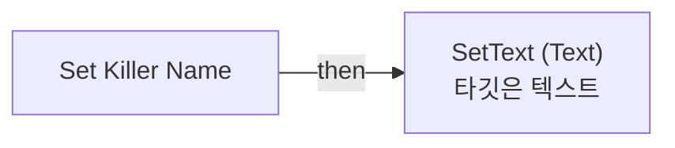

# WBP_DeathScreen

에셋: `/Game/QuakeLike_1_0/UI/DeathUI/WBP_DeathScreen`

부모: `/Script/CoreUObject.Class'/Script/UMG.UserWidget'`

수집일: 2026-10-12. MCP에서 읽은 그래프·핀 연결의 자동 전사입니다. 상속된 그래프는 부모 문서를 함께 확인합니다.

정적 루트 참조 도달: 있음. 실행 여부 또는 삭제 가능 여부의 확정이 아닙니다.

컴포넌트 목록은 이 BP가 직접 정의한 SCS만 포함합니다. 부모·네이티브 생성 컴포넌트, 인스턴스 설정은 별도입니다.

## 변수와 기본값

| 이름 | 타입 | CDO 기본값 |
|---|---|---|
| `TargetLife` | `BPC_Life_C` | None |
| `MaxRespawnTime` | `real` | 0.0 |
| `PlayerState` | `PlayerState` | None |
| `CurrentRespawnTime` | `real` | 0.0 |
| `RespawnTimerHandle` | `TimerHandle` | &lt;Struct 'TimerHandle' {}&gt; |
| `LavaIcon` | `Texture2D` | None |
| `SuicideIcon` | `Texture2D` | None |

## 그래프 목록

| 그래프 | 전체 노드 수 |
|---|---|
| EventGraph | 57 |
| Set Killer Name | 4 |

## 그래프별 실행 연결

실선은 출력 exec 핀의 실제 연결입니다. 여러 분기는 출력 핀 이름을 표시합니다. 함수 호출·delegate·타이머의 다음 그래프 실행은 이 그림에서 자동으로 이어 붙이지 않습니다.

순수 계산 노드 및 데이터 핀은 아래 목록과 원본 JSON을 확인합니다. 연결되지 않은 이벤트도 표시되므로, 노드가 있다는 이유만으로 실행된다고 판단하면 안 됩니다.

### EventGraph

```mermaid
flowchart LR
  n0["InitDeathUI<br/>Custom Event"]
  n1["Is Valid"]
  n2["Branch"]
  n3["Set Brush from Texture<br/>타깃은 이미지"]
  n4["SetText (Text)<br/>타깃은 텍스트"]
  n5["경유 노드"]
  n6["경유 노드"]
  n7["Set MaxRespawnTime"]
  n8["Set CurrentRespawnTime"]
  n9["Set Timer by Event"]
  n10["Set RespawnTimerHandle"]
  n11["UpdateRespawnTimer<br/>Custom Event"]
  n12["Set CurrentRespawnTime"]
  n13["Set Scalar Parameter Value<br/>타깃은 머티리얼 인스턴스 다이내믹"]
  n14["SetText (Text)<br/>타깃은 텍스트"]
  n15["Branch"]
  n16["Clear and Invalidate Timer by Handle"]
  n17["Set Visibility<br/>타깃은 위젯"]
  n18["경유 노드"]
  n19["시퀀스"]
  n20["Cast To BP_QuakePlayerController"]
  n21["Is Valid"]
  n22["Show Competitive Death Message<br/>타깃은 WBP Player HUD Sdm"]
  n23["Get Dynamic Material<br/>타깃은 이미지"]
  n24["Get Dynamic Material<br/>타깃은 이미지"]
  n25["Set Scalar Parameter Value<br/>타깃은 머티리얼 인스턴스 다이내믹"]
  n26["Construct 이벤트"]
  n27["Play Animation<br/>타깃은 사용자 위젯"]
  n0 -->|"then"| n19
  n1 -->|"Is Valid"| n2
  n2 -->|"else"| n5
  n3 -->|"then"| n18
  n4 -->|"then"| n18
  n5 -->|"OutputPin"| n6
  n6 -->|"OutputPin"| n4
  n7 -->|"then"| n8
  n8 -->|"then"| n24
  n9 -->|"then"| n10
  n11 -->|"then"| n12
  n12 -->|"then"| n23
  n13 -->|"then"| n14
  n14 -->|"then"| n15
  n15 -->|"then"| n16
  n16 -->|"then"| n17
  n18 -->|"OutputPin"| n7
  n19 -->|"then_0"| n1
  n19 -->|"then_1"| n20
  n20 -->|"then"| n21
  n21 -->|"Is Valid"| n22
  n22 -->|"then"| n3
  n23 -->|"then"| n13
  n24 -->|"then"| n25
  n25 -->|"then"| n9
  n26 -->|"then"| n27
```

실행 핀 플로우차트

전체 노드·기본 입력 목록

| 노드 ID | 제목 | 미연결 기본 입력 / 에셋 입력 |
|---|---|---|
| `K2Node_CustomEvent_0` | InitDeathUI Custom Event |  |
| `K2Node_BreakStruct_0` | Break S Damage Info |  |
| `K2Node_MacroInstance_0` | Is Valid |  |
| `K2Node_IfThenElse_0` | Branch |  |
| `K2Node_VariableGet_1` | Get Img_DeathType |  |
| `K2Node_CallFunction_3` | Set Brush from Texture 타깃은 이미지 | bMatchSize=false |
| `K2Node_VariableGet_6` | Get SuicideIcon |  |
| `K2Node_VariableGet_0` | Get Text_KillerName |  |
| `K2Node_CallFunction_0` | SetText (Text) 타깃은 텍스트 |  |
| `K2Node_Knot_3` | 경유 노드 |  |
| `K2Node_Knot_4` | 경유 노드 |  |
| `K2Node_CallFunction_8` | Get Class |  |
| `K2Node_PromotableOperator_2` | Equal (Class) | B=/Game/QuakeLike_1_0/MapDesign/MapGimmick/BPA_YJS_DamagePlate.BPA_YJS_DamagePlate_C |
| `K2Node_VariableSet_1` | Set MaxRespawnTime | Output_Get=0.0 |
| `K2Node_VariableSet_2` | Set CurrentRespawnTime | Output_Get=0.0 |
| `K2Node_Knot_5` | 경유 노드 |  |
| `K2Node_Knot_6` | 경유 노드 |  |
| `K2Node_CallFunction_10` | Set Timer by Event | Time=0.030000; bLooping=true; bMaxOncePerFrame=false; InitialStartDelay=0.000000; InitialStartDelayVariance=0.000000 |
| `K2Node_VariableSet_3` | Set RespawnTimerHandle |  |
| `K2Node_CustomEvent_1` | UpdateRespawnTimer Custom Event |  |
| `K2Node_VariableSet_4` | Set CurrentRespawnTime | Output_Get=0.0 |
| `K2Node_VariableGet_8` | Get CurrentRespawnTime |  |
| `K2Node_PromotableOperator_3` | float - float | B=0.030000 |
| `K2Node_VariableGet_9` | Get Img_RespawnRing |  |
| `K2Node_VariableGet_10` | Get CurrentRespawnTime |  |
| `K2Node_PromotableOperator_4` | Safe Divide |  |
| `K2Node_VariableGet_11` | Get MaxRespawnTime |  |
| `K2Node_CallFunction_11` | Set Scalar Parameter Value 타깃은 머티리얼 인스턴스 다이내믹 | ParameterName=Progress |
| `K2Node_CallFunction_13` | Ceil |  |
| `K2Node_VariableGet_12` | Get Text_RespawnCount |  |
| `K2Node_CallFunction_14` | SetText (Text) 타깃은 텍스트 |  |
| `K2Node_CallFunction_19` | To Text (Integer) | bAlwaysSign=false; bUseGrouping=true; MinimumIntegralDigits=1; MaximumIntegralDigits=324 |
| `K2Node_VariableGet_13` | Get CurrentRespawnTime |  |
| `K2Node_PromotableOperator_5` | float &lt;= float |  |
| `K2Node_IfThenElse_3` | Branch |  |
| `K2Node_CallFunction_15` | Clear and Invalidate Timer by Handle |  |
| `K2Node_VariableGet_14` | Get RespawnTimerHandle |  |
| `K2Node_CallFunction_16` | Set Visibility 타깃은 위젯 | InVisibility=Collapsed |
| `EdGraphNode_Comment_0` | Timer |  |
| `K2Node_Knot_0` | 경유 노드 |  |
| `K2Node_Knot_9` | 경유 노드 |  |
| `K2Node_Knot_11` | 경유 노드 |  |
| `K2Node_ExecutionSequence_0` | 시퀀스 |  |
| `K2Node_CallFunction_1` | Get Owning Player 타깃은 위젯 |  |
| `K2Node_DynamicCast_0` | Cast To BP_QuakePlayerController |  |
| `K2Node_VariableGet_2` | Get LifeAndWeapon |  |
| `K2Node_MacroInstance_1` | Is Valid |  |
| `K2Node_CallFunction_2` | Show Competitive Death Message 타깃은 WBP Player HUD Sdm |  |
| `K2Node_CallFunction_23` | To Text (String) |  |
| `K2Node_Knot_1` | 경유 노드 |  |
| `K2Node_Knot_2` | 경유 노드 |  |
| `K2Node_CallFunction_RadialGet` | Get Dynamic Material 타깃은 이미지 |  |
| `K2Node_CallFunction_RadialInitGet` | Get Dynamic Material 타깃은 이미지 |  |
| `K2Node_CallFunction_RadialInitSet` | Set Scalar Parameter Value 타깃은 머티리얼 인스턴스 다이내믹 | ParameterName=Progress; Value=1.0 |
| `K2Node_Event_0` | Construct 이벤트 |  |
| `K2Node_CallFunction_4` | Play Animation 타깃은 사용자 위젯 | StartAtTime=0.000000; NumLoopsToPlay=1; PlayMode=Forward; PlaybackSpeed=1.000000; bRestoreState=false |
| `K2Node_VariableGet_3` | Get RespawnMessageIn |  |

### Set Killer Name

실행 핀 플로우차트

전체 노드·기본 입력 목록

| 노드 ID | 제목 | 미연결 기본 입력 / 에셋 입력 |
|---|---|---|
| `K2Node_FunctionEntry_0` | Set Killer Name |  |
| `K2Node_CallFunction_4` | SetText (Text) 타깃은 텍스트 |  |
| `K2Node_VariableGet_3` | Get Text_KillerName |  |
| `K2Node_CallFunction_18` | To Text (String) |  |

## 조회 범위의 한계

ObjectIterator로 발견했으나 MCP helper가 반환하지 않은 그래프입니다. delegate signature·컴파일된 중간 그래프·macro·애니메이션 내부 그래프가 섞일 수 있습니다.

- `Construct`: Graph 'Construct' not found in Blueprint.
- `InitDeathUI`: Graph 'InitDeathUI' not found in Blueprint.
- `UpdateRespawnTimer`: Graph 'UpdateRespawnTimer' not found in Blueprint.

[원본 MCP 스냅샷](../../../../Evidence/blueprints-105.json)
