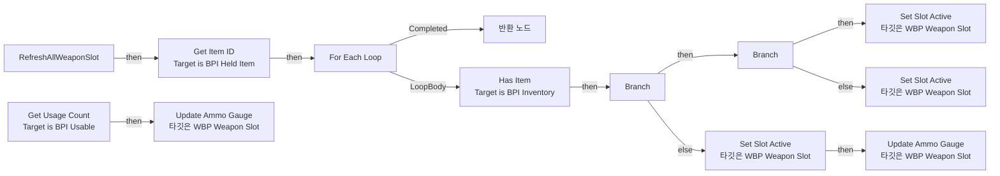
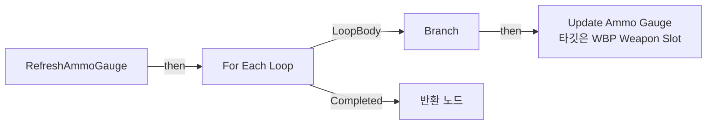
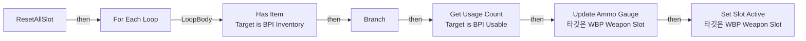

# WBP_PlayerHUD

에셋: `/Game/QuakeLike_1_0/UI/PlayerUI/WBP_PlayerHUD`

부모: `/Script/CoreUObject.Class'/Script/UMG.UserWidget'`

수집일: 2026-10-12. MCP에서 읽은 그래프·핀 연결의 자동 전사입니다. 상속된 그래프는 부모 문서를 함께 확인합니다.

정적 루트 참조 도달: 없음. 실행 여부 또는 삭제 가능 여부의 확정이 아닙니다.

컴포넌트 목록은 이 BP가 직접 정의한 SCS만 포함합니다. 부모·네이티브 생성 컴포넌트, 인스턴스 설정은 별도입니다.

## 변수와 기본값

| 이름 | 타입 | CDO 기본값 |
|---|---|---|
| `WeaponName` | `name` | None |
| `CurrentWeapon` | `BP_HeldItem_C` | None |
| `WeaponSlotArray` | `WBP_WeaponSlot_C` | [] |
| `PlayerInventory` | `BPC_Inventory_C` | None |

## 그래프 목록

| 그래프 | 전체 노드 수 |
|---|---|
| EventGraph | 98 |
| RefreshAllWeaponSlot | 25 |
| RefreshAmmoGauge | 14 |
| ResetAllSlot | 10 |

## 그래프별 실행 연결

실선은 출력 exec 핀의 실제 연결입니다. 여러 분기는 출력 핀 이름을 표시합니다. 함수 호출·delegate·타이머의 다음 그래프 실행은 이 그림에서 자동으로 이어 붙이지 않습니다.

순수 계산 노드 및 데이터 핀은 아래 목록과 원본 JSON을 확인합니다. 연결되지 않은 이벤트도 표시되므로, 노드가 있다는 이유만으로 실행된다고 판단하면 안 됩니다.

### EventGraph

```mermaid
flowchart LR
  n0["RefreshLifeTextHUD<br/>Custom Event"]
  n1["Get Life<br/>타깃은 BPI Life"]
  n2["Is Valid"]
  n3["Bind Event to On Life Changed"]
  n4["Set Text"]
  n5["Get Life<br/>타깃은 BPI Life"]
  n6["Set Text"]
  n7["Refresh Life Text HUD<br/>타깃은 WBP Player HUD"]
  n8["Is Valid"]
  n9["Bind Event to On Pickup Item"]
  n10["OnPickUp<br/>Custom Event"]
  n11["Get Item ID<br/>Target is BPI Held Item"]
  n12["Set WeaponName"]
  n13["Bind Event to On Swap Item"]
  n14["Get Item ID<br/>Target is BPI Held Item"]
  n15["Set WeaponName"]
  n16["OnSwap<br/>Custom Event"]
  n17["시퀀스"]
  n18["Initialize UI<br/>Custom Event"]
  n19["Set CurrentWeapon"]
  n20["Is Valid"]
  n21["Set CurrentWeapon"]
  n22["Refresh Bullet HUD<br/>타깃은 WBP Player HUD"]
  n23["Get Usage Count<br/>Target is BPI Usable"]
  n24["Construct 이벤트"]
  n25["Set WeaponSlotArray"]
  n26["Refresh All Weapon Slot<br/>타깃은 WBP Player HUD"]
  n27["Refresh Ammo Gauge<br/>타깃은 WBP Player HUD"]
  n28["SetText (Text)<br/>타깃은 텍스트"]
  n29["경유 노드"]
  n30["경유 노드"]
  n31["Set PlayerInventory"]
  n32["Is Valid"]
  n33["Reset All Slot<br/>타깃은 WBP Player HUD"]
  n34["Bind Event to On Death"]
  n35["OnDeath<br/>Custom Event"]
  n36["Reset All Slot<br/>타깃은 WBP Player HUD"]
  n37["Bind Event to On Usable Consum"]
  n38["RefreshBulletHUD<br/>Custom Event"]
  n39["Bind Event to On Usable Recover"]
  n40["Bind Event to On Usable Consum"]
  n41["Bind Event to On Usable Recover"]
  n42["Bind Event to On Usable Recover"]
  n43["Bind Event to On Usable Consum"]
  n0 -->|"then"| n1
  n1 -->|"then"| n4
  n2 -->|"Is Valid"| n17
  n3 -->|"then"| n7
  n4 -->|"then"| n5
  n5 -->|"then"| n6
  n7 -->|"then"| n34
  n8 -->|"Is Valid"| n33
  n9 -->|"then"| n13
  n10 -->|"then"| n11
  n11 -->|"then"| n12
  n12 -->|"then"| n37
  n14 -->|"then"| n15
  n15 -->|"then"| n43
  n16 -->|"then"| n32
  n17 -->|"then_0"| n31
  n17 -->|"then_1"| n3
  n18 -->|"then"| n2
  n20 -->|"Is Valid"| n40
  n20 -->|"Is Not Valid"| n29
  n21 -->|"then"| n26
  n23 -->|"then"| n22
  n24 -->|"then"| n25
  n26 -->|"then"| n23
  n28 -->|"then"| n27
  n29 -->|"OutputPin"| n30
  n30 -->|"OutputPin"| n14
  n31 -->|"then"| n8
  n32 -->|"Is Valid"| n20
  n33 -->|"then"| n9
  n35 -->|"then"| n36
  n37 -->|"then"| n39
  n38 -->|"then"| n28
  n39 -->|"then"| n19
  n40 -->|"then"| n41
  n41 -->|"then"| n14
  n42 -->|"then"| n21
  n43 -->|"then"| n42
```

실행 핀 플로우차트

전체 노드·기본 입력 목록

| 노드 ID | 제목 | 미연결 기본 입력 / 에셋 입력 |
|---|---|---|
| `K2Node_CustomEvent_0` | RefreshLifeTextHUD Custom Event |  |
| `K2Node_CallFunction_8` | Get Life 타깃은 BPI Life | type=NewEnumerator0 |
| `K2Node_FormatText_1` | 포맷 텍스트 |  |
| `K2Node_MacroInstance_2` | Is Valid |  |
| `K2Node_CallFunction_7` | Get Component by Class 타깃은 액터 | ComponentClass=/Game/QuakeLike_1_0/Life/BPC_Life.BPC_Life_C |
| `K2Node_AddDelegate_1` | Bind Event to On Life Changed |  |
| `K2Node_VariableSet_4` | Set Text |  |
| `K2Node_VariableGet_1` | Get PlateText |  |
| `K2Node_VariableGet_3` | Get HealthText |  |
| `K2Node_CallFunction_2` | Get Life 타깃은 BPI Life | type=NewEnumerator1 |
| `K2Node_FormatText_0` | 포맷 텍스트 |  |
| `K2Node_VariableSet_0` | Set Text |  |
| `K2Node_CallFunction_9` | Refresh Life Text HUD 타깃은 WBP Player HUD |  |
| `K2Node_CreateDelegate_0` | 이벤트 생성 |  |
| `K2Node_CallFunction_16` | Get Component by Class 타깃은 액터 | ComponentClass=/Game/QuakeLike_1_0/Inventory/BPC_Inventory.BPC_Inventory_C |
| `K2Node_MacroInstance_3` | Is Valid |  |
| `K2Node_VariableGet_9` | Get BulletText |  |
| `K2Node_FormatText_5` | 포맷 텍스트 |  |
| `K2Node_AddDelegate_3` | Bind Event to On Pickup Item |  |
| `K2Node_CustomEvent_3` | OnPickUp Custom Event |  |
| `K2Node_CreateDelegate_1` | 이벤트 생성 |  |
| `K2Node_Message_4` | Get Item ID Target is BPI Held Item |  |
| `K2Node_CallFunction_19` | Get Tag Name |  |
| `K2Node_VariableSet_6` | Set WeaponName | Output_Get=None |
| `K2Node_Knot_8` | 경유 노드 |  |
| `K2Node_AddDelegate_6` | Bind Event to On Swap Item |  |
| `K2Node_CreateDelegate_2` | 이벤트 생성 |  |
| `K2Node_Message_3` | Get Item ID Target is BPI Held Item |  |
| `K2Node_CallFunction_18` | Get Tag Name |  |
| `K2Node_VariableSet_5` | Set WeaponName | Output_Get=None |
| `K2Node_CustomEvent_7` | OnSwap Custom Event |  |
| `K2Node_Knot_9` | 경유 노드 |  |
| `K2Node_Knot_10` | 경유 노드 |  |
| `K2Node_ExecutionSequence_0` | 시퀀스 |  |
| `K2Node_Knot_12` | 경유 노드 |  |
| `K2Node_Knot_13` | 경유 노드 |  |
| `K2Node_CustomEvent_9` | Initialize UI Custom Event |  |
| `K2Node_Knot_15` | 경유 노드 |  |
| `K2Node_VariableSet_2` | Set CurrentWeapon |  |
| `K2Node_Knot_0` | 경유 노드 |  |
| `K2Node_VariableGet_0` | Get CurrentWeapon |  |
| `K2Node_MacroInstance_0` | Is Valid |  |
| `K2Node_CreateDelegate_3` | 이벤트 생성 |  |
| `K2Node_Knot_1` | 경유 노드 |  |
| `K2Node_VariableSet_3` | Set CurrentWeapon |  |
| `K2Node_Knot_3` | 경유 노드 |  |
| `K2Node_CallFunction_3` | Refresh Bullet HUD 타깃은 WBP Player HUD |  |
| `K2Node_Message_1` | Get Usage Count Target is BPI Usable |  |
| `K2Node_Event_0` | Construct 이벤트 |  |
| `K2Node_VariableGet_2` | Get SlotPistol |  |
| `K2Node_VariableGet_4` | Get SlotRailGun |  |
| `K2Node_VariableGet_5` | Get SlotPlasmaGun |  |
| `K2Node_MakeArray_0` | 배열 만들기 |  |
| `K2Node_VariableSet_1` | Set WeaponSlotArray |  |
| `K2Node_Knot_17` | 경유 노드 |  |
| `K2Node_Knot_18` | 경유 노드 |  |
| `K2Node_CallFunction_5` | Refresh All Weapon Slot 타깃은 WBP Player HUD |  |
| `K2Node_CallFunction_6` | Refresh Ammo Gauge 타깃은 WBP Player HUD |  |
| `K2Node_Knot_19` | 경유 노드 |  |
| `K2Node_Knot_20` | 경유 노드 |  |
| `K2Node_CallFunction_1` | SetText (Text) 타깃은 텍스트 |  |
| `K2Node_Knot_2` | 경유 노드 |  |
| `K2Node_Knot_4` | 경유 노드 |  |
| `K2Node_VariableSet_9` | Set PlayerInventory |  |
| `K2Node_Knot_16` | 경유 노드 |  |
| `K2Node_MacroInstance_1` | Is Valid |  |
| `K2Node_VariableGet_6` | Get SlotMachineGun |  |
| `K2Node_CallFunction_11` | Round |  |
| `K2Node_CallFunction_12` | Round |  |
| `K2Node_CallFunction_10` | Round |  |
| `K2Node_CallFunction_0` | Round |  |
| `K2Node_VariableGet_7` | Get SlotShotGun |  |
| `K2Node_VariableGet_11` | Get SlotRocket |  |
| `K2Node_CallFunction_14` | Reset All Slot 타깃은 WBP Player HUD |  |
| `K2Node_AddDelegate_2` | Bind Event to On Death |  |
| `K2Node_CreateDelegate_5` | 이벤트 생성 |  |
| `K2Node_CustomEvent_1` | OnDeath Custom Event |  |
| `K2Node_CallFunction_17` | Reset All Slot 타깃은 WBP Player HUD |  |
| `EdGraphNode_Comment_0` | 죽었을 때 슬롯 초기화 |  |
| `K2Node_AddDelegate_5` | Bind Event to On Usable Consum |  |
| `K2Node_CustomEvent_2` | RefreshBulletHUD Custom Event |  |
| `K2Node_AddDelegate_9` | Bind Event to On Usable Recover |  |
| `K2Node_Knot_5` | 경유 노드 |  |
| `K2Node_Knot_6` | 경유 노드 |  |
| `K2Node_Knot_7` | 경유 노드 |  |
| `K2Node_Knot_11` | 경유 노드 |  |
| `K2Node_AddDelegate_11` | Bind Event to On Usable Consum |  |
| `K2Node_AddDelegate_12` | Bind Event to On Usable Recover |  |
| `K2Node_Knot_14` | 경유 노드 |  |
| `K2Node_AddDelegate_13` | Bind Event to On Usable Recover |  |
| `K2Node_AddDelegate_14` | Bind Event to On Usable Consum |  |
| `K2Node_CreateDelegate_7` | 이벤트 생성 |  |
| `K2Node_Knot_21` | 경유 노드 |  |
| `K2Node_Knot_22` | 경유 노드 |  |
| `K2Node_Knot_23` | 경유 노드 |  |
| `K2Node_Knot_25` | 경유 노드 |  |
| `K2Node_Knot_26` | 경유 노드 |  |
| `K2Node_Knot_27` | 경유 노드 |  |

### RefreshAllWeaponSlot

실행 핀 플로우차트

전체 노드·기본 입력 목록

| 노드 ID | 제목 | 미연결 기본 입력 / 에셋 입력 |
|---|---|---|
| `K2Node_FunctionEntry_0` | RefreshAllWeaponSlot |  |
| `K2Node_FunctionResult_0` | 반환 노드 |  |
| `K2Node_VariableGet_11` | Get WeaponSlotArray |  |
| `K2Node_MacroInstance_5` | For Each Loop |  |
| `K2Node_Message_2` | Get Item ID Target is BPI Held Item |  |
| `K2Node_VariableGet_12` | Get SlotWeaponID |  |
| `K2Node_PromotableOperator_1` | Equal (GameplayTag) |  |
| `K2Node_Knot_7` | 경유 노드 |  |
| `K2Node_Message_1` | Has Item Target is BPI Inventory |  |
| `K2Node_IfThenElse_0` | Branch |  |
| `K2Node_VariableGet_1` | Get PlayerInventory |  |
| `K2Node_Knot_3` | 경유 노드 |  |
| `K2Node_CreateDelegate_0` | 이벤트 생성 |  |
| `K2Node_CallFunction_5` | Update Ammo Gauge 타깃은 WBP Weapon Slot |  |
| `K2Node_Message_3` | Get Usage Count Target is BPI Usable |  |
| `K2Node_Knot_4` | 경유 노드 |  |
| `K2Node_CallFunction_7` | Set Slot Active 타깃은 WBP Weapon Slot | IsActive=false; IsOwned=false |
| `K2Node_Knot_6` | 경유 노드 |  |
| `K2Node_Knot_8` | 경유 노드 |  |
| `K2Node_CallFunction_0` | Update Ammo Gauge 타깃은 WBP Weapon Slot | CurrentAmmo=0; MaxAmmo=0 |
| `K2Node_Knot_0` | 경유 노드 |  |
| `K2Node_IfThenElse_1` | Branch |  |
| `K2Node_CallFunction_3` | Set Slot Active 타깃은 WBP Weapon Slot | IsOwned=true |
| `K2Node_CallFunction_4` | Set Slot Active 타깃은 WBP Weapon Slot | IsActive=false; IsOwned=true |
| `K2Node_Knot_1` | 경유 노드 |  |

### RefreshAmmoGauge

실행 핀 플로우차트

전체 노드·기본 입력 목록

| 노드 ID | 제목 | 미연결 기본 입력 / 에셋 입력 |
|---|---|---|
| `K2Node_FunctionEntry_0` | RefreshAmmoGauge |  |
| `K2Node_VariableGet_6` | Get WeaponSlotArray |  |
| `K2Node_MacroInstance_1` | For Each Loop |  |
| `K2Node_VariableGet_7` | Get SlotWeaponID |  |
| `K2Node_CallFunction_4` | Update Ammo Gauge 타깃은 WBP Weapon Slot |  |
| `K2Node_IfThenElse_0` | Branch |  |
| `K2Node_Knot_11` | 경유 노드 |  |
| `K2Node_Knot_16` | 경유 노드 |  |
| `K2Node_Knot_0` | 경유 노드 |  |
| `K2Node_Knot_1` | 경유 노드 |  |
| `K2Node_FunctionResult_0` | 반환 노드 |  |
| `K2Node_CallFunction_0` | Has Tag | bExactMatch=true |
| `K2Node_Knot_3` | 경유 노드 |  |
| `K2Node_Knot_4` | 경유 노드 |  |

### ResetAllSlot

실행 핀 플로우차트

전체 노드·기본 입력 목록

| 노드 ID | 제목 | 미연결 기본 입력 / 에셋 입력 |
|---|---|---|
| `K2Node_FunctionEntry_0` | ResetAllSlot |  |
| `K2Node_VariableGet_0` | Get WeaponSlotArray |  |
| `K2Node_MacroInstance_0` | For Each Loop |  |
| `K2Node_CallFunction_0` | Update Ammo Gauge 타깃은 WBP Weapon Slot |  |
| `K2Node_CallFunction_1` | Set Slot Active 타깃은 WBP Weapon Slot | IsActive=false; IsOwned=false |
| `K2Node_VariableGet_2` | Get SlotWeaponID |  |
| `K2Node_Message_2` | Get Usage Count Target is BPI Usable |  |
| `K2Node_IfThenElse_0` | Branch |  |
| `K2Node_Knot_1` | 경유 노드 |  |
| `K2Node_Message_1` | Has Item Target is BPI Inventory |  |

## 조회 범위의 한계

ObjectIterator로 발견했으나 MCP helper가 반환하지 않은 그래프입니다. delegate signature·컴파일된 중간 그래프·macro·애니메이션 내부 그래프가 섞일 수 있습니다.

- `Construct`: Graph 'Construct' not found in Blueprint.
- `EdGraph_0`: Graph 'EdGraph_0' not found in Blueprint.
- `EdGraph_1`: Graph 'EdGraph_1' not found in Blueprint.
- `EdGraph_2`: Graph 'EdGraph_2' not found in Blueprint.
- `EdGraph_3`: Graph 'EdGraph_3' not found in Blueprint.
- `EdGraph_4`: Graph 'EdGraph_4' not found in Blueprint.
- `EdGraph_5`: Graph 'EdGraph_5' not found in Blueprint.
- `EdGraph_6`: Graph 'EdGraph_6' not found in Blueprint.
- `ExecuteUbergraph_WBP_PlayerHUD`: Graph 'ExecuteUbergraph_WBP_PlayerHUD' not found in Blueprint.
- `Initialize UI`: Graph 'Initialize UI' not found in Blueprint.
- `OnDeath`: Graph 'OnDeath' not found in Blueprint.
- `OnPickUp`: Graph 'OnPickUp' not found in Blueprint.
- `OnSwap`: Graph 'OnSwap' not found in Blueprint.
- `RefreshAllWeaponSlot_MERGED`: Graph 'RefreshAllWeaponSlot_MERGED' not found in Blueprint.
- `RefreshAmmoGauge_MERGED`: Graph 'RefreshAmmoGauge_MERGED' not found in Blueprint.
- `RefreshBulletHUD`: Graph 'RefreshBulletHUD' not found in Blueprint.
- `RefreshLifeTextHUD`: Graph 'RefreshLifeTextHUD' not found in Blueprint.
- `ResetAllSlot_MERGED`: Graph 'ResetAllSlot_MERGED' not found in Blueprint.

[원본 MCP 스냅샷](../../../../Evidence/blueprints-245.json)
