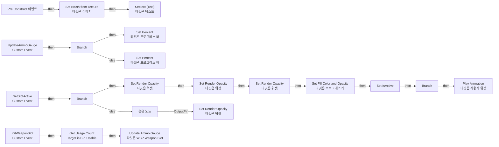

# WBP_WeaponSlot

에셋: `/Game/QuakeLike_1_0/UI/PlayerUI/WBP_WeaponSlot`

부모: `/Script/CoreUObject.Class'/Script/UMG.UserWidget'`

수집일: 2026-10-12. MCP에서 읽은 그래프·핀 연결의 자동 전사입니다. 상속된 그래프는 부모 문서를 함께 확인합니다.

정적 루트 참조 도달: 있음. 실행 여부 또는 삭제 가능 여부의 확정이 아닙니다.

컴포넌트 목록은 이 BP가 직접 정의한 SCS만 포함합니다. 부모·네이티브 생성 컴포넌트, 인스턴스 설정은 별도입니다.

## 변수와 기본값

| 이름 | 타입 | CDO 기본값 |
|---|---|---|
| `SlotWeaponID` | `GameplayTag` | &lt;Struct 'GameplayTag' {}&gt; |
| `IconTexture` | `Texture2D` | None |
| `NumberText` | `text` |  |
| `ActiveColor` | `LinearColor` | &lt;Struct 'LinearColor' {r: 0.000000, g: 0.000000, b: 0.000000, a: 0.000000}&gt; |
| `MyWeapon` | `BP_HeldItem_C` | None |
| `IsActive` | `bool` | False |

## 그래프 목록

| 그래프 | 전체 노드 수 |
|---|---|
| EventGraph | 43 |

## 그래프별 실행 연결

실선은 출력 exec 핀의 실제 연결입니다. 여러 분기는 출력 핀 이름을 표시합니다. 함수 호출·delegate·타이머의 다음 그래프 실행은 이 그림에서 자동으로 이어 붙이지 않습니다.

순수 계산 노드 및 데이터 핀은 아래 목록과 원본 JSON을 확인합니다. 연결되지 않은 이벤트도 표시되므로, 노드가 있다는 이유만으로 실행된다고 판단하면 안 됩니다.

### EventGraph

실행 핀 플로우차트

전체 노드·기본 입력 목록

| 노드 ID | 제목 | 미연결 기본 입력 / 에셋 입력 |
|---|---|---|
| `K2Node_CustomEvent_0` | SetSlotActive Custom Event |  |
| `K2Node_Event_3` | Pre Construct 이벤트 | IsDesignTime=false |
| `K2Node_VariableGet_1` | Get IconTexture |  |
| `K2Node_VariableGet_3` | Get SlotNumber |  |
| `K2Node_VariableGet_4` | Get NumberText |  |
| `K2Node_VariableGet_5` | Get WeaponIcon |  |
| `K2Node_CallFunction_3` | Set Brush from Texture 타깃은 이미지 | bMatchSize=false |
| `K2Node_CallFunction_4` | SetText (Text) 타깃은 텍스트 |  |
| `K2Node_CallFunction_1` | Set Render Opacity 타깃은 위젯 |  |
| `K2Node_VariableGet_12` | Get WeaponIcon |  |
| `K2Node_VariableGet_13` | Get SlotNumber |  |
| `K2Node_Select_2` | 선택 | Option 0=0.400000; Option 1=1.000000 |
| `K2Node_Knot_1` | 경유 노드 |  |
| `K2Node_CallFunction_11` | Set Render Opacity 타깃은 위젯 |  |
| `K2Node_VariableGet_16` | Get BackGroundGlow |  |
| `K2Node_CallFunction_16` | Set Fill Color and Opacity 타깃은 프로그레스 바 |  |
| `K2Node_Select_4` | 선택 |  |
| `K2Node_VariableGet_2` | Get ActiveColor |  |
| `K2Node_CustomEvent_1` | UpdateAmmoGauge Custom Event |  |
| `K2Node_VariableGet_18` | Get BackGroundGlow |  |
| `K2Node_CallFunction_17` | Set Percent 타깃은 프로그레스 바 |  |
| `K2Node_IfThenElse_1` | Branch |  |
| `K2Node_CallFunction_19` | To Float (Integer) |  |
| `K2Node_CallFunction_20` | To Float (Integer) |  |
| `K2Node_PromotableOperator_5` | float / float |  |
| `K2Node_PromotableOperator_6` | integer &gt; integer |  |
| `K2Node_PromotableOperator_0` | LinearColor * LinearColor | B=(R=0.300000,G=0.300000,B=0.300000,A=0.400000) |
| `K2Node_IfThenElse_2` | Branch |  |
| `K2Node_CallFunction_5` | Set Render Opacity 타깃은 위젯 | InOpacity=0.100000 |
| `K2Node_VariableGet_8` | Get SlotContent |  |
| `K2Node_CallFunction_2` | Set Render Opacity 타깃은 위젯 | InOpacity=1.000000 |
| `K2Node_VariableGet_7` | Get SlotContent |  |
| `K2Node_CallFunction_9` | Set Percent 타깃은 프로그레스 바 | InPercent=0.0 |
| `K2Node_CustomEvent_2` | InitWeaponSlot Custom Event |  |
| `K2Node_CallFunction_6` | Update Ammo Gauge 타깃은 WBP Weapon Slot |  |
| `K2Node_Message_0` | Get Usage Count Target is BPI Usable |  |
| `K2Node_Knot_0` | 경유 노드 |  |
| `EdGraphNode_Comment_0` | weaponslot 총알 초기화 |  |
| `K2Node_VariableGet_0` | Get AnimateIn |  |
| `K2Node_CallFunction_0` | Play Animation 타깃은 사용자 위젯 | StartAtTime=0.000000; NumLoopsToPlay=1; PlayMode=Forward; PlaybackSpeed=1.000000; bRestoreState=false |
| `K2Node_IfThenElse_0` | Branch |  |
| `K2Node_Knot_2` | 경유 노드 |  |
| `K2Node_VariableSet_2` | Set IsActive | Output_Get=false |

## 조회 범위의 한계

ObjectIterator로 발견했으나 MCP helper가 반환하지 않은 그래프입니다. delegate signature·컴파일된 중간 그래프·macro·애니메이션 내부 그래프가 섞일 수 있습니다.

- `InitWeaponSlot`: Graph 'InitWeaponSlot' not found in Blueprint.
- `PreConstruct`: Graph 'PreConstruct' not found in Blueprint.
- `SetSlotActive`: Graph 'SetSlotActive' not found in Blueprint.
- `UpdateAmmoGauge`: Graph 'UpdateAmmoGauge' not found in Blueprint.

[원본 MCP 스냅샷](../../../../Evidence/blueprints-105.json)
