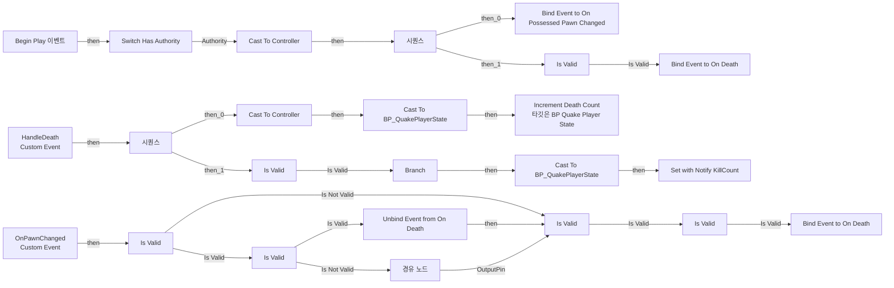

# BPC_DeathCountTracker

에셋: `/Game/QuakeLike_Base/SDM/UI/Combat_UI/BPC_DeathCountTracker`

부모: `/Script/CoreUObject.Class'/Script/Engine.ActorComponent'`

수집일: 2026-10-12. MCP에서 읽은 그래프·핀 연결의 자동 전사입니다. 상속된 그래프는 부모 문서를 함께 확인합니다.

정적 루트 참조 도달: 있음. 실행 여부 또는 삭제 가능 여부의 확정이 아닙니다.

컴포넌트 목록은 이 BP가 직접 정의한 SCS만 포함합니다. 부모·네이티브 생성 컴포넌트, 인스턴스 설정은 별도입니다.

## 그래프 목록

| 그래프 | 전체 노드 수 |
|---|---|
| EventGraph | 39 |

## 그래프별 실행 연결

실선은 출력 exec 핀의 실제 연결입니다. 여러 분기는 출력 핀 이름을 표시합니다. 함수 호출·delegate·타이머의 다음 그래프 실행은 이 그림에서 자동으로 이어 붙이지 않습니다.

순수 계산 노드 및 데이터 핀은 아래 목록과 원본 JSON을 확인합니다. 연결되지 않은 이벤트도 표시되므로, 노드가 있다는 이유만으로 실행된다고 판단하면 안 됩니다.

### EventGraph

실행 핀 플로우차트

전체 노드·기본 입력 목록

| 노드 ID | 제목 | 미연결 기본 입력 / 에셋 입력 |
|---|---|---|
| `K2Node_Event_0` | Begin Play 이벤트 |  |
| `K2Node_CallFunction_0` | Get Owner 타깃은 액터 컴포넌트 |  |
| `K2Node_DynamicCast_0` | Cast To Controller |  |
| `K2Node_AddDelegate_0` | Bind Event to On Possessed Pawn Changed |  |
| `K2Node_CustomEvent_0` | OnPawnChanged Custom Event |  |
| `K2Node_MacroInstance_0` | Is Valid |  |
| `K2Node_CallFunction_3` | Get Component by Class 타깃은 액터 | ComponentClass=/Game/QuakeLike_1_0/Life/BPC_Life.BPC_Life_C |
| `K2Node_RemoveDelegate_0` | Unbind Event from On Death |  |
| `K2Node_MacroInstance_1` | Is Valid |  |
| `K2Node_CallFunction_16` | Get Component by Class 타깃은 액터 | ComponentClass=/Game/QuakeLike_1_0/Life/BPC_Life.BPC_Life_C |
| `K2Node_AddDelegate_2` | Bind Event to On Death |  |
| `K2Node_CustomEvent_1` | HandleDeath Custom Event |  |
| `K2Node_DynamicCast_3` | Cast To Controller |  |
| `K2Node_Knot_0` | 경유 노드 |  |
| `K2Node_VariableGet_0` | Get PlayerState |  |
| `K2Node_DynamicCast_2` | Cast To BP_QuakePlayerState |  |
| `K2Node_CallFunction_7` | Increment Death Count 타깃은 BP Quake Player State |  |
| `K2Node_CallFunction_14` | Get Controlled Pawn 타깃은 컨트롤러 |  |
| `K2Node_MacroInstance_2` | Is Valid |  |
| `K2Node_ExecutionSequence_1` | 시퀀스 |  |
| `K2Node_CallFunction_1` | Get Component by Class 타깃은 액터 | ComponentClass=/Game/QuakeLike_1_0/Life/BPC_Life.BPC_Life_C |
| `K2Node_AddDelegate_1` | Bind Event to On Death |  |
| `K2Node_CreateDelegate_0` | 이벤트 생성 |  |
| `K2Node_MacroInstance_4` | Switch Has Authority |  |
| `K2Node_VariableGet_1` | Get PlayerState |  |
| `K2Node_DynamicCast_1` | Cast To BP_QuakePlayerState |  |
| `K2Node_VariableGet_2` | Get KillCount |  |
| `K2Node_VariableSet_2` | Set with Notify KillCount | Output_Get=0 |
| `K2Node_PromotableOperator_1` | int + int | B=1 |
| `K2Node_ExecutionSequence_0` | 시퀀스 |  |
| `K2Node_MacroInstance_6` | Is Valid |  |
| `K2Node_MacroInstance_3` | Is Valid |  |
| `K2Node_Knot_1` | 경유 노드 |  |
| `K2Node_Knot_2` | 경유 노드 |  |
| `K2Node_MacroInstance_5` | Is Valid |  |
| `K2Node_Knot_3` | 경유 노드 |  |
| `K2Node_CallFunction_2` | Not Equal (Object) |  |
| `K2Node_IfThenElse_0` | Branch |  |
| `K2Node_Knot_4` | 경유 노드 |  |

## 조회 범위의 한계

ObjectIterator로 발견했으나 MCP helper가 반환하지 않은 그래프입니다. delegate signature·컴파일된 중간 그래프·macro·애니메이션 내부 그래프가 섞일 수 있습니다.

- `HandleDeath`: Graph 'HandleDeath' not found in Blueprint.
- `OnPawnChanged`: Graph 'OnPawnChanged' not found in Blueprint.
- `ReceiveBeginPlay`: Graph 'ReceiveBeginPlay' not found in Blueprint.

[원본 MCP 스냅샷](../../../../../Evidence/blueprints-070.json)
