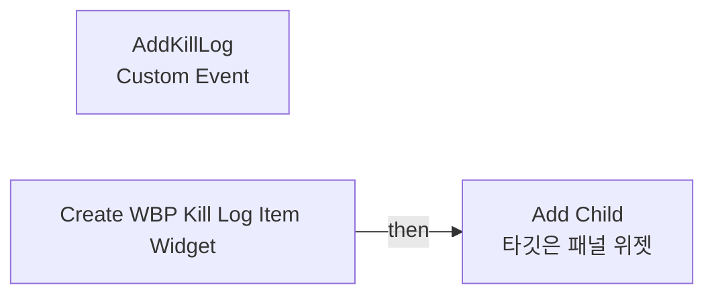
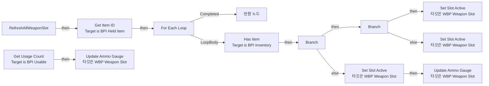
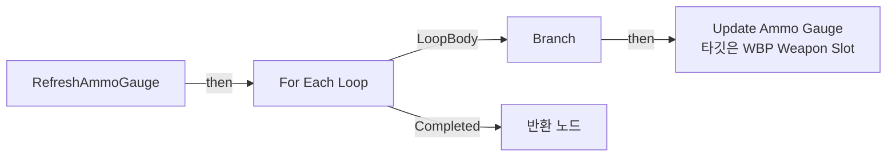
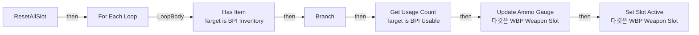

# WBP_KillLog

에셋: `/Game/QuakeLike_Base/SDM/UI/Combat_UI/WBP_KillLog`

부모: `/Script/CoreUObject.Class'/Script/UMG.UserWidget'`

수집일: 2026-10-12. MCP에서 읽은 그래프·핀 연결의 자동 전사입니다. 상속된 그래프는 부모 문서를 함께 확인합니다.

정적 루트 참조 도달: 있음. 실행 여부 또는 삭제 가능 여부의 확정이 아닙니다.

컴포넌트 목록은 이 BP가 직접 정의한 SCS만 포함합니다. 부모·네이티브 생성 컴포넌트, 인스턴스 설정은 별도입니다.

## 변수와 기본값

| 이름 | 타입 | CDO 기본값 |
|---|---|---|
| `WeaponName` | `name` | None |
| `CurrentWeapon` | `BP_HeldItem_C` | None |
| `WeaponSlotArray` | `WBP_WeaponSlot_C` | [] |
| `PlayerInventory` | `BPC_Inventory_C` | None |

## 그래프 목록

| 그래프 | 전체 노드 수 |
|---|---|
| EventGraph | 4 |
| RefreshAllWeaponSlot | 25 |
| RefreshAmmoGauge | 14 |
| ResetAllSlot | 10 |

## 그래프별 실행 연결

실선은 출력 exec 핀의 실제 연결입니다. 여러 분기는 출력 핀 이름을 표시합니다. 함수 호출·delegate·타이머의 다음 그래프 실행은 이 그림에서 자동으로 이어 붙이지 않습니다.

순수 계산 노드 및 데이터 핀은 아래 목록과 원본 JSON을 확인합니다. 연결되지 않은 이벤트도 표시되므로, 노드가 있다는 이유만으로 실행된다고 판단하면 안 됩니다.

### EventGraph

실행 핀 플로우차트

전체 노드·기본 입력 목록

| 노드 ID | 제목 | 미연결 기본 입력 / 에셋 입력 |
|---|---|---|
| `K2Node_CustomEvent_AddKillLog` | AddKillLog Custom Event |  |
| `K2Node_CallFunction_AddChild` | Add Child 타깃은 패널 위젯 |  |
| `K2Node_CreateWidget_0` | Create WBP Kill Log Item Widget | Class=/Game/QuakeLike_Base/SDM/UI/Combat_UI/WBP_KillLogItem.WBP_KillLogItem_C |
| `K2Node_VariableGet_0` | Get KillLogBox |  |

### RefreshAllWeaponSlot

실행 핀 플로우차트

전체 노드·기본 입력 목록

| 노드 ID | 제목 | 미연결 기본 입력 / 에셋 입력 |
|---|---|---|
| `K2Node_FunctionEntry_0` | RefreshAllWeaponSlot |  |
| `K2Node_FunctionResult_0` | 반환 노드 |  |
| `K2Node_VariableGet_11` | Get WeaponSlotArray |  |
| `K2Node_MacroInstance_5` | For Each Loop |  |
| `K2Node_Message_2` | Get Item ID Target is BPI Held Item |  |
| `K2Node_VariableGet_12` | Get SlotWeaponID |  |
| `K2Node_PromotableOperator_1` | Equal (GameplayTag) |  |
| `K2Node_Knot_7` | 경유 노드 |  |
| `K2Node_Message_1` | Has Item Target is BPI Inventory |  |
| `K2Node_IfThenElse_0` | Branch |  |
| `K2Node_VariableGet_1` | Get PlayerInventory |  |
| `K2Node_Knot_3` | 경유 노드 |  |
| `K2Node_CreateDelegate_0` | 이벤트 생성 |  |
| `K2Node_CallFunction_5` | Update Ammo Gauge 타깃은 WBP Weapon Slot |  |
| `K2Node_Message_3` | Get Usage Count Target is BPI Usable |  |
| `K2Node_Knot_4` | 경유 노드 |  |
| `K2Node_CallFunction_7` | Set Slot Active 타깃은 WBP Weapon Slot | IsActive=false; IsOwned=false |
| `K2Node_Knot_6` | 경유 노드 |  |
| `K2Node_Knot_8` | 경유 노드 |  |
| `K2Node_CallFunction_0` | Update Ammo Gauge 타깃은 WBP Weapon Slot | CurrentAmmo=0; MaxAmmo=0 |
| `K2Node_Knot_0` | 경유 노드 |  |
| `K2Node_IfThenElse_1` | Branch |  |
| `K2Node_CallFunction_3` | Set Slot Active 타깃은 WBP Weapon Slot | IsOwned=true |
| `K2Node_CallFunction_4` | Set Slot Active 타깃은 WBP Weapon Slot | IsActive=false; IsOwned=true |
| `K2Node_Knot_1` | 경유 노드 |  |

### RefreshAmmoGauge

실행 핀 플로우차트

전체 노드·기본 입력 목록

| 노드 ID | 제목 | 미연결 기본 입력 / 에셋 입력 |
|---|---|---|
| `K2Node_FunctionEntry_0` | RefreshAmmoGauge |  |
| `K2Node_VariableGet_6` | Get WeaponSlotArray |  |
| `K2Node_MacroInstance_1` | For Each Loop |  |
| `K2Node_VariableGet_7` | Get SlotWeaponID |  |
| `K2Node_CallFunction_4` | Update Ammo Gauge 타깃은 WBP Weapon Slot |  |
| `K2Node_IfThenElse_0` | Branch |  |
| `K2Node_Knot_11` | 경유 노드 |  |
| `K2Node_Knot_16` | 경유 노드 |  |
| `K2Node_Knot_0` | 경유 노드 |  |
| `K2Node_Knot_1` | 경유 노드 |  |
| `K2Node_FunctionResult_0` | 반환 노드 |  |
| `K2Node_CallFunction_0` | Has Tag | bExactMatch=true |
| `K2Node_Knot_3` | 경유 노드 |  |
| `K2Node_Knot_4` | 경유 노드 |  |

### ResetAllSlot

실행 핀 플로우차트

전체 노드·기본 입력 목록

| 노드 ID | 제목 | 미연결 기본 입력 / 에셋 입력 |
|---|---|---|
| `K2Node_FunctionEntry_0` | ResetAllSlot |  |
| `K2Node_VariableGet_0` | Get WeaponSlotArray |  |
| `K2Node_MacroInstance_0` | For Each Loop |  |
| `K2Node_CallFunction_0` | Update Ammo Gauge 타깃은 WBP Weapon Slot |  |
| `K2Node_CallFunction_1` | Set Slot Active 타깃은 WBP Weapon Slot | IsActive=false; IsOwned=false |
| `K2Node_VariableGet_2` | Get SlotWeaponID |  |
| `K2Node_Message_2` | Get Usage Count Target is BPI Usable |  |
| `K2Node_IfThenElse_0` | Branch |  |
| `K2Node_Knot_1` | 경유 노드 |  |
| `K2Node_Message_1` | Has Item Target is BPI Inventory |  |

## 조회 범위의 한계

ObjectIterator로 발견했으나 MCP helper가 반환하지 않은 그래프입니다. delegate signature·컴파일된 중간 그래프·macro·애니메이션 내부 그래프가 섞일 수 있습니다.

- `AddKillLog`: Graph 'AddKillLog' not found in Blueprint.

[원본 MCP 스냅샷](../../../../../Evidence/blueprints-105.json)
