# WBP_PlayerHUD_sdm

에셋: `/Game/QuakeLike_Base/SDM/UI/Combat_UI/WBP_PlayerHUD_sdm`

부모: `/Script/CoreUObject.Class'/Script/UMG.UserWidget'`

수집일: 2026-10-12. MCP에서 읽은 그래프·핀 연결의 자동 전사입니다. 상속된 그래프는 부모 문서를 함께 확인합니다.

정적 루트 참조 도달: 있음. 실행 여부 또는 삭제 가능 여부의 확정이 아닙니다.

컴포넌트 목록은 이 BP가 직접 정의한 SCS만 포함합니다. 부모·네이티브 생성 컴포넌트, 인스턴스 설정은 별도입니다.

## 변수와 기본값

| 이름 | 타입 | CDO 기본값 |
|---|---|---|
| `WeaponName` | `name` | None |
| `CurrentWeapon` | `BP_HeldItem_C` | None |
| `WeaponSlotArray` | `WBP_WeaponSlot_C` | [] |
| `PlayerInventory` | `BPC_Inventory_C` | None |
| `OwendPlayer` | `Pawn` | None |
| `LastHealth` | `real` | 0.0 |
| `LastMaxHealth` | `real` | 0.0 |
| `LastPlate` | `real` | 0.0 |
| `LastMaxPlate` | `real` | 0.0 |
| `LifeHUDInitialized` | `bool` | False |
| `CrosshairSettingData` | `PDA_CrosshairSetting_C` | /Game/QuakeLike_Base/SDM/UI/DA_CrosshairDefault.DA_CrosshairDefault |
| `WeaponOrderArray` | `GameplayTag` | [{}, {}, {}, {}, {}, {}] |

## 그래프 목록

| 그래프 | 전체 노드 수 |
|---|---|
| AddCompetitiveKillLog | 7 |
| EnterCompetitiveZoom | 9 |
| EventGraph | 81 |
| ExitCompetitiveZoom | 7 |
| HideCompetitiveCombatHUD | 7 |
| HideCompetitiveCrosshairUI | 6 |
| InitCompetitiveMatchTimer | 15 |
| InitializeCompetitiveLifeHUD | 13 |
| PlayCompetitiveCrosshairRecoil | 3 |
| PlayCompetitiveHitMarker | 3 |
| RF_HandleAmmoConsumed | 11 |
| RF_HandleAmmoRecovered | 13 |
| RF_HandleDeath | 3 |
| RF_HandleLifeChanged | 66 |
| RF_HandlePickup | 7 |
| RF_HandleSwap | 7 |
| RF_InitializeInventory | 16 |
| RF_InitializeLife | 27 |
| RF_RefreshDisplayedCombat | 21 |
| RF_RefreshDisplayedLife | 12 |
| RF_SetDisplayedPawn | 7 |
| RF_SetSelectedWeapon | 23 |
| RF_UnbindDisplayedSources | 28 |
| RefreshAllWeaponSlot | 36 |
| RefreshAmmoGauge | 14 |
| RefreshCompetitiveCombatHUD | 18 |
| RefreshCompetitveWeaponSlots | 43 |
| ResetAllSlot | 10 |
| RestoreCompetitiveLifeHUD | 12 |
| SaveCompetitiveLifeState | 4 |
| ShowCompetitiveDeathMessage | 3 |
| ShowCompetitiveKillMessage | 3 |
| TryPlayHitIndicator | 14 |
| UpdateCompetitiveAmmoHUD | 5 |
| UpdateCompetitiveCrosshair | 3 |
| UpdateCompetitiveWeaponHUD | 17 |
| UpdateCrosshairByWeaponData | 4 |

## 그래프별 실행 연결

실선은 출력 exec 핀의 실제 연결입니다. 여러 분기는 출력 핀 이름을 표시합니다. 함수 호출·delegate·타이머의 다음 그래프 실행은 이 그림에서 자동으로 이어 붙이지 않습니다.

순수 계산 노드 및 데이터 핀은 아래 목록과 원본 JSON을 확인합니다. 연결되지 않은 이벤트도 표시되므로, 노드가 있다는 이유만으로 실행된다고 판단하면 안 됩니다.

### AddCompetitiveKillLog

<details>
<summary>실행 핀 플로우차트</summary>

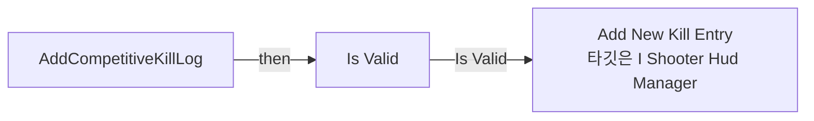

</details>

<details>
<summary>전체 노드·기본 입력 목록</summary>

| 노드 ID | 제목 | 미연결 기본 입력 / 에셋 입력 |
|---|---|---|
| `K2Node_FunctionEntry_0` | AddCompetitiveKillLog |  |
| `K2Node_CallFunction_0` | Get Shooter Hud Manager |  |
| `K2Node_CallFunction_1` | Add New Kill Entry<br/>타깃은 I Shooter Hud Manager |  |
| `K2Node_MakeStruct_0` | Make S Kill Count Entry | InstigatorNameColor_21_8017677D4B7F36918A353A96B5C48C73=(R=1.000000,G=1.000000,B=1.000000,A=1.000000); DamagedNameColor_20_6FE9C85B4EBD78FF34F860B03BCF00B4=(R=1.000000,G=1.000000,B=1.000000,A=1.000000) |
| `K2Node_VariableGet_0` | Get Icon |  |
| `K2Node_VariableGet_1` | Get WeaponHUDColor |  |
| `K2Node_MacroInstance_0` | Is Valid |  |

</details>

### EnterCompetitiveZoom

<details>
<summary>실행 핀 플로우차트</summary>

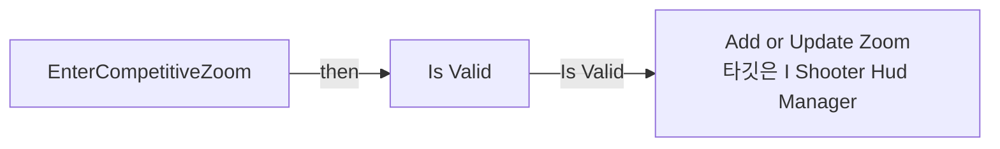

</details>

<details>
<summary>전체 노드·기본 입력 목록</summary>

| 노드 ID | 제목 | 미연결 기본 입력 / 에셋 입력 |
|---|---|---|
| `K2Node_FunctionEntry_0` | EnterCompetitiveZoom |  |
| `K2Node_CallFunction_0` | Get Owning Player Pawn<br/>타깃은 사용자 위젯 |  |
| `K2Node_CallFunction_2` | Get Component by Class<br/>타깃은 액터 | ComponentClass=/Script/Engine.CameraComponent |
| `K2Node_MacroInstance_0` | Is Valid |  |
| `K2Node_CallFunction_3` | Get Shooter Hud Manager |  |
| `K2Node_CallFunction_4` | Add or Update Zoom<br/>타깃은 I Shooter Hud Manager |  |
| `K2Node_Knot_0` | 경유 노드 |  |
| `K2Node_VariableGet_0` | Get zoomFov |  |
| `K2Node_MakeStruct_0` | Make S Scope Info | ScopeType_10_B7B9B2E04D4FD2F7215A85954A39C01D=NewEnumerator0; ScopeBackgroundColor_8_D8792A8048FD4ADFB2E88189D5748752=(R=0.100000,G=0.100000,B=0.100000,A=0.700000); ScopeLensColor_9_34295F2C47BC3C4C45ECC5B145FF9903=(R=0.000000,G=0.300000,B=1.000000,A=0.100000) |

</details>

### EventGraph

<details>
<summary>실행 핀 플로우차트</summary>

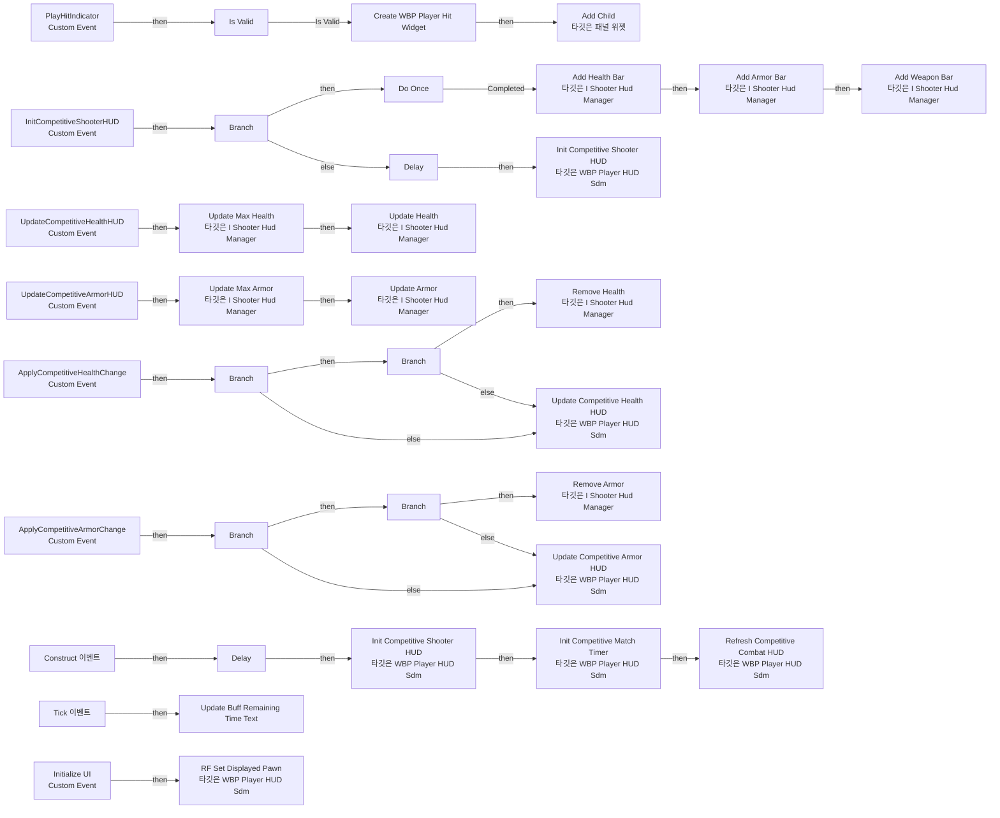

</details>

<details>
<summary>전체 노드·기본 입력 목록</summary>

| 노드 ID | 제목 | 미연결 기본 입력 / 에셋 입력 |
|---|---|---|
| `K2Node_CustomEvent_9` | Initialize UI<br/>Custom Event |  |
| `K2Node_Event_0` | Construct 이벤트 |  |
| `K2Node_CustomEvent_5` | PlayHitIndicator<br/>Custom Event |  |
| `K2Node_CreateWidget_0` | Create WBP Player Hit Widget | Class=/Game/QuakeLike_Base/SDM/UI/Combat_UI/WBP_PlayerHit.WBP_PlayerHit_C |
| `K2Node_VariableGet_12` | Get HitZone |  |
| `K2Node_CallFunction_20` | Add Child<br/>타깃은 패널 위젯 |  |
| `K2Node_MacroInstance_4` | Is Valid |  |
| `K2Node_VariableGet_13` | Get OwendPlayer |  |
| `K2Node_CallFunction_21` | Get Actor Location<br/>타깃은 액터 |  |
| `K2Node_CallFunction_25` | Get Control Rotation<br/>타깃은 폰 |  |
| `K2Node_CallFunction_26` | Get Actor Location<br/>타깃은 액터 |  |
| `K2Node_CallFunction_27` | Find Look at Rotation |  |
| `K2Node_CallFunction_28` | Delta (Rotator) |  |
| `K2Node_CallFunction_29` | Break Rotator | Roll=0.0; Pitch=0.0 |
| `EdGraphNode_Comment_4` | 맞는 방향에 따른 Hit UI 생성 |  |
| `K2Node_CustomEvent_6` | InitCompetitiveShooterHUD<br/>Custom Event |  |
| `K2Node_CallFunction_49` | Get Shooter Hud Manager |  |
| `K2Node_CallFunction_50` | Is Valid Interface |  |
| `K2Node_IfThenElse_4` | Branch |  |
| `K2Node_MacroInstance_9` | Do Once |  |
| `K2Node_CallFunction_48` | Add Health Bar<br/>타깃은 I Shooter Hud Manager | ProgressBar_Color=(R=0.071186,G=1.000000,B=0.352139,A=1.000000); Progress_Color=(R=0.187374,G=1.000000,B=0.027944,A=1.000000); Text_Color=(R=1.000000,G=0.939591,B=0.770522,A=1.000000); Frame_Color=(R=1.000000,G=0.961905,B=0.660602,A=1.000000); Damage_Color=(R=1.000000,G=0.000000,B=0.078602,A=1.000000); Health_Color=(R=0.327367,G=1.000000,B=0.353236,A=1.000000); IsMaxHealthSensitive=false; bUseLowDamagePostProcess=false |
| `K2Node_Knot_1` | 경유 노드 |  |
| `K2Node_CustomEvent_10` | UpdateCompetitiveHealthHUD<br/>Custom Event |  |
| `K2Node_CallFunction_65` | Get Shooter Hud Manager |  |
| `K2Node_CallFunction_52` | Update Max Health<br/>타깃은 I Shooter Hud Manager |  |
| `K2Node_CallFunction_54` | Update Health<br/>타깃은 I Shooter Hud Manager | bUsePostProcessFX=false |
| `K2Node_Knot_2` | 경유 노드 |  |
| `K2Node_Knot_10` | 경유 노드 |  |
| `K2Node_Knot_21` | 경유 노드 |  |
| `K2Node_CallFunction_55` | Init Competitive Shooter HUD<br/>타깃은 WBP Player HUD Sdm |  |
| `K2Node_CallFunction_60` | Delay | Duration=1.000000 |
| `K2Node_CallFunction_61` | Delay | Duration=0.100000 |
| `K2Node_CallFunction_62` | Init Competitive Shooter HUD<br/>타깃은 WBP Player HUD Sdm |  |
| `K2Node_CallFunction_63` | Add Armor Bar<br/>타깃은 I Shooter Hud Manager | ProgressBar_Color=(R=0.024381,G=0.556071,B=1.000000,A=1.000000); Progress_Color=(R=0.000769,G=0.790272,B=1.000000,A=1.000000); Text_Color=(R=0.905660,G=1.000000,B=0.949677,A=1.000000); Frame_Color=(R=1.000000,G=1.000000,B=1.000000,A=1.000000); Damage_Color=(R=1.000000,G=0.033943,B=0.043970,A=1.000000); Armor_Color=(R=0.000831,G=0.000000,B=1.000000,A=1.000000); MaxArmorSensitive=false |
| `K2Node_Knot_22` | 경유 노드 |  |
| `K2Node_CustomEvent_8` | UpdateCompetitiveArmorHUD<br/>Custom Event |  |
| `K2Node_CallFunction_10` | Get Shooter Hud Manager |  |
| `K2Node_CallFunction_66` | Update Max Armor<br/>타깃은 I Shooter Hud Manager |  |
| `K2Node_CallFunction_67` | Update Armor<br/>타깃은 I Shooter Hud Manager | bUsePostProcessFX=false |
| `K2Node_Knot_23` | 경유 노드 |  |
| `K2Node_Knot_31` | 경유 노드 |  |
| `K2Node_Knot_32` | 경유 노드 |  |
| `EdGraphNode_Comment_1` | CompShooter Health초기화 |  |
| `EdGraphNode_Comment_8` | CompShooter Plate초기화 |  |
| `EdGraphNode_Comment_9` | CompShooter Life HUD 초기화 |  |
| `K2Node_CustomEvent_12` | ApplyCompetitiveHealthChange<br/>Custom Event |  |
| `K2Node_IfThenElse_2` | Branch |  |
| `K2Node_PromotableOperator_8` | integer &lt; integer |  |
| `K2Node_PromotableOperator_9` | int - int |  |
| `K2Node_CallFunction_35` | Get Shooter Hud Manager |  |
| `K2Node_CallFunction_36` | Remove Health<br/>타깃은 I Shooter Hud Manager | bUsePostProcessFX=false |
| `K2Node_Knot_54` | 경유 노드 |  |
| `K2Node_CallFunction_38` | Update Competitive Health HUD<br/>타깃은 WBP Player HUD Sdm | UpdateType=NewEnumerator0 |
| `K2Node_Knot_55` | 경유 노드 |  |
| `K2Node_Knot_56` | 경유 노드 |  |
| `K2Node_CustomEvent_11` | ApplyCompetitiveArmorChange<br/>Custom Event |  |
| `K2Node_IfThenElse_0` | Branch |  |
| `K2Node_PromotableOperator_1` | integer &lt; integer |  |
| `K2Node_PromotableOperator_7` | int - int |  |
| `K2Node_CallFunction_46` | Get Shooter Hud Manager |  |
| `K2Node_Knot_49` | 경유 노드 |  |
| `K2Node_Knot_50` | 경유 노드 |  |
| `K2Node_Knot_53` | 경유 노드 |  |
| `K2Node_CallFunction_39` | Remove Armor<br/>타깃은 I Shooter Hud Manager | bUsePostProcessFX=false |
| `K2Node_CallFunction_41` | Update Competitive Armor HUD<br/>타깃은 WBP Player HUD Sdm | UpdateType=NewEnumerator0 |
| `K2Node_IfThenElse_1` | Branch |  |
| `K2Node_Knot_42` | 경유 노드 |  |
| `K2Node_IfThenElse_9` | Branch |  |
| `K2Node_Knot_45` | 경유 노드 |  |
| `EdGraphNode_Comment_12` | Halth 이펙트 분기처리 |  |
| `EdGraphNode_Comment_13` | Armor분기처리 |  |
| `K2Node_CallFunction_70` | Add Weapon Bar<br/>타깃은 I Shooter Hud Manager | Ammo_ValueColor=(R=0.932918,G=1.000000,B=0.970299,A=1.000000); MaxAmmo_ValueColor=(R=0.944117,G=1.000000,B=0.869117,A=1.000000); Frame_Color=(R=0.890253,G=0.974442,B=1.000000,A=1.000000); ProgressColor=(R=0.570474,G=0.847032,B=1.000000,A=1.000000); WeaponColor=(R=0.744855,G=1.000000,B=0.718034,A=1.000000); ProgressImpactColor=(R=1.000000,G=0.964928,B=0.913977,A=1.000000) |
| `K2Node_Knot_70` | 경유 노드 |  |
| `K2Node_CallFunction_32` | Init Competitive Match Timer<br/>타깃은 WBP Player HUD Sdm |  |
| `K2Node_CallFunction_71` | Refresh Competitive Combat HUD<br/>타깃은 WBP Player HUD Sdm |  |
| `K2Node_Event_1` | Tick 이벤트 | InDeltaTime=0.0 |
| `K2Node_CallFunction_79` | Update Buff Remaining Time Text |  |
| `K2Node_CallFunction_80` | Get Owning Player Pawn<br/>타깃은 사용자 위젯 |  |
| `K2Node_VariableGet_4` | Get BuffRemainingTimeText |  |
| `K2Node_CallFunction_81` | RF Set Displayed Pawn<br/>타깃은 WBP Player HUD Sdm |  |
| `EdGraphNode_Comment_0` | 누구를 추적할지 설정 |  |

</details>

### ExitCompetitiveZoom

<details>
<summary>실행 핀 플로우차트</summary>

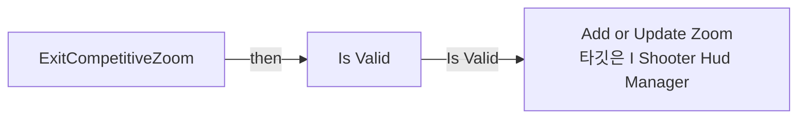

</details>

<details>
<summary>전체 노드·기본 입력 목록</summary>

| 노드 ID | 제목 | 미연결 기본 입력 / 에셋 입력 |
|---|---|---|
| `K2Node_FunctionEntry_0` | ExitCompetitiveZoom |  |
| `K2Node_CallFunction_0` | Get Owning Player Pawn<br/>타깃은 사용자 위젯 |  |
| `K2Node_CallFunction_2` | Get Component by Class<br/>타깃은 액터 | ComponentClass=/Script/Engine.CameraComponent |
| `K2Node_CallFunction_3` | Get Shooter Hud Manager |  |
| `K2Node_CallFunction_4` | Add or Update Zoom<br/>타깃은 I Shooter Hud Manager | bZoomIn=false; ZoomValueDegrees=0.0 |
| `K2Node_Knot_0` | 경유 노드 |  |
| `K2Node_MacroInstance_0` | Is Valid |  |

</details>

### HideCompetitiveCombatHUD

<details>
<summary>실행 핀 플로우차트</summary>

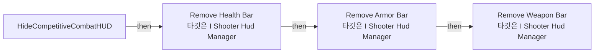

</details>

<details>
<summary>전체 노드·기본 입력 목록</summary>

| 노드 ID | 제목 | 미연결 기본 입력 / 에셋 입력 |
|---|---|---|
| `K2Node_FunctionEntry_0` | HideCompetitiveCombatHUD |  |
| `K2Node_CallFunction_0` | Get Shooter Hud Manager |  |
| `K2Node_CallFunction_2` | Remove Weapon Bar<br/>타깃은 I Shooter Hud Manager |  |
| `K2Node_Knot_0` | 경유 노드 |  |
| `K2Node_CallFunction_3` | Remove Health Bar<br/>타깃은 I Shooter Hud Manager |  |
| `K2Node_CallFunction_5` | Remove Armor Bar<br/>타깃은 I Shooter Hud Manager |  |
| `K2Node_Knot_1` | 경유 노드 |  |

</details>

### HideCompetitiveCrosshairUI

<details>
<summary>실행 핀 플로우차트</summary>

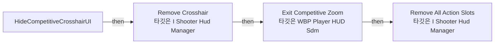

</details>

<details>
<summary>전체 노드·기본 입력 목록</summary>

| 노드 ID | 제목 | 미연결 기본 입력 / 에셋 입력 |
|---|---|---|
| `K2Node_FunctionEntry_0` | HideCompetitiveCrosshairUI |  |
| `K2Node_CallFunction_0` | Get Shooter Hud Manager |  |
| `K2Node_CallFunction_1` | Remove Crosshair<br/>타깃은 I Shooter Hud Manager |  |
| `K2Node_CallFunction_2` | Exit Competitive Zoom<br/>타깃은 WBP Player HUD Sdm |  |
| `K2Node_CallFunction_3` | Remove All Action Slots<br/>타깃은 I Shooter Hud Manager |  |
| `K2Node_Knot_0` | 경유 노드 |  |

</details>

### InitCompetitiveMatchTimer

<details>
<summary>실행 핀 플로우차트</summary>

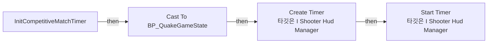

</details>

<details>
<summary>전체 노드·기본 입력 목록</summary>

| 노드 ID | 제목 | 미연결 기본 입력 / 에셋 입력 |
|---|---|---|
| `K2Node_FunctionEntry_0` | InitCompetitiveMatchTimer |  |
| `K2Node_CallFunction_0` | Get Game State |  |
| `K2Node_DynamicCast_0` | Cast To BP_QuakeGameState |  |
| `K2Node_VariableGet_0` | Get GameConfig |  |
| `K2Node_VariableGet_1` | Get MatchDuration |  |
| `K2Node_VariableGet_2` | Get ElapsedMatchTime |  |
| `K2Node_PromotableOperator_0` | float - float |  |
| `K2Node_CommutativeAssociativeBinaryOperator_0` | Max (Float) | B=0.0 |
| `K2Node_PromotableOperator_1` | float / float | B=60.000000 |
| `K2Node_CallFunction_1` | Floor |  |
| `K2Node_CallFunction_2` | Get Shooter Hud Manager |  |
| `K2Node_CallFunction_3` | Create Timer<br/>타깃은 I Shooter Hud Manager | ETimerMode=NewEnumerator0; Color=(R=1.000000,G=1.000000,B=1.000000,A=1.000000) |
| `K2Node_CallFunction_4` | % (Float) | B=60.000000 |
| `K2Node_CallFunction_5` | Floor |  |
| `K2Node_CallFunction_6` | Start Timer<br/>타깃은 I Shooter Hud Manager |  |

</details>

### InitializeCompetitiveLifeHUD

<details>
<summary>실행 핀 플로우차트</summary>

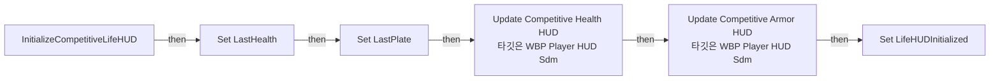

</details>

<details>
<summary>전체 노드·기본 입력 목록</summary>

| 노드 ID | 제목 | 미연결 기본 입력 / 에셋 입력 |
|---|---|---|
| `K2Node_FunctionEntry_0` | InitializeCompetitiveLifeHUD |  |
| `K2Node_VariableSet_0` | Set LastHealth | Output_Get=0.0 |
| `K2Node_VariableSet_4` | Set LastPlate | Output_Get=0.0 |
| `K2Node_CallFunction_72` | Round |  |
| `K2Node_CallFunction_73` | Round |  |
| `K2Node_CallFunction_77` | Update Competitive Health HUD<br/>타깃은 WBP Player HUD Sdm | UpdateType=NewEnumerator0 |
| `K2Node_CallFunction_78` | Update Competitive Armor HUD<br/>타깃은 WBP Player HUD Sdm | UpdateType=NewEnumerator0 |
| `K2Node_CallFunction_75` | Round |  |
| `K2Node_CallFunction_76` | Round |  |
| `K2Node_Knot_0` | 경유 노드 |  |
| `K2Node_Knot_1` | 경유 노드 |  |
| `K2Node_Knot_2` | 경유 노드 |  |
| `K2Node_VariableSet_1` | Set LifeHUDInitialized | LifeHUDInitialized=true; Output_Get=false |

</details>

### PlayCompetitiveCrosshairRecoil

<details>
<summary>실행 핀 플로우차트</summary>

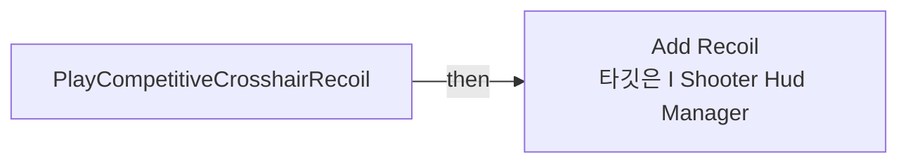

</details>

<details>
<summary>전체 노드·기본 입력 목록</summary>

| 노드 ID | 제목 | 미연결 기본 입력 / 에셋 입력 |
|---|---|---|
| `K2Node_FunctionEntry_0` | PlayCompetitiveCrosshairRecoil |  |
| `K2Node_CallFunction_0` | Get Shooter Hud Manager |  |
| `K2Node_CallFunction_1` | Add Recoil<br/>타깃은 I Shooter Hud Manager |  |

</details>

### PlayCompetitiveHitMarker

<details>
<summary>실행 핀 플로우차트</summary>

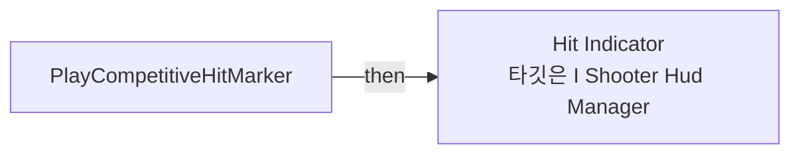

</details>

<details>
<summary>전체 노드·기본 입력 목록</summary>

| 노드 ID | 제목 | 미연결 기본 입력 / 에셋 입력 |
|---|---|---|
| `K2Node_FunctionEntry_0` | PlayCompetitiveHitMarker |  |
| `K2Node_CallFunction_0` | Get Shooter Hud Manager |  |
| `K2Node_CallFunction_1` | Hit Indicator<br/>타깃은 I Shooter Hud Manager | IndicatorType=NewEnumerator0; IndicatorColor=(R=1.000000,G=0.000000,B=0.027540,A=1.000000) |

</details>

### RF_HandleAmmoConsumed

<details>
<summary>실행 핀 플로우차트</summary>

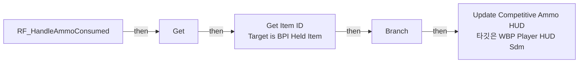

</details>

<details>
<summary>전체 노드·기본 입력 목록</summary>

| 노드 ID | 제목 | 미연결 기본 입력 / 에셋 입력 |
|---|---|---|
| `K2Node_FunctionEntry_0` | RF_HandleAmmoConsumed |  |
| `K2Node_Message_9` | Get Item ID<br/>Target is BPI Held Item |  |
| `K2Node_IfThenElse_3` | Branch |  |
| `K2Node_CallFunction_5` | Update Competitive Ammo HUD<br/>타깃은 WBP Player HUD Sdm |  |
| `K2Node_VariableGet_0` | Get CurrentWeapon |  |
| `K2Node_PromotableOperator_2` | Equal (GameplayTag) |  |
| `K2Node_CallFunction_3` | Get Filtering Tag (First) | filter=(TagName="ID"); Exact Match=false |
| `K2Node_VariableGet_9` | Get |  |
| `K2Node_Knot_0` | 경유 노드 |  |
| `K2Node_Knot_1` | 경유 노드 |  |
| `K2Node_Knot_2` | 경유 노드 |  |

</details>

### RF_HandleAmmoRecovered

<details>
<summary>실행 핀 플로우차트</summary>

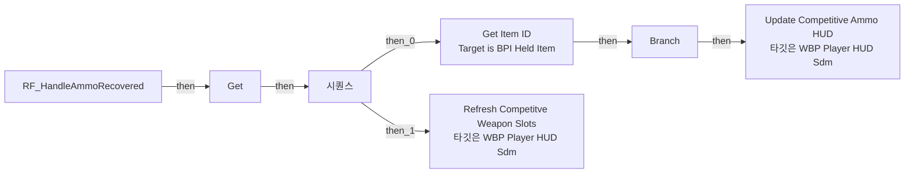

</details>

<details>
<summary>전체 노드·기본 입력 목록</summary>

| 노드 ID | 제목 | 미연결 기본 입력 / 에셋 입력 |
|---|---|---|
| `K2Node_FunctionEntry_0` | RF_HandleAmmoRecovered |  |
| `K2Node_ExecutionSequence_1` | 시퀀스 |  |
| `K2Node_Message_2` | Get Item ID<br/>Target is BPI Held Item |  |
| `K2Node_CallFunction_6` | Refresh Competitve Weapon Slots<br/>타깃은 WBP Player HUD Sdm |  |
| `K2Node_IfThenElse_10` | Branch |  |
| `K2Node_CallFunction_75` | Update Competitive Ammo HUD<br/>타깃은 WBP Player HUD Sdm |  |
| `K2Node_VariableGet_0` | Get CurrentWeapon |  |
| `K2Node_PromotableOperator_0` | Equal (GameplayTag) |  |
| `K2Node_CallFunction_51` | Get Filtering Tag (First) | filter=(TagName="ID"); Exact Match=false |
| `K2Node_VariableGet_23` | Get |  |
| `K2Node_Knot_0` | 경유 노드 |  |
| `K2Node_Knot_1` | 경유 노드 |  |
| `K2Node_Knot_2` | 경유 노드 |  |

</details>

### RF_HandleDeath

<details>
<summary>실행 핀 플로우차트</summary>

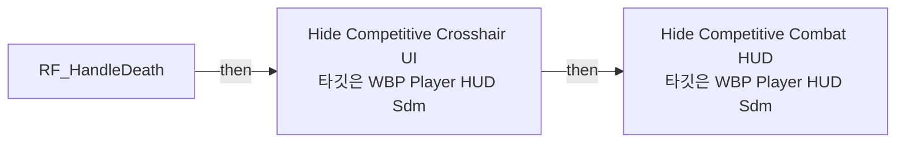

</details>

<details>
<summary>전체 노드·기본 입력 목록</summary>

| 노드 ID | 제목 | 미연결 기본 입력 / 에셋 입력 |
|---|---|---|
| `K2Node_FunctionEntry_0` | RF_HandleDeath |  |
| `K2Node_CallFunction_0` | Hide Competitive Crosshair UI<br/>타깃은 WBP Player HUD Sdm |  |
| `K2Node_CallFunction_1` | Hide Competitive Combat HUD<br/>타깃은 WBP Player HUD Sdm |  |

</details>

### RF_HandleLifeChanged

<details>
<summary>실행 핀 플로우차트</summary>

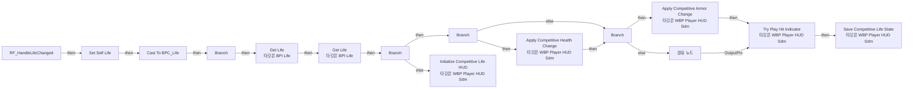

</details>

<details>
<summary>전체 노드·기본 입력 목록</summary>

| 노드 ID | 제목 | 미연결 기본 입력 / 에셋 입력 |
|---|---|---|
| `K2Node_FunctionEntry_0` | RF_HandleLifeChanged |  |
| `K2Node_CallFunction_8` | Get Life<br/>타깃은 BPI Life | type=NewEnumerator0 |
| `K2Node_CallFunction_2` | Get Life<br/>타깃은 BPI Life | type=NewEnumerator1 |
| `K2Node_IfThenElse_6` | Branch |  |
| `K2Node_IfThenElse_7` | Branch |  |
| `K2Node_CallFunction_12` | Initialize Competitive Life HUD<br/>타깃은 WBP Player HUD Sdm |  |
| `K2Node_CallFunction_43` | Apply Competitive Health Change<br/>타깃은 WBP Player HUD Sdm |  |
| `K2Node_IfThenElse_8` | Branch |  |
| `K2Node_CallFunction_45` | Apply Competitive Armor Change<br/>타깃은 WBP Player HUD Sdm |  |
| `K2Node_Knot_37` | 경유 노드 |  |
| `K2Node_CallFunction_42` | Try Play Hit Indicator<br/>타깃은 WBP Player HUD Sdm |  |
| `K2Node_CallFunction_53` | Save Competitive Life State<br/>타깃은 WBP Player HUD Sdm |  |
| `K2Node_VariableGet_10` | Get LifeHUDInitialized |  |
| `K2Node_PromotableOperator_3` | Not Equal (Float) |  |
| `K2Node_Knot_41` | 경유 노드 |  |
| `K2Node_Knot_57` | 경유 노드 |  |
| `K2Node_Knot_40` | 경유 노드 |  |
| `K2Node_Knot_60` | 경유 노드 |  |
| `K2Node_CallFunction_57` | Round |  |
| `K2Node_CallFunction_58` | Round |  |
| `K2Node_CallFunction_44` | Round |  |
| `K2Node_CommutativeAssociativeBinaryOperator_1` | AND Boolean |  |
| `K2Node_PromotableOperator_4` | Not Equal (Float) |  |
| `K2Node_CallFunction_59` | Round |  |
| `K2Node_CallFunction_64` | Round |  |
| `K2Node_CallFunction_47` | Round |  |
| `K2Node_Knot_64` | 경유 노드 |  |
| `K2Node_Knot_65` | 경유 노드 |  |
| `K2Node_VariableGet_6` | Get LastHealth |  |
| `K2Node_VariableGet_18` | Get LastPlate |  |
| `K2Node_Knot_61` | 경유 노드 |  |
| `K2Node_Knot_39` | 경유 노드 |  |
| `K2Node_Knot_52` | 경유 노드 |  |
| `K2Node_Knot_47` | 경유 노드 |  |
| `K2Node_VariableGet_1` | Get LastHealth |  |
| `K2Node_Knot_46` | 경유 노드 |  |
| `K2Node_Knot_58` | 경유 노드 |  |
| `K2Node_Knot_36` | 경유 노드 |  |
| `K2Node_Knot_59` | 경유 노드 |  |
| `K2Node_Knot_66` | 경유 노드 |  |
| `K2Node_Knot_67` | 경유 노드 |  |
| `K2Node_VariableGet_20` | Get LastHealth |  |
| `K2Node_CallFunction_0` | Is Valid |  |
| `K2Node_PromotableOperator_6` | Not Equal (Object) |  |
| `K2Node_Knot_63` | 경유 노드 |  |
| `K2Node_VariableGet_21` | Get LastPlate |  |
| `K2Node_Knot_68` | 경유 노드 |  |
| `K2Node_Knot_69` | 경유 노드 |  |
| `K2Node_VariableGet_3` | Get LastPlate |  |
| `K2Node_Knot_33` | 경유 노드 |  |
| `K2Node_Knot_51` | 경유 노드 |  |
| `K2Node_Knot_44` | 경유 노드 |  |
| `K2Node_Knot_35` | 경유 노드 |  |
| `K2Node_VariableGet_24` | Get OwendPlayer |  |
| `K2Node_Knot_48` | 경유 노드 |  |
| `K2Node_Knot_43` | 경유 노드 |  |
| `K2Node_Knot_38` | 경유 노드 |  |
| `K2Node_CallFunction_1` | Get Owner<br/>타깃은 액터 컴포넌트 |  |
| `K2Node_VariableGet_0` | Get OwendPlayer |  |
| `K2Node_CallFunction_3` | Equal (Object) |  |
| `K2Node_IfThenElse_0` | Branch |  |
| `K2Node_CallFunction_4` | To Object (Interface) |  |
| `K2Node_DynamicCast_1` | Cast To BPC_Life |  |
| `K2Node_VariableSet_4` | Set Self Life |  |
| `K2Node_VariableGet_2` | Get Self Life |  |
| `K2Node_VariableGet_4` | Get Self Life |  |

</details>

### RF_HandlePickup

<details>
<summary>실행 핀 플로우차트</summary>

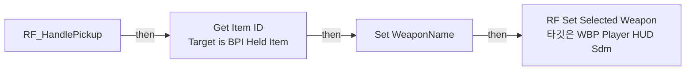

</details>

<details>
<summary>전체 노드·기본 입력 목록</summary>

| 노드 ID | 제목 | 미연결 기본 입력 / 에셋 입력 |
|---|---|---|
| `K2Node_FunctionEntry_0` | RF_HandlePickup |  |
| `K2Node_CallFunction_0` | RF Set Selected Weapon<br/>타깃은 WBP Player HUD Sdm |  |
| `K2Node_Message_4` | Get Item ID<br/>Target is BPI Held Item |  |
| `K2Node_CallFunction_19` | Get Tag Name |  |
| `K2Node_VariableSet_6` | Set WeaponName | Output_Get=None |
| `K2Node_Knot_0` | 경유 노드 |  |
| `K2Node_Knot_1` | 경유 노드 |  |

</details>

### RF_HandleSwap

<details>
<summary>실행 핀 플로우차트</summary>

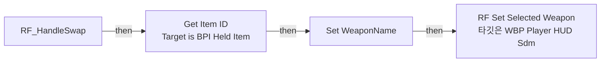

</details>

<details>
<summary>전체 노드·기본 입력 목록</summary>

| 노드 ID | 제목 | 미연결 기본 입력 / 에셋 입력 |
|---|---|---|
| `K2Node_FunctionEntry_0` | RF_HandleSwap |  |
| `K2Node_CallFunction_0` | RF Set Selected Weapon<br/>타깃은 WBP Player HUD Sdm |  |
| `K2Node_Message_3` | Get Item ID<br/>Target is BPI Held Item |  |
| `K2Node_CallFunction_18` | Get Tag Name |  |
| `K2Node_VariableSet_5` | Set WeaponName | Output_Get=None |
| `K2Node_Knot_0` | 경유 노드 |  |
| `K2Node_Knot_1` | 경유 노드 |  |

</details>

### RF_InitializeInventory

<details>
<summary>실행 핀 플로우차트</summary>

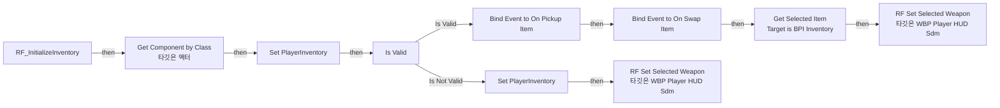

</details>

<details>
<summary>전체 노드·기본 입력 목록</summary>

| 노드 ID | 제목 | 미연결 기본 입력 / 에셋 입력 |
|---|---|---|
| `K2Node_FunctionEntry_0` | RF_InitializeInventory |  |
| `K2Node_CallFunction_0` | Get Component by Class<br/>타깃은 액터 | ComponentClass=/Game/QuakeLike_1_0/Inventory/BPC_Inventory.BPC_Inventory_C |
| `K2Node_VariableSet_0` | Set PlayerInventory |  |
| `K2Node_AddDelegate_0` | Bind Event to On Pickup Item |  |
| `K2Node_CreateDelegate_0` | 이벤트 생성 |  |
| `K2Node_AddDelegate_1` | Bind Event to On Swap Item |  |
| `K2Node_CreateDelegate_1` | 이벤트 생성 |  |
| `K2Node_Message_0` | Get Selected Item<br/>Target is BPI Inventory |  |
| `K2Node_CallFunction_1` | RF Set Selected Weapon<br/>타깃은 WBP Player HUD Sdm |  |
| `K2Node_VariableSet_1` | Set PlayerInventory |  |
| `K2Node_CallFunction_2` | RF Set Selected Weapon<br/>타깃은 WBP Player HUD Sdm |  |
| `K2Node_MacroInstance_0` | Is Valid |  |
| `K2Node_VariableGet_0` | Get PlayerInventory |  |
| `K2Node_Knot_0` | 경유 노드 |  |
| `K2Node_Knot_1` | 경유 노드 |  |
| `K2Node_Knot_2` | 경유 노드 |  |

</details>

### RF_InitializeLife

<details>
<summary>실행 핀 플로우차트</summary>

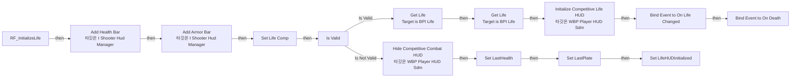

</details>

<details>
<summary>전체 노드·기본 입력 목록</summary>

| 노드 ID | 제목 | 미연결 기본 입력 / 에셋 입력 |
|---|---|---|
| `K2Node_FunctionEntry_0` | RF_InitializeLife |  |
| `K2Node_CallFunction_0` | Get Shooter Hud Manager |  |
| `K2Node_CallFunction_1` | Add Health Bar<br/>타깃은 I Shooter Hud Manager | ProgressBar_Color=(R=0.070360,G=1.000000,B=0.351533,A=1.000000); Progress_Color=(R=0.187821,G=1.000000,B=0.028426,A=1.000000); Text_Color=(R=1.000000,G=0.939591,B=0.770522,A=1.000000); Frame_Color=(R=1.000000,G=0.961905,B=0.660602,A=1.000000); Damage_Color=(R=1.000000,G=0.000000,B=0.078602,A=1.000000); Health_Color=(R=0.327367,G=1.000000,B=0.353236,A=1.000000); IsMaxHealthSensitive=false; bUseLowDamagePostProcess=false |
| `K2Node_CallFunction_5` | Add Armor Bar<br/>타깃은 I Shooter Hud Manager | ProgressBar_Color=(R=0.024158,G=0.558341,B=1.000000,A=1.000000); Progress_Color=(R=0.000911,G=0.791298,B=1.000000,A=1.000000); Text_Color=(R=0.905660,G=1.000000,B=0.949677,A=1.000000); Frame_Color=(R=1.000000,G=1.000000,B=1.000000,A=1.000000); Damage_Color=(R=1.000000,G=0.033943,B=0.043970,A=1.000000); Armor_Color=(R=0.000831,G=0.000000,B=1.000000,A=1.000000); MaxArmorSensitive=false |
| `K2Node_CallFunction_2` | Initialize Competitive Life HUD<br/>타깃은 WBP Player HUD Sdm |  |
| `K2Node_CallFunction_4` | Get Component by Class<br/>타깃은 액터 | ComponentClass=/Game/QuakeLike_1_0/Life/BPC_Life.BPC_Life_C |
| `K2Node_MacroInstance_0` | Is Valid |  |
| `K2Node_Message_1` | Get Life<br/>Target is BPI Life | type=NewEnumerator0 |
| `K2Node_Knot_0` | 경유 노드 |  |
| `K2Node_Message_0` | Get Life<br/>Target is BPI Life | type=NewEnumerator1 |
| `K2Node_Knot_1` | 경유 노드 |  |
| `K2Node_CallFunction_3` | Hide Competitive Combat HUD<br/>타깃은 WBP Player HUD Sdm |  |
| `K2Node_AddDelegate_0` | Bind Event to On Life Changed |  |
| `K2Node_CreateDelegate_0` | 이벤트 생성 |  |
| `K2Node_AddDelegate_1` | Bind Event to On Death |  |
| `K2Node_CreateDelegate_1` | 이벤트 생성 |  |
| `K2Node_VariableSet_0` | Set LastHealth | LastHealth=0.0; Output_Get=0.0 |
| `K2Node_VariableSet_1` | Set LastPlate | LastPlate=0.0; Output_Get=0.0 |
| `K2Node_VariableSet_2` | Set LifeHUDInitialized | LifeHUDInitialized=false; Output_Get=false |
| `K2Node_Knot_2` | 경유 노드 |  |
| `K2Node_VariableSet_3` | Set Life Comp |  |
| `K2Node_VariableGet_0` | Get Life Comp |  |
| `K2Node_Knot_3` | 경유 노드 |  |
| `K2Node_Knot_4` | 경유 노드 |  |
| `K2Node_Knot_5` | 경유 노드 |  |
| `K2Node_Knot_6` | 경유 노드 |  |
| `K2Node_VariableGet_2` | Get Life Comp |  |

</details>

### RF_RefreshDisplayedCombat

<details>
<summary>실행 핀 플로우차트</summary>

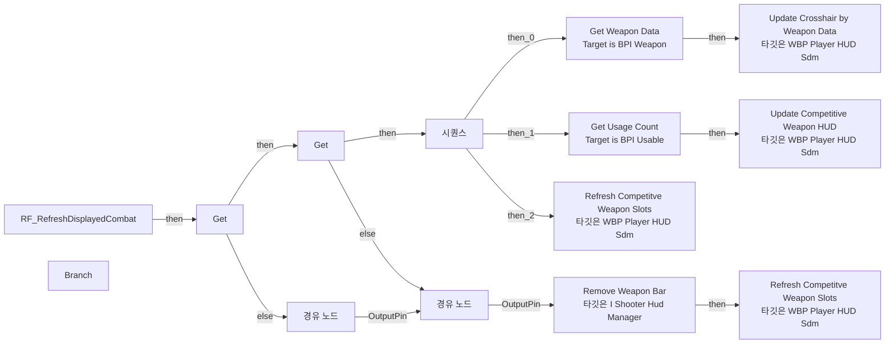

</details>

<details>
<summary>전체 노드·기본 입력 목록</summary>

| 노드 ID | 제목 | 미연결 기본 입력 / 에셋 입력 |
|---|---|---|
| `K2Node_FunctionEntry_0` | RF_RefreshDisplayedCombat |  |
| `K2Node_VariableGet_2` | Get PlayerInventory |  |
| `K2Node_CallFunction_3` | Is Valid |  |
| `K2Node_VariableGet_4` | Get CurrentWeapon |  |
| `K2Node_IfThenElse_0` | Branch |  |
| `K2Node_CallFunction_8` | Get Shooter Hud Manager |  |
| `K2Node_CallFunction_7` | Remove Weapon Bar<br/>타깃은 I Shooter Hud Manager |  |
| `K2Node_CallFunction_5` | Refresh Competitve Weapon Slots<br/>타깃은 WBP Player HUD Sdm |  |
| `K2Node_ExecutionSequence_0` | 시퀀스 |  |
| `K2Node_Message_1` | Get Weapon Data<br/>Target is BPI Weapon |  |
| `K2Node_CallFunction_1` | Update Crosshair by Weapon Data<br/>타깃은 WBP Player HUD Sdm |  |
| `K2Node_Message_2` | Get Usage Count<br/>Target is BPI Usable |  |
| `K2Node_CallFunction_2` | Update Competitive Weapon HUD<br/>타깃은 WBP Player HUD Sdm |  |
| `K2Node_CallFunction_0` | Refresh Competitve Weapon Slots<br/>타깃은 WBP Player HUD Sdm |  |
| `K2Node_VariableGet_0` | Get |  |
| `K2Node_VariableGet_1` | Get |  |
| `K2Node_VariableGet_3` | Get CurrentWeapon |  |
| `K2Node_Knot_0` | 경유 노드 |  |
| `K2Node_Knot_1` | 경유 노드 |  |
| `K2Node_Knot_2` | 경유 노드 |  |
| `K2Node_Knot_3` | 경유 노드 |  |

</details>

### RF_RefreshDisplayedLife

<details>
<summary>실행 핀 플로우차트</summary>

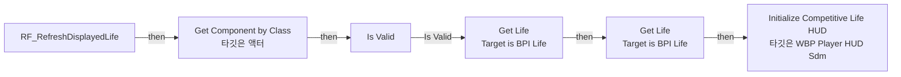

</details>

<details>
<summary>전체 노드·기본 입력 목록</summary>

| 노드 ID | 제목 | 미연결 기본 입력 / 에셋 입력 |
|---|---|---|
| `K2Node_FunctionEntry_0` | RF_RefreshDisplayedLife |  |
| `K2Node_CallFunction_2` | Initialize Competitive Life HUD<br/>타깃은 WBP Player HUD Sdm |  |
| `K2Node_CallFunction_4` | Get Component by Class<br/>타깃은 액터 | ComponentClass=/Game/QuakeLike_1_0/Life/BPC_Life.BPC_Life_C |
| `K2Node_MacroInstance_0` | Is Valid |  |
| `K2Node_Message_1` | Get Life<br/>Target is BPI Life | type=NewEnumerator0 |
| `K2Node_Knot_0` | 경유 노드 |  |
| `K2Node_Message_0` | Get Life<br/>Target is BPI Life | type=NewEnumerator1 |
| `K2Node_Knot_1` | 경유 노드 |  |
| `K2Node_VariableGet_0` | Get OwendPlayer |  |
| `K2Node_Knot_2` | 경유 노드 |  |
| `K2Node_Knot_3` | 경유 노드 |  |
| `K2Node_Knot_4` | 경유 노드 |  |

</details>

### RF_SetDisplayedPawn

<details>
<summary>실행 핀 플로우차트</summary>

```mermaid
flowchart LR
  n0["RF_SetDisplayedPawn"]
  n1["RF Unbind Displayed Sources<br/>타깃은 WBP Player HUD Sdm"]
  n2["Set OwendPlayer"]
  n3["RF Initialize Life<br/>타깃은 WBP Player HUD Sdm"]
  n4["RF Initialize Inventory<br/>타깃은 WBP Player HUD Sdm"]
  n5["시퀀스"]
  n0 -->|"then"| n1
  n1 -->|"then"| n2
  n2 -->|"then"| n5
  n5 -->|"then_0"| n3
  n5 -->|"then_1"| n4
```

</details>

<details>
<summary>전체 노드·기본 입력 목록</summary>

| 노드 ID | 제목 | 미연결 기본 입력 / 에셋 입력 |
|---|---|---|
| `K2Node_FunctionEntry_0` | RF_SetDisplayedPawn |  |
| `K2Node_CallFunction_0` | RF Unbind Displayed Sources<br/>타깃은 WBP Player HUD Sdm |  |
| `K2Node_VariableSet_0` | Set OwendPlayer |  |
| `K2Node_CallFunction_2` | RF Initialize Life<br/>타깃은 WBP Player HUD Sdm |  |
| `K2Node_CallFunction_3` | RF Initialize Inventory<br/>타깃은 WBP Player HUD Sdm |  |
| `K2Node_ExecutionSequence_0` | 시퀀스 |  |
| `K2Node_Knot_0` | 경유 노드 |  |

</details>

### RF_SetSelectedWeapon

<details>
<summary>실행 핀 플로우차트</summary>

```mermaid
flowchart LR
  n0["RF_SetSelectedWeapon"]
  n1["Unbind Event from On Usable Consum"]
  n2["Unbind Event from On Usable Recover"]
  n3["Set CurrentWeapon"]
  n4["Bind Event to On Usable Consum"]
  n5["Bind Event to On Usable Recover"]
  n6["RF Refresh Displayed Combat<br/>타깃은 WBP Player HUD Sdm"]
  n7["경유 노드"]
  n8["경유 노드"]
  n9["경유 노드"]
  n10["경유 노드"]
  n11["Set L_New Item"]
  n12["Get"]
  n13["Get"]
  n0 -->|"then"| n11
  n1 -->|"then"| n2
  n2 -->|"then"| n3
  n3 -->|"then"| n13
  n4 -->|"then"| n5
  n5 -->|"then"| n6
  n7 -->|"OutputPin"| n8
  n8 -->|"OutputPin"| n6
  n9 -->|"OutputPin"| n10
  n10 -->|"OutputPin"| n3
  n11 -->|"then"| n12
  n12 -->|"then"| n1
  n12 -->|"else"| n9
  n13 -->|"then"| n4
  n13 -->|"else"| n7
```

</details>

<details>
<summary>전체 노드·기본 입력 목록</summary>

| 노드 ID | 제목 | 미연결 기본 입력 / 에셋 입력 |
|---|---|---|
| `K2Node_FunctionEntry_0` | RF_SetSelectedWeapon |  |
| `K2Node_RemoveDelegate_0` | Unbind Event from On Usable Consum |  |
| `K2Node_CreateDelegate_0` | 이벤트 생성 |  |
| `K2Node_RemoveDelegate_1` | Unbind Event from On Usable Recover |  |
| `K2Node_CreateDelegate_1` | 이벤트 생성 |  |
| `K2Node_VariableSet_0` | Set CurrentWeapon |  |
| `K2Node_AddDelegate_0` | Bind Event to On Usable Consum |  |
| `K2Node_CreateDelegate_2` | 이벤트 생성 |  |
| `K2Node_AddDelegate_1` | Bind Event to On Usable Recover |  |
| `K2Node_CreateDelegate_3` | 이벤트 생성 |  |
| `K2Node_CallFunction_2` | RF Refresh Displayed Combat<br/>타깃은 WBP Player HUD Sdm |  |
| `K2Node_Knot_0` | 경유 노드 |  |
| `K2Node_Knot_1` | 경유 노드 |  |
| `K2Node_Knot_2` | 경유 노드 |  |
| `K2Node_Knot_3` | 경유 노드 |  |
| `K2Node_VariableSet_3` | Set L_New Item |  |
| `K2Node_VariableGet_0` | Get |  |
| `K2Node_VariableGet_2` | Get L_New Item |  |
| `K2Node_Knot_4` | 경유 노드 |  |
| `K2Node_Knot_5` | 경유 노드 |  |
| `K2Node_VariableGet_3` | Get |  |
| `K2Node_Knot_6` | 경유 노드 |  |
| `K2Node_Knot_7` | 경유 노드 |  |

</details>

### RF_UnbindDisplayedSources

<details>
<summary>실행 핀 플로우차트</summary>

```mermaid
flowchart LR
  n0["RF_UnbindDisplayedSources"]
  n1["시퀀스"]
  n2["Get"]
  n3["Get Component by Class<br/>타깃은 액터"]
  n4["Unbind Event from On Life Changed"]
  n5["Unbind Event from On Death"]
  n6["Unbind Event from On Pickup Item"]
  n7["Unbind Event from On Swap Item"]
  n8["Unbind Event from On Usable Consum"]
  n9["Unbind Event from On Usable Recover"]
  n10["시퀀스"]
  n11["Get"]
  n12["Get"]
  n13["Is Valid"]
  n0 -->|"then"| n1
  n1 -->|"then_0"| n2
  n1 -->|"then_1"| n10
  n2 -->|"then"| n3
  n3 -->|"then"| n13
  n4 -->|"then"| n5
  n6 -->|"then"| n7
  n8 -->|"then"| n9
  n10 -->|"then_0"| n11
  n10 -->|"then_1"| n12
  n11 -->|"then"| n6
  n12 -->|"then"| n8
  n13 -->|"Is Valid"| n4
```

</details>

<details>
<summary>전체 노드·기본 입력 목록</summary>

| 노드 ID | 제목 | 미연결 기본 입력 / 에셋 입력 |
|---|---|---|
| `K2Node_FunctionEntry_0` | RF_UnbindDisplayedSources |  |
| `K2Node_ExecutionSequence_0` | 시퀀스 |  |
| `K2Node_VariableGet_0` | Get |  |
| `K2Node_CallFunction_0` | Get Component by Class<br/>타깃은 액터 | ComponentClass=/Game/QuakeLike_1_0/Life/BPC_Life.BPC_Life_C |
| `K2Node_RemoveDelegate_0` | Unbind Event from On Life Changed |  |
| `K2Node_CreateDelegate_0` | 이벤트 생성 |  |
| `K2Node_RemoveDelegate_1` | Unbind Event from On Death |  |
| `K2Node_CreateDelegate_1` | 이벤트 생성 |  |
| `K2Node_RemoveDelegate_2` | Unbind Event from On Pickup Item |  |
| `K2Node_CreateDelegate_2` | 이벤트 생성 |  |
| `K2Node_RemoveDelegate_3` | Unbind Event from On Swap Item |  |
| `K2Node_CreateDelegate_3` | 이벤트 생성 |  |
| `K2Node_RemoveDelegate_4` | Unbind Event from On Usable Consum |  |
| `K2Node_CreateDelegate_4` | 이벤트 생성 |  |
| `K2Node_RemoveDelegate_5` | Unbind Event from On Usable Recover |  |
| `K2Node_CreateDelegate_5` | 이벤트 생성 |  |
| `K2Node_ExecutionSequence_1` | 시퀀스 |  |
| `K2Node_VariableGet_1` | Get |  |
| `K2Node_VariableGet_2` | Get |  |
| `K2Node_Knot_1` | 경유 노드 |  |
| `K2Node_Knot_2` | 경유 노드 |  |
| `K2Node_Knot_3` | 경유 노드 |  |
| `K2Node_Knot_4` | 경유 노드 |  |
| `K2Node_Knot_5` | 경유 노드 |  |
| `K2Node_Knot_6` | 경유 노드 |  |
| `K2Node_Knot_7` | 경유 노드 |  |
| `K2Node_Knot_8` | 경유 노드 |  |
| `K2Node_MacroInstance_0` | Is Valid |  |

</details>

### RefreshAllWeaponSlot

<details>
<summary>실행 핀 플로우차트</summary>

```mermaid
flowchart LR
  n0["RefreshAllWeaponSlot"]
  n1["반환 노드"]
  n2["For Each Loop"]
  n3["Get Item ID<br/>Target is BPI Held Item"]
  n4["Has Item<br/>Target is BPI Inventory"]
  n5["Branch"]
  n6["Update Ammo Gauge<br/>타깃은 WBP Weapon Slot"]
  n7["Get Usage Count<br/>Target is BPI Usable"]
  n8["Set Slot Active<br/>타깃은 WBP Weapon Slot"]
  n9["Update Ammo Gauge<br/>타깃은 WBP Weapon Slot"]
  n10["Branch"]
  n11["Set Slot Active<br/>타깃은 WBP Weapon Slot"]
  n12["Set Slot Active<br/>타깃은 WBP Weapon Slot"]
  n13["Clear Children<br/>타깃은 패널 위젯"]
  n14["Add Child<br/>타깃은 패널 위젯"]
  n15["Set Visibility<br/>타깃은 위젯"]
  n16["Add Child to Vertical Box<br/>타깃은 세로 박스"]
  n17["Set Padding<br/>타깃은 세로 박스 슬롯"]
  n18["Set Visibility<br/>타깃은 위젯"]
  n19["Set Visibility<br/>타깃은 위젯"]
  n2 -->|"LoopBody"| n4
  n2 -->|"Completed"| n1
  n3 -->|"then"| n13
  n4 -->|"then"| n5
  n5 -->|"then"| n10
  n5 -->|"else"| n8
  n7 -->|"then"| n6
  n8 -->|"then"| n19
  n10 -->|"then"| n11
  n10 -->|"else"| n12
  n11 -->|"then"| n14
  n12 -->|"then"| n16
  n13 -->|"then"| n2
  n14 -->|"then"| n15
  n15 -->|"then"| n7
  n16 -->|"then"| n17
  n17 -->|"then"| n18
  n18 -->|"then"| n7
  n19 -->|"then"| n9
```

</details>

<details>
<summary>전체 노드·기본 입력 목록</summary>

| 노드 ID | 제목 | 미연결 기본 입력 / 에셋 입력 |
|---|---|---|
| `K2Node_FunctionEntry_0` | RefreshAllWeaponSlot |  |
| `K2Node_FunctionResult_0` | 반환 노드 |  |
| `K2Node_VariableGet_11` | Get WeaponSlotArray |  |
| `K2Node_MacroInstance_5` | For Each Loop |  |
| `K2Node_Message_2` | Get Item ID<br/>Target is BPI Held Item |  |
| `K2Node_VariableGet_12` | Get SlotWeaponID |  |
| `K2Node_PromotableOperator_1` | Equal (GameplayTag) |  |
| `K2Node_Knot_7` | 경유 노드 |  |
| `K2Node_Message_1` | Has Item<br/>Target is BPI Inventory |  |
| `K2Node_IfThenElse_0` | Branch |  |
| `K2Node_VariableGet_1` | Get PlayerInventory |  |
| `K2Node_Knot_3` | 경유 노드 |  |
| `K2Node_CallFunction_5` | Update Ammo Gauge<br/>타깃은 WBP Weapon Slot |  |
| `K2Node_Message_3` | Get Usage Count<br/>Target is BPI Usable |  |
| `K2Node_Knot_4` | 경유 노드 |  |
| `K2Node_CallFunction_7` | Set Slot Active<br/>타깃은 WBP Weapon Slot | IsActive=false; IsOwned=false |
| `K2Node_Knot_6` | 경유 노드 |  |
| `K2Node_Knot_8` | 경유 노드 |  |
| `K2Node_CallFunction_0` | Update Ammo Gauge<br/>타깃은 WBP Weapon Slot | CurrentAmmo=0; MaxAmmo=0 |
| `K2Node_Knot_0` | 경유 노드 |  |
| `K2Node_IfThenElse_1` | Branch |  |
| `K2Node_CallFunction_3` | Set Slot Active<br/>타깃은 WBP Weapon Slot | IsOwned=true |
| `K2Node_CallFunction_4` | Set Slot Active<br/>타깃은 WBP Weapon Slot | IsActive=false; IsOwned=true |
| `K2Node_Knot_1` | 경유 노드 |  |
| `K2Node_VariableGet_2` | Get InactiveVeritcalBox |  |
| `K2Node_CallFunction_1` | Clear Children<br/>타깃은 패널 위젯 |  |
| `K2Node_CallFunction_6` | Add Child<br/>타깃은 패널 위젯 |  |
| `K2Node_CallFunction_11` | Set Visibility<br/>타깃은 위젯 | InVisibility=Visible |
| `K2Node_Knot_2` | 경유 노드 |  |
| `K2Node_VariableGet_4` | Get InactiveVeritcalBox |  |
| `K2Node_CallFunction_9` | Add Child to Vertical Box<br/>타깃은 세로 박스 |  |
| `K2Node_CallFunction_10` | Set Padding<br/>타깃은 세로 박스 슬롯 | InPadding_Left=0.000000; InPadding_Top=0.000000; InPadding_Right=0.000000; InPadding_Bottom=10.000000 |
| `K2Node_CallFunction_8` | Set Visibility<br/>타깃은 위젯 | InVisibility=Visible |
| `K2Node_Knot_5` | 경유 노드 |  |
| `K2Node_CallFunction_12` | Set Visibility<br/>타깃은 위젯 | InVisibility=Collapsed |
| `K2Node_Knot_9` | 경유 노드 |  |

</details>

### RefreshAmmoGauge

<details>
<summary>실행 핀 플로우차트</summary>

```mermaid
flowchart LR
  n0["RefreshAmmoGauge"]
  n1["For Each Loop"]
  n2["Update Ammo Gauge<br/>타깃은 WBP Weapon Slot"]
  n3["Branch"]
  n4["반환 노드"]
  n0 -->|"then"| n1
  n1 -->|"LoopBody"| n3
  n1 -->|"Completed"| n4
  n3 -->|"then"| n2
```

</details>

<details>
<summary>전체 노드·기본 입력 목록</summary>

| 노드 ID | 제목 | 미연결 기본 입력 / 에셋 입력 |
|---|---|---|
| `K2Node_FunctionEntry_0` | RefreshAmmoGauge |  |
| `K2Node_VariableGet_6` | Get WeaponSlotArray |  |
| `K2Node_MacroInstance_1` | For Each Loop |  |
| `K2Node_VariableGet_7` | Get SlotWeaponID |  |
| `K2Node_CallFunction_4` | Update Ammo Gauge<br/>타깃은 WBP Weapon Slot |  |
| `K2Node_IfThenElse_0` | Branch |  |
| `K2Node_Knot_11` | 경유 노드 |  |
| `K2Node_Knot_16` | 경유 노드 |  |
| `K2Node_Knot_0` | 경유 노드 |  |
| `K2Node_Knot_1` | 경유 노드 |  |
| `K2Node_FunctionResult_0` | 반환 노드 |  |
| `K2Node_CallFunction_0` | Has Tag | bExactMatch=true |
| `K2Node_Knot_3` | 경유 노드 |  |
| `K2Node_Knot_4` | 경유 노드 |  |

</details>

### RefreshCompetitiveCombatHUD

<details>
<summary>실행 핀 플로우차트</summary>

```mermaid
flowchart LR
  n0["RefreshCompetitiveCombatHUD"]
  n1["Is Valid"]
  n2["Get Selected Item<br/>Target is BPI Inventory"]
  n3["Is Valid"]
  n4["Set CurrentWeapon"]
  n5["시퀀스"]
  n6["Get Weapon Data<br/>Target is BPI Weapon"]
  n7["Update Crosshair by Weapon Data<br/>타깃은 WBP Player HUD Sdm"]
  n8["Get Usage Count<br/>Target is BPI Usable"]
  n9["Update Competitive Weapon HUD<br/>타깃은 WBP Player HUD Sdm"]
  n10["Refresh Competitve Weapon Slots<br/>타깃은 WBP Player HUD Sdm"]
  n0 -->|"then"| n1
  n1 -->|"Is Valid"| n2
  n2 -->|"then"| n3
  n3 -->|"Is Valid"| n4
  n4 -->|"then"| n5
  n5 -->|"then_0"| n6
  n5 -->|"then_1"| n8
  n5 -->|"then_2"| n10
  n6 -->|"then"| n7
  n8 -->|"then"| n9
```

</details>

<details>
<summary>전체 노드·기본 입력 목록</summary>

| 노드 ID | 제목 | 미연결 기본 입력 / 에셋 입력 |
|---|---|---|
| `K2Node_FunctionEntry_0` | RefreshCompetitiveCombatHUD |  |
| `K2Node_VariableGet_0` | Get PlayerInventory |  |
| `K2Node_MacroInstance_0` | Is Valid |  |
| `K2Node_Message_0` | Get Selected Item<br/>Target is BPI Inventory |  |
| `K2Node_Knot_0` | 경유 노드 |  |
| `K2Node_MacroInstance_1` | Is Valid |  |
| `K2Node_VariableSet_0` | Set CurrentWeapon |  |
| `K2Node_Knot_1` | 경유 노드 |  |
| `K2Node_Knot_2` | 경유 노드 |  |
| `K2Node_ExecutionSequence_0` | 시퀀스 |  |
| `K2Node_VariableGet_1` | Get CurrentWeapon |  |
| `K2Node_Message_1` | Get Weapon Data<br/>Target is BPI Weapon |  |
| `K2Node_CallFunction_1` | Update Crosshair by Weapon Data<br/>타깃은 WBP Player HUD Sdm |  |
| `K2Node_Message_2` | Get Usage Count<br/>Target is BPI Usable |  |
| `K2Node_CallFunction_2` | Update Competitive Weapon HUD<br/>타깃은 WBP Player HUD Sdm |  |
| `K2Node_VariableGet_2` | Get CurrentWeapon |  |
| `K2Node_Knot_3` | 경유 노드 |  |
| `K2Node_CallFunction_0` | Refresh Competitve Weapon Slots<br/>타깃은 WBP Player HUD Sdm |  |

</details>

### RefreshCompetitveWeaponSlots

<details>
<summary>실행 핀 플로우차트</summary>

```mermaid
flowchart LR
  n0["RefreshCompetitveWeaponSlots"]
  n1["For Each Loop"]
  n2["Has Item<br/>Target is BPI Inventory"]
  n3["Branch"]
  n4["Branch"]
  n5["Clear"]
  n6["Cast To BP_WeaponBase"]
  n7["Get Weapon Data<br/>Target is BPI Weapon"]
  n8["Add or Update Action Slot<br/>타깃은 I Shooter Hud Manager"]
  n9["Get Usage Count<br/>Target is BPI Usable"]
  n10["Add"]
  n11["For Each Loop"]
  n12["Set DisplayIndex"]
  n13["Get Item ID<br/>Target is BPI Held Item"]
  n14["Remove Action Slot<br/>타깃은 I Shooter Hud Manager"]
  n15["Remove All Action Slots<br/>타깃은 I Shooter Hud Manager"]
  n0 -->|"then"| n15
  n1 -->|"LoopBody"| n2
  n1 -->|"Completed"| n11
  n2 -->|"then"| n3
  n3 -->|"then"| n4
  n4 -->|"then"| n10
  n5 -->|"then"| n1
  n6 -->|"then"| n7
  n7 -->|"then"| n9
  n9 -->|"then"| n8
  n11 -->|"LoopBody"| n12
  n12 -->|"then"| n13
  n13 -->|"then"| n6
  n15 -->|"then"| n5
```

</details>

<details>
<summary>전체 노드·기본 입력 목록</summary>

| 노드 ID | 제목 | 미연결 기본 입력 / 에셋 입력 |
|---|---|---|
| `K2Node_FunctionEntry_0` | RefreshCompetitveWeaponSlots |  |
| `K2Node_MacroInstance_0` | For Each Loop |  |
| `K2Node_VariableGet_0` | Get WeaponOrderArray |  |
| `K2Node_VariableGet_1` | Get PlayerInventory |  |
| `K2Node_Message_0` | Has Item<br/>Target is BPI Inventory |  |
| `K2Node_IfThenElse_0` | Branch |  |
| `K2Node_PromotableOperator_0` | Not Equal (Object) |  |
| `K2Node_VariableGet_2` | Get CurrentWeapon |  |
| `K2Node_IfThenElse_1` | Branch |  |
| `K2Node_Knot_0` | 경유 노드 |  |
| `K2Node_Select_1` | 선택 | Option 0=NewEnumerator0; Option 1=NewEnumerator1; Option 2=NewEnumerator2; Option 3=NewEnumerator3; Option 4=NewEnumerator4 |
| `K2Node_VariableGet_5` | Get DisplayIndex |  |
| `K2Node_VariableGet_7` | Get VisibleWeapons |  |
| `K2Node_CallArrayFunction_0` | Clear |  |
| `K2Node_DynamicCast_0` | Cast To BP_WeaponBase |  |
| `K2Node_Message_1` | Get Weapon Data<br/>Target is BPI Weapon |  |
| `K2Node_VariableGet_3` | Get Icon |  |
| `K2Node_VariableGet_4` | Get WeaponHUDColor |  |
| `K2Node_CallFunction_2` | Get Shooter Hud Manager |  |
| `K2Node_CallFunction_1` | Add or Update Action Slot<br/>타깃은 I Shooter Hud Manager | Slot_KeyColor=(R=0.988248,G=1.000000,B=0.969797,A=1.000000); Slot_IconColor=(R=1.000000,G=0.985858,B=0.996464,A=1.000000) |
| `K2Node_Message_2` | Get Usage Count<br/>Target is BPI Usable |  |
| `K2Node_CallFunction_3` | To Float (Integer) |  |
| `K2Node_CallFunction_4` | To Float (Integer) |  |
| `K2Node_PromotableOperator_3` | float / float |  |
| `K2Node_Knot_2` | 경유 노드 |  |
| `K2Node_VariableGet_11` | Get VisibleWeapons |  |
| `K2Node_CallArrayFunction_1` | Add | ReturnValue=0 |
| `K2Node_MacroInstance_1` | For Each Loop |  |
| `K2Node_VariableGet_12` | Get VisibleWeapons |  |
| `K2Node_CallArrayFunction_2` | Length |  |
| `K2Node_PromotableOperator_7` | int - int | B=1 |
| `K2Node_PromotableOperator_8` | int - int |  |
| `K2Node_VariableSet_3` | Set DisplayIndex | Output_Get=0 |
| `K2Node_Message_5` | Get Item ID<br/>Target is BPI Held Item |  |
| `K2Node_VariableGet_13` | Get WeaponOrderArray |  |
| `K2Node_CallArrayFunction_3` | Find Item |  |
| `K2Node_PromotableOperator_9` | int + int | B=1 |
| `K2Node_CallFunction_40` | To Text (Integer) | bAlwaysSign=false; bUseGrouping=true; MinimumIntegralDigits=1; MaximumIntegralDigits=324 |
| `K2Node_Knot_4` | 경유 노드 |  |
| `K2Node_CallFunction_10` | Get Shooter Hud Manager |  |
| `K2Node_CallFunction_11` | Remove Action Slot<br/>타깃은 I Shooter Hud Manager | ActionSlot=NewEnumerator0 |
| `K2Node_CallFunction_0` | Get Shooter Hud Manager |  |
| `K2Node_CallFunction_5` | Remove All Action Slots<br/>타깃은 I Shooter Hud Manager |  |

</details>

### ResetAllSlot

<details>
<summary>실행 핀 플로우차트</summary>

```mermaid
flowchart LR
  n0["ResetAllSlot"]
  n1["For Each Loop"]
  n2["Update Ammo Gauge<br/>타깃은 WBP Weapon Slot"]
  n3["Set Slot Active<br/>타깃은 WBP Weapon Slot"]
  n4["Get Usage Count<br/>Target is BPI Usable"]
  n5["Branch"]
  n6["Has Item<br/>Target is BPI Inventory"]
  n1 -->|"LoopBody"| n6
  n2 -->|"then"| n3
  n4 -->|"then"| n2
  n5 -->|"then"| n4
  n6 -->|"then"| n5
```

</details>

<details>
<summary>전체 노드·기본 입력 목록</summary>

| 노드 ID | 제목 | 미연결 기본 입력 / 에셋 입력 |
|---|---|---|
| `K2Node_FunctionEntry_0` | ResetAllSlot |  |
| `K2Node_VariableGet_0` | Get WeaponSlotArray |  |
| `K2Node_MacroInstance_0` | For Each Loop |  |
| `K2Node_CallFunction_0` | Update Ammo Gauge<br/>타깃은 WBP Weapon Slot |  |
| `K2Node_CallFunction_1` | Set Slot Active<br/>타깃은 WBP Weapon Slot | IsActive=false; IsOwned=false |
| `K2Node_VariableGet_2` | Get SlotWeaponID |  |
| `K2Node_Message_2` | Get Usage Count<br/>Target is BPI Usable |  |
| `K2Node_IfThenElse_0` | Branch |  |
| `K2Node_Knot_1` | 경유 노드 |  |
| `K2Node_Message_1` | Has Item<br/>Target is BPI Inventory |  |

</details>

### RestoreCompetitiveLifeHUD

<details>
<summary>실행 핀 플로우차트</summary>

```mermaid
flowchart LR
  n0["RestoreCompetitiveLifeHUD"]
  n1["Add Health Bar<br/>타깃은 I Shooter Hud Manager"]
  n2["Add Armor Bar<br/>타깃은 I Shooter Hud Manager"]
  n3["Initialize Competitive Life HUD<br/>타깃은 WBP Player HUD Sdm"]
  n4["Is Valid"]
  n5["Get Life<br/>Target is BPI Life"]
  n6["Get Life<br/>Target is BPI Life"]
  n0 -->|"then"| n1
  n1 -->|"then"| n2
  n2 -->|"then"| n4
  n4 -->|"Is Valid"| n5
  n5 -->|"then"| n6
  n6 -->|"then"| n3
```

</details>

<details>
<summary>전체 노드·기본 입력 목록</summary>

| 노드 ID | 제목 | 미연결 기본 입력 / 에셋 입력 |
|---|---|---|
| `K2Node_FunctionEntry_0` | RestoreCompetitiveLifeHUD |  |
| `K2Node_CallFunction_0` | Get Shooter Hud Manager |  |
| `K2Node_CallFunction_1` | Add Health Bar<br/>타깃은 I Shooter Hud Manager | ProgressBar_Color=(R=0.070360,G=1.000000,B=0.351533,A=1.000000); Progress_Color=(R=0.187821,G=1.000000,B=0.028426,A=1.000000); Text_Color=(R=1.000000,G=0.939591,B=0.770522,A=1.000000); Frame_Color=(R=1.000000,G=0.961905,B=0.660602,A=1.000000); Damage_Color=(R=1.000000,G=0.000000,B=0.078602,A=1.000000); Health_Color=(R=0.327367,G=1.000000,B=0.353236,A=1.000000); IsMaxHealthSensitive=false; bUseLowDamagePostProcess=false |
| `K2Node_CallFunction_5` | Add Armor Bar<br/>타깃은 I Shooter Hud Manager | ProgressBar_Color=(R=0.024158,G=0.558341,B=1.000000,A=1.000000); Progress_Color=(R=0.000911,G=0.791298,B=1.000000,A=1.000000); Text_Color=(R=0.905660,G=1.000000,B=0.949677,A=1.000000); Frame_Color=(R=1.000000,G=1.000000,B=1.000000,A=1.000000); Damage_Color=(R=1.000000,G=0.033943,B=0.043970,A=1.000000); Armor_Color=(R=0.000831,G=0.000000,B=1.000000,A=1.000000); MaxArmorSensitive=false |
| `K2Node_CallFunction_2` | Initialize Competitive Life HUD<br/>타깃은 WBP Player HUD Sdm |  |
| `K2Node_CallFunction_3` | Get Owning Player Pawn<br/>타깃은 사용자 위젯 |  |
| `K2Node_CallFunction_4` | Get Component by Class<br/>타깃은 액터 | ComponentClass=/Game/QuakeLike_1_0/Life/BPC_Life.BPC_Life_C |
| `K2Node_MacroInstance_0` | Is Valid |  |
| `K2Node_Message_1` | Get Life<br/>Target is BPI Life | type=NewEnumerator0 |
| `K2Node_Knot_0` | 경유 노드 |  |
| `K2Node_Message_0` | Get Life<br/>Target is BPI Life | type=NewEnumerator1 |
| `K2Node_Knot_1` | 경유 노드 |  |

</details>

### SaveCompetitiveLifeState

<details>
<summary>실행 핀 플로우차트</summary>

```mermaid
flowchart LR
  n0["SaveCompetitiveLifeState"]
  n1["Set LastHealth"]
  n2["Set LastPlate"]
  n0 -->|"then"| n1
  n1 -->|"then"| n2
```

</details>

<details>
<summary>전체 노드·기본 입력 목록</summary>

| 노드 ID | 제목 | 미연결 기본 입력 / 에셋 입력 |
|---|---|---|
| `K2Node_FunctionEntry_0` | SaveCompetitiveLifeState |  |
| `K2Node_VariableSet_10` | Set LastHealth | Output_Get=0.0 |
| `K2Node_VariableSet_13` | Set LastPlate | Output_Get=0.0 |
| `K2Node_Knot_0` | 경유 노드 |  |

</details>

### ShowCompetitiveDeathMessage

<details>
<summary>실행 핀 플로우차트</summary>

```mermaid
flowchart LR
  n0["ShowCompetitiveDeathMessage"]
  n1["Add Kill Message 1<br/>타깃은 I Shooter Hud Manager"]
  n0 -->|"then"| n1
```

</details>

<details>
<summary>전체 노드·기본 입력 목록</summary>

| 노드 ID | 제목 | 미연결 기본 입력 / 에셋 입력 |
|---|---|---|
| `K2Node_FunctionEntry_0` | ShowCompetitiveDeathMessage |  |
| `K2Node_CallFunction_0` | Get Shooter Hud Manager |  |
| `K2Node_CallFunction_1` | Add Kill Message 1<br/>타깃은 I Shooter Hud Manager | Head_Color=(R=1.000000,G=0.000000,B=0.004740,A=1.000000); Child_Color=(R=0.713542,G=0.713542,B=0.713542,A=1.000000) |

</details>

### ShowCompetitiveKillMessage

<details>
<summary>실행 핀 플로우차트</summary>

```mermaid
flowchart LR
  n0["ShowCompetitiveKillMessage"]
  n1["Add Kill Message 1<br/>타깃은 I Shooter Hud Manager"]
  n0 -->|"then"| n1
```

</details>

<details>
<summary>전체 노드·기본 입력 목록</summary>

| 노드 ID | 제목 | 미연결 기본 입력 / 에셋 입력 |
|---|---|---|
| `K2Node_FunctionEntry_0` | ShowCompetitiveKillMessage |  |
| `K2Node_CallFunction_0` | Get Shooter Hud Manager |  |
| `K2Node_CallFunction_1` | Add Kill Message 1<br/>타깃은 I Shooter Hud Manager | Display_Time=2.400000; Head_Color=(R=1.000000,G=1.000000,B=1.000000,A=1.000000); Child_Color=(R=0.713542,G=0.000000,B=0.043725,A=1.000000) |

</details>

### TryPlayHitIndicator

<details>
<summary>실행 핀 플로우차트</summary>

```mermaid
flowchart LR
  n0["TryPlayHitIndicator"]
  n1["Branch"]
  n2["Play Hit Indicator<br/>타깃은 WBP Player HUD Sdm"]
  n3["반환 노드"]
  n4["경유 노드"]
  n0 -->|"then"| n1
  n1 -->|"then"| n2
  n1 -->|"else"| n4
  n2 -->|"then"| n3
  n4 -->|"OutputPin"| n3
```

</details>

<details>
<summary>전체 노드·기본 입력 목록</summary>

| 노드 ID | 제목 | 미연결 기본 입력 / 에셋 입력 |
|---|---|---|
| `K2Node_FunctionEntry_0` | TryPlayHitIndicator |  |
| `K2Node_IfThenElse_1` | Branch |  |
| `K2Node_CallFunction_40` | Play Hit Indicator<br/>타깃은 WBP Player HUD Sdm |  |
| `K2Node_Knot_37` | 경유 노드 |  |
| `K2Node_PromotableOperator_2` | Not Equal (Object) |  |
| `K2Node_VariableGet_6` | Get OwendPlayer |  |
| `K2Node_CommutativeAssociativeBinaryOperator_0` | AND Boolean |  |
| `K2Node_CallFunction_0` | Is Valid |  |
| `K2Node_Knot_11` | 경유 노드 |  |
| `K2Node_PromotableOperator_5` | float &lt; float |  |
| `K2Node_CommutativeAssociativeBinaryOperator_1` | OR Boolean |  |
| `K2Node_PromotableOperator_6` | float &lt; float |  |
| `K2Node_FunctionResult_1` | 반환 노드 |  |
| `K2Node_Knot_0` | 경유 노드 |  |

</details>

### UpdateCompetitiveAmmoHUD

<details>
<summary>실행 핀 플로우차트</summary>

```mermaid
flowchart LR
  n0["UpdateCompetitiveAmmoHUD"]
  n1["Update Ammo<br/>타깃은 I Shooter Hud Manager"]
  n2["Update Max Ammo<br/>타깃은 I Shooter Hud Manager"]
  n0 -->|"then"| n1
  n1 -->|"then"| n2
```

</details>

<details>
<summary>전체 노드·기본 입력 목록</summary>

| 노드 ID | 제목 | 미연결 기본 입력 / 에셋 입력 |
|---|---|---|
| `K2Node_FunctionEntry_0` | UpdateCompetitiveAmmoHUD |  |
| `K2Node_CallFunction_0` | Get Shooter Hud Manager |  |
| `K2Node_CallFunction_1` | Update Ammo<br/>타깃은 I Shooter Hud Manager | Update_Type=NewEnumerator0 |
| `K2Node_CallFunction_2` | Update Max Ammo<br/>타깃은 I Shooter Hud Manager | Update_Type=NewEnumerator0 |
| `K2Node_Knot_0` | 경유 노드 |  |

</details>

### UpdateCompetitiveCrosshair

<details>
<summary>실행 핀 플로우차트</summary>

```mermaid
flowchart LR
  n0["UpdateCompetitiveCrosshair"]
  n1["Add or Update Crosshair<br/>타깃은 I Shooter Hud Manager"]
  n0 -->|"then"| n1
```

</details>

<details>
<summary>전체 노드·기본 입력 목록</summary>

| 노드 ID | 제목 | 미연결 기본 입력 / 에셋 입력 |
|---|---|---|
| `K2Node_FunctionEntry_0` | UpdateCompetitiveCrosshair |  |
| `K2Node_CallFunction_0` | Get Shooter Hud Manager |  |
| `K2Node_CallFunction_1` | Add or Update Crosshair<br/>타깃은 I Shooter Hud Manager | bUseMovementSensitivity=false |

</details>

### UpdateCompetitiveWeaponHUD

<details>
<summary>실행 핀 플로우차트</summary>

```mermaid
flowchart LR
  n0["UpdateCompetitiveWeaponHUD"]
  n1["Cast To BP_WeaponBase"]
  n2["Get Weapon Data<br/>타깃은 BPI Weapon"]
  n3["Update Weapon Bar<br/>타깃은 I Shooter Hud Manager"]
  n4["Update Ammo<br/>타깃은 I Shooter Hud Manager"]
  n5["Update Max Ammo<br/>타깃은 I Shooter Hud Manager"]
  n6["Add Weapon Bar<br/>타깃은 I Shooter Hud Manager"]
  n0 -->|"then"| n1
  n1 -->|"then"| n2
  n2 -->|"then"| n6
  n3 -->|"then"| n4
  n4 -->|"then"| n5
  n6 -->|"then"| n3
```

</details>

<details>
<summary>전체 노드·기본 입력 목록</summary>

| 노드 ID | 제목 | 미연결 기본 입력 / 에셋 입력 |
|---|---|---|
| `K2Node_FunctionEntry_0` | UpdateCompetitiveWeaponHUD |  |
| `K2Node_DynamicCast_0` | Cast To BP_WeaponBase |  |
| `K2Node_CallFunction_0` | Get Weapon Data<br/>타깃은 BPI Weapon |  |
| `K2Node_CallFunction_1` | Get Shooter Hud Manager |  |
| `K2Node_CallFunction_2` | Update Weapon Bar<br/>타깃은 I Shooter Hud Manager | Ammo_Type=NewEnumerator0 |
| `K2Node_VariableGet_0` | Get name |  |
| `K2Node_VariableGet_1` | Get Icon |  |
| `K2Node_CallFunction_3` | Update Ammo<br/>타깃은 I Shooter Hud Manager | Update_Type=NewEnumerator0 |
| `K2Node_Knot_0` | 경유 노드 |  |
| `K2Node_Knot_1` | 경유 노드 |  |
| `K2Node_Knot_2` | 경유 노드 |  |
| `K2Node_CallFunction_4` | Update Max Ammo<br/>타깃은 I Shooter Hud Manager | Update_Type=NewEnumerator0 |
| `K2Node_Knot_3` | 경유 노드 |  |
| `K2Node_Knot_4` | 경유 노드 |  |
| `K2Node_Knot_5` | 경유 노드 |  |
| `K2Node_CallFunction_6` | Add Weapon Bar<br/>타깃은 I Shooter Hud Manager | Ammo_ValueColor=(R=0.934651,G=1.000000,B=0.907805,A=1.000000); MaxAmmo_ValueColor=(R=1.000000,G=0.999230,B=0.916392,A=1.000000); ProgressColor=(R=0.974473,G=0.968377,B=1.000000,A=1.000000) |
| `K2Node_VariableGet_2` | Get WeaponHUDColor |  |

</details>

### UpdateCrosshairByWeaponData

<details>
<summary>실행 핀 플로우차트</summary>

```mermaid
flowchart LR
  n0["UpdateCrosshairByWeaponData"]
  n1["Update Competitive Crosshair<br/>타깃은 WBP Player HUD Sdm"]
  n0 -->|"then"| n1
```

</details>

<details>
<summary>전체 노드·기본 입력 목록</summary>

| 노드 ID | 제목 | 미연결 기본 입력 / 에셋 입력 |
|---|---|---|
| `K2Node_FunctionEntry_0` | UpdateCrosshairByWeaponData |  |
| `K2Node_CallFunction_3` | Update Competitive Crosshair<br/>타깃은 WBP Player HUD Sdm |  |
| `K2Node_VariableGet_2` | Get crosshairSetting |  |
| `K2Node_BreakStruct_1` | Break ST Crosshair Setting |  |

</details>

## 조회 범위의 한계

ObjectIterator로 발견했으나 MCP helper가 반환하지 않은 그래프입니다. delegate signature·컴파일된 중간 그래프·macro·애니메이션 내부 그래프가 섞일 수 있습니다.

- `ApplyCompetitiveArmorChange`: Graph 'ApplyCompetitiveArmorChange' not found in Blueprint.
- `ApplyCompetitiveHealthChange`: Graph 'ApplyCompetitiveHealthChange' not found in Blueprint.
- `Construct`: Graph 'Construct' not found in Blueprint.
- `InitCompetitiveShooterHUD`: Graph 'InitCompetitiveShooterHUD' not found in Blueprint.
- `Initialize UI`: Graph 'Initialize UI' not found in Blueprint.
- `PlayHitIndicator`: Graph 'PlayHitIndicator' not found in Blueprint.
- `Tick`: Graph 'Tick' not found in Blueprint.
- `UpdateCompetitiveArmorHUD`: Graph 'UpdateCompetitiveArmorHUD' not found in Blueprint.
- `UpdateCompetitiveHealthHUD`: Graph 'UpdateCompetitiveHealthHUD' not found in Blueprint.

[원본 MCP 스냅샷](../../../../../Evidence/blueprints-105.json)
