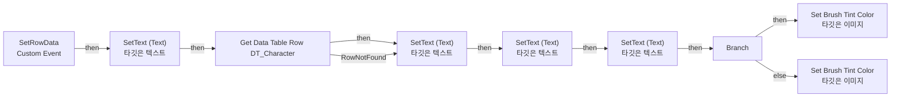

# WBP_ScoreboardRow

에셋: `/Game/QuakeLike_Base/SDM/UI/Combat_UI/WBP_ScoreboardRow`

부모: `/Script/CoreUObject.Class'/Script/UMG.UserWidget'`

수집일: 2026-10-12. MCP에서 읽은 그래프·핀 연결의 자동 전사입니다. 상속된 그래프는 부모 문서를 함께 확인합니다.

정적 루트 참조 도달: 있음. 실행 여부 또는 삭제 가능 여부의 확정이 아닙니다.

컴포넌트 목록은 이 BP가 직접 정의한 SCS만 포함합니다. 부모·네이티브 생성 컴포넌트, 인스턴스 설정은 별도입니다.

## 그래프 목록

| 그래프 | 전체 노드 수 |
|---|---|
| EventGraph | 33 |

## 그래프별 실행 연결

실선은 출력 exec 핀의 실제 연결입니다. 여러 분기는 출력 핀 이름을 표시합니다. 함수 호출·delegate·타이머의 다음 그래프 실행은 이 그림에서 자동으로 이어 붙이지 않습니다.

순수 계산 노드 및 데이터 핀은 아래 목록과 원본 JSON을 확인합니다. 연결되지 않은 이벤트도 표시되므로, 노드가 있다는 이유만으로 실행된다고 판단하면 안 됩니다.

### EventGraph

실행 핀 플로우차트

전체 노드·기본 입력 목록

| 노드 ID | 제목 | 미연결 기본 입력 / 에셋 입력 |
|---|---|---|
| `K2Node_CustomEvent_0` | SetRowData Custom Event |  |
| `K2Node_CallFunction_0` | Get Player Controller | PlayerIndex=0 |
| `K2Node_VariableGet_0` | Get PlayerState |  |
| `K2Node_PromotableOperator_0` | Equal (Object) |  |
| `K2Node_IfThenElse_0` | Branch |  |
| `K2Node_VariableGet_1` | Get BackGroud |  |
| `K2Node_CallFunction_2` | Set Brush Tint Color 타깃은 이미지 | TintColor_SpecifiedColor=(R=1.000000,G=0.900000,B=0.200000,A=0.800000); TintColor_ColorUseRule=UseColor_Specified |
| `K2Node_CallFunction_1` | Set Brush Tint Color 타깃은 이미지 | TintColor_SpecifiedColor=(R=0.100000,G=0.100000,B=0.100000,A=0.400000); TintColor_ColorUseRule=UseColor_Specified |
| `K2Node_VariableGet_2` | Get RankText |  |
| `K2Node_CallFunction_4` | SetText (Text) 타깃은 텍스트 |  |
| `K2Node_CallFunction_18` | To Text (Integer) | bAlwaysSign=false; bUseGrouping=true; MinimumIntegralDigits=1; MaximumIntegralDigits=324 |
| `K2Node_Knot_0` | 경유 노드 |  |
| `K2Node_CallFunction_7` | SetText (Text) 타깃은 텍스트 |  |
| `K2Node_VariableGet_3` | Get NameText |  |
| `K2Node_CallFunction_12` | SetText (Text) 타깃은 텍스트 |  |
| `K2Node_Knot_1` | 경유 노드 |  |
| `K2Node_Knot_2` | 경유 노드 |  |
| `EdGraphNode_Comment_10` | 자기 색깔은 강조하고 다른 사람은 약간 불투명하게 처리함 |  |
| `K2Node_VariableGet_6` | Get KillCount |  |
| `K2Node_CallFunction_8` | To Text (Integer) | bAlwaysSign=false; bUseGrouping=true; MinimumIntegralDigits=1; MaximumIntegralDigits=324 |
| `K2Node_VariableGet_7` | Get DeathCount |  |
| `K2Node_CallFunction_9` | To Text (Integer) | bAlwaysSign=false; bUseGrouping=true; MinimumIntegralDigits=1; MaximumIntegralDigits=324 |
| `K2Node_VariableGet_9` | Get DeathText |  |
| `K2Node_CallFunction_3` | SetText (Text) 타깃은 텍스트 |  |
| `K2Node_CallFunction_23` | To Text (String) |  |
| `K2Node_VariableGet_5` | Get KillText |  |
| `K2Node_VariableGet_4` | Get CampaignName |  |
| `K2Node_CallFunction_5` | Is Empty |  |
| `K2Node_CallFunction_13` | Select String |  |
| `K2Node_CallFunction_11` | Get Player Name 타깃은 플레이어 스테이트 |  |
| `K2Node_CallFunction_6` | String To Name |  |
| `K2Node_GetDataTableRow_0` | Get Data Table Row DT_Character | DataTable=/Game/QuakeLike_1_0/GameFlow/Table/DT/DT_Character.DT_Character |
| `K2Node_CallFunction_32` | To String (Name) |  |

## 조회 범위의 한계

ObjectIterator로 발견했으나 MCP helper가 반환하지 않은 그래프입니다. delegate signature·컴파일된 중간 그래프·macro·애니메이션 내부 그래프가 섞일 수 있습니다.

- `SetRowData`: Graph 'SetRowData' not found in Blueprint.

[원본 MCP 스냅샷](../../../../../Evidence/blueprints-105.json)
