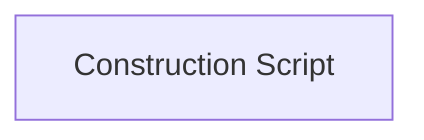

# BP_FanBox

에셋: `/Game/SciFi_Hanger/Blueprints/BP_FanBox`

부모: `/Script/CoreUObject.Class'/Script/Engine.Actor'`

수집일: 2026-10-12. MCP에서 읽은 그래프·핀 연결의 자동 전사입니다. 상속된 그래프는 부모 문서를 함께 확인합니다.

정적 루트 참조 도달: 있음. 실행 여부 또는 삭제 가능 여부의 확정이 아닙니다.

컴포넌트 목록은 이 BP가 직접 정의한 SCS만 포함합니다. 부모·네이티브 생성 컴포넌트, 인스턴스 설정은 별도입니다.

## 직접 정의한 컴포넌트

| 이름 | 클래스 | 부모 컴포넌트 |
|---|---|---|
| `DefaultSceneRoot` | `SceneComponent` | `` |
| `SM_FanBox` | `StaticMeshComponent` | `DefaultSceneRoot` |
| `SM_FanBlade1` | `StaticMeshComponent` | `DefaultSceneRoot` |
| `SM_FanBlade` | `StaticMeshComponent` | `DefaultSceneRoot` |
| `SM_FanBlade2` | `StaticMeshComponent` | `DefaultSceneRoot` |
| `SM_FanBlade3` | `StaticMeshComponent` | `DefaultSceneRoot` |
| `SM_FanBlade4` | `StaticMeshComponent` | `DefaultSceneRoot` |
| `SM_FanBlade5` | `StaticMeshComponent` | `DefaultSceneRoot` |
| `RotatingMovement` | `RotatingMovementComponent` | `` |
| `RotatingMovement1` | `RotatingMovementComponent` | `` |
| `RotatingMovement2` | `RotatingMovementComponent` | `` |
| `RotatingMovement3` | `RotatingMovementComponent` | `` |
| `RotatingMovement4` | `RotatingMovementComponent` | `` |
| `RotatingMovement5` | `RotatingMovementComponent` | `` |

## 변수와 기본값

| 이름 | 타입 | CDO 기본값 |
|---|---|---|
| `New Updated Component` | `SceneComponent` | None |

## 그래프 목록

| 그래프 | 전체 노드 수 |
|---|---|
| EventGraph | 19 |
| UserConstructionScript | 1 |

## 그래프별 실행 연결

실선은 출력 exec 핀의 실제 연결입니다. 여러 분기는 출력 핀 이름을 표시합니다. 함수 호출·delegate·타이머의 다음 그래프 실행은 이 그림에서 자동으로 이어 붙이지 않습니다.

순수 계산 노드 및 데이터 핀은 아래 목록과 원본 JSON을 확인합니다. 연결되지 않은 이벤트도 표시되므로, 노드가 있다는 이유만으로 실행된다고 판단하면 안 됩니다.

### EventGraph

```mermaid
flowchart LR
  n0["BeginPlay 이벤트"]
  n1["Set Updated Component<br/>타깃은 무브먼트 컴포넌트"]
  n2["Set Updated Component<br/>타깃은 무브먼트 컴포넌트"]
  n3["Set Updated Component<br/>타깃은 무브먼트 컴포넌트"]
  n4["Set Updated Component<br/>타깃은 무브먼트 컴포넌트"]
  n5["Set Updated Component<br/>타깃은 무브먼트 컴포넌트"]
  n6["Set Updated Component<br/>타깃은 무브먼트 컴포넌트"]
  n0 -->|"then"| n1
  n1 -->|"then"| n2
  n2 -->|"then"| n3
  n3 -->|"then"| n4
  n4 -->|"then"| n5
  n5 -->|"then"| n6
```

실행 핀 플로우차트

전체 노드·기본 입력 목록

| 노드 ID | 제목 | 미연결 기본 입력 / 에셋 입력 |
|---|---|---|
| `K2Node_Event_0` | BeginPlay 이벤트 |  |
| `K2Node_VariableGet_7` | Get RotatingMovement |  |
| `K2Node_CallFunction_9` | Set Updated Component 타깃은 무브먼트 컴포넌트 |  |
| `K2Node_VariableGet_8` | Get SM_FanBlade1 |  |
| `K2Node_VariableGet_9` | Get SM_FanBlade2 |  |
| `K2Node_VariableGet_10` | Get SM_FanBlade3 |  |
| `K2Node_VariableGet_11` | Get SM_FanBlade4 |  |
| `K2Node_VariableGet_12` | Get SM_FanBlade5 |  |
| `K2Node_VariableGet_13` | Get SM_FanBlade |  |
| `K2Node_CallFunction_10` | Set Updated Component 타깃은 무브먼트 컴포넌트 |  |
| `K2Node_VariableGet_16` | Get RotatingMovement1 |  |
| `K2Node_VariableGet_17` | Get RotatingMovement2 |  |
| `K2Node_VariableGet_18` | Get RotatingMovement3 |  |
| `K2Node_CallFunction_11` | Set Updated Component 타깃은 무브먼트 컴포넌트 |  |
| `K2Node_CallFunction_12` | Set Updated Component 타깃은 무브먼트 컴포넌트 |  |
| `K2Node_VariableGet_19` | Get RotatingMovement5 |  |
| `K2Node_VariableGet_20` | Get RotatingMovement4 |  |
| `K2Node_CallFunction_8` | Set Updated Component 타깃은 무브먼트 컴포넌트 |  |
| `K2Node_CallFunction_3` | Set Updated Component 타깃은 무브먼트 컴포넌트 |  |

### UserConstructionScript

실행 핀 플로우차트

전체 노드·기본 입력 목록

| 노드 ID | 제목 | 미연결 기본 입력 / 에셋 입력 |
|---|---|---|
| `K2Node_FunctionEntry_0` | Construction Script |  |

## 조회 범위의 한계

ObjectIterator로 발견했으나 MCP helper가 반환하지 않은 그래프입니다. delegate signature·컴파일된 중간 그래프·macro·애니메이션 내부 그래프가 섞일 수 있습니다.

- `ExecuteUbergraph_BP_FanBox`: Graph 'ExecuteUbergraph_BP_FanBox' not found in Blueprint.
- `ReceiveBeginPlay`: Graph 'ReceiveBeginPlay' not found in Blueprint.
- `UserConstructionScript_MERGED`: Graph 'UserConstructionScript_MERGED' not found in Blueprint.

[원본 MCP 스냅샷](../../../Evidence/blueprints-351.json)
