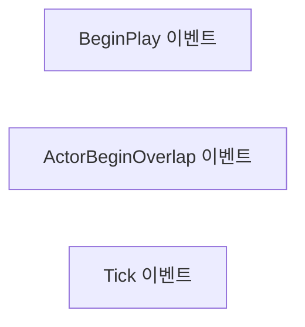
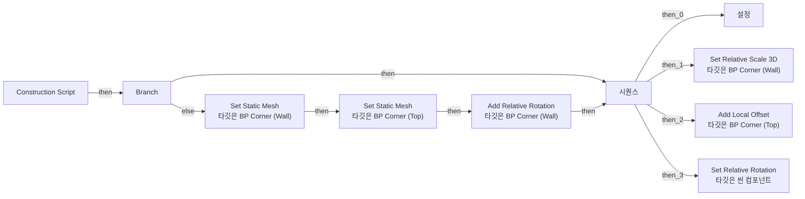

# BP_Corner

에셋: `/Game/SuperGrid/TutorialLevel/Blueprints/LevelElements/BP_Corner`

부모: `/Script/CoreUObject.Class'/Script/Engine.Actor'`

수집일: 2026-10-12. MCP에서 읽은 그래프·핀 연결의 자동 전사입니다. 상속된 그래프는 부모 문서를 함께 확인합니다.

정적 루트 참조 도달: 있음. 실행 여부 또는 삭제 가능 여부의 확정이 아닙니다.

컴포넌트 목록은 이 BP가 직접 정의한 SCS만 포함합니다. 부모·네이티브 생성 컴포넌트, 인스턴스 설정은 별도입니다.

## 직접 정의한 컴포넌트

| 이름 | 클래스 | 부모 컴포넌트 |
|---|---|---|
| `Root` | `SceneComponent` | `` |
| `Center` | `SceneComponent` | `Root` |
| `Wall` | `StaticMeshComponent` | `Center` |
| `Top` | `StaticMeshComponent` | `Center` |

## 변수와 기본값

| 이름 | 타입 | CDO 기본값 |
|---|---|---|
| `Switch` | `bool` | False |
| `HeightAndRotation` | `Transform` | &lt;Struct 'Transform' {rotation: {x: 0.000000, y: 0.000000, z: 0.000000, w: 1.000000}, translation: {x: 0.000000, y: 0.000000, z: 0.000000}, scale3d: {x: 1.000000, y: 1.000000, z: 1.000000}}&gt; |

## 그래프 목록

| 그래프 | 전체 노드 수 |
|---|---|
| EventGraph | 3 |
| UserConstructionScript | 26 |

## 그래프별 실행 연결

실선은 출력 exec 핀의 실제 연결입니다. 여러 분기는 출력 핀 이름을 표시합니다. 함수 호출·delegate·타이머의 다음 그래프 실행은 이 그림에서 자동으로 이어 붙이지 않습니다.

순수 계산 노드 및 데이터 핀은 아래 목록과 원본 JSON을 확인합니다. 연결되지 않은 이벤트도 표시되므로, 노드가 있다는 이유만으로 실행된다고 판단하면 안 됩니다.

### EventGraph

실행 핀 플로우차트

전체 노드·기본 입력 목록

| 노드 ID | 제목 | 미연결 기본 입력 / 에셋 입력 |
|---|---|---|
| `K2Node_Event_124` | BeginPlay 이벤트 |  |
| `K2Node_Event_125` | ActorBeginOverlap 이벤트 |  |
| `K2Node_Event_126` | Tick 이벤트 | DeltaSeconds=0.0 |

### UserConstructionScript

실행 핀 플로우차트

전체 노드·기본 입력 목록

| 노드 ID | 제목 | 미연결 기본 입력 / 에셋 입력 |
|---|---|---|
| `K2Node_FunctionEntry_80` | Construction Script |  |
| `K2Node_ExecutionSequence_4` | 시퀀스 |  |
| `K2Node_VariableGet_254` | Get | HeightAndRotation_Location_X=0.0; HeightAndRotation_Location_Y=0.0; HeightAndRotation_Rotation=0, 0, 0; HeightAndRotation_Scale=0, 0, 0 |
| `K2Node_CallFunction_2381` | float / float | B=100 |
| `K2Node_VariableGet_258` | Get | HeightAndRotation_Rotation=0, 0, 0; HeightAndRotation_Scale=0, 0, 0 |
| `K2Node_CallFunction_2387` | Clamp (Float) | Min=100; Max=100000 |
| `K2Node_VariableSet_79` | 설정 |  |
| `K2Node_CallFunction_2388` | Make Vector |  |
| `K2Node_CallFunction_2399` | Clamp (Float) | Min=-100; Max=200 |
| `K2Node_CallFunction_2398` | Clamp (Float) | Min=-100; Max=200 |
| `K2Node_CallFunctionOnMember_14` | Add Local Offset 타깃은 BP Corner (Top) | DeltaLocation_X=0.0; DeltaLocation_Y=0.0; bSweep=false; bTeleport=false |
| `K2Node_VariableGet_295` | Get | HeightAndRotation_Location_X=0.0; HeightAndRotation_Location_Y=0.0; HeightAndRotation_Scale=0, 0, 0 |
| `K2Node_CallFunction_2457` | Break Vector |  |
| `K2Node_CallFunction_2499` | float - float | B=1.000000 |
| `K2Node_CallFunction_2522` | float - float | B=100 |
| `K2Node_VariableGet_334` | Get | HeightAndRotation_Location=0, 0, 0 |
| `K2Node_CallFunction_2585` | Select Vector | A_Y=1; A_Z=1; B_X=2; B_Y=2 |
| `K2Node_CallFunctionOnMember_18` | Set Relative Scale 3D 타깃은 BP Corner (Wall) |  |
| `K2Node_VariableGet_403` | Get Switch |  |
| `K2Node_VariableGet_416` | Get Center |  |
| `K2Node_CallFunction_2782` | Set Relative Rotation 타깃은 씬 컴포넌트 | bSweep=false; bTeleport=false |
| `K2Node_IfThenElse_30` | Branch |  |
| `K2Node_VariableGet_421` | Get Switch |  |
| `K2Node_CallFunctionOnMember_19` | Set Static Mesh 타깃은 BP Corner (Top) | NewMesh=/Game/SuperGrid/StarterPack/Source/New/SuperGrid_CornerOuter.SuperGrid_CornerOuter; ReturnValue=false |
| `K2Node_CallFunctionOnMember_20` | Set Static Mesh 타깃은 BP Corner (Wall) | NewMesh=/Game/SuperGrid/StarterPack/Source/New/SuperGrid_CylinderQuarter.SuperGrid_CylinderQuarter; ReturnValue=false |
| `K2Node_CallFunctionOnMember_21` | Add Relative Rotation 타깃은 BP Corner (Wall) | DeltaRotation=90.000000,0.000000,0.000000; bSweep=false; bTeleport=false |

## 조회 범위의 한계

ObjectIterator로 발견했으나 MCP helper가 반환하지 않은 그래프입니다. delegate signature·컴파일된 중간 그래프·macro·애니메이션 내부 그래프가 섞일 수 있습니다.

- `ExecuteUbergraph_BP_Corner`: Graph 'ExecuteUbergraph_BP_Corner' not found in Blueprint.
- `UserConstructionScript_MERGED`: Graph 'UserConstructionScript_MERGED' not found in Blueprint.

[원본 MCP 스냅샷](../../../../../Evidence/blueprints-351.json)
