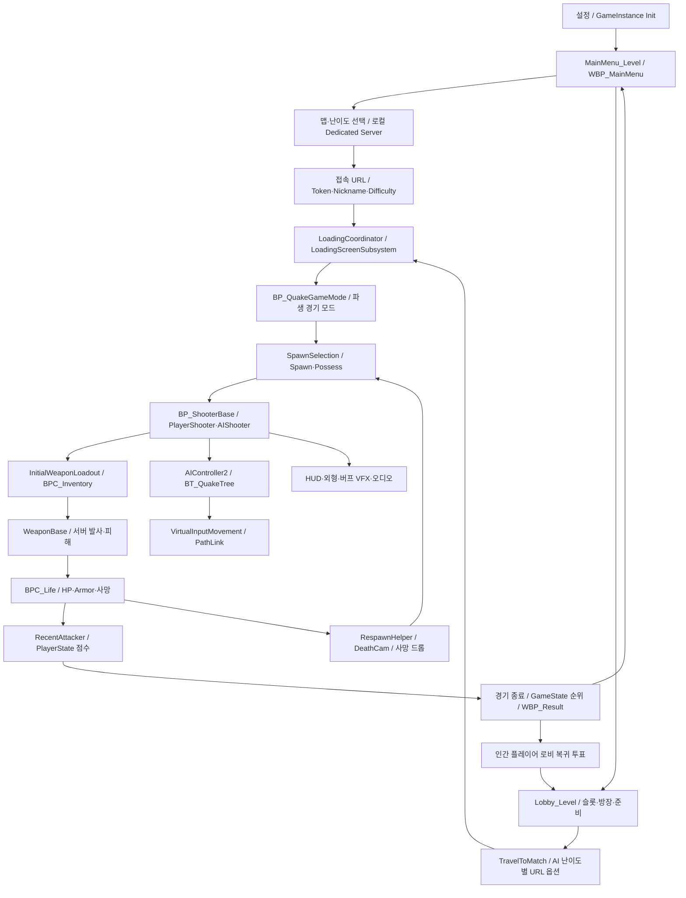

# ShootingArena 로직 조사

기준일 **2026-10-12**, Unreal **5.6.1**. 리팩토링 구현에 앞서 현재 책임·호출 순서·데이터·네트워크 경계를 기록한 문서입니다. 변경 제안은 별도로 표시하며, 게임 코드와 에셋은 수정하지 않았습니다.

## 읽는 순서

| 문서 | 조사 대상 |
|---|---|
| [01 진입·로비·서버·로딩](01_GameFlow.md) | 메인 메뉴, 캠페인, 로비, 접속, travel, 로딩 |
| [02 경기·스폰·재접속](02_MatchAndSpawn.md) | 시작 대기, 최초 배치, 리스폰, 종료, 순위, 로비 복귀 |
| [03 피해·사망·킬 크레딧](03_CombatAndDeath.md) | HP/Armor, 버프 피해, 최근 공격자, 점수, 사망 드롭 |
| [04 무기·인벤토리·발사체](04_WeaponsAndInventory.md) | 초기 지급, 획득/교체, hitscan, projectile, 조준·연출 |
| [05 아이템 스폰·버프](05_ItemsAndBuffs.md) | 스폰 순환, 재생성, 획득 효과, 버프 타이머·표현 |
| [06 입력·이동·텔레포트 스킬](06_PlayerAndSkill.md) | 플레이어 입력, 기본 이동, 줌, 스킬 발사·재입력 |
| [07 AI 의사결정·전투](07_AI.md) | Perception, 타깃, 목표 점수, 무기 선택, 실제 BT |
| [08 AI 경로·Area 후퇴](08_NavigationAndAreas.md) | PathLink, 가상 입력 이동, Area 위험도·미연결 구현 |
| [09 맵 기믹·포탈](09_MapGimmicks.md) | 점프패드, 포탈, 문·이동 발판·피해판 |
| [10 HUD·카메라·외형·오디오](10_Presentation.md) | UI 갱신, 데스캠, 복수 표시, 애니메이션, BGM/음성 |
| [11 데이터·설정·분석·도구](11_DataAndTools.md) | DT/DA, SaveGame, JSON 적용, 분석, Editor 도구 |
| [리팩토링 경계와 유지 후보](RefactoringBoundaries.md) | 분리 순서, 함께 옮길 대상, 보존 계약, 폐기 보류 |

## 전체 실행 구조

이 그림은 시스템 간 연결을 요약합니다. `ReadyToPlay`는 로컬 로딩 해제와 BGM 시작 신호이며, 경기 시계·스폰을 모두 제어하는 단일 상태 머신으로 구현되어 있지는 않습니다.

## 조사 범위와 증거 수준

- MCP Asset Registry에서 전체 `/Game`의 로직 관련 에셋 **934개**를 목록화했습니다. 이미지·메시·사운드 등을 포함한 전체 에셋 수는 28,759개입니다.
- `/Game/QuakeLike_1_0`의 Blueprint 전부와 선정 루트에서 정적으로 참조되는 외부 Blueprint **387개**, 조회 가능한 그래프 **1,471개**, 노드 **22,506개**를 상세 조사했습니다. 외부 HUD, 사용 중인 Base 에셋, 템플릿·외형 참조도 포함합니다. 정확한 집계는 [coverage.json](Evidence/coverage.json)을 기준으로 합니다.
- 실제 프로젝트 루트 `Source/`의 C++ 파일 **178개**를 색인화하고 시스템 구현을 대조했습니다. `Assignment/`는 복사본으로 구분합니다.
- 15개 DataTable의 전체 행, 주요 DataAsset의 값, 12개 로드된 맵의 GameMode와 메모리에 로드된 Actor 클래스, 현재 BT 구조를 수집했습니다.
- **연결 확인**: 그래프 exec 핀, CDO/SCS, DT 행, C++ 구현에서 확인한 호출입니다. **정적 참조**: Asset Registry package 참조로 실행 여부를 보장하지 않습니다. **유지/분리 제안**: 조사 결과를 근거로 한 설계 제안입니다.

## 상세 조사 색인

- [Blueprint 상세 색인](BlueprintIndex.md): 각 에셋의 부모, 컴포넌트, 변수, 그래프별 Mermaid와 전체 노드 입력 목록.
- [전체 로직 에셋 목록](AssetInventory.md): 현재 루트에서의 정적 도달 여부·참조자 수.
- [C++ 파일·심볼 색인](CppIndex.md), [문자열·Reflection 결합 지점](ReflectionContracts.md).
- [원본 증거 안내](Evidence/README.md). 시스템 문서의 그림은 해당 Blueprint 상세 문서와 원본 핀 JSON으로 대조할 수 있습니다.
- `Diagrams/`에는 시스템 문서의 Mermaid를 독립 `.mmd` 파일로도 제공합니다.

## 판정할 때 주의할 범위

이번 조사는 정적 조사입니다. PIE 경기 실행, 여러 클라이언트의 RPC 순서, 패키징 빌드, 실제 청취·시각 검증은 수행하지 않았습니다. 런타임 장애나 완전한 미사용 판정을 확정하지 않습니다.

MCP helper는 top-level Ubergraph와 FunctionGraph를 읽습니다. Blueprint macro 내부, AnimGraph state machine 내부·중첩 그래프, compiler intermediate와 delegate signature 일부는 이 API로 반환되지 않습니다. 각 BP 문서에 미지원 이름을 남겼고, 순수 계산은 노드 목록/JSON으로 보존했습니다. 외부 에셋 팩 중 선정 루트에서 도달하지 않는 에셋은 목록 조사만 수행했습니다.

World Partition 외부 Actor·서브레벨 전체 인스턴스 설정은 메모리에 로드된 범위를 넘겨 확정하지 않았습니다. 네이티브 문자열 경로, 런타임 생성·옵션 URL은 package 참조 그래프만으로 완전히 추적할 수 없습니다.

## 먼저 결정해야 할 사항

1. 캠페인 로컬 서버 / 로비에서 같은 서버를 travel하는 모델 / 별도 매치 서버 연결 호환 경로 중 유지할 모델.
2. `BP_ShooterBase`의 피해·킬·UI·인벤토리 연계를 어떤 이벤트 계약으로 분리할지.
3. AI의 현재 STG/LTG 후퇴를 유지할지, 구현되어 있으나 현재 BT에 없는 C++ Area 후퇴로 교체할지.
4. DT/DA 스키마와 Reflection 문자열 계약을 언제 타입 있는 API로 옮길지.
5. `QuakeLike_Base` 전체 폐기 대신 실제 사용 맵·HUD·사운드·기믹만 먼저 보존/이동할지.
