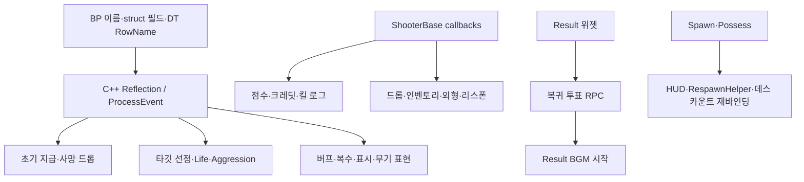

# 리팩토링 경계·유지 후보·폐기 보류

아래는 현재 연결에 대한 **설계 제안**입니다. 이번 작업에서는 로직 변경·에셋 이전·삭제를 수행하지 않았습니다.

## 교체 단위와 보존할 계약

| 순서 | 뜯어고칠 책임 경계 | 함께 이행할 대상 | 우선 보존할 동작/자산 |
|---|---|---|---|
| 1 | 공통 데이터·인터페이스 | BP struct·BPI·DT/DA·JSON schema·native Reflection 호출자 | 기존 수치·RowName/tag 매핑·soft class 경로 |
| 2 | 경기 단계·서버 travel | GameMode/GI/Lobby/Loading/Result UI·투표 | absolute 옵션 초기화, 중복 travel 가드, 서버 cleanup 순서 |
| 3 | 피해·사망 transaction | Weapon·Life·Shooter callbacks·RecentAttacker·점수·DeathCountTracker·드롭 | 66/34 분배, 최근 공격자, 1회 처리, 드롭 후 inventory 정리 |
| 4 | 인벤토리·무기 실행 | Loadout·Inventory·HeldItem·Weapon·ProjectileFire·AI selection | 지급/회복/중복무기 규칙, 탄약·재발사, projectile ID 수명 |
| 5 | 스폰·리스폰 lifecycle | GameMode·SpawnSelection·RespawnHelper·Controller·DeathCam | 타입 우선, 최초 배정 실패 복구, 먼 절반 랜덤 리스폰 |
| 6 | 아이템·버프 스케줄링 | SpawnPoint·Spawner·DropItem·Buff·BuffSpawnCycle | 성공한 생성/획득음, 드롭 버프 원 만료시각, 순환 정책 |
| 7 | AI 정책·경로 실행 | Controller2·score/cache·BT·Blackboard·VirtualInputMovement·PathLink | 현재 BT 우선순위, 목표 기억, traversal Entry/Exit·완료 |
| 8 | 표현·설정 구독 | 실제 Base HUD·CompShooterHUD·외형·카메라·BGM·음성 | Pawn 재바인딩, DeathCam 즉시 진입, owner-only/공간음 범위 |

이 순서는 완전 재작성보다 점진적 이행을 위한 의존 순서입니다. 경기 시스템을 먼저 확정해야 이후 사망/리스폰/결과 UI가 공통 상태를 사용할 수 있습니다. UI 디자인 변경은 별도 범위입니다.

## 현재 가장 큰 결합

[ReflectionContracts](ReflectionContracts.md)는 rename과 함께 바뀌어야 하는 원문 위치를 기록합니다. 특히 `BPC_Inventory_C`, `BPC_Buff_C`, `weaponData`, `itemInfo`, `All_Items`, `IndexInfo`, `Having Item`, `Data Table Handle`, `RevengeTarget`, `Pickup/Recover`, `Set Current Target` 등은 이름만 바꿔도 런타임 연계가 끊어질 수 있습니다.

## 보존 후보

- 수학/정책: SpawnSelection, ItemSpawnSelection, WeaponProjectileAim/Convergence, aim alignment math. 단일 책임이 비교적 명확하고 기존 테스트가 있습니다.
- 표현 컴포넌트: BuffPresentation, DeathCam, CharacterAppearance, BGMPlayback. lifecycle 계약을 고정한 후 호출자만 이행할 수 있습니다.
- 개발 자산: ArenaAnalyze의 비교 기록, GameplayValidator/BlackboardUsageScanner, 기존 회귀 테스트. 로직 재작성 후 검증에 활용할 수 있습니다.
- 데이터: 실제 무기·아이템 수치, 맵 배치, 캐릭터 외형, 사운드·FX. 스키마 교체와 콘텐츠 재제작을 구분합니다.

유지는 영구 동결을 뜻하지 않습니다. 기존 이름 기반 bridge는 typed interface 도입 이후 제거 후보입니다.

## 폐기 판정을 보류해야 하는 대상

| 대상 | 지금 삭제하면 안 되는 근거 / 다음 판정 |
|---|---|
| QuakeLike_Base 전체 | DT_MapData가 Base 경기 맵을 선택하며 실제 HUD/DeathCountTracker/사운드·FX도 연결됨. 사용 자산 이동 후 폴더 단위 정리 |
| AI/Refactoring_BT의 Test 이름 서비스 | 현재 BT_QuakeTree가 BTS_Test_UpdateDroneLocation 등을 사용. 이름이 아닌 연결 기준 |
| 구형 포탈 / BP Area | Lvl_QuakeMap_04의 구형 포탈, StartLobby의 구형 Area Actor 배치 확인. 인스턴스 이행 전 보류 |
| C++ Area 후퇴 | 구현 있으나 현재 BT/Blackboard에 미연결. 도입/격리/삭제 중 정책 결정 필요 |
| 별도 매치 서버 / 로그인 lobby 경로 | 현재 same-server travel과 호환·시험 코드 혼재. 운영 모드를 확정하고 호출자 확인 |
| FirstPerson·StateTree·AITest·Test 폴더 | 일부 전역 기본값·캐릭터/애니메이션·DT 경로로 도달. 정적 무참조도 문자열 로드를 확인해야 함 |

## 설정·구현 불일치로 확인한 항목

1. `DefaultGame.ini` MapsToCook의 Lvl_QuakeMap_01/03은 현재 Asset Registry에 없고 MCP load도 실패했습니다. 실제 DT_MapData는 00/02/04·PortalMap·Lvl_02Map·시험 맵 등을 사용합니다. cook 경로를 실제 선택 맵과 맞출 필요가 있습니다.
2. 메뉴는 QuakeGameMode, 서버 기본은 StartLobby, UI 로비는 Lobby_Level로 분리되어 있습니다. 경기/로비/메뉴를 구별하는 이름 비교와 URL override가 여러 곳에 있습니다.
3. `MaxScore` 등 점수 종료/서든데스 관련 변수가 있으나 현재 CheckEndCondition의 연결은 시간 종료입니다. 구현 보존 여부를 실제 규칙 기준으로 결정합니다.
4. `SubstituteWeapon` 필드가 남지만 현재 기본 무기 사망 드롭은 loadout.GrantedWeapons[0]를 사용합니다. 데이터 설명과 구현을 통일할 후보입니다.
5. BPC_Life CDO replicates=false, ShooterBase의 SCS template은 true입니다. 복제 설정을 클래스·template·인스턴스 계층별로 검증해야 합니다.
6. Area 후퇴 API 출력 key가 현재 BB_QuakeBoard에 없습니다. 현재 후퇴는 STG/LTG 계통입니다.

위 항목은 자동으로 장애를 확정한 목록이 아닙니다. 연결·현재값 차이를 근거로 정리한 설계 검토 항목입니다.

## 이행 단계별 검증 후보

| 단계 | 현재 행동을 비교할 시나리오 |
|---|---|
| 경기/접속 | 캠페인 시작, 원격/로컬 멀티, 늦은 참가, Token 재접속, 중복 시작, 전원 복귀 투표·퇴장 |
| 전투 | 직접/환경/자해 사망, 최근 공격자 만료, 방어 부족, 초과 Life, 같은 프레임 여러 피해·드롭 |
| 무기/아이템 | 처음 지급, 중복 무기 획득, 탄약 소진·교체, hitscan, 직격·범위, 벽 옆 총구, server/client FX |
| AI/경로 | 적 인지·재인지·망각, STG/LTG 변경, 파밍·전투·추격·후퇴, 특수 link, stuck·abort·Landed |
| 표현 | Pawn 교체 후 구독 중복, 사망 UI/데스캠, 결과 pause BGM, 복수 표시, 청취 범위 |

구현 재사용/삭제 결정을 내릴 때 각 행의 실제 호출자, 맵 배치, JSON startup 적용, 패키징, 위 시나리오 확인이 완료 조건입니다.
