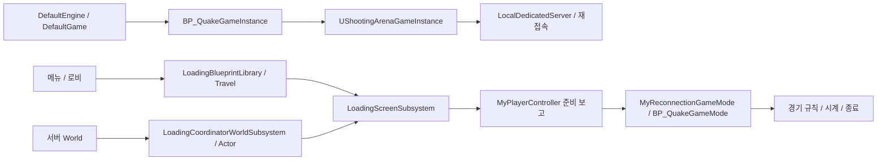
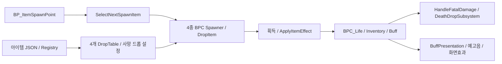

# 현행 시스템 지도

2026-11-05 정적 전수조사입니다. 기준 커밋과 원본 수집 경로는 [조사 요약](audit-summary.json)에 있습니다.
이 문서의 연결은 소스 선언·구현과 MCP 그래프/참조 조회를 근거로 합니다. 실제 플레이·맵 전체 로드·Cook 검증은 하지 않았습니다.
폴더명만으로 분류한 전체 색인은 [객체 카탈로그](README.md)에서 별도 **추론**으로 표시합니다.

## 시작·로비·경기·로딩

- `Config/DefaultEngine.ini`의 GameInstance는 `BP_QuakeGameInstance`, 시작 맵은 `TestMainMenu_Level`, 서버 시작 맵은 `StartLobby`입니다.
- GameInstance의 native 부모는 `UShootingArenaGameInstance`입니다. 연결 실패·의도적 접속 종료·로컬 데디케이티드 서버 관리가 이 계층에 있습니다.
- `ALobbyGameMode`, `ALobbyGameState`, `ALobbyPlayerController`, `ALobbyPlayerState`는 로비 참가자/방장/RPC 상태를 담당합니다. 경기 Controller와 동일하다고 가정하지 않습니다.
- `AMyReconnectionGameMode`와 `AMyPlayerController`는 재접속과 플레이 준비 보고의 native 경계입니다. `BP_QuakeGameMode`의 native 부모이며, `BP_MultiplayerAIGameMode`/`BP_QuakeAIGameMode`는 그 Blueprint 파생입니다.
- 두 AI GameMode의 EventGraph에서 `Mark Server World Ready` 호출 노드를 확인했습니다. 로딩 Coordinator의 서버 준비와 클라이언트 오버레이 제거 후 보고를 구분합니다.
- `AMatchRulesInfo`/`UMatchRulesSubsystem`과 GameMode/GameState는 경기 시간·종료 조건을 연결합니다. 실제 타이머 개시 시점은 [기존 준비 보고 문서](../../../Docs/ClientGameplayReady.md)를 함께 읽습니다.

근거: `Source/ShootingArena/Public/Loading/`, `Private/Loading/`, `Public/MyReconnectionGameMode.h`,
`Private/MyReconnectionGameMode.cpp`, `Public/MyPlayerController.h`, `Private/MyPlayerController.cpp`,
`Public/MatchRulesInfo.h`, `Private/MatchRulesInfo.cpp`, [GameFlow 카탈로그](catalogs/GameFlow-Network.md).

## 캐릭터·리스폰·참가자 수명

`BP_PlayerShooter`와 `BP_AIShooter`는 `BP_ShooterBase`를 상속하고, 그 native 부모는 `ACharacter`입니다.
공통 캐릭터 정의와 사람 입력/AI 입력을 분리해 읽습니다. `BP_ShooterBase.EventGraph`의 `Grant Loadout` 호출을 확인했습니다.

- `UCharacterPoolSubsystem`은 서버 World의 참가자 소유 Pawn과 제한된 재접속 예약을 관리합니다. 지원 클래스는 위 두 Shooter 경로로 제한합니다.
- `UCharacterPoolComponent`는 다음 생애를 위한 상태 정리를 연결하고, `BPC_RespawnHelper.EventGraph`는 `Start Pooled Respawn`을 호출합니다.
- `UInitialWeaponLoadoutComponent`/`UInitialWeaponLoadoutDataAsset`는 초기 무기 목록과 생애당 부여를 담당합니다. 무기·인벤토리와 캐릭터 수명을 연결하는 경계입니다.
- `UCharacterAppearanceComponent`와 표시 관련 컴포넌트는 모델링/표시를 다룹니다. 풀 재사용을 단순 Spawn/Destroy와 동일하게 취급하지 않습니다.

근거: `Source/ShootingArena/Private/Character/CharacterPoolSubsystem.cpp`, `Public/Character/`,
`Public/Weapon/InitialWeaponLoadoutComponent.h`, [Character 카탈로그](catalogs/Character.md).

## 전투·무기·투사체

2026-11-10 부분 갱신: `AMyPlayerController → UAimAssistComponent → ControlRotation → BP_PlayerShooter.GetAim` 경로로 로컬 에임 어시스트를 추가했습니다. `GetHeart`, Life/CharacterPool을 읽고 자신 이외의 Pawn은 적으로 간주합니다. Team을 사용하지 않으며 무기별 피해·발사 판정은 기존 경로입니다. 설정과 검증 범위는 [AimAssist](../systems/AimAssist.md)에 있습니다.

`HeldItem`/`Fire` 계열 Blueprint와 native `Weapon` 폴더가 함께 동작합니다.
`BP_Weapon_PlasmaGun`과 `BP_Weapon_RocketLauncher`의 `Spawn Pooled Projectile`,
두 Projectile의 `Is Pooled Projectile` 호출을 확인했습니다.

- `UProjectilePoolSubsystem`/Component/Library는 World별 투사체 획득·반환과 발사자 생애 분리를 담당합니다.
- `UProjectileConvergenceComponent`, `UProjectileWorldCollisionComponent`, `UProjectileFirstPersonRenderingComponent`는 각각 수렴·월드 충돌·1인칭 렌더링을 나눕니다.
- AimAlignment, ProjectileAim, MuzzleFlash, BeamEffect, ImpactEffect, Presentation 관련 라이브러리는 조준/시각 효과의 경계입니다.
- `UCascadeEffectPoolSubsystem`은 설정된 전투 World의 Cascade 효과 풀을 준비합니다. 일반 에셋 리소스와 transient 재생 객체를 구분합니다.
- `UArenaCombatLibrary`와 RecentAttacker 컴포넌트는 피해·최근 공격자·분석 기록의 교차 지점입니다.

근거: `Source/ShootingArena/Public/Weapon/`, `Private/Weapon/`, `Public/Combat/`,
[무기 카탈로그](catalogs/Combat-Weapons.md). 시각적 명중과 서버 피해 판정은 별도이며 실행 검증하지 않았습니다.

## 아이템·Life·버프·사망 드롭

- `BP_ItemSpawnPoint.EventGraph`의 `Select Next Spawn Item` 호출은 순환·왕복·무작위 선택을 native `UItemSpawnSelectionLibrary`에 연결합니다.
- `BPC_HeldItemSpawner`, `BPC_BuffSpawner`, `BPC_LifeItemSpawner`, `BPC_AmmoItemSpawner`와 `BPC_SpawnerManager`가 존재하며 실제 생성/배치는 Blueprint에 남아 있습니다.
- `BPC_Life.EventGraph`에서 `UDeathDropSubsystem::HandleFatalDamage` 호출을 확인했습니다. native 함수는 Authority·치명적 Health·중복 사망 처리를 검사한 뒤 드롭 후보를 수집합니다.
- `BPC_Buff.ApplyBuff`와 `ApplyDroppedBuff`는 `Set Buff Presentation`을 호출합니다. `UBuffPresentationComponent`는 표현 상태/종료 예고음, ScreenEffect/WeaponGlow는 화면·무기 표시를 담당합니다.
- `UBuffSpawnCycleSubsystem`은 Buff 스폰 지점의 ATK/DEF 순환을 보조합니다. 실제 생성/재생성 흐름의 소유자는 BP_ItemSpawnPoint입니다.
- DropTable 4개는 총 25행이며 Registry의 JSON 원본에 연결됩니다. [데이터 원본 정책](DataAuthority.md)을 먼저 확인합니다.

근거: `Public/Spawner/ItemSpawnSelectionLibrary.h`, `Private/Items/DeathDropSubsystem.cpp`,
`Public/Buff/`, [아이템 카탈로그](catalogs/Items-Buffs.md), [생성음·획득음](../../../Docs/ItemSoundSettings.md).

## AI 의사결정·이동·Area

AIController, BehaviorTree/Blackboard, Task/Service, 가상 입력 이동 컴포넌트를 구분합니다.
`BPC_VirtualInputAIMovement.Build Path`의 `Find Shortest Route` 호출이 `UPathLinkSubsystem`에 연결됩니다.

- `AQuakeTargetSelectionAIController`는 대상 목록·선택의 native Controller입니다. `BTService_SelectTarget_R`, FireCycle, Blueprint Task/Service와 함께 읽습니다.
- `UPathLinkSubsystem`과 `APathLink`는 Area 위험도와 독립된 경로 연결/최단 경로 계층입니다. RuntimeCache, RouteFinder, LazySearch, NavSnapshot으로 계산 책임을 나눕니다.
- 현행 baked 캐시 저장은 WorldSettings의 `UPathLinkCacheStorageComponent`입니다. `APathLinkRoutingCache` Actor는 마이그레이션 호환용 선언이 남아 있습니다.
- `UAreaManagerSubsystem`은 Area 인식·위험도·후퇴 계산의 외부 진입점이며, 내부 Graph/Risk/Route/Retreat 서비스가 계산합니다.
- `AAIAreaBase`, `AAreaLinkBase`, `AAreaManagerActorBase`는 공간 영역/연결/관리 배치 정의이고, PathLink Actor와 같은 역할이 아닙니다.

근거: `Public/AI/`, `Private/AI/`, [이동 카탈로그](catalogs/AI-Navigation.md),
[의사결정 카탈로그](catalogs/AI-Decision.md), [기존 Bot 연결](../../history/plans/PathLinkBotAPIIntegration.md).
전체 BT 실행 순서와 Blackboard 값 변화는 정적 호출 목록만으로 검증하지 않았습니다.

## 월드 기믹·이동

SeamlessPortalActor/TraversalSubsystem/SyncComponent/PortalViewSubsystem은 Portal 이동·동기화·보기를 분리합니다.
OneWayTeleportActor, JumpPadFlightComponent/CommonSettings는 별도 이동 기믹입니다.
`SpawnSelectionComponent`는 캐릭터 스폰 위치 선택과 관련되며 아이템 배열 선택 라이브러리와 구분합니다.

근거: `Source/ShootingArena/Teleport/`, `JumpPadFlightComponent.*`, `SpawnSelectionSystem/`,
[이동·월드 카탈로그](catalogs/Movement-World.md). 맵별 충돌/내비메시 실제 배치 검증은 기존 수정 이력과 구분합니다.

## UI·오디오·카메라

- 2026-11-11: `ULanguageSubsystem`은 클라이언트 GameInstance 수명으로 Culture와 사용자 설정 저장을 관리합니다. 메인·일시정지 메뉴의 공유 `WBP_SettingsMenu`에 `ULanguageSelector`를 연결했으며 `DT_Language → Font`, `ST_Game + PO/locres → FText`를 사용합니다. `ULoadingScreenSubsystem`이 언어 초기화에 의존하고, 기존 String 표시 경계는 직렬화한 FText를 복원합니다. `BP_QuakePlayerState.GetDisplayName`은 표시 전용 어댑터이며 ID/점수 저장에 새로 사용하지 않습니다. 새 언어 설정 복제/RPC는 없습니다. [현행 언어 시스템과 사용자 검증 항목](../systems/LanguageSystem.md)을 참조합니다.

- 촬영 UI는 `DA_UIRecordingSettings`의 15개 체크박스로 표시 영역별 그리기를 제어합니다. `URecordingUIMask`는 자식 위젯 상태를 유지하며 표시만 감춥니다. [연결 범위와 사용법](../systems/UIRecording.md).

- UIBackInput은 Slate 입력 선처리와 CommonUI/버튼 규칙의 뒤로가기 경계입니다. ReusableStyleHost/UIPalette는 화면 스타일을 공유합니다.
- MapPreviewSubsystem/Widget은 미디어 소스·플레이어와 메뉴 간 미리보기를 관리합니다. HUD/CompetitiveRanking·KillMedal·RespawnCountdown·CrosshairRecoil은 표시 기능입니다.
- BGM은 GameInstance 수명이며 로딩·옵션 볼륨 경계가 있습니다. [BGM 상세 조사](../systems/BGM.md)를 참고합니다.
- DeathCamComponent/Actor는 ViewTarget과 카메라 수명, Revenge/Outline/Nickname은 대상 표시를 담당합니다. 별도 PlayerController 수명/RPC와 연결됩니다.
- CharacterSpawnSound와 KillStreakVoice는 생성/연속 킬 이벤트의 오디오 컴포넌트입니다.

근거: `Public/UI/`, `Public/Camera/`, `Public/Audio/`, [UI 카탈로그](catalogs/UI.md), [오디오·카메라 카탈로그](catalogs/Audio-Camera.md).

## 분석·기록·디버그

ArenaAnalyze의 JSON chunk 기록·시각화와 ArenaMatchLog의 SQLite 경기 기록은 서로 다른 저장 경로입니다.
둘 다 `Saved`를 쓰므로 캐시로 일괄 취급하지 않습니다. DebugAINetwork는 서버 수집과 소유 클라이언트 표시를 나눕니다.

근거: `Public/Analyzer/`, `Public/Debug/`, [분석 카탈로그](catalogs/Telemetry-Debug.md),
[ArenaAnalyzer](../../ArenaAnalyzerV2.md), [DB 안내](../../../GamePlayDB/README.md), [AI 디버그](../../DebugAINetwork.md).

## Editor 도구·외부 플러그인

ShootingArenaEditorTools에는 캐릭터·투사체·아이템 음향·UI 등의 마이그레이션/저작 도구가 있습니다.
GameplayValidator는 Portal/JumpPad/PathLink 배치 검사, BlackboardUsageScanner는 Blackboard 사용처 조사,
UnrealMCPython은 Editor와 MCP의 읽기/편집 연결, JsonAssetSync는 외부 데이터 적용을 제공합니다.
AdvancedSessions/AdvancedSteamSessions, NiagaraUIRenderer, JsonBlueprintUtilities의 선언은 [플러그인 목록](plugins.json)에 있습니다.

`Build.cs`의 13개 모듈과 3,375개 include 연결을 추출했습니다. 조건부 모듈 문자열은 실제 플랫폼 빌드 그래프로
확정하지 않았으며, 플러그인이 폴더에 존재한다는 사실만으로 실행 중 활성 상태를 판단하지 않습니다.
