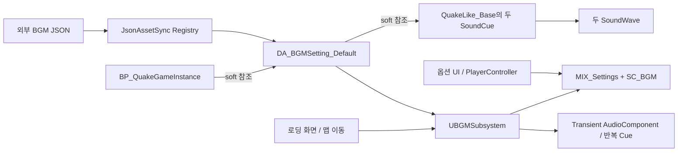

# BGM 시스템 — 시험 조사

조사일: 2026-11-05 / 기준 커밋: `6956f5d2bec90ea7171da34cb48a117a2211b944` / UE 5.6.1

GameInstance 수명의 클라이언트 BGM 관리자입니다. 곡 선택·로딩 감쇠·반복 재생을 C++이 담당하고,
현재 옵션 Blueprint는 SoundMix 볼륨을 직접 조절합니다. 레벨 배치 BGM Actor를 전제로 하지 않으며,
재생 시 일시적인 AudioComponent를 생성합니다.

**확인**은 코드·설정·MCP 조회의 사실, **추론**은 예상 영향, **미확인**은 실행 또는 의도 확인이
필요한 항목입니다. 삭제 판정은 수행하지 않았습니다.

## 객체별 역할

| 객체/자료 | 역할과 근거 |
|---|---|
| `BP_QuakeGameInstance` | 설정된 GameInstance이며 `BGMSettings` 기본값이 `DA_BGMSetting_Default`를 가리킵니다. MCP 기본 객체 조회와 [설정](../../../Config/DefaultEngine.ini)으로 확인했습니다. |
| `UShootingArenaGameInstance` | 설정의 soft 참조를 보유합니다. [선언](../../../Source/ShootingArena/Public/ShootingArenaGameInstance.h) |
| `UBGMSubsystem` | GameInstance에서 설정을 읽고 맵 전환 delegate를 구독합니다. Dedicated Server에서는 오디오 초기화를 건너뜁니다. [구현](../../../Source/ShootingArena/Private/Audio/BGMSubsystem.cpp) |
| `UBGMSettingsDataAsset` / `FBGMTrack` | 메뉴·맵별 곡, 볼륨·반복·fade, 로딩 감쇠와 Mix/Class를 정의합니다. [선언](../../../Source/ShootingArena/Public/Audio/BGMSettingsDataAsset.h) |
| `DA_BGMSetting_Default` | 현재 설정 인스턴스입니다. `/Game/QuakeLike_1_0/Data/BGM`에 있습니다. |
| 외부 BGM JSON | JsonAssetSync Registry에 등록된 입력이며 현재 Editor 메모리 값과 일치합니다. [JSON](../../../Content/DataAssets/DA_BGMSetting_Default.json) |
| `UJsonAssetSyncSubsystem` / `DA_JsonApplyRegistry` | JSON과 설정 에셋을 연결하고 시작 시 적용합니다. EngineSubsystem이며 현재 Editor 모드는 Memory Only입니다. [구현](../../../Plugins/JsonAssetSync/Source/JsonAssetSync/Private/JsonAssetSyncSubsystem.cpp) |
| `ULoadingScreenSubsystem` | BGMSubsystem 초기화 의존성을 선언하고 로딩 시작/오버레이 해제 때 감쇠와 복구를 요청합니다. [구현](../../../Source/ShootingArena/Private/Loading/LoadingScreenSubsystem.cpp) |
| `ULoadingBlueprintLibrary` | 이동 목적지 이름을 BGMSubsystem에 먼저 전달합니다. [구현](../../../Source/ShootingArena/Private/Loading/LoadingBlueprintLibrary.cpp) |
| `BGMPlayback` | 공유 원본 SoundCue를 수정하지 않고 transient 복사본/래퍼를 만들어 반복합니다. [구현](../../../Source/ShootingArena/Private/Audio/BGMPlayback.cpp) |
| `WBP_SettingsMenu` | `ApplyBGMVolume`에서 슬라이더 값을 CurrentSettings와 PlayerController에 반영하고 SoundMix를 직접 갱신합니다. |
| `BP_QuakePlayerController` | EventGraph에서 Mix를 push하고 `ApplyAudioSettings`에서 옵션 볼륨을 반영합니다. `/Game/QuakeLike_1_0/Controller`에 있습니다. |
| `MIX_Settings` / `SC_BGM` | C++와 Blueprint의 볼륨 적용 대상입니다. 설정된 두 SoundCue도 `SC_BGM`을 사용합니다. |

## 연결 흐름



그림은 데이터/호출 관계를 함께 요약한 것입니다. 실제 Registry 참조 종류는 아래 표와
[증거 JSON](evidence/bgm.json)의 `settings_dependencies`로 구분합니다.

| 연결 | 확인된 종류 |
|---|---|
| GameInstance → 설정 DataAsset | soft package |
| JsonApplyRegistry → 설정 DataAsset | hard package |
| 설정 DataAsset → 두 SoundCue | soft package |
| 설정 DataAsset → MIX_Settings / SC_BGM | hard package |
| 선택 패키지의 management 참조 조회 | 0건; 프로젝트 전체에 없다는 의미는 아닙니다. |

외부 Manifest 외에 실제 Registry binding도 `DA_BGMSetting_Default.json` → 설정 에셋으로
등록된 것을 확인했습니다. `Config/DefaultGame.ini`는 BGM 폴더를 AlwaysCook,
`DataAssets` 폴더를 NonUFS stage 대상으로 지정합니다.

## 재생 정책과 현재 설정

**확인:** Initialize는 GameInstance 설정을 동기 로드합니다. `PlayMapBGM`은 맵 키가 있으면 해당 곡을,
없으면 공용 메뉴 곡을 선택합니다. 맵 이름은 경로·오브젝트 suffix·URL 옵션·PIE 접두사를 제거해 비교합니다.
메뉴 레벨도 맵별 설정에 등록되어 있으면 코드상 Gameplay 상태를 사용합니다.

| 구분/맵 키 | 현재 설정 |
|---|---|
| 공용 `mainMenuBGM.sound` | `None` |
| `lvl_PortalMap` | `_후보5_050_qk_music_goroth_neutral_loop_Cue` |
| `testMainMenu_Level` | `_후보3_046_qk_music_volkerh_theme_Cue` |
| 두 곡의 위치 | `/Game/QuakeLike_Base/SDM/SoundPack_SDM/Cue` |
| 두 곡의 볼륨 / 반복 | 1.0 / true |
| 기본 Fade In / Out | 각각 1.0초 |
| 로딩 감쇠 / 복구 시간 | 0.5배 / 0.5초 |

두 Cue는 같은 팩의 `ETC` 폴더에 있는 SoundWave를 각각 참조합니다. Cue와 Wave 네 패키지는
현재 설정에서 도달 가능하므로 정리 시 보존 대상으로 취급합니다. 실제 플레이 재생을 증명한 것은 아닙니다.

**확인:** 로딩 시 같은 곡과 반복 설정이면 재생 위치를 유지하고 감쇠합니다. 다른 곡이면 이전 곡을
정지한 뒤 목적지 곡을 동기 로드합니다. 일반 전환은 비동기 로드할 수 있고 요청 ID로 오래된 완료를 무시합니다.
설정되지 않은 곡을 선택하면 이전 곡도 정지하므로, 미등록 맵은 현재 공용 메뉴 설정상 무음이 될 수 있습니다.

`PlayLobbyBGM`은 메뉴 재생에 위임하고 `PlayResultBGM`은 호환용 no-op입니다.
SoundWave/SoundCue 반복은 오디오 스레드에서 처리합니다. Procedural/MetaSound는 자체 Loop 그래프가
필요하며, 지원되지 않는 소스의 완료 콜백 fallback에는 Pause 중 지연 가능성이 있습니다.

## 옵션과 저장 경로

**확인:** `WBP_SettingsMenu.ApplyBGMVolume`은 0~100 입력을 CurrentSettings와 PlayerController의
`BGMVolume`에 넣고, 100으로 나눠 SoundMix override에 전달합니다. 근거 노드는
`K2Node_SetFieldsInStruct_0`, `K2Node_VariableSet_20`, `K2Node_PromotableOperator_12`,
`K2Node_CallFunction_82`입니다.

GameInstance의 `LoadSettings`는 SaveGame이 있으면 `SG_Settings`를 읽고 없으면 DT 기본값을 사용합니다.
`SaveSettings`는 CurrentSettings를 SaveGame 객체에 넣어 슬롯에 저장합니다. 슬라이더 변경마다
디스크 저장이 호출되는지는 이번에 확정하지 않았습니다.

PlayerController의 `ApplyAudioSettings`도 CurrentSettings에서 읽은 볼륨으로 같은 Mix/Class를
조절합니다(`K2Node_CallFunction_1`). 조사한 그래프에서는 C++ `SetBGMVolume` 또는
`SetBGMVolumePercent` 호출을 확인하지 못했습니다. 전체 Blueprint에 호출이 없다는 뜻은 아닙니다.

## 후속 검토

| 상태 | 항목과 확인 방법 |
|---|---|
| 추론·실행 미확인 | C++ 내부 BGMVolume 기본값은 1이며 PostLoadMap에서 ApplyVolumeOverride를 호출합니다. Blueprint도 같은 Mix/Class를 갱신하므로 옵션을 덮어쓸 여지가 있습니다. 낮은 볼륨 설정 후 맵 이동·재접속으로 순서와 유지 여부를 확인해야 합니다. |
| 의도 미확인 | 공용 메뉴 곡 None이 의도인지 확인해야 합니다. 테스트 메뉴만 별도 맵별 곡이 있습니다. |
| 실행 미확인 | 패키징 실행의 JSON 자동 적용과 soft 참조 음악 리소스의 Cook/로드 성공을 확인해야 합니다. |
| 범위 밖 | 전체 BGM 호출자, GameInstance 변종, 다른 맵의 로컬 오디오, SoundClass 계층 전체, 배치 Actor별 설정은 조사하지 않았습니다. |

## 증거와 재현

MCP로 Blueprint 4개의 그래프 10개, 선택 패키지 10개의 종류별 정방향/역방향 참조와
오디오 리소스 4개를 조사했습니다. 242개 조회 행에는 양방향에서 중복 관찰한 연결이 포함됩니다.
원본 그래프·상세 참조는 [증거 JSON](evidence/bgm.json)의 `run_directory`에 있는 로컬 재생성 자료입니다.
이 문서와 증거 JSON은 Git에 포함할 대상으로 작성했습니다.

수집기 [AuditBGMSystem.py](../../../Scripts/AuditBGMSystem.py)는 **MCP `util.execute_python`으로만** 실행합니다.

```python
import runpy
runpy.run_path('D:/UnrealProjects/ShootingArena/Scripts/AuditBGMSystem.py')['collect']()
```

매번 새 실행 폴더를 만들고 증거 JSON을 최신화합니다. `status: running`은 완료 결과가 아닙니다.
설명 문서는 자동 갱신되지 않으므로 재수집 후 대조해야 합니다. 일반 셸의
`python Scripts/VerifyBGMSystemAudit.py`는 입력·산출물 해시, 그래프 근거와 참조 분리를 검증합니다.

조회 전후 dirty 패키지는 모두 0건입니다. 에셋 수정·저장·컴파일·JSON 적용·PIE 재생은 하지 않았습니다.
기존 `BGMPlaybackTests.cpp`의 NativeWaveLoop, NativeCueLoop, WholeGraphLoop, PausedBGM 테스트는
소스 존재를 확인했으며 이번에 재실행하지 않았습니다.
